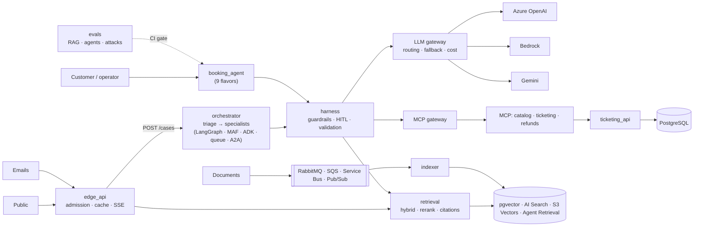

# GenAI_PoCs · Agentic GenAI systems on Azure, AWS and GCP

[Español](README.md) · **English**

Hands-on proofs of concept that walk through the full stack of a production agentic system:
transactional SQL, a model layer with a gateway, event-driven indexing, hybrid RAG, evals, tool
calling and MCP, agents in several frameworks and a guardrails harness. Everything runs on
**Azure, AWS and GCP**, and each piece comes in up to **three comparable lanes** with the same
dataset and the same evals.

Use case: **Genaipocs**, a global marketplace for experiences and events (~300 M users) with agents
for internal users (operations, support, partners) and for the public.

> The phase docs, the plan and the Q&A under `docs/` are written in Spanish. This page is the
> English entry point to the repository.

## Architecture



A zoom into each block (models, RAG, MCP, agent and harness, multi-agent, scale, observability,
evals, deployment) and the end-to-end path of a case: [arquitectura.md](docs/arquitectura.md).

| Lane | What it is | Examples |
|---|---|---|
| **A. Managed** | The cloud service does the work | Foundry Agent Service, Foundry IQ, Bedrock Knowledge Bases, AgentCore, Prompt Shields, Bedrock Guardrails, RAG Engine, Agent Search, Agent Runtime, Model Armor |
| **B. Native SDK** | Our own code on top of the SDKs | `openai`, `azure-search-documents`, `boto3` (Converse, S3 Vectors), `google-genai`, `google-cloud-*`, our own gateway and tool loop |
| **C. Framework** | An agent/RAG framework | LlamaIndex, LangGraph, Microsoft Agent Framework, Strands, ADK, LiteLLM, RAGAS, DeepEval |

## Layout

```text
packages/
  genaipocs_core/   domain, use cases, ports and adapters (Clean Architecture) + migrations
  harness/         validation, self-correction, guardrails, safe SQL, PII, human approval
services/
  ticketing_api/   transactional API (FastAPI)
  indexer/         event-driven ingestion (producer + workers + DLQ)
  retrieval/       RAG service (hybrid, filters, rerank, citations)
  mcp_servers/     MCP servers (FastMCP) and MCP gateway
  support_agent/   minimal agent on top of MCP
  booking_agent/   the same agent in 9 flavors
  orchestrator/    multi-agent: triage and specialists (LangGraph, MAF, ADK, queue, A2A)
  edge_api/        public front door: admission, rate limiting, semantic cache and SSE
evals/             golden datasets, RAG, agent and multi-agent evals, and attack tests
infra/             Terraform (aws, azure, gcp), benchmark SQL, emulator config
scripts/           synthetic data, load, benchmarks, provisioning (dry-run by default)
docs/              one document per phase, pending cloud work and lessons learned
```

## Quick start (local, no cost)

Requirements: Python 3.12, [uv](https://docs.astral.sh/uv/), Docker Desktop and Git.

```powershell
uv sync --all-packages
Copy-Item .env.example .env                      # and fill in the local passwords
docker compose up -d                             # PostgreSQL + pgvector and RabbitMQ
uv run alembic -c packages/genaipocs_core/alembic.ini upgrade head
uv run python scripts/generate_synthetic_data.py --scale small
uv run python scripts/load_seed.py --truncate

uv run ruff check . ; uv run mypy ; uv run pytest    # quality (same as CI)
uv run python -m rag_evals.retrieval_eval            # retrieval evals (no cost)
uv run python -m rag_evals.attacks --check           # harness attack tests (no cost)
uv run python -m rag_evals.multiagent --check        # multi-agent evals (no cost)
uv run python -m rag_evals.redteam.report            # red teaming report (no cost)
```

Optional Docker profiles: `observability` (Langfuse), `sqs` (ElasticMQ), `servicebus` (emulator),
`pubsub` (Pub/Sub emulator), `aws` (official AWS Emulator on `127.0.0.1:9297`: SQS, S3, S3 Vectors
and the AWS Terraform), `azure` (Azurite, Blob Storage), `mcp` (MCP servers), `agents` (A2A
specialists), `scale` (Redis 8, Valkey and the phase 10 autoscaling workers) and `telemetry`
(OpenTelemetry collector, Jaeger, Prometheus and Grafana from phase 11). Anything that uses models
or the cloud is explicit and has a cost: see [pending cloud work](docs/pendientes-cloud.md).

## Phases

| Phase | Topic | Status | Doc |
|---|---|---|---|
| 0 | Foundations: uv monorepo, Clean Architecture, local environment, synthetic data, CI | ✅ | [phase 0](docs/fase-0-cimientos.md) |
| 1 | Advanced SQL (PostgreSQL, Alembic, indexes, concurrency) + `ticketing_api` | ✅ | [phase 1](docs/fase-1-sql.md) |
| 2 | Model layer: Azure OpenAI, Bedrock and Gemini, LLM gateway, routing, prompt caching, cost | ✅* | [phase 2](docs/fase-2-modelos.md) |
| 3 | Event-driven indexing in 3 lanes × 3 clouds | ✅* | [phase 3](docs/fase-3-comparativa.md) |
| 4 | Advanced retrieval: hybrid, filters, reranking, query rewriting, citations | ✅* | [phase 4](docs/fase-4-retrieval.md) |
| 5 | RAG evals: golden dataset, metrics, RAGAS/DeepEval, CI gate | ✅* | [phase 5](docs/fase-5-evals.md) |
| 6 | Manual tool calling, MCP servers, OAuth and MCP gateway | ✅* | [phase 6](docs/fase-6-tools-mcp.md) |
| 7 | One agent in 9 flavors (LangGraph, LlamaIndex, MAF, Strands, ADK, Foundry, AgentCore, Agent Runtime...) | ✅* | [phase 7](docs/fase-7-agentes.md) |
| 8 | Agentic harness: validation, safe SQL, PII, prompt injection, human-in-the-loop | ✅* | [phase 8](docs/fase-8-harness.md) |
| 8→9 | Checkpoint: CI, documentation, AI-assisted development and Azure validation of phases 2–8 | ✅ | [checkpoint](docs/fase-9-8-checkpoint.md) |
| 9 | Multi-agent orchestration (LangGraph, MAF, ADK, queue), A2A and evals of the four engines | ✅* | [phase 9](docs/fase-9-multiagente.md) |
| 10 | Scale: rate limiting, semantic cache, streaming, outbox, queue-based autoscaling and load tests (Redis and Valkey) | ✅* | [phase 10](docs/fase-10-escala.md) |
| 11 | Observability: OpenTelemetry GenAI, propagation through queues and A2A, SLOs and alerts as code, Langfuse, App Insights, X-Ray and Cloud Trace | ✅* | [phase 11](docs/fase-11-observabilidad.md) |
| 12 | Agent evals (trajectory, LLM-as-a-judge, Gen AI Evaluation Service as a cross-check), red teaming with PyRIT and promptfoo, versioned prompts, A/B with MLflow and Vertex AI Experiments, and drift | ✅* | [phase 12](docs/fase-12-evals-llmops.md) |
| 12→13 | Checkpoint: glossary, layered architecture and plan to add GCP | ✅ | [checkpoint](docs/fase-13-12-checkpoint.md) |
| 0.G | GCP · Foundations: dependencies, GCP Terraform and the Pub/Sub emulator (for phase 1, GCP is documentation only) | ✅* | [0.G](docs/fase-0-cimientos.md#7-gcp-pasada-0g) · [GCP plan](docs/fase-13-12-checkpoint.md#plan-gcp) |
| 2.G | GCP · Models: Gemini in the gateway (*thought signatures*), fallback across three clouds, implicit and explicit caching | ✅* | [2.G](docs/fase-2-modelos.md#10-gcp-pasada-2g) |
| 3.G | GCP · Indexing: Pub/Sub in the broker contract, Gemini embeddings, Agent Retrieval and RAG Engine with one corpus per ACL | ✅* | [3.G](docs/fase-3-comparativa.md#7-gcp-pasada-3g) |
| 4.G | GCP · Retrieval: hybrid search in Agent Retrieval with the Ranking API, RAG Engine and Agent Search with verified citations | ✅* | [4.G](docs/fase-4-retrieval.md#gcp-pasada-4g) |
| 5.G | GCP · RAG evals: Gemini judge, Gen AI Evaluation Service and faithfulness of RAG Engine and Agent Search | ✅* | [5.G](docs/fase-5-evals.md#8-gcp-pasada-5g) |
| 6.G | GCP · Tools and MCP: tools with Gemini, per-server token with `signJwt` and Identity Platform, Agent Gateway + Agent Registry and Apigee | ✅* | [6.G](docs/fase-6-tools-mcp.md#9-gcp-pasada-6g) |
| 7.G | GCP · Agents: Gemini signatures in every flavor, `adk` and `agentplatform` flavors, Sessions and Memory Bank, Agent Identity | ✅* | [7.G](docs/fase-7-agentes.md#10-gcp-pasada-7g) |
| 8.G | GCP · Harness: Model Armor as a fail-closed shield, PII with Sensitive Data Protection, templates and *floor setting* in Terraform | ✅* | [8.G](docs/fase-8-harness.md#9-gcp-pasada-8g) |
| 9.G | GCP · Multi-agent: ADK as the fourth engine, Pub/Sub with *exactly-once*, A2A with ID tokens on Cloud Run and human wait in Workflows | ✅* | [9.G](docs/fase-9-multiagente.md#7-gcp-pasada-9g) |
| 10.G | GCP · Scale: Pub/Sub backlog with PromQL, semantic cache and GCRA on Memorystore for Valkey, worker pools with CREMA, Cloud Armor | ✅* | [10.G](docs/fase-10-escala.md#7-gcp-pasada-10g) |
| 11.G | GCP · Observability: Telemetry API and Managed Prometheus, 36 PromQL alerts generated from the SLOs, logs linked to Cloud Trace | ✅* | [11.G](docs/fase-11-observabilidad.md#7-gcp-pasada-11g) |
| 12.G | GCP · Agent evals and LLMOps: Gemini judge, Evaluation Service as a cross-check, promptfoo with an LLM attacker, prompts in Agent Platform, Vertex AI Experiments | ✅* | [12.G](docs/fase-12-evals-llmops.md#7-gcp-pasada-12g) |
| G→13 | Checkpoint: official local emulators (AWS Emulator with the AWS Terraform applied in CI, Azurite, Service Bus pinned to 2.0.1; Pub/Sub was already there) | ✅ | [checkpoint](docs/fase-13-g-checkpoint.md) |
| G→13 B | Checkpoint B: index per GCP pass, connectors checked against the repo, parity pass in the plan and the accounts of the three clouds reviewed | ✅ | [checkpoint](docs/fase-13-g-checkpoint-b.md) |
| P | Parity pass: Azure, AWS and GCP on par before deploying (managed router, Bedrock Evaluations, API Center, Foundry memory, PII on Azure and AWS, Step Functions and Durable Functions, managed prompts...) | 2.P ✅*; next: 5.P | [candidate connectors](docs/conectores-candidatos.md#pasada-p) |
| 13–16+ | Deployment on AWS, Azure and GCP; extras | Planned | [phase plan](docs/plan-fases.md) |

✅* = implementation and local tests done; cloud validation pending ([pending work](docs/pendientes-cloud.md)). For phases 2–8, Azure was validated at the 8→9 checkpoint (€3.76); AWS and GCP are pending (GCP for every phase). Note: the Azure subscription used back then was lost on 20-11-2026; the results are kept as history and the resources are rebuilt in another subscription ([pending work](docs/pendientes-cloud.md)).

Questions and answers (technical and business/stakeholder) for every phase, with model answers
and an Azure → AWS → GCP cheat sheet: [preguntas-y-respuestas.md](docs/preguntas-y-respuestas.md).
Acronyms, terms and libraries used in the project: [glosario.md](docs/glosario.md).

## Quality and CI

`main` is protected: changes arrive through a PR (one per phase, merged with a *merge commit* after
review) and only if the `release-gate` check passes, which sums up every CI job.

GitHub Actions runs on every PR and on every merge to `main`: lint, formatting, `mypy --strict`,
tests, deterministic evals gated against a baseline, attack tests in the 9 flavors, multi-agent
evals in the 4 engines (LangGraph, MAF, ADK and queue), builds of the MCP and A2A specialist
images, a dashboard and alert rules kept up to date and tested with `promtool`, the configuration
of the OpenTelemetry collectors, the Terraform of the three clouds (`validate` and `terraform test`
with mocked providers), integration tests with PostgreSQL, RabbitMQ, Redis, Valkey, Azurite, and
emulated SQS and Pub/Sub, and the `aws-emulator` job: SQS, S3, S3 Vectors and Knowledge Base tests
against the official AWS Emulator, plus the AWS Terraform applied and destroyed against it
(in-memory state). No secrets and no cost.

## AI-assisted development

The repo works the same with GitHub Copilot and with Claude Code, and all the context lives in it
(nothing depends on earlier chats or on an agent's private memory):

| What | Where | Copilot | Claude Code |
|---|---|---|---|
| Rules that always apply | [AGENTS.md](AGENTS.md) | Loaded automatically | Through `CLAUDE.md` (`@AGENTS.md`) |
| Rules per area | `.github/instructions/*.instructions.md` | Through `applyTo` | Through the pointers in `.claude/rules/` (generated with `scripts/sync_agent_rules.py`) |
| Procedures (skills) | `.claude/skills/*/SKILL.md` | Yes (reads `.claude/skills`) | Yes |
| Permissions and environment | `.claude/settings.json` (versioned) and `.claude/settings.local.json` (personal) | — | Confirmation for commit, push, Terraform and deletions; isolated `az`/`gcloud` |
| Plan for every phase | [docs/plan-fases.md](docs/plan-fases.md) | | |
| Lessons learned along the way | [docs/lecciones-aprendidas.md](docs/lecciones-aprendidas.md) | | |

### Working sessions

One session per phase with all its sub-phases (one commit per sub-phase, one PR per phase), started
with a short message; the skill rebuilds the context from the repo (plan, branch, draft PR, docs
and CI). A new session with `retomar-fase` only if the context goes over ~70 % or work continues
on another day. The messages are in Spanish because the agent instructions are:

```text
Vamos a por la fase 13. Usa la skill iniciar-fase.                    # new phase (new branch from main)
Seguimos con la fase 13. Usa la skill retomar-fase.                   # phase in progress, new session
revisado                                                              # commit + push + PR of the sub-phase
dale                                                                  # start the proposed sub-phase
```

Check that the session starts with the latest Claude Opus model and that, before implementing, it
proposes the plan of sub-phases (or the next sub-phase) and waits for your approval.

### Setting up a clone

```powershell
git config core.hooksPath .githooks          # forbidden-terms hook (once per clone)
# create .secrets/forbidden_terms.txt (ignored by Git): one term per line (the client's real
# name and its variants, brands and media, third parties); without it the hook warns and does not block
git config --local user.email <your personal GitHub email>   # the global identity is left alone
```

For Claude Code, create `.claude/settings.local.json` (ignored) with the absolute paths of the
isolated CLI profiles:

```json
{ "env": { "AZURE_CONFIG_DIR": "C:\\Users\\<user>\\.azure-genaipocs",
           "CLOUDSDK_CONFIG": "C:\\Users\\<user>\\.gcloud-genaipocs", "PYTHONUTF8": "1" } }
```

## Contributing and license

Issues and small PRs are welcome: setup, verification commands and rules in
[CONTRIBUTING.md](CONTRIBUTING.md), together with the [code of conduct](CODE_OF_CONDUCT.md).
Vulnerabilities are reported privately ([SECURITY.md](SECURITY.md)).

Code and documentation under the [MIT license](LICENSE).
