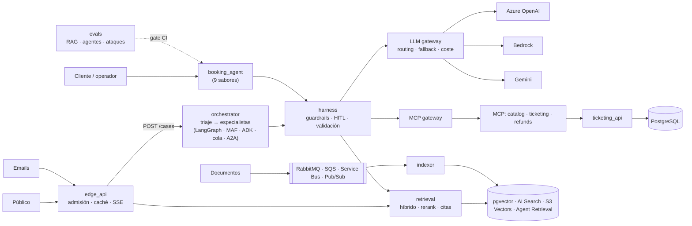

# GenAI_PoCs · Sistemas agénticos GenAI en Azure, AWS y GCP

Pruebas de concepto didácticas que recorren el stack completo de un sistema agéntico de producción:
SQL transaccional, capa de modelos con gateway, indexación event-driven, RAG híbrido, evals, tool
calling y MCP, agentes en varios frameworks y harness de guardrails. Todo en **Azure, AWS y GCP**, y cada pieza en hasta **tres carriles
comparables** con el mismo dataset y las mismas evals.

Caso de uso: **Genaipocs**, un marketplace global de experiencias y eventos (~300 M de usuarios) con
agentes para usuarios internos (operaciones, soporte, partners) y para el público.

## Arquitectura



Zoom por bloques (modelos, RAG, MCP, agente y harness, multi-agente, escala, observabilidad,
evals, despliegue) y el recorrido de un caso de punta a punta: [arquitectura.md](docs/arquitectura.md).

| Carril | Qué es | Ejemplos |
|---|---|---|
| **A. Gestionado** | El servicio de la nube hace el trabajo | Foundry Agent Service, Foundry IQ, Bedrock Knowledge Bases, AgentCore, Prompt Shields, Bedrock Guardrails, RAG Engine, Agent Search, Agent Runtime, Model Armor |
| **B. SDK nativo** | Código propio sobre los SDK | `openai`, `azure-search-documents`, `boto3` (Converse, S3 Vectors), `google-genai`, `google-cloud-*`, gateway y bucle de tools propios |
| **C. Framework** | Un framework de agentes/RAG | LlamaIndex, LangGraph, Microsoft Agent Framework, Strands, ADK, LiteLLM, RAGAS, DeepEval |

## Estructura

```text
packages/
  genaipocs_core/   dominio, casos de uso, puertos y adaptadores (Clean Architecture) + migraciones
  harness/         validación, autocorrección, guardrails, SQL seguro, PII, aprobación humana
services/
  ticketing_api/   API transaccional (FastAPI)
  indexer/         ingesta event-driven (productor + workers + DLQ)
  retrieval/       servicio RAG (híbrido, filtros, rerank, citas)
  mcp_servers/     servidores MCP (FastMCP) y MCP gateway
  support_agent/   agente mínimo sobre MCP
  booking_agent/   el mismo agente en 9 sabores
  orchestrator/    multi-agente: triaje y especialistas (LangGraph, MAF, ADK, cola, A2A)
  edge_api/        puerta pública: admisión, rate limit, caché semántica y SSE
evals/             golden datasets, evals de RAG, de agentes, multi-agente y tests de ataque
infra/             Terraform (aws, azure, gcp), SQL de benchmark, config de emuladores
scripts/           datos sintéticos, carga, benchmarks, aprovisionamiento (dry-run por defecto)
docs/              un documento por fase, pendientes y lecciones aprendidas
```

## Arranque rápido (local, sin coste)

Requisitos: Python 3.12, [uv](https://docs.astral.sh/uv/), Docker Desktop y Git.

```powershell
uv sync --all-packages
Copy-Item .env.example .env                      # y rellenar las contraseñas locales
docker compose up -d                             # PostgreSQL + pgvector y RabbitMQ
uv run alembic -c packages/genaipocs_core/alembic.ini upgrade head
uv run python scripts/generate_synthetic_data.py --scale small
uv run python scripts/load_seed.py --truncate

uv run ruff check . ; uv run mypy ; uv run pytest    # calidad (lo mismo que la CI)
uv run python -m rag_evals.retrieval_eval            # evals de retrieval (coste 0)
uv run python -m rag_evals.attacks --check           # tests de ataque del harness (coste 0)
uv run python -m rag_evals.multiagent --check        # evals multi-agente (coste 0)
uv run python -m rag_evals.redteam.report            # informe de red teaming (coste 0)
```

Perfiles opcionales de Docker: `observability` (Langfuse), `sqs` (ElasticMQ), `servicebus`
(emulador), `pubsub` (emulador de Pub/Sub), `aws` (AWS Emulator oficial en `127.0.0.1:9297`: SQS,
S3, S3 Vectors y Terraform de AWS), `azure` (Azurite, Blob Storage), `mcp` (servidores MCP), `agents`
(especialistas A2A), `scale` (Redis 8, Valkey y workers autoescalables de la fase 10) y `telemetry`
(collector de OpenTelemetry, Jaeger, Prometheus y Grafana de la fase 11). Todo lo que usa modelos o nube es explícito y tiene coste:
ver [pendientes con coste](docs/pendientes-cloud.md).

## Fases

| Fase | Tema | Estado | Doc |
|---|---|---|---|
| 0 | Cimientos: monorepo uv, Clean Architecture, entorno local, datos sintéticos, CI | ✅ | [fase-0](docs/fase-0-cimientos.md) |
| 1 | SQL avanzado (PostgreSQL, Alembic, índices, concurrencia) + `ticketing_api` | ✅ | [fase-1](docs/fase-1-sql.md) |
| 2 | Capa de modelos: Azure OpenAI, Bedrock y Gemini, LLM gateway, routing, prompt caching, coste | ✅* | [fase-2](docs/fase-2-modelos.md) |
| 3 | Indexación event-driven en 3 carriles × 3 nubes | ✅* | [fase-3](docs/fase-3-comparativa.md) |
| 4 | Retrieval avanzado: híbrido, filtros, reranking, query rewriting, citas | ✅* | [fase-4](docs/fase-4-retrieval.md) |
| 5 | Evals de RAG: golden dataset, métricas, RAGAS/DeepEval, gate en CI | ✅* | [fase-5](docs/fase-5-evals.md) |
| 6 | Tool calling manual, servidores MCP, OAuth y MCP gateway | ✅* | [fase-6](docs/fase-6-tools-mcp.md) |
| 7 | Un agente en 9 sabores (LangGraph, LlamaIndex, MAF, Strands, ADK, Foundry, AgentCore, Agent Runtime...) | ✅* | [fase-7](docs/fase-7-agentes.md) |
| 8 | Agentic harness: validación, SQL seguro, PII, prompt injection, human-in-the-loop | ✅* | [fase-8](docs/fase-8-harness.md) |
| 8→9 | Checkpoint: CI, documentación, desarrollo con IA y validación en Azure de las fases 2–8 | ✅ | [checkpoint](docs/fase-9-8-checkpoint.md) |
| 9 | Orquestación multi-agente (LangGraph, MAF, ADK, cola), A2A y evals de los cuatro motores | ✅* | [fase-9](docs/fase-9-multiagente.md) |
| 10 | Escala: rate limiting, caché semántica, streaming, outbox, autoescalado por cola y pruebas de carga (Redis y Valkey) | ✅* | [fase-10](docs/fase-10-escala.md) |
| 11 | Observabilidad: OpenTelemetry GenAI, propagación por colas y A2A, SLO y alertas como código, Langfuse, App Insights, X-Ray y Cloud Trace | ✅* | [fase-11](docs/fase-11-observabilidad.md) |
| 12 | Evals de agentes (trayectoria, LLM-juez, Gen AI Evaluation Service de contraste), red teaming con PyRIT y promptfoo, prompts versionados, A/B con MLflow y Vertex AI Experiments, y drift | ✅* | [fase-12](docs/fase-12-evals-llmops.md) |
| 12→13 | Checkpoint: glosario, arquitectura por niveles y plan para añadir GCP | ✅ | [checkpoint](docs/fase-13-12-checkpoint.md) |
| 0.G | GCP · Cimientos: dependencias, Terraform de GCP y emulador de Pub/Sub (en la fase 1, GCP es solo documental) | ✅* | [0.G](docs/fase-0-cimientos.md#7-gcp-pasada-0g) · [plan GCP](docs/fase-13-12-checkpoint.md#plan-gcp) |
| 2.G | GCP · Modelos: Gemini en el gateway (*thought signatures*), fallback entre tres nubes, caché implícita y explícita | ✅* | [2.G](docs/fase-2-modelos.md#10-gcp-pasada-2g) |
| 3.G | GCP · Indexación: Pub/Sub en el contrato de brokers, embeddings de Gemini, Agent Retrieval y RAG Engine con un corpus por ACL | ✅* | [3.G](docs/fase-3-comparativa.md#7-gcp-pasada-3g) |
| 4.G | GCP · Retrieval: híbrida en Agent Retrieval con la Ranking API, RAG Engine y Agent Search con citas verificadas | ✅* | [4.G](docs/fase-4-retrieval.md#gcp-pasada-4g) |
| 5.G | GCP · Evals de RAG: juez Gemini, Gen AI Evaluation Service y fidelidad de RAG Engine y Agent Search | ✅* | [5.G](docs/fase-5-evals.md#8-gcp-pasada-5g) |
| 6.G | GCP · Tools y MCP: tools con Gemini, token por servidor con `signJwt` e Identity Platform, Agent Gateway + Agent Registry y Apigee | ✅* | [6.G](docs/fase-6-tools-mcp.md#9-gcp-pasada-6g) |
| 7.G | GCP · Agentes: firmas de Gemini en todos los sabores, sabores `adk` y `agentplatform`, Sessions y Memory Bank, Agent Identity | ✅* | [7.G](docs/fase-7-agentes.md#10-gcp-pasada-7g) |
| 8.G | GCP · Harness: Model Armor como escudo que falla cerrado, PII con Sensitive Data Protection, plantillas y *floor setting* en Terraform | ✅* | [8.G](docs/fase-8-harness.md#9-gcp-pasada-8g) |
| 9.G | GCP · Multi-agente: ADK como cuarto motor, Pub/Sub con *exactly-once*, A2A con ID tokens en Cloud Run y espera humana en Workflows | ✅* | [9.G](docs/fase-9-multiagente.md#7-gcp-pasada-9g) |
| 10.G | GCP · Escala: backlog de Pub/Sub con PromQL, caché semántica y GCRA en Memorystore for Valkey, worker pools con CREMA, Cloud Armor | ✅* | [10.G](docs/fase-10-escala.md#7-gcp-pasada-10g) |
| 11.G | GCP · Observabilidad: Telemetry API y Managed Prometheus, 36 alertas PromQL generadas desde los SLO, logs enlazados con Cloud Trace | ✅* | [11.G](docs/fase-11-observabilidad.md#7-gcp-pasada-11g) |
| 12.G | GCP · Evals de agentes y LLMOps: juez Gemini, Evaluation Service de contraste, promptfoo con atacante LLM, prompts en Agent Platform, Vertex AI Experiments | ✅* | [12.G](docs/fase-12-evals-llmops.md#7-gcp-pasada-12g) |
| G→13 | Checkpoint: emuladores locales oficiales (AWS Emulator con el Terraform de AWS aplicado en la CI, Azurite, Service Bus fijado en 2.0.1; Pub/Sub ya estaba) | ✅ | [checkpoint](docs/fase-13-g-checkpoint.md) |
| G→13 B | Checkpoint B: índice por pasada GCP, conectores contrastados con el repo, pasada de paridad en el plan y cuentas de las tres nubes revisadas | ✅ | [checkpoint](docs/fase-13-g-checkpoint-b.md) |
| P | Pasada de paridad: Azure, AWS y GCP iguales antes de desplegar (Bedrock Evaluations, API Center, memoria de Foundry, PII de Azure y AWS, Step Functions y Durable Functions, prompts gestionados...) | Plan | [conectores candidatos](docs/conectores-candidatos.md#pasada-p) |
| 13–16+ | Despliegue en AWS, Azure y GCP; extras | Plan | [plan de fases](docs/plan-fases.md) |

✅* = implementación y pruebas locales cerradas; falta la validación en la nube ([pendientes](docs/pendientes-cloud.md)). En las fases 2–8, Azure se validó en el checkpoint 8→9 (3,76 €); faltan AWS y GCP (en GCP, todas las fases). Aviso: la suscripción de Azure de entonces se perdió el 20-11-2026; los resultados se conservan como histórico y los recursos se rehacen en otra suscripción ([pendientes](docs/pendientes-cloud.md)).

Preguntas de entrevista (técnicas y de negocio/stakeholders) de todas las fases, con respuestas
modelo y una chuleta Azure → AWS → GCP: [preguntas-entrevista.md](docs/preguntas-entrevista.md). Siglas,
términos y librerías del proyecto: [glosario.md](docs/glosario.md).

## Calidad y CI

`main` está protegida: los cambios llegan por PR (una por fase, fusionada con *merge commit* tras
revisión) y solo si pasa el check `release-gate`, que resume todos los jobs de la CI.

GitHub Actions ejecuta en cada PR y en cada merge a `main`: lint, formato, `mypy --strict`, tests, evals deterministas con
gate contra un baseline, tests de ataque en los 9 sabores, evals multi-agente en los 4 motores
(LangGraph, MAF, ADK y cola), build de las imágenes MCP y de especialistas A2A, dashboard y reglas
de alerta al día y probadas con `promtool`, configuración de los collectors de OpenTelemetry,
Terraform de las tres nubes (`validate` y `terraform test` con proveedores simulados), tests de
integración con PostgreSQL, RabbitMQ, Redis, Valkey, Azurite, y SQS y Pub/Sub emulados, y el job
`aws-emulator`: tests de SQS, S3, S3 Vectors y la Knowledge Base contra el AWS Emulator oficial y
el Terraform de AWS aplicado y destruido contra él (estado en memoria). Sin secretos y sin coste.

## Desarrollo con IA

El repo funciona igual con GitHub Copilot y con Claude Code, y todo el contexto vive en él (nada
depende de chats anteriores ni de la memoria privada de un agente):

| Qué | Dónde | Copilot | Claude Code |
|---|---|---|---|
| Reglas que aplican siempre | [AGENTS.md](AGENTS.md) | Lo carga solo | Por `CLAUDE.md` (`@AGENTS.md`) |
| Reglas por área | `.github/instructions/*.instructions.md` | Por `applyTo` | Por los punteros de `.claude/rules/` (generados con `scripts/sync_agent_rules.py`) |
| Procedimientos (skills) | `.claude/skills/*/SKILL.md` | Sí (lee `.claude/skills`) | Sí |
| Permisos y entorno | `.claude/settings.json` (versionado) y `.claude/settings.local.json` (personal) | — | Confirmación en commit, push, Terraform y borrados; `az`/`gcloud` aislados |
| Plan de todas las fases | [docs/plan-fases.md](docs/plan-fases.md) | | |
| Lo aprendido por el camino | [docs/lecciones-aprendidas.md](docs/lecciones-aprendidas.md) | | |

### Sesiones de trabajo

Una sesión por fase con todas sus subfases (un commit por subfase, una PR por fase), con un
mensaje corto; la skill reconstruye el contexto desde el repo (plan, rama, PR draft, docs y CI).
Sesión nueva con `retomar-fase` solo si el contexto pasa del ~70 % o se sigue otro día:

```text
Vamos a por la fase 13. Usa la skill iniciar-fase.                    # fase nueva (rama nueva desde main)
Seguimos con la fase 13. Usa la skill retomar-fase.                   # fase empezada, en sesión nueva
revisado                                                              # commit + push + PR de la subfase
dale                                                                  # empieza la subfase propuesta
```

Comprueba que la sesión arranca con el modelo Claude Opus más reciente y que, antes de implementar,
propone el plan de subfases (o la siguiente subfase) y espera tu visto bueno.

### Puesta en marcha de un clon

```powershell
git config core.hooksPath .githooks          # hook de términos prohibidos (una vez por clon)
# crea .secrets/forbidden_terms.txt (ignorado por Git): un término por línea (nombre real del
# cliente y sus variantes, marcas y medios, terceros); sin él el hook avisa y no bloquea
git config --local user.email <tu email personal de GitHub>   # la identidad global no se toca
```

Para Claude Code, crea `.claude/settings.local.json` (ignorado) con las rutas absolutas de los
perfiles aislados de las CLI:

```json
{ "env": { "AZURE_CONFIG_DIR": "C:\\Users\\<usuario>\\.azure-genaipocs",
           "CLOUDSDK_CONFIG": "C:\\Users\\<usuario>\\.gcloud-genaipocs", "PYTHONUTF8": "1" } }
```

## Contribuir y licencia

Issues y PR pequeñas son bienvenidas: puesta en marcha, comandos de verificación y reglas en
[CONTRIBUTING.md](CONTRIBUTING.md), con el [código de conducta](CODE_OF_CONDUCT.md). Las
vulnerabilidades se informan en privado ([SECURITY.md](SECURITY.md)).

Código y documentación con [licencia MIT](LICENSE).
