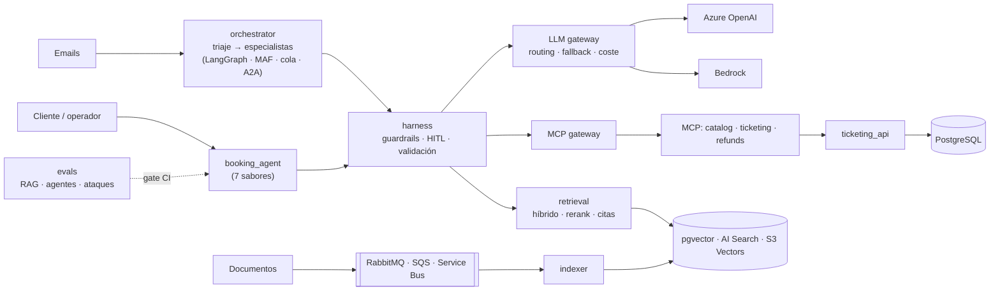

# GenAI_PoCs · Sistemas agénticos GenAI en Azure y AWS

Pruebas de concepto didácticas que recorren el stack completo de un sistema agéntico de producción:
SQL transaccional, capa de modelos con gateway, indexación event-driven, RAG híbrido, evals, tool
calling y MCP, agentes en varios frameworks y harness de guardrails. Todo en **Azure y AWS** (y
**GCP**, en curso), y cada pieza en hasta **tres carriles comparables** con el mismo dataset y las
mismas evals.

Caso de uso: **Headache**, un marketplace global de experiencias y eventos (~300 M de usuarios) con
agentes para usuarios internos (operaciones, soporte, partners) y para el público.

## Arquitectura



Zoom por bloques (modelos, RAG, MCP, agente y harness, multi-agente, escala, observabilidad,
evals, despliegue) y el recorrido de un caso de punta a punta: [arquitectura.md](docs/arquitectura.md).

| Carril | Qué es | Ejemplos |
|---|---|---|
| **A. Gestionado** | El servicio de la nube hace el trabajo | Foundry Agent Service, Foundry IQ, Bedrock Knowledge Bases, AgentCore, Prompt Shields, Bedrock Guardrails |
| **B. SDK nativo** | Código propio sobre los SDK | `openai`, `azure-search-documents`, `boto3` (Converse, S3 Vectors), gateway y bucle de tools propios |
| **C. Framework** | Un framework de agentes/RAG | LlamaIndex, LangGraph, Microsoft Agent Framework, Strands, LiteLLM, RAGAS, DeepEval |

## Estructura

```text
packages/
  headache_core/   dominio, casos de uso, puertos y adaptadores (Clean Architecture) + migraciones
  harness/         validación, autocorrección, guardrails, SQL seguro, PII, aprobación humana
services/
  ticketing_api/   API transaccional (FastAPI)
  indexer/         ingesta event-driven (productor + workers + DLQ)
  retrieval/       servicio RAG (híbrido, filtros, rerank, citas)
  mcp_servers/     servidores MCP (FastMCP) y MCP gateway
  support_agent/   agente mínimo sobre MCP
  booking_agent/   el mismo agente en 7 sabores
  orchestrator/    multi-agente: triaje y especialistas (LangGraph, MAF, cola, A2A)
evals/             golden datasets, evals de RAG, de agentes, multi-agente y tests de ataque
infra/             Terraform (aws, azure, gcp), SQL de benchmark, config de emuladores
scripts/           datos sintéticos, carga, benchmarks, aprovisionamiento (dry-run por defecto)
docs/              un documento por fase, pendientes y lecciones aprendidas
```

## Arranque rápido (local, sin coste)

Requisitos: Python 3.12, [uv](https://docs.astral.sh/uv/), Docker Desktop y Git.

```powershell
uv sync --all-packages
Copy-Item .env.example .env                      # y rellenar las contraseñas locales
docker compose up -d                             # PostgreSQL + pgvector y RabbitMQ
uv run alembic -c packages/headache_core/alembic.ini upgrade head
uv run python scripts/generate_synthetic_data.py --scale small
uv run python scripts/load_seed.py --truncate

uv run ruff check . ; uv run mypy ; uv run pytest    # calidad (lo mismo que la CI)
uv run python -m rag_evals.retrieval_eval            # evals de retrieval (coste 0)
uv run python -m rag_evals.attacks --check           # tests de ataque del harness (coste 0)
uv run python -m rag_evals.multiagent --check        # evals multi-agente (coste 0)
uv run python -m rag_evals.redteam.report            # informe de red teaming (coste 0)
```

Perfiles opcionales de Docker: `observability` (Langfuse), `sqs` (ElasticMQ), `servicebus`
(emulador), `pubsub` (emulador de Pub/Sub), `mcp` (servidores MCP), `agents` (especialistas A2A), `scale` (Redis 8 y workers
autoescalables de la fase 10) y `telemetry` (collector de OpenTelemetry, Jaeger, Prometheus y
Grafana de la fase 11). Todo lo que usa modelos o nube es explícito y tiene coste:
ver [pendientes con coste](docs/pendientes-cloud.md).

## Fases

| Fase | Tema | Estado | Doc |
|---|---|---|---|
| 0 | Cimientos: monorepo uv, Clean Architecture, entorno local, datos sintéticos, CI | ✅ | [fase-0](docs/fase-0-cimientos.md) |
| 1 | SQL avanzado (PostgreSQL, Alembic, índices, concurrencia) + `ticketing_api` | ✅ | [fase-1](docs/fase-1-sql.md) |
| 2 | Capa de modelos: Azure OpenAI vs Bedrock, LLM gateway, routing, prompt caching, coste | ✅* | [fase-2](docs/fase-2-modelos.md) |
| 3 | Indexación event-driven en 3 carriles × 2 nubes | ✅* | [fase-3](docs/fase-3-comparativa.md) |
| 4 | Retrieval avanzado: híbrido, filtros, reranking, query rewriting, citas | ✅* | [fase-4](docs/fase-4-retrieval.md) |
| 5 | Evals de RAG: golden dataset, métricas, RAGAS/DeepEval, gate en CI | ✅* | [fase-5](docs/fase-5-evals.md) |
| 6 | Tool calling manual, servidores MCP, OAuth y MCP gateway | ✅* | [fase-6](docs/fase-6-tools-mcp.md) |
| 7 | Un agente en 7 sabores (LangGraph, LlamaIndex, MAF, Strands, Foundry, AgentCore...) | ✅* | [fase-7](docs/fase-7-agentes.md) |
| 8 | Agentic harness: validación, SQL seguro, PII, prompt injection, human-in-the-loop | ✅* | [fase-8](docs/fase-8-harness.md) |
| 8→9 | Checkpoint: CI, documentación, desarrollo con IA y validación en Azure de las fases 2–8 | ✅ | [checkpoint](docs/fase-9-8-checkpoint.md) |
| 9 | Orquestación multi-agente (LangGraph, MAF, cola), A2A y evals de los tres motores | ✅* | [fase-9](docs/fase-9-multiagente.md) |
| 10 | Escala: rate limiting, caché semántica, streaming, outbox, autoescalado por cola y pruebas de carga | ✅* | [fase-10](docs/fase-10-escala.md) |
| 11 | Observabilidad: OpenTelemetry GenAI, propagación por colas y A2A, SLO y alertas como código, Langfuse, App Insights y X-Ray | ✅* | [fase-11](docs/fase-11-observabilidad.md) |
| 12 | Evals de agentes (trayectoria, LLM-juez), red teaming con PyRIT y promptfoo, prompts versionados, A/B con MLflow y drift | ✅* | [fase-12](docs/fase-12-evals-llmops.md) |
| 12→13 | Checkpoint: glosario, arquitectura por niveles y plan para añadir GCP | ✅ | [checkpoint](docs/fase-13-12-checkpoint.md) |
| G | Pasada GCP: Gemini, Pub/Sub, Vector Search, RAG Engine, ADK, Agent Runtime, Model Armor... en las fases 0–12. Hecha la 0.G (dependencias, Terraform de GCP, emulador de Pub/Sub) | En curso | [plan](docs/fase-13-12-checkpoint.md#plan-gcp) · [0.G](docs/fase-0-cimientos.md#7-gcp-pasada-0g) |
| 13–16+ | Despliegue en AWS, Azure y GCP; extras | Plan | [plan de fases](docs/plan-fases.md) |

✅* = implementación y pruebas locales cerradas; falta la validación en la nube ([pendientes](docs/pendientes-cloud.md)). En las fases 2–8, Azure ya está validado (checkpoint 8→9, 3,76 €); falta AWS.

Preguntas de entrevista (técnicas y de negocio/stakeholders) de todas las fases, con respuestas
modelo y una chuleta Azure → AWS → GCP: [preguntas-entrevista.md](docs/preguntas-entrevista.md). Siglas,
términos y librerías del proyecto: [glosario.md](docs/glosario.md).

## Calidad y CI

`main` está protegida: los cambios llegan por PR (una por fase, fusionada con *merge commit* tras
revisión) y solo si pasa el check `release-gate`, que resume todos los jobs de la CI.

GitHub Actions ejecuta en cada PR y en cada merge a `main`: lint, formato, `mypy --strict`, tests, evals deterministas con
gate contra un baseline, tests de ataque en los 7 sabores, evals multi-agente en los 3 motores,
build de las imágenes MCP y de especialistas A2A, dashboard y reglas de alerta al día y probadas
con `promtool`, configuración de los collectors de OpenTelemetry, validación de Terraform y tests de integración con PostgreSQL, RabbitMQ, Redis y SQS emulado. Sin secretos y sin coste.

## Desarrollo con IA

El repo funciona igual con GitHub Copilot y con Claude Code, y todo el contexto vive en él (nada
depende de chats anteriores ni de la memoria privada de un agente):

| Qué | Dónde | Copilot | Claude Code |
|---|---|---|---|
| Reglas que aplican siempre | [AGENTS.md](AGENTS.md) | Lo carga solo | Por `CLAUDE.md` (`@AGENTS.md`) |
| Reglas por área | `.github/instructions/*.instructions.md` | Por `applyTo` | Por los punteros de `.claude/rules/` (generados con `scripts/sync_agent_rules.py`) |
| Procedimientos (skills) | `.claude/skills/*/SKILL.md` | Sí (lee `.claude/skills`) | Sí |
| Permisos y entorno | `.claude/settings.json` (versionado) y `.claude/settings.local.json` (personal) | — | Confirmación en commit, push, Terraform y borrados; `az`/`gcloud` aislados |
| Plan de todas las fases | [docs/plan-fases.md](docs/plan-fases.md) | | |
| Lo aprendido por el camino | [docs/lecciones-aprendidas.md](docs/lecciones-aprendidas.md) | | |

### Sesiones de trabajo

Una sesión por fase con todas sus subfases (un commit por subfase, una PR por fase), con un
mensaje corto; la skill reconstruye el contexto desde el repo (plan, rama, PR draft, docs y CI).
Sesión nueva con `retomar-fase` solo si el contexto pasa del ~70 % o se sigue otro día:

```text
Vamos a por la 2.G de la pasada GCP. Usa la skill iniciar-fase.        # fase nueva (rama fase/2-g desde main)
Seguimos con la 2.G. Usa la skill retomar-fase.                       # fase empezada, en sesión nueva
revisado                                                              # commit + push + PR de la subfase
dale                                                                  # empieza la subfase propuesta
```

Comprueba que la sesión arranca con el modelo Claude Opus más reciente y que, antes de implementar,
propone el plan de subfases (o la siguiente subfase) y espera tu visto bueno.

### Puesta en marcha de un clon

```powershell
git config core.hooksPath .githooks          # hook de términos prohibidos (una vez por clon)
# crea .secrets/forbidden_terms.txt (ignorado por Git): un término por línea (nombre real del
# cliente y sus variantes, marcas y medios, terceros); sin él el hook avisa y no bloquea
git config --local user.email <tu email personal de GitHub>   # la identidad global no se toca
```

Para Claude Code, crea `.claude/settings.local.json` (ignorado) con las rutas absolutas de los
perfiles aislados de las CLI:

```json
{ "env": { "AZURE_CONFIG_DIR": "C:\\Users\\<usuario>\\.azure-headache",
           "CLOUDSDK_CONFIG": "C:\\Users\\<usuario>\\.gcloud-headache", "PYTHONUTF8": "1" } }
```
