# Arquitectura por niveles · De la vista general al detalle

Un diagrama único de todo el sistema es ilegible. Aquí va por **niveles de zoom**, como en un mapa:

- **Nivel 0**: el sistema completo en una pantalla (el del [README](../README.md), ampliado con la
  puerta pública, la observabilidad y las evals).
- **Nivel 1**: un zoom por bloque (modelos, RAG, tools, agente, multi-agente, escala,
  observabilidad, evals). Cada uno con "qué contar en 30 segundos" y enlace a su fase.
- **Nivel 2**: el recorrido de un caso real de punta a punta, para contarlo en una pizarra.

Siglas y términos: [glosario](glosario.md). Preguntas y respuestas: [preguntas-entrevista.md](preguntas-entrevista.md).

## Índice

- [Nivel 0 · Vista general](#n0)
- Nivel 1: [1. Capas del código](#n1-capas) · [2. Modelos y LLM gateway](#n1-modelos) ·
  [3. Indexación](#n1-indexacion) · [4. Retrieval (RAG)](#n1-rag) · [5. Tools y MCP](#n1-mcp) ·
  [6. Agente y harness](#n1-agente) · [7. Multi-agente](#n1-multiagente) ·
  [8. Edge y escala](#n1-escala) · [9. Observabilidad](#n1-observabilidad) ·
  [10. Evals y LLMOps](#n1-evals) · [11. Despliegue en AWS y Azure](#n1-despliegue)
- [Nivel 2 · Recorrido de un caso](#n2)

## Nivel 0 · Vista general

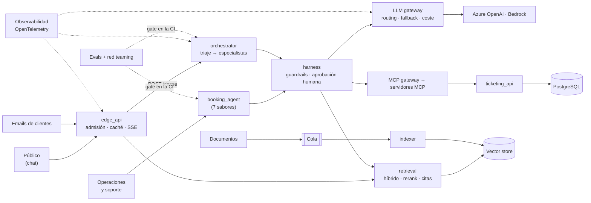

**En 30 segundos:** tres entradas (chat público, agente interno y emails) llegan a agentes que
nunca tocan nada directamente: todo pasa por el **harness** (seguridad), el **LLM gateway**
(modelos y coste), el **MCP gateway** (acciones sobre el negocio) y el **retrieval** (conocimiento).
El conocimiento se indexa por eventos. Todo está trazado con OpenTelemetry y ningún cambio se
despliega sin pasar las evals.

---

## Nivel 1 · 1. Capas del código (Clean Architecture)

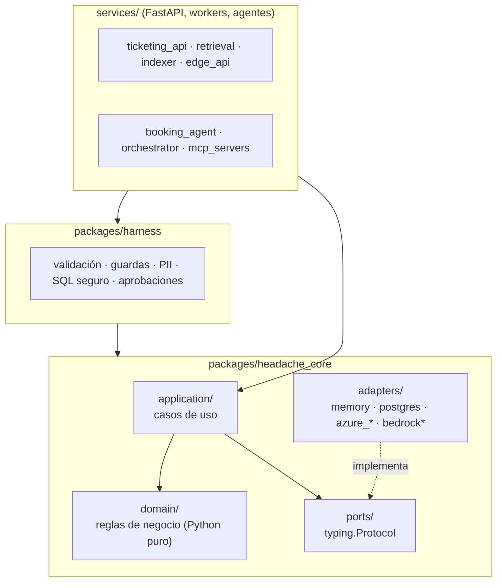

**Qué contar:**

- Las flechas solo van hacia dentro: el dominio no importa nada externo; `harness` depende de
  `core`, nunca al revés.
- Cada proveedor (Azure, AWS, Postgres) es un **adaptador** de un **puerto**; los tests usan el
  adaptador `memory` (deterministas, sin red ni coste).
- El LLM propone; el **dominio decide** (`evaluate_refund`). Detalle: [fase 0](fase-0-cimientos.md).

## Nivel 1 · 2. Modelos y LLM gateway

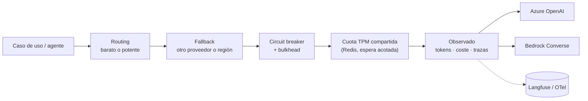

**Qué contar:**

- Es una cadena de **decoradores** sobre el mismo `LLMPort`: cada pieza añade una
  responsabilidad (routing, fallback, resiliencia, cuota, observabilidad) sin que el código de
  negocio lo sepa.
- Routing: 18/20 emails al modelo barato con 100 % de acierto; las escrituras, siempre al potente.
- Prompt caching: lo estable primero (Azure automático, Bedrock con `cachePoint`).
- Detalle: [fase 2](fase-2-modelos.md) y resiliencia en la [fase 10](fase-10-escala.md).

## Nivel 1 · 3. Indexación event-driven

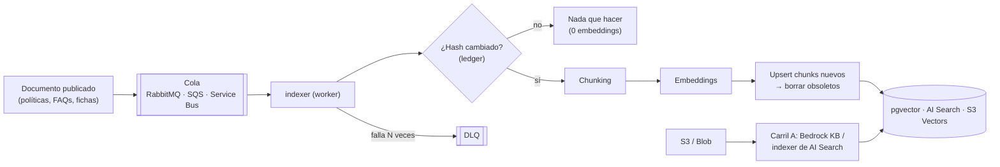

**Qué contar:**

- Por eventos, no por lotes: publicar un documento encola su indexación (frescura en minutos).
- **Idempotente**: hash en un ledger (republicar 116 documentos = 0 embeddings) y orden
  upsert → borrado para que una consulta nunca vea el documento vacío.
- Tres carriles con el mismo corpus: A gestionado (Bedrock KB / AI Search), B SDK propio, C
  LlamaIndex. Detalle: [fase 3](fase-3-comparativa.md).

## Nivel 1 · 4. Retrieval (RAG)

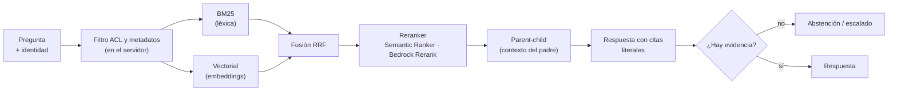

**Qué contar:**

- La **ACL se aplica antes del ranking**, en el backend: el LLM no puede ampliar el alcance.
- Híbrida no es gratis: en Azure, sola rindió peor que el vector (recall@5 0,79 frente a 0,95);
  con reranker, la mejor (0,97). HyDE y query rewriting medidos y descartados (×3 latencia).
- Mejor "no lo sé" que una política inventada. Detalle: [fase 4](fase-4-retrieval.md).

## Nivel 1 · 5. Tools y MCP

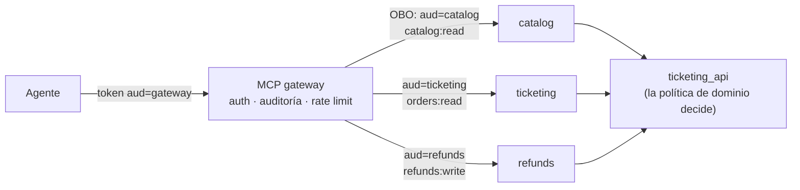

**Qué contar:**

- El modelo solo **propone** llamadas; la identidad sale del token, nunca de los argumentos.
- Tres servidores por **mínimo privilegio**; el gateway da un único endpoint y cambia el token por
  uno nuevo para cada servidor (OBO), sin *token passthrough*.
- En AWS, AgentCore Gateway; en Azure, APIM. Detalle: [fase 6](fase-6-tools-mcp.md).

## Nivel 1 · 6. Agente y harness

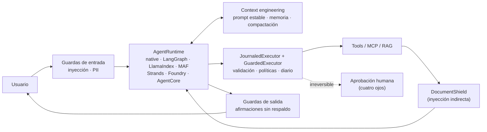

**Qué contar:**

- **Siete sabores** del mismo agente detrás de un contrato (`AgentRuntime`): el framework
  orquesta, pero identidad, tools, modelo y evals son nuestros.
- El **harness** es el punto de paso obligatorio: "el modelo propone; el harness dispone".
  Sin harness, 0/6 ataques contenidos; con harness, 6/6 en los siete sabores.
- La última capa no es un filtro sino arquitectura: identidad fuera del modelo y aprobación
  humana en lo irreversible. Detalle: [fase 7](fase-7-agentes.md) y [fase 8](fase-8-harness.md).

## Nivel 1 · 7. Multi-agente y asíncrono

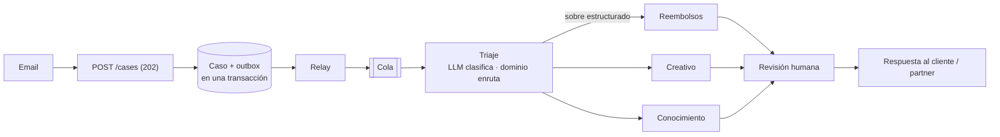

**Qué contar:**

- Patrón **router**: el LLM clasifica y una tabla del dominio elige el especialista (auditable,
  3 llamadas; el supervisor costaba 6).
- Entre agentes viaja un **sobre** (intención, idioma, urgencia), no el email: −63 % de tokens y la
  inyección del cliente no llega al especialista.
- **Idempotencia**: el caso se reclama antes de llamar al LLM y el *transactional outbox* evita
  perder o duplicar mensajes. Mismo flujo en LangGraph, MAF y con colas; especialistas en proceso
  o remotos por **A2A**. Detalle: [fase 9](fase-9-multiagente.md).

## Nivel 1 · 8. Edge y escala

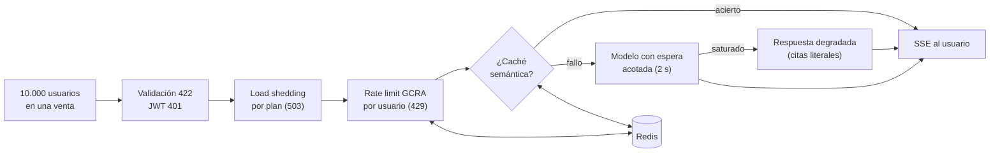

**Qué contar:**

- Decidir **pronto y barato**, por capas: cada filtro descarta antes de llegar al modelo.
- Caché semántica con **guarda de facetas** (ciudad, fecha, IDs): 12/17 paráfrasis reutilizadas y
  0 falsos aciertos. Con protección: de 6,8 a 75 req/s y TTFT p95 de 42 ms.
- Workers escalados por **longitud de cola**, con el techo que pone la cuota del modelo
  (ley de Little). Detalle: [fase 10](fase-10-escala.md).

## Nivel 1 · 9. Observabilidad

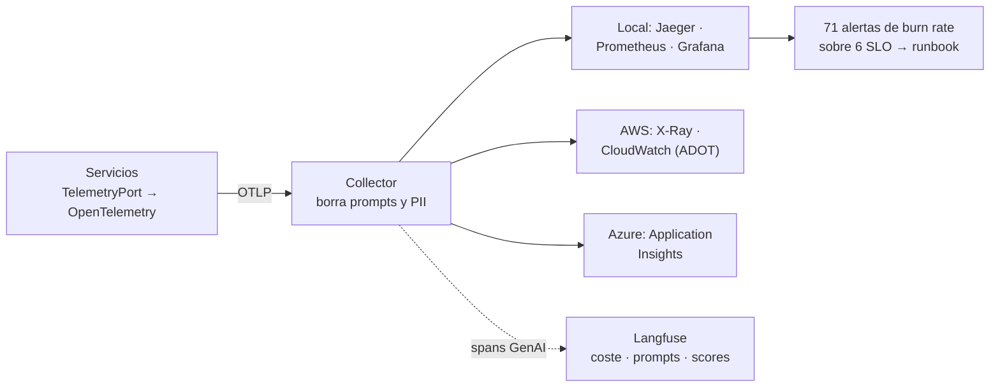

**Qué contar:**

- Se instrumenta **una vez** (convención GenAI de OTel detrás de un puerto) y el collector decide
  el destino: cambiar de backend es configuración.
- El `traceparent` viaja por colas, outbox y A2A: un caso = 14 spans con un solo `trace_id`.
- Sin PII en trazas ni métricas; alertas de burn rate multiventana, cada una con su runbook.
  Detalle: [fase 11](fase-11-observabilidad.md).

## Nivel 1 · 10. Evals y LLMOps (el ciclo de calidad)

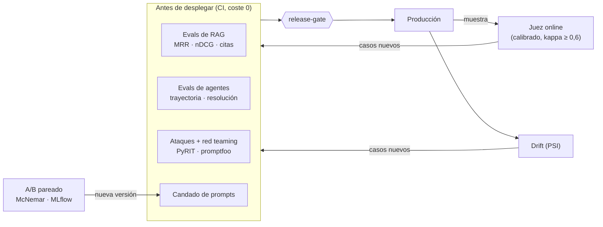

**Qué contar:**

- **Offline** (CI, gratis, en cada PR) y **online** (muestra del tráfico real, con presupuesto).
- Se evalúa el **resultado** (estado final, invariantes), no la redacción; el juez etiqueta
  hechos y el dominio decide.
- Cerrar el ciclo: lo que detectan el juez online y el drift vuelve como casos al dataset.
  Detalle: [fase 5](fase-5-evals.md) y [fase 12](fase-12-evals-llmops.md).

## Nivel 1 · 11. Despliegue en AWS y Azure (objetivo de las fases 13–14)

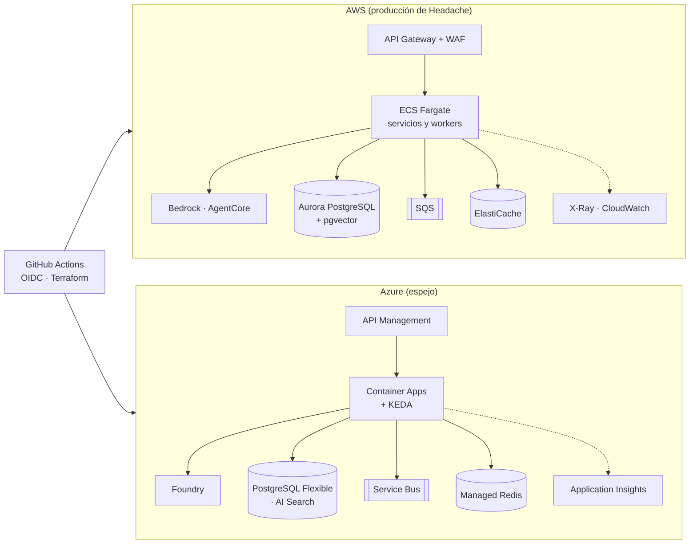

**Qué contar:**

- El mismo código en ambas nubes: solo cambian los **adaptadores** y el Terraform.
- Identidad sin secretos: IAM Roles ↔ Managed Identity; OIDC desde la CI.
- Aún no desplegado: es el plan de las fases 13 (AWS) y 14 (Azure). Equivalencias completas en la
  [chuleta Azure → AWS](preguntas-entrevista.md#chuleta).

---

## Nivel 2 · Recorrido de un caso de punta a punta

Un cliente escribe: *"Quiero el reembolso del pedido 1234, el concierto se canceló"*.

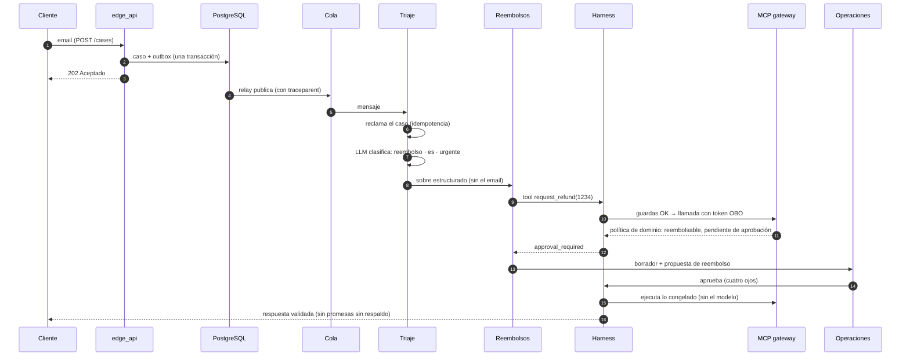

**Cómo contarlo (2 minutos en una pizarra):**

1. **Entrada asíncrona y segura**: el edge acepta en milisegundos (202) y guarda caso y mensaje en
   una transacción; un reintento o un email duplicado no duplica nada.
2. **Triaje barato**: el modelo barato clasifica; el dominio decide a quién va. El especialista
   recibe un sobre, no el texto del cliente.
3. **El especialista propone, no ejecuta**: la tool pasa por el harness y el MCP gateway; la
   política de reembolso es código y lo irreversible espera a una persona.
4. **Lo aprobado se ejecuta sin el modelo**, con los argumentos congelados.
5. **Todo es una traza** (un solo `trace_id` de principio a fin) y el caso cuenta para las métricas, el juez
   online y el drift.
