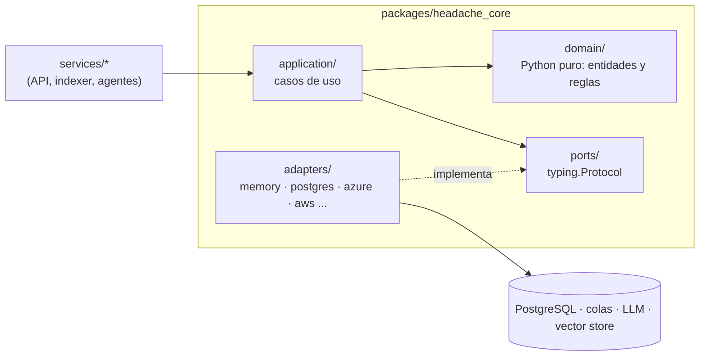

# Fase 0 · Cimientos: monorepo, Clean Architecture, entorno local y CI

**Objetivo:** una base sobre la que las fases siguientes solo **añaden adaptadores y servicios**, sin
reescribir nada. El dominio de Headache (eventos, sesiones, pedidos, reembolsos) existe antes que
cualquier nube, base de datos o modelo, y se prueba sin red ni coste.

Commit: `bd044b2 chore: fase 0 - monorepo uv, dominio Headache, puertos y adaptadores, entorno local y CI`.

## 1. Arquitectura: puertos y adaptadores



| Capa | Qué contiene | Regla |
|---|---|---|
| `domain/` | `models.py` (dataclasses `frozen`/`slots`: `Money`, `Event`, `Session`, `Order`, `Refund`...), `policies.py` (`evaluate_refund`) | Sin imports de frameworks, nube ni base de datos. **El LLM nunca decide negocio: decide el dominio.** |
| `application/` | Casos de uso (`RefundService` en la fase 0) | Depende solo de puertos y del dominio |
| `ports/` | `llm.py`, `repositories.py`, `messaging.py`, `vector_store.py` | Interfaces con `typing.Protocol` (tipado estructural: el adaptador no hereda de nada) |
| `adapters/` | `memory.py` en la fase 0; después `postgres/`, `azure_openai.py`, `bedrock.py`, ... | Única capa que conoce SDKs |

Los servicios (`services/<nombre>`) son la **raíz de composición**: eligen adaptadores según la
configuración y se los inyectan a los casos de uso. Así, la misma lógica corre con adaptadores en
memoria (tests) o con PostgreSQL, Azure o AWS (fases siguientes).

Ejemplo de la fase 0: `evaluate_refund(order, session, event, requested_at)` devuelve una
`RefundDecision` (estado del pedido, categoría reembolsable, ventana de horas antes de la sesión).
Es la "fuente de verdad" que en la fase 8 reutiliza el harness para validar lo que propone un agente.

## 2. Monorepo uv

| Pieza | Decisión |
|---|---|
| `pyproject.toml` raíz | `[tool.uv.workspace] members = ["packages/*", "services/*", "evals"]`; un solo `uv.lock` para todo |
| Paquetes | `packages/headache_core` compartido (extras opcionales: `postgres`, `azure`, `aws`, `gateway`...); cada servicio con su `pyproject.toml` |
| Python | 3.12 (`.python-version`), `py.typed` en cada paquete |
| Calidad | `ruff check` (E, F, I, N, UP, B, SIM, ASYNC, RUF), `ruff format`, `mypy --strict` con el plugin de Pydantic, `pytest` con `asyncio_mode = "auto"` |
| Tests | Adaptadores en memoria: deterministas, sin red ni coste. Integración con el marcador `integration`, excluida por defecto |

```powershell
uv sync --all-packages
uv run ruff check . ; uv run ruff format --check . ; uv run mypy ; uv run pytest
```

## 3. Configuración tipada

`headache_core/config.py`: `Settings(BaseSettings)` con submodelos por integración
(`AzureOpenAISettings`, `BedrockSettings`, `PostgresSettings`, `RabbitMQSettings`, `LangfuseSettings`...).

- Variables anidadas con `__`: `BEDROCK__REGION`, `POSTGRES__PASSWORD`.
- Secretos como `SecretStr` (no salen en logs ni en `repr`).
- `api_key = None` en Azure ⇒ Entra ID (`az login` / Managed Identity); sin claves por defecto.
- `.env.example` versionado; `.env` ignorado por Git.
- `get_settings()` con `lru_cache`: una sola lectura por proceso.

## 4. Entorno local (`docker-compose.yml`)

Docker solo ejecuta **infraestructura**; los modelos son siempre de nube.

| Servicio | Imagen | Perfil | Puerto (siempre `127.0.0.1`) |
|---|---|---|---|
| PostgreSQL + pgvector | `pgvector/pgvector:pg17` | por defecto | `5432` |
| RabbitMQ | `rabbitmq:4-management` | por defecto | `5672`, consola `15672` |
| ElasticMQ (SQS) | `softwaremill/elasticmq-native` | `sqs` (fase 3) | `9324` |
| Emulador de Service Bus + SQL Server | `servicebus-emulator` | `servicebus` (fase 3) | `5673` |
| Langfuse v3 (web, worker, ClickHouse, Redis, MinIO) | `langfuse/langfuse:3` | `observability` (fase 2) | `3000` |
| Servidores MCP y gateway | `headache-mcp:local` | `mcp` (fase 6) | `8100`–`8103` |

Puertos ligados a `127.0.0.1` para no exponer servicios a la red. Los perfiles evitan arrancar lo
que no se usa. En Windows el código conecta a `127.0.0.1` y no a `localhost` (el intento IPv6
añade ~2 s por conexión).

## 5. Datos sintéticos

`scripts/generate_synthetic_data.py --scale small|medium|large [--seed 42] [--reference-date 2026-10-01]`
→ `data/synthetic/` (no versionado). Deterministas por semilla (`random.Random` + `Faker.seed`).

| Escala | Recintos/ciudad | Eventos/recinto | Sesiones/evento | Clientes | Pedidos | Emails |
|---|---|---|---|---|---|---|
| `small` | 2 | 3 | 4 | 500 | 2 000 | 120 |
| `medium` | 5 | 6 | 10 | 20 000 | 100 000 | 500 |
| `large` | 10 | 10 | 30 | 300 000 | 3 000 000 | 2 000 |

- 10 ciudades (ES, GB, FR, PT, IT, US, MX), con moneda e idioma propios.
- 7 categorías con reglas de negocio reales (`candlelit` reembolsable 48 h, `theatre` no reembolsable...).
- Pedidos con estados realistas (~5 % reembolsados, ~2 % cancelados) y sus reembolsos.
- Emails de soporte en es/en con 6 intenciones (reembolso, cambio de fecha, información, entradas
  perdidas, queja, partnership): el dataset del triaje de la fase 2.
- Corpus de conocimiento (políticas, FAQs por ciudad, guías de recintos, fichas de evento y un
  manual largo) en JSONL y Markdown: la base de las fases 3–5.
- Los pedidos se escriben en streaming: la escala `large` no cabe en memoria.

## 6. CI (GitHub Actions)

Job `quality`: `uv sync --all-packages --locked` (falla si el lock no está al día) → ruff → formato →
mypy → pytest → smoke test del generador. Las fases siguientes añaden jobs (`integration`, `evals`,
`terraform`, `mcp-image`). Acciones fijadas por SHA y runner `ubuntu-26.04` fijado (checkpoint 8→9).

## 7. Comparativa Azure ↔ AWS ↔ framework

| Concepto | Este repo | Azure | AWS |
|---|---|---|---|
| Configuración y secretos | Pydantic Settings + `.env` local | App Configuration + Key Vault, Managed Identity | Parameter Store / Secrets Manager, IAM Roles |
| Infra local | Docker Compose | Emuladores (Service Bus, Azurite) | ElasticMQ / LocalStack |
| CI/CD | GitHub Actions | Azure DevOps Pipelines | CodePipeline / CodeBuild |
| Identidad en CI | OIDC (fases 13/14) | Federated credentials en Entra ID | `AssumeRoleWithWebIdentity` |

## 8. Decisiones (para defenderlas)

- **Clean Architecture desde el día 0**: tres carriles (gestionado, SDK nativo, framework) × dos
  nubes solo son comparables si comparten dominio, casos de uso y tests; cambia el adaptador.
- **`Protocol` en lugar de ABC**: los adaptadores de terceros encajan sin heredar; mypy comprueba
  la conformidad.
- **Dominio con dataclasses inmutables**, no modelos ORM ni Pydantic: sin dependencias y sin estado
  compartido mutable; Pydantic se queda en los bordes (API, config, salidas del LLM).
- **Monorepo con un solo lock**: versiones coherentes entre servicios; cada servicio sigue siendo
  desplegable por separado.
- **Datos sintéticos deterministas** con reglas de negocio: evals reproducibles y sin datos reales.

## 9. Checkpoint de entrevista

Las preguntas técnicas y de negocio/stakeholders de esta fase, con sus respuestas modelo, están en
[preguntas de entrevista · fase 0](preguntas-entrevista.md#fase-0).
