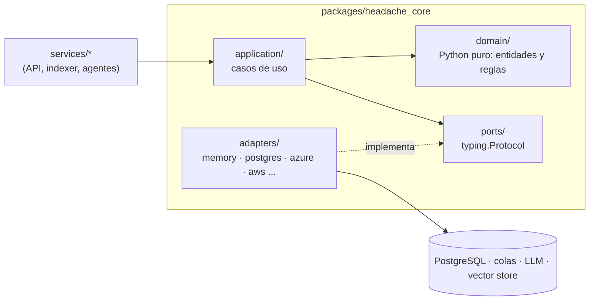

# Fase 0 · Cimientos: monorepo, Clean Architecture, entorno local y CI

**Objetivo:** una base sobre la que las fases siguientes solo **añaden adaptadores y servicios**, sin
reescribir nada. El dominio de Headache (eventos, sesiones, pedidos, reembolsos) existe antes que
cualquier nube, base de datos o modelo, y se prueba sin red ni coste.

Commit: `bd044b2 chore: fase 0 - monorepo uv, dominio Headache, puertos y adaptadores, entorno local y CI`.

Pasada GCP ([sección 7](#7-gcp-pasada-0g), PR #2): `ef71b14` (0.G1, dependencias y configuración),
`03a1f68` (0.G2, Terraform de GCP), `6c1f8dd` (0.G3, emulador de Pub/Sub) y el cierre (0.G4, docs).

## 1. Arquitectura: puertos y adaptadores



| Capa | Qué contiene | Regla |
|---|---|---|
| `domain/` | `models.py` (dataclasses `frozen`/`slots`: `Money`, `Event`, `Session`, `Order`, `Refund`...), `policies.py` (`evaluate_refund`) | Sin imports de frameworks, nube ni base de datos. **El LLM nunca decide negocio: decide el dominio.** |
| `application/` | Casos de uso (`RefundService` en la fase 0) | Depende solo de puertos y del dominio |
| `ports/` | `llm.py`, `repositories.py`, `messaging.py`, `vector_store.py` | Interfaces con `typing.Protocol` (tipado estructural: el adaptador no hereda de nada) |
| `adapters/` | `memory.py` en la fase 0; después `postgres/`, `azure_openai.py`, `bedrock.py`, ... | Única capa que conoce SDKs |

Los servicios (`services/<nombre>`) son la **raíz de composición**: eligen adaptadores según la
configuración y se los inyectan a los casos de uso. Así, la misma lógica corre con adaptadores en
memoria (tests) o con PostgreSQL, Azure o AWS (fases siguientes).

Ejemplo de la fase 0: `evaluate_refund(order, session, event, requested_at)` devuelve una
`RefundDecision` (estado del pedido, categoría reembolsable, ventana de horas antes de la sesión).
Es la "fuente de verdad" que en la fase 8 reutiliza el harness para validar lo que propone un agente.

## 2. Monorepo uv

| Pieza | Decisión |
|---|---|
| `pyproject.toml` raíz | `[tool.uv.workspace] members = ["packages/*", "services/*", "evals"]`; un solo `uv.lock` para todo |
| Paquetes | `packages/headache_core` compartido (extras opcionales: `postgres`, `azure`, `aws`, `gateway`...); cada servicio con su `pyproject.toml` |
| Python | 3.12 (`.python-version`), `py.typed` en cada paquete |
| Calidad | `ruff check` (E, F, I, N, UP, B, SIM, ASYNC, RUF), `ruff format`, `mypy --strict` con el plugin de Pydantic, `pytest` con `asyncio_mode = "auto"` |
| Tests | Adaptadores en memoria: deterministas, sin red ni coste. Integración con el marcador `integration`, excluida por defecto |

```powershell
uv sync --all-packages
uv run ruff check . ; uv run ruff format --check . ; uv run mypy ; uv run pytest
```

## 3. Configuración tipada

`headache_core/config.py`: `Settings(BaseSettings)` con submodelos por integración
(`AzureOpenAISettings`, `BedrockSettings`, `PostgresSettings`, `RabbitMQSettings`, `LangfuseSettings`...).

- Variables anidadas con `__`: `BEDROCK__REGION`, `POSTGRES__PASSWORD`.
- Secretos como `SecretStr` (no salen en logs ni en `repr`).
- `api_key = None` en Azure ⇒ Entra ID (`az login` / Managed Identity); sin claves por defecto.
- `.env.example` versionado; `.env` ignorado por Git.
- `get_settings()` con `lru_cache`: una sola lectura por proceso.

## 4. Entorno local (`docker-compose.yml`)

Docker solo ejecuta **infraestructura**; los modelos son siempre de nube.

| Servicio | Imagen | Perfil | Puerto (siempre `127.0.0.1`) |
|---|---|---|---|
| PostgreSQL + pgvector | `pgvector/pgvector:pg17` | por defecto | `5432` |
| RabbitMQ | `rabbitmq:4-management` | por defecto | `5672`, consola `15672` |
| ElasticMQ (SQS) | `softwaremill/elasticmq-native` | `sqs` (fase 3) | `9324` |
| Emulador de Service Bus + SQL Server | `servicebus-emulator` | `servicebus` (fase 3) | `5673` |
| Emulador de Pub/Sub | `google-cloud-cli:<versión>-emulators` | `pubsub` (0.G3) | `8085` |
| Langfuse v3 (web, worker, ClickHouse, Redis, MinIO) | `langfuse/langfuse:3` | `observability` (fase 2) | `3000` |
| Servidores MCP y gateway | `headache-mcp:local` | `mcp` (fase 6) | `8100`–`8103` |

Puertos ligados a `127.0.0.1` para no exponer servicios a la red. Los perfiles evitan arrancar lo
que no se usa. En Windows el código conecta a `127.0.0.1` y no a `localhost` (el intento IPv6
añade ~2 s por conexión).

## 5. Datos sintéticos

`scripts/generate_synthetic_data.py --scale small|medium|large [--seed 42] [--reference-date 2026-10-01]`
→ `data/synthetic/` (no versionado). Deterministas por semilla (`random.Random` + `Faker.seed`).

| Escala | Recintos/ciudad | Eventos/recinto | Sesiones/evento | Clientes | Pedidos | Emails |
|---|---|---|---|---|---|---|
| `small` | 2 | 3 | 4 | 500 | 2 000 | 120 |
| `medium` | 5 | 6 | 10 | 20 000 | 100 000 | 500 |
| `large` | 10 | 10 | 30 | 300 000 | 3 000 000 | 2 000 |

- 10 ciudades (ES, GB, FR, PT, IT, US, MX), con moneda e idioma propios.
- 7 categorías con reglas de negocio reales (`candlelit` reembolsable 48 h, `theatre` no reembolsable...).
- Pedidos con estados realistas (~5 % reembolsados, ~2 % cancelados) y sus reembolsos.
- Emails de soporte en es/en con 6 intenciones (reembolso, cambio de fecha, información, entradas
  perdidas, queja, partnership): el dataset del triaje de la fase 2.
- Corpus de conocimiento (políticas, FAQs por ciudad, guías de recintos, fichas de evento y un
  manual largo) en JSONL y Markdown: la base de las fases 3–5.
- Los pedidos se escriben en streaming: la escala `large` no cabe en memoria.
- **Trampas intencionadas** para medir precisión: la apertura de puertas varía por ciudad (15, 30
  o 45 min) y las ventanas de reembolso por categoría coinciden entre las políticas (RAG) y los
  datos de los eventos (SQL), para comprobar que el agente responde lo mismo que la regla de dominio.
  Cada email lleva `expected_intent`.
- **Invariantes:** ningún pedido posterior a `--reference-date` (corregido en la fase 1). Al añadir
  datos nuevos (fichas de evento en la 3.1) no se consume el RNG de las rutas existentes, para que
  el resto de la salida con la misma semilla no cambie.
- El `data/synthetic/` de trabajo está en escala `large`: para pruebas se genera `small` en otro
  directorio, sin sobrescribirlo.
- Python 3.12 y no 3.14 (la instalada en el equipo): varias librerías de GenAI no soportaban la
  3.14 cuando se creó el repo. Revisarlo antes de subir de versión.

## 6. CI (GitHub Actions)

Job `quality`: `uv sync --all-packages --locked` (falla si el lock no está al día) → ruff → formato →
mypy → pytest → smoke test del generador. Las fases siguientes añaden jobs (`integration`, `evals`,
`terraform`, `mcp-image`). Acciones fijadas por SHA y runner `ubuntu-26.04` fijado (checkpoint 8→9).

## 7. GCP (pasada 0.G)

**Objetivo:** dejar el hueco donde encaja la tercera nube para que las fases 2.G–12.G solo añadan
adaptadores. No hay capacidad nueva de producto: es la prueba de que la arquitectura es portable.
Coste 0: nada se ejecuta en la nube.

| Subfase | Commit | Qué |
|---|---|---|
| 0.G1 | `ef71b14` | Dependencias de GCP en el lock y configuración tipada |
| 0.G2 | `03a1f68` | `infra/terraform/gcp`: APIs, presupuesto e identidades sin claves; `gcp` en la CI |
| 0.G3 | `6c1f8dd` | Emulador de Pub/Sub en `docker-compose.yml` y en la CI |
| 0.G4 | (cierre) | Chuleta a tres columnas, comparativas, glosario y pendientes |

### 7.1 Dependencias y configuración (0.G1)

- Extra `gcp` de `headache-core`: `google-genai` (Gemini) y `google-cloud-{aiplatform,
  discoveryengine,dlp,modelarmor,monitoring,pubsub,storage}`. `google-adk` en `booking-agent`,
  bloqueado ya aunque su sabor llega en la 7.G1: es el que impone las restricciones.
- **Conflicto resuelto:** `google-genai` iba por la 3.0, pero ADK 2.14 exige `<3`; manda el techo
  del framework (`google-genai>=2.34,<3`). El lock baja `websockets` 16.1 → 15.0 y sube `authlib`
  a 1.9. Toda la suite, los gates y la imagen de agentes pasan con él
  ([lección](lecciones-aprendidas.md)).
- `GcpSettings` (`GCP__PROJECT`, `GCP__REGION=europe-west4`, `GCP__IMPERSONATE_SERVICE_ACCOUNT`),
  `GeminiSettings` (`GEMINI__*`: modelos barato/potente/juez y `location=global`) y
  `PubSubSettings` (`PUBSUB__EMULATOR_HOST`...).
- `LLMProvider.GCP` existe (también como fallback) pero aún no tiene adaptador: las raíces de
  composición fallan con un error que nombra la fase (2.G1, 2.G2, 3.G2, 5.G1). Antes, cualquier
  valor nuevo del enum acababa construyendo Bedrock **en silencio**; lo fija
  `test_gcp_fails_loudly_where_its_adapter_does_not_exist_yet` (desde la 2.G1, el chat ya
  construye Gemini).

### 7.2 Terraform (0.G2)

```powershell
cd infra/terraform/gcp
terraform fmt -check -recursive ; terraform init -backend=false -input=false ; terraform validate
```

| Fichero | Qué | Por qué así |
|---|---|---|
| `versions.tf` | `google` y `google-beta` `~> 8.10`, `billing_project` + `user_project_override` | Con ADC de usuario, Billing Budgets devuelve 403 sin proyecto de cuota |
| `main.tf` | 15 APIs con `google_project_service` (`disable_on_destroy = false`) | En GCP cada API se habilita por proyecto; también es control: lo no habilitado no se usa |
| `budget.tf` | 100 al mes, alertas al 50/75/100 % y previsión al 100 %, por correo | `EXCLUDE_ALL_CREDITS`: con créditos de prueba, el gasto neto es 0 y ninguna alerta saltaría |
| `identity.tf` | Cuenta de servicio `headache-dev-app` (se suplanta desde local) y Workload Identity Federation para GitHub Actions con `headache-dev-ci` | Sin claves JSON; condición por IDs numéricos del repo y del dueño y solo `refs/heads/main`: una PR no obtiene credenciales |

El proyecto se crea a mano con la cuenta de facturación de prueba; Terraform gestiona lo de dentro.

### 7.3 Emulador de Pub/Sub (0.G3)

```powershell
docker compose --profile pubsub up -d
uv run pytest packages/headache_core/tests/integration/test_pubsub_emulator.py -m integration
```

- Imagen oficial `google-cloud-cli:593.0.0-emulators` (emulador 0.8.38, ~1,7 GB), solo en memoria.
- **Hallazgo:** sin `--host-port=0.0.0.0:8085` el emulador escucha en el `localhost` *del
  contenedor* y el puerto publicado no responde (comprobado; el plan decía IPv6 y era incorrecto).
- En la CI, `docker run` en segundo plano al principio del job `integration` (los *services* no
  admiten `command`); la descarga se solapa con `uv sync` y la espera posterior es de 0 s.
- El smoke test publica con un atributo `traceparent` (donde viajará la traza en la 11.G1). El
  contrato completo (reintentos, *dead-letter topic*) llega con el adaptador en la 3.G1.

## 8. Comparativa Azure ↔ AWS ↔ GCP ↔ framework

| Concepto | Este repo | Azure | AWS | GCP |
|---|---|---|---|---|
| Unidad de aislamiento | — | Grupo de recursos (`rg-headache-dev`) | Cuenta | Proyecto (facturación, cuotas, APIs e IAM) |
| Configuración y secretos | Pydantic Settings + `.env` local | App Configuration + Key Vault, Managed Identity | Parameter Store / Secrets Manager, IAM Roles | Secret Manager, cuenta de servicio adjunta |
| Credenciales en local | Sin claves en `.env` | `az login` (`AZURE_CONFIG_DIR` aislado) | `aws sso login` + perfil | ADC + *impersonation* (`CLOUDSDK_CONFIG` aislado) |
| Infra local | Docker Compose | Emuladores (Service Bus, Azurite) | ElasticMQ / LocalStack | Emuladores de `google-cloud-cli` (Pub/Sub) |
| CI/CD | GitHub Actions | Azure DevOps Pipelines | CodePipeline / CodeBuild | Cloud Build / Cloud Deploy |
| Identidad en CI | OIDC (fases 13–15) | Federated credentials en Entra ID | `AssumeRoleWithWebIdentity` | Workload Identity Federation (`identity.tf`) |
| Presupuesto | — | Presupuesto del grupo de recursos | AWS Budgets | Cloud Billing budget (bruto de créditos) |

## 9. Decisiones (para defenderlas)

- **Clean Architecture desde el día 0**: tres carriles (gestionado, SDK nativo, framework) × dos
  nubes solo son comparables si comparten dominio, casos de uso y tests; cambia el adaptador.
- **`Protocol` en lugar de ABC**: los adaptadores de terceros encajan sin heredar; mypy comprueba
  la conformidad.
- **Dominio con dataclasses inmutables**, no modelos ORM ni Pydantic: sin dependencias y sin estado
  compartido mutable; Pydantic se queda en los bordes (API, config, salidas del LLM).
- **Monorepo con un solo lock**: versiones coherentes entre servicios; cada servicio sigue siendo
  desplegable por separado.
- **Datos sintéticos deterministas** con reglas de negocio: evals reproducibles y sin datos reales.
- **Las dependencias de una nube nueva, en una subfase propia y temprana** (0.G1): el conflicto
  `google-genai` 3 frente a ADK se pagó una vez y con toda la suite delante, no a mitad de la 7.G.
- **Un proveedor declarado sin adaptador falla en voz alta**: un error con la fase es mejor que un
  sistema que "funciona" hablando con otra nube y se descubre en la factura.
- **Presupuesto sobre el gasto bruto** en GCP: la alerta debe saltar por el uso, no al agotarse
  los créditos.

## 10. Pendiente con coste

GCP: crear el proyecto, `terraform apply` del módulo `gcp` y conectar la CI por federación de
identidad ([pendientes-cloud.md](pendientes-cloud.md#fase-0)).

## 11. Checkpoint de entrevista

Las preguntas técnicas y de negocio/stakeholders de esta fase, con sus respuestas modelo, están en
[preguntas de entrevista · fase 0](preguntas-entrevista.md#fase-0), con una subsección de la
pasada GCP.
