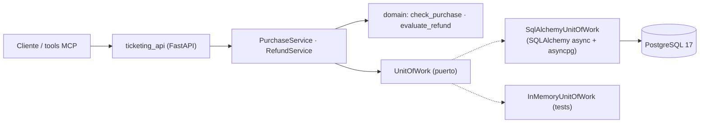

# Fase 1 · SQL avanzado y `ticketing_api`

**Objetivo:** el sistema transaccional de Headache (catálogo, disponibilidad, pedidos y reembolsos)
sobre PostgreSQL, correcto bajo concurrencia y rápido a escala. Es la API que en la fase 6 envuelven
las tools y los servidores MCP: si aquí hay sobreventa o reembolsos dobles, ningún agente lo arregla.

Commit: `ab8e44c feat: fase 1 - esquema SQL, Alembic, ticketing_api y benchmarks de índices`.

## 1. Arquitectura



- **Unit of Work** (`ports/repositories.py` → `adapters/postgres/database.py`): una transacción por
  caso de uso; los repositorios comparten sesión y el caso de uso decide cuándo hacer `commit`.
- `expire_on_commit=False`: en async no hay *lazy loading* implícito tras el commit.
- Pool de conexiones con `pool_pre_ping` y `application_name` (aparece en `pg_stat_activity`).
- Mapeo explícito fila → entidad de dominio (`_to_order`, `_to_session`...): el ORM no sale del adaptador.

## 2. Esquema (migración 0001)

| Tabla | Restricciones destacadas |
|---|---|
| `venues` | `capacity > 0` |
| `events` | FK a `venues`; `category` con `CHECK ... IN (...)`; precio y ventana de reembolso ≥ 0 |
| `sessions` | `CHECK (available BETWEEN 0 AND capacity)`: **la base de datos impide la sobreventa** |
| `customers` | Email único sin distinguir mayúsculas (índice de expresión en 0002) |
| `orders` | `quantity BETWEEN 1 AND 10`; índice único **parcial** `idempotency_key WHERE NOT NULL` |
| `refunds` | Índice único **parcial** `order_id WHERE status IN ('requested','approved')`: un solo reembolso abierto por pedido |

- Importes `NUMERIC(12,2)` + moneda ISO; fechas `timestamptz`.
- Enumerados como `CHECK` sobre `text` en lugar de `ENUM` nativo: añadir un valor no exige
  `ALTER TYPE` (que no admite transacción en versiones antiguas y bloquea).
- Restricciones con nombre (`ck_`, `fk_`, `uq_`, `ix_`): mensajes de error legibles y `alembic check` estable.
- La 0001 crea **solo** claves primarias y restricciones: permite medir el antes y el después de los índices.

## 3. Índices (migración 0002) y benchmark

Se crean con `CREATE INDEX CONCURRENTLY` dentro de `autocommit_block()`: no bloquean escrituras en
tablas grandes (a cambio no pueden ir en una transacción y, si fallan, dejan un índice `INVALID`
que hay que borrar).

| Índice | Tipo | Para qué |
|---|---|---|
| `ix_orders_customer_id_created_at` | Compuesto | Historial del cliente (igualdad + orden) |
| `ix_orders_session_id` | FK | PostgreSQL **no** indexa las FK: sin él los `JOIN` por sesión son *seq scans* |
| `ix_sessions_event_id_starts_at` | Compuesto | Sesiones de un evento ordenadas |
| `ix_sessions_starts_at_with_availability` | Parcial (`available > 0`) | Catálogo: solo lo que se puede comprar |
| `ix_events_city_category` | Compuesto | Filtro por ciudad y categoría |
| `uq_customers_lower_email` | Expresión, único | Búsqueda por `lower(email)` + unicidad real |
| `ix_refunds_requested_at_pending` | Parcial (`status = 'requested'`) | Cola de pendientes: diminuta frente al histórico |

`scripts/sql_benchmark.py` ejecuta las 9 consultas de `infra/sql/queries/` con
`EXPLAIN (ANALYZE, BUFFERS, FORMAT JSON)`, guarda el mejor de N y compara etiquetas.
Resultados con la escala `large` (300 k clientes, 3 M de pedidos), medidos en local:

| Consulta | Antes (ms) | Después (ms) | Buffers | Plan después |
|---|---|---|---|---|
| 01 Pedidos de un cliente | 71,4 | 0,11 | 40 084 → 74 | Index Scan compuesto |
| 02 Disponibilidad de un evento | 1,97 | 0,02 | 264 → 4 | Index Scan |
| 03 Cliente por email | 27,9 | 0,01 | 3 364 → 4 | Index Scan de expresión |
| 04 Ocupación por sesión (CTE + `LEFT JOIN`) | 151,6 | 3,2 | 41 162 → 3 129 | Bitmap sobre la FK |
| 05 Top 3 por ciudad (CTEs + `RANK()`) | 642,8 | 638,9 | igual | Seq Scan (analítica) |
| 06 Gasto acumulado (ventana) | 73,7 | 0,05 | 40 004 → 13 | Bitmap compuesto |
| 07 Próximas sesiones con plazas | 4,88 | 0,02 | 264 → 21 | Índice parcial |
| 08 Reembolsos pendientes | 9,61 | 0,01 | 2 584 → 1 | Índice parcial |
| 09 Eventos por ciudad y categoría | 0,08 | 0,04 | 22 → 4 | Bitmap |

La 05 no mejora a propósito: recorre todos los pedidos pagados y ningún B-tree lo evita. En
producción iría a una réplica de lectura, una vista materializada o un data warehouse.

```powershell
uv run alembic -c packages/headache_core/alembic.ini upgrade 0001   # tablas sin índices
uv run python scripts/load_seed.py --truncate                       # COPY por lotes + ANALYZE
uv run python scripts/sql_benchmark.py --label before
uv run alembic -c packages/headache_core/alembic.ini upgrade head
uv run python scripts/sql_benchmark.py --label after --compare before
```

`load_seed.py` usa `COPY` (`copy_records_to_table`, lotes de 50 000) y termina con `ANALYZE`: sin
estadísticas frescas el planificador estima a ciegas tras una carga masiva.

## 4. Concurrencia e idempotencia

| Problema | Solución | Dónde |
|---|---|---|
| Sobreventa | `UPDATE sessions SET available = available - :q WHERE id = :id AND available >= :q RETURNING id`: comprobar y descontar en una sola sentencia atómica; el `CHECK` es la red de seguridad | `try_reserve` |
| Reembolso doble | Bloqueo pesimista `SELECT ... FOR UPDATE` del pedido: dos solicitudes se serializan; el índice único parcial lo garantiza aunque falle el código | `RefundService` |
| Reintentos del cliente | Cabecera `Idempotency-Key`: devuelve el pedido original; la misma clave con otra petición ⇒ `409` | `PurchaseService` + índice único parcial |
| Carrera en la clave | `IntegrityError` se traduce a `ConflictError` (`409`) | `_flush_or_conflict` |

Tests de integración (`packages/headache_core/tests/integration/test_postgres_concurrency.py`,
`uv run pytest -m integration`), con un catálogo aislado (`it_*`) que se borra al terminar:

- 20 compras simultáneas sobre pocas plazas: se venden exactamente las plazas y se rechaza el resto.
- **Antipatrón demostrado**: leer–calcular–escribir pierde actualizaciones (todos leen 5, todos escriben 4).
- `SELECT FOR UPDATE` serializa a los compradores.
- Reembolsos concurrentes del mismo pedido: solo uno se aprueba.
- Compra idempotente: una sola fila; clave duplicada con otro cuerpo: conflicto.

## 5. `ticketing_api`

`services/ticketing_api` (FastAPI, `create_app(uow_factory, clock)` inyectables para tests).

| Método y ruta | Uso |
|---|---|
| `GET /events`, `GET /events/{id}` | Catálogo con filtros |
| `GET /events/{id}/sessions`, `GET /sessions/{id}` | Disponibilidad |
| `POST /orders` | Compra (idempotente con `Idempotency-Key`) |
| `GET /orders/{id}`, `GET /customers/{id}/orders` | Pedidos |
| `POST /orders/{id}/refunds` | Reembolso: **decide la política del dominio** |

Errores de dominio → HTTP en un único sitio: `NotFoundError` → 404,
`PurchaseNotAllowedError`/`ConflictError` → 409. Los tests de la API usan el UoW en memoria.

## 6. CI

Job `integration` con servicios `pgvector/pgvector:pg17` y RabbitMQ: migraciones arriba → abajo →
arriba (las `downgrade` también se prueban), `alembic check` (el ORM coincide con las migraciones),
tests de integración y smoke test de carga + benchmark.

## 7. Comparativa Azure ↔ AWS

| Necesidad | Azure | AWS |
|---|---|---|
| PostgreSQL gestionado | Azure Database for PostgreSQL Flexible Server (pgvector como extensión) | Aurora PostgreSQL / RDS (pgvector) |
| Escala de lectura | Réplicas de lectura | Réplicas de Aurora (hasta 15, endpoint lector) |
| Analítica (consulta 05) | Fabric / Synapse, vistas materializadas | Redshift, Athena sobre S3, vistas materializadas |
| Pool de conexiones | PgBouncer integrado en Flexible Server | RDS Proxy |
| Autenticación sin contraseña | Entra ID | IAM database authentication |

Frameworks: SQLAlchemy 2 async (Core para las sentencias críticas, ORM para el mapeo) y Alembic;
alternativas habituales son SQLModel, asyncpg directo o Django ORM.

## 8. Decisiones (para defenderlas)

- **Atomicidad en la base de datos**, no en Python: `UPDATE` condicional para el inventario y
  restricciones como última línea de defensa.
- **Pesimista para reembolsos, condicional para compras**: el reembolso lee varias filas y decide
  (bloqueo corto y explícito); la compra es un contador (sentencia única, sin esperas).
- **Idempotencia por clave del cliente**: los agentes y las redes reintentan; repetir una compra
  debe ser inocuo.
- **Índices guiados por `EXPLAIN (ANALYZE, BUFFERS)`**, no por intuición: los *buffers* explican el
  porqué del tiempo.
- **Migraciones reversibles y probadas** en CI, y creación concurrente de índices.

## 9. Checkpoint de entrevista

Las preguntas técnicas y de negocio/stakeholders de esta fase, con sus respuestas modelo, están en
[preguntas de entrevista · fase 1](preguntas-entrevista.md#fase-1).
