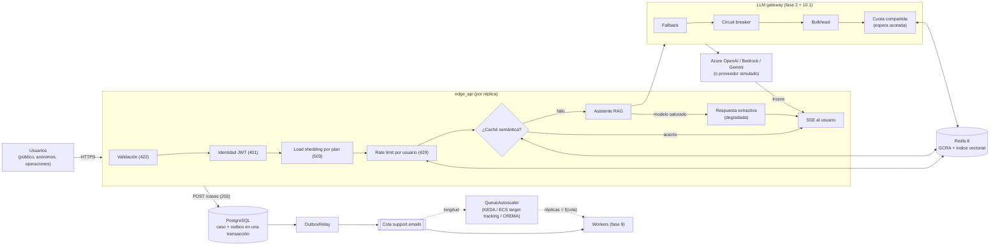

# Fase 10 · Escala y patrones asíncronos bajo carga

**Objetivo:** que un pico de demanda (la salida a la venta de un festival en Genaipocs) no tumbe el
sistema ni agote la cuota de los modelos. Cada petición se decide pronto y barato: se rechaza,
se sirve desde la caché, se degrada o se encola. Nada espera sin límite.

| Subfase | Commit | Qué |
|---|---|---|
| 10.1 | `adad325` | Resiliencia del cliente LLM: circuit breaker, bulkhead, backpressure, presupuesto de tiempo |
| 10.2 | `f9a3df8` | `edge_api`: identidad por JWT, *load shedding* por plan y rate limiting GCRA en Redis |
| 10.3 | `6707f46` | Caché semántica con guarda de facetas, Redis 8 vectorial y calibración en la CI |
| 10.4 | `070db89` | Streaming SSE en la capa de modelos y en el edge |
| 10.5 | `0a012ca` | *Transactional outbox*, idempotencia y `POST /cases` con 202 + SSE |
| 10.6 | `5f5e20e` | Autoescalado por longitud de cola (regla tipo KEDA, plan de capacidad, Terraform) |
| 10.7 | — | Pruebas de carga con Locust, informe de límites, bulkhead por ruta, degradación y este documento |

## 1. Arquitectura



| Pieza | Dónde vive |
|---|---|
| Breaker, bulkhead, presupuesto de tiempo (`time_budget`, `with_deadline`) | `genaipocs_core/application/llm/resilience.py` |
| Cuota con espera acotada y cuota compartida entre réplicas | `application/llm/gateway.py`, `adapters/llm_factory.py` |
| Rate limiting (puerto, GCRA en memoria y en Redis con Lua) | `ports/rate_limit.py`, `adapters/memory.py`, `adapters/redis_rate_limit.py` |
| Admisión: reparto de capacidad por plan, bulkhead por ruta | `domain/admission.py`, `application/admission.py` |
| Caché semántica: facetas y espacio (dominio), servicio, Redis | `domain/semantic_cache.py`, `application/semantic_cache.py`, `adapters/redis_semantic_cache.py` |
| Streaming del modelo y respuesta con citas verificadas | `application/llm/streaming.py`, `application/answer_stream.py` |
| Outbox, relay e idempotencia de altas | `application/outbox.py`, `application/case_intake.py`, `adapters/postgres/outbox.py`, migración 0007 |
| Autoescalado (regla, plan de capacidad, controlador, métricas, actuador) | `domain/autoscaling.py`, `application/autoscaler.py`, `adapters/queue_metrics.py`, `adapters/compose_scaler.py` |
| Edge (rutas, identidad, SSE, caché, casos, degradación) | `services/edge_api/` |
| Proveedor simulado para carga | `adapters/simulated_llm.py` (`LLM_PROVIDER=simulated`) |
| Carga e informe | `loadtests/locustfile.py`, `loadtests/run_edge.ps1`, `scripts/load_report.py` |
| Nube (desactivado por defecto) | `infra/terraform/{azure,aws,gcp}/queue_workers.tf`; en GCP, además, `memorystore.tf`, `edge_armor.tf` y `load_test.tf` |
| GCP: backlog de Pub/Sub, latido del plazo, cliente de Valkey/Memorystore, registro de cachés de Gemini | `adapters/queue_metrics.py`, `adapters/pubsub.py`, `adapters/redis_client.py`, `adapters/redis_gemini_cache.py` |
| Imagen del generador de carga | `loadtests/Dockerfile` |

## 2. Qué se construye

### 10.1 · Resiliencia del cliente LLM

- Orden del gateway: `Fallback → CircuitBreaker → Bulkhead → Observed → SharedQuota → RateLimited → adaptador`.
- **Circuit breaker** (cerrado, abierto, semiabierto). Un 429 con `Retry-After` lo abre a la primera, porque el proveedor ya ha dicho cuándo volver.
- **Bulkhead**: N llamadas a la vez por despliegue (`LLM_GATEWAY__MAX_CONCURRENCY`).
- **Backpressure**: la cuota TPM/RPM se *reserva* con espera máxima (`MAX_QUEUE_SECONDS`) y se devuelve si la llamada no ocurre. Si la espera no cabe, `LLMOverloadedError` con `retry_after`.
- **Presupuesto de tiempo por petición** (`time_budget`): acota reintentos, esperas y la llamada. Si se agota, `LLMDeadlineExceededError` (HTTP 504).

### 10.2 · Admisión y rate limiting distribuido

```powershell
docker compose --profile scale up -d                     # Redis 8 en :6380 (y Valkey en :6381, 10.G2)
$env:RATE_LIMIT__BACKEND = "redis"
uv run uvicorn edge_api.app:create_app --factory --port 8200
uv run python -m edge_api.tokens --user ops-ana --plan internal
```

- Se decide de lo más barato a lo más caro: 422 → 401 → 503 por saturación (en memoria) → 429 por usuario (Redis) → modelo.
- El plan sale del token firmado. Un token inválido da 401, nunca se trata como anónimo.
- *Load shedding* por plan: internos 100 % de la capacidad, públicos 80 %, anónimos 60 %.
- **GCRA** en un script Lua atómico con el reloj de Redis: la misma cuota para todas las réplicas.
- Si Redis cae, *fail-open* con un límite local por réplica y un enfriamiento de 5 s, sin reintentos que bloqueen.

### 10.3 · Caché semántica con guarda de facetas

```powershell
uv run python -m rag_evals.semantic_cache --check        # calibración del umbral (CI, coste 0)
```

- La similitud solo **propone**. El dominio exige las mismas facetas: ciudad (con alias), categoría, operación, IDs y números. Sin esa guarda, "¿abren antes en Barcelona?" respondería a la misma pregunta sobre Madrid.
- Espacio por ACL del plan, idioma, versión del índice y modo. Lo personal (`ord_`, "mi pedido") nunca se busca ni se guarda.
- *Single-flight* por réplica: N preguntas idénticas en curso se calculan una sola vez (`coalesced`).

### 10.4 · Streaming SSE

- `StreamingLLMPort.stream()` en Azure (`include_usage`), Bedrock `ConverseStream` y el fake. Todas las capas del gateway lo respetan.
- El fallback solo salta **antes del primer trozo**: después no se empalman respuestas.
- `POST /ask/stream` hace *priming*: lo que falla antes del primer evento es un código HTTP; lo que falla después, `event: error`. Hay latidos `: ping`.
- Las citas `[n]` se verifican al final; una respuesta sin verificar no se cachea.

### 10.5 · Outbox, idempotencia y 202

- El cambio de estado del caso y su evento se guardan en la **misma transacción**. `OutboxRelay` publica con `FOR UPDATE SKIP LOCKED`, reserva por tiempo y backoff. Esto cierra el límite de la 9.6.
- `POST /cases` con `Idempotency-Key` devuelve 202. Un doble clic devuelve el mismo caso (`Idempotent-Replayed`); otro cuerpo con la misma clave, 409.
- El cliente sigue el estado por SSE en `GET /cases/{id}/events`.

### 10.6 · Autoescalado por longitud de cola

```powershell
uv run python scripts/capacity_plan.py
uv run python scripts/queue_autoscaler.py --apply      # con el perfil scale y RabbitMQ
```

- Regla tipo KEDA `queueLength` en el dominio, con:
  - activación desde 0;
  - subida limitada por paso;
  - ventana de estabilización;
  - enfriamiento antes de bajar a 0.
- `CapacityPlan` usa la ley de Little y el **techo de la cuota**: por encima de él, más réplicas solo producen 429.
- Terraform desactivado:
  - Azure: Container Apps con regla KEDA `azure-servicebus` e identidad.
  - AWS: ECS Fargate con *target tracking* sobre mensajes por tarea.

### 10.7 · Pruebas de carga e informe de límites

```powershell
docker compose up -d postgres ; docker compose --profile scale up -d redis-scale
powershell -NoProfile -ExecutionPolicy Bypass -File loadtests/run_edge.ps1 -Profile protegido   # o sin_cache / ingenuo
$env:LOAD_PEAK = 200
uv run --group load locust -f loadtests/locustfile.py --host http://127.0.0.1:8200 --headless --csv evals/reports/load/protegido
uv run python scripts/load_report.py evals/reports/load/ingenuo evals/reports/load/sin_cache evals/reports/load/protegido --out evals/reports/load/README.md
```

- **Proveedor simulado** (`SimulatedLLM`), con coste 0 y comportamiento realista:
  - 450 ms hasta el primer token y 80 tokens/s;
  - cuota de 200 K TPM y 1.200 RPM compartida en Redis, con 429 y `retry_after` como el real.
  - El gateway del edge se limita a 150 K TPM, por debajo del proveedor.
- **Forma `FestivalOnSale`:**
  - 30 s de calentamiento al 15 %;
  - subida a 200 usuarios;
  - 90 s de pico;
  - bajada.
- **Mezcla de tráfico:**
  - visitantes con SSE (miden el TTFT);
  - anónimos;
  - personal interno;
  - altas de casos con un 20 % de doble clic;
  - dos abusadores a 20 peticiones/s.
- **Tres perfiles del mismo edge:**
  - `ingenuo`: sin caché, sin límites y esperas de cuota sin tope;
  - `sin_cache`: toda la protección menos la caché;
  - `protegido`: la configuración de la fase.
- La carga destapó dos límites y se corrigieron en esta subfase (sección 3.2):
  - **Bulkhead por ruta**: `/cases` tiene su propio compartimento (`EDGE__CASES_CAPACITY`, `AdmissionController.bulkhead()`).
  - **Degradación**: con el modelo saturado se responde con citas literales (`degraded=true`, no se cachea). En el edge, la espera máxima de cuota baja a 2 s.

## 3. Resultados medidos

Todo en local: el edge (un proceso) y Locust en la misma máquina, con el proveedor simulado y
embeddings `hashing`. Locust avisó de CPU alta, así que las colas de p99 son en parte del
generador de carga. Las cifras sirven para **comparar perfiles**, no como capacidad absoluta.
Informe completo: [evals/reports/load/README.md](../evals/reports/load/README.md).

### 3.1 · Pico de 200 usuarios: tres perfiles

| Métrica | Ingenuo | Sin caché | Protegido |
|---|---:|---:|---:|
| Peticiones servidas en 150 s | 1.018 | 4.717 | 11.401 |
| Rendimiento | 6,8 req/s | 31,3 req/s | 75,6 req/s |
| Respuestas por SSE entregadas a visitantes | 243 | 1.469 | 2.920 |
| Visitantes sin respuesta (`/ask/stream`) | 17 % (504 a los 60 s) | 23 % (503 inmediato) | 0,03 % |
| TTFT p50 / p95 (respuesta nueva) | 1,4 s / 57 s | 2,5 s / 4,4 s | 0,77 s / 1,4 s |
| TTFT p50 / p95 (caché) | — | — | 8 ms / 42 ms |
| Personal interno: fallos / p95 | 33 % / 60 s | 0 % / 4,0 s | 0 % / 0,77 s |
| Altas de casos: fallos / p95 | 0 % / 0,54 s | 0 % / 0,82 s | 0 % / 0,84 s |
| Abusador frenado con 429 | no (lo frena la lentitud) | 73 % | 97 % |
| Llamadas al modelo | 505 | 532 | 68 |
| Coste estimado del pico (gpt-4.1-mini) | ~0,19 $ | ~0,20 $ | ~0,03 $ |
| Peticiones colgadas al terminar | 90 | 8 | 0 |

- **Ingenuo**: el modelo marca el ritmo. Hay 505 llamadas en 150 s: la ráfaga inicial del cubo de
  cuota más ~2,5/s sostenidas. Lo demás se acumula en
  una cola sin límite:
  - la latencia crece hasta el timeout de 60 s;
  - el personal interno sufre igual que un anónimo;
  - el abusador no se frena por política, solo porque todo va lento.
- **Sin caché**: la protección convierte la sobrecarga en rechazos **inmediatos** (503 `shed`
  con `Retry-After`) en lugar de esperas de un minuto. Con el modelo saturado:
  - 1.366 respuestas salieron degradadas (citas literales) en vez de error;
  - el personal interno no pierde ninguna petición.
- **Protegido**: la caché sirve el 97,7 % (3.521 aciertos, 14 fusionadas y 68 cálculos). El
  modelo trabaja por **preguntas distintas**, no por usuarios: cabe en la cuota y el p95 de
  TTFT queda por debajo de 1,5 s.
- El coste estimado usa el uso que devuelve el simulador (~585 tokens de entrada, medidos con las
  40 preguntas del escenario, y 90 de salida) a precio de gpt-4.1-mini. Por cada 1.000 respuestas
  entregadas sale ~0,79 $ en el ingenuo y ~0,009 $ en el protegido. En el ingenuo, la mitad del gasto (505 llamadas para 243 respuestas)
  se pierde: el modelo responde a usuarios que ya se han ido por timeout.

### 3.2 · Dónde se rompe y cómo se arregló

La primera ejecución de `sin_cache` (antes de los arreglos) destapó dos límites que los tests unitarios no veían:

| Límite | Síntoma medido | Causa | Solución | Después |
|---|---|---|---|---|
| Capacidad compartida entre rutas | 72 % de las altas de casos con 503 | Las preguntas lentas al modelo ocupaban los 64 huecos de la réplica | Bulkhead por ruta: `/cases` con 32 huecos propios y el mismo rate limit por usuario | 0 % de fallos en `/cases` |
| Espera de cuota larga para un chat | TTFT p50 9,8 s; 84 % de visitantes sin respuesta; personal interno con 30 % de fallos y p50 11 s | 10 s de espera máxima por cuota, pensados para *workers*: los huecos se llenaban de peticiones esperando | Espera de 2 s en el edge y **degradación** a respuesta extractiva si el modelo no llega | TTFT p95 4,4 s; 23 % sin respuesta; personal interno sin fallos |

Límites que quedan (y su siguiente paso):

| Límite | Por qué | Solución propuesta |
|---|---|---|
| El techo del modelo es la cuota: ~2,5 respuestas nuevas por segundo sostenidas | 150 K TPM / ~985 tokens **reservados** por llamada | Más cuota (otro despliegue o región con el fallback de la fase 2) o menos tokens por llamada (menos fragmentos) |
| Se reserva cuota de más | El gateway reserva entrada + `max_tokens` (400) y la respuesta usa ~90: ~985 reservados frente a ~675 usados (31 % de cuota desaprovechada) | `max_tokens` ajustado a la respuesta (150 bastaría) o devolver la diferencia al terminar, con el uso real |
| La degradación espera 2 s antes de rendirse | Hasta agotar la espera no se sabe si llega la cuota | Degradar al instante si `retry_after` supera el presupuesto, o leer el breaker abierto antes de esperar |
| Un proceso de edge satura la CPU con ~75 req/s locales | Python + SSE + Locust en la misma máquina | Varias réplicas tras el balanceador (el estado ya está en Redis) y la carga desde Azure Load Testing |
| *Single-flight* solo dentro de una réplica | Las peticiones en curso viven en memoria del proceso | Bloqueo corto en Redis por clave de caché si las réplicas son muchas |

### 3.3 · Resto de la fase (local, coste 0)

| Prueba | Resultado |
|---|---|
| Calibración de la caché (`hashing`, 36 casos) | Umbral 0,55: 12/17 paráfrasis reutilizadas y 0 falsos aciertos con guarda; sin guarda, 11 falsos aciertos |
| Demo de autoescalado (2 ráfagas, 20 mensajes por réplica) | 0 → 4 → 8 réplicas; bajada 8 → 4 → 1 → 0 tras la ventana y el enfriamiento ([informe](../evals/reports/autoscaling.md)) |
| Plan de capacidad (150 K TPM, 4.000 tokens por caso) | Techo de 38 casos/min: más de 2 réplicas solo producen 429 |
| Proveedor simulado con cuota de 3 RPM y 10 peticiones a la vez por el gateway completo | 3 respuestas; el breaker deja como mucho 2 429 del proveedor |

## 4. Comparativa Azure ↔ AWS ↔ GCP ↔ framework

| Pieza | A. Gestionado (Azure / AWS / GCP) | B. Propio (este repo) | C. Framework / librería |
|---|---|---|---|
| Rate limiting y cuotas | APIM `rate-limit-by-key`, `llm-token-limit` / API Gateway *usage plans*, WAF *rate-based rules* / Cloud Armor `throttle` y `rate_based_ban` (10.G4), token policies del Agent Gateway (*preview*) | `RedisRateLimiter` (GCRA en Lua, Redis o Valkey) + `AdmissionController` | `slowapi`, `limits`; LiteLLM proxy (TPM/RPM por clave) |
| Caché semántica | APIM `azure-openai-semantic-cache-lookup/store` + Managed Redis / ElastiCache (Valkey vectorial) / Memorystore for Valkey (10.G2) | `SemanticCache` + guarda de facetas | LangChain `RedisSemanticCache`, GPTCache |
| Caché del prompt entre réplicas | Implícita del proveedor (Azure OpenAI, Bedrock `cachePoint`) / caché explícita de Gemini compartida en Valkey (10.G3) | `ExplicitCache` + `RedisCacheRegistry` | — |
| Resiliencia del cliente | APIM *backend circuit breaker* / SDK con reintentos (`botocore` *adaptive*) / el gateway propio (el SDK de Gemini no reintenta) | `CircuitBreakerLLM`, bulkhead, `time_budget` | `tenacity`, `aiobreaker`, LiteLLM *router* (cooldowns) |
| Streaming | Container Apps / ALB / Cloud Run tras el ALB con SSE | `POST /ask/stream` (SSE con *priming* y latidos) | `sse-starlette` |
| Outbox | Cosmos DB *change feed* / DynamoDB Streams, EventBridge Pipes / Datastream o Eventarc | `outbox_events` + `OutboxRelay` | Debezium (CDC), MassTransit |
| Métrica de cola | Service Bus (al momento) / SQS `ApproximateNumberOf*` (al momento) / Cloud Monitoring con PromQL (1-3 min de retraso, 10.G1) | `QueueMetricsPort` (`RabbitMQManagementMetrics`, `SqsQueueMetrics`, `PubSubBacklogMetrics`) | KEDA (escaladores `azure-servicebus`, `aws-sqs-queue`, `prometheus`) |
| Autoescalado por cola | KEDA en ACA/AKS (`azure-servicebus`) / ECS *target tracking* sobre SQS, KEDA en EKS / worker pool de Cloud Run + CREMA (10.G4) | `QueueAutoscaler` + `DockerComposeScaler` | KEDA `ScaledObject` |
| Plazo del mensaje en proceso | `renew_message_lock` / `ChangeMessageVisibility` / `modifyAckDeadline` (latido, 10.G1) | `PubSubMessageBus` con latido (`PUBSUB__MAX_LEASE_S`) | *Lease management* de las librerías de alto nivel |
| Carga | Azure Load Testing (JMeter, Locust) / *Distributed Load Testing on AWS* / sin servicio gestionado: Locust en un Cloud Run job (10.G5) | `loadtests/locustfile.py` + proveedor simulado + `loadtests/Dockerfile` | Locust, k6 |

## 5. Decisiones y límites (para defenderlos)

- **Se rechaza pronto y barato.** El 503 por saturación se decide en memoria, antes de tocar Redis o el modelo. Un rechazo con `Retry-After` en 5 ms es mejor experiencia que un timeout a los 60 s, y el cliente sabe cuándo volver.
- **Caché con guarda del dominio.** El riesgo de una caché semántica no es el coste, sino responder lo de Madrid a quien pregunta por Barcelona. Por eso la similitud propone y el dominio decide, con un gate en la CI (0 falsos aciertos).
- **Degradar antes que fallar.** Una respuesta con citas literales es peor que una redactada, pero mejor que un 503 en mitad de una venta.
  - No se cachea, para que el plan B no se quede cuando el modelo vuelve.
  - Solo se degrada antes del primer trozo: no se cambia de modo a mitad de respuesta.
- **Un compartimento por clase de ruta.** Lo barato y crítico para el negocio (dar de alta un caso) no compite por huecos con lo caro (preguntar al modelo).
- **Proveedor simulado para la carga.** Una prueba de carga contra el modelo real cuesta dinero y choca con la cuota antes de medir el resto. El simulado reproduce lo que importa (latencia, cuota compartida, 429), y la validación real se hace aparte y pequeña.
- **Locust frente a k6.** Python como el resto del repo, escenarios con lógica (Zipf, doble clic, SSE) y compatible con Azure Load Testing. k6 escala mejor por generador, pero añade otro lenguaje.
- **Límites conocidos:** las cifras son de una sola máquina; el *single-flight* es por réplica; la degradación espera 2 s; no se ha medido con varias réplicas del edge ni con el modelo real.
- **GCP: la misma consulta en todas partes** (10.G1, 10.G4). El backlog de Pub/Sub solo existe en Cloud Monitoring. Una sola PromQL (`pubsub_backlog_promql()`) la usan el adaptador local, CREMA y, en la 11.G, las alertas; un test comprueba que Terraform no se desvía.
- **GCP: un hueco en la métrica no es "cola vacía"** (10.G1). Con 1-3 min de retraso y huecos reconocidos, leer "0" bajaría los workers a cero en mitad de un pico. Ni el adaptador ni CREMA (`ignoreNullValues = false`) lo hacen.
- **GCP: código portable a Valkey antes que dos adaptadores** (10.G2). El mismo `RedisSemanticCache` sirve para Redis 8 y Valkey limitándose a lo que admiten los dos (TAG + VECTOR, orden en el cliente, RESP2), y la CI lo prueba contra los dos motores.
- **GCP: worker pools + CREMA frente a GKE + KEDA** (10.G4). Sin clúster que mantener y con el pool a cero, pero CREMA tiene coste fijo (una instancia siempre encendida). GKE solo compensaría con muchos workers o si ya hubiera un clúster.
- **GCP: dos capas de rate limiting** (10.G4). Cloud Armor (grueso, por IP o token, antes de pagar Cloud Run) y el edge (fino, por plan, con `Retry-After`). Cloud Armor no ve el plan: va dentro del JWT.

## 6. Pendiente con coste

Ver [pendientes-cloud.md](pendientes-cloud.md) (sección de la fase 10):

- calibración de la caché con embeddings reales;
- Redis gestionado;
- APIM / API Gateway frente al edge;
- streaming real;
- autoescalado en Container Apps y ECS;
- carga con Azure Load Testing y una prueba pequeña contra Azure OpenAI para ver los 429 reales;
- GCP ([sección propia](pendientes-cloud.md#fase-10-gcp)): backlog real de Pub/Sub, latido,
  Memorystore, umbral con Gemini y Titan, registro compartido, CREMA, Cloud Armor y carga desde
  un Cloud Run job.

## 7. GCP (pasada 10.G)

**Objetivo:** que el pico se absorba igual sobre GCP. El estado compartido (GCRA y caché
semántica) va en **Memorystore for Valkey**. Los workers escalan según el **backlog de Pub/Sub**
(worker pools de Cloud Run más CREMA). El perímetro lo protege **Cloud Armor**, y la carga se
lanza desde un **Cloud Run job**. Coste 0: emulador, Valkey en Docker y dobles; lo real, en
[pendientes](pendientes-cloud.md#fase-10-gcp).

| Subfase | Commit | Qué |
|---|---|---|
| 10.G1 | `5f25ec6` | Backlog de Pub/Sub con PromQL para el autoescalador y latido del plazo de ack (heredado de la 9.G3) |
| 10.G2 | `a0af72e` | Valkey: caché semántica portable, IAM auth y `memorystore.tf` |
| 10.G3 | `e692050` | Caché semántica con embeddings de Gemini y registro compartido de cachés explícitas |
| 10.G4 | `4e38d50` | `queue_workers.tf` (worker pool + CREMA) y `edge_armor.tf` (Cloud Armor) |
| 10.G5 | | Carga desde un Cloud Run job, cuotas de tokens y doc a tres nubes |

### Verificación previa (21-11-2026)

| Comprobado | Resultado | Consecuencia |
|---|---|---|
| [Búsqueda vectorial de Memorystore for Valkey](https://docs.cloud.google.com/memorystore/docs/valkey/about-vector-search) | GA (22-04-2025). Campos `VECTOR`, `TAG` y `NUMERIC` sobre HASH. Ni `TEXT`, ni `SORTBY`, ni `AS` en el KNN: la puntuación vuelve como `__<campo>_score` | `RedisSemanticCache` no funciona tal cual; se hace portable y se prueba contra Valkey en local (10.G2) |
| [Comandos de Memorystore](https://docs.cloud.google.com/memorystore/docs/valkey/supported-commands) | `EVAL`, `EVALSHA` y `TIME` admitidos; en modo clúster, multiclave solo en un mismo slot | El GCRA en Lua sirve tal cual (ya usa *hash tags*) |
| [Backlog de Pub/Sub](https://docs.cloud.google.com/pubsub/docs/monitoring) | La API de Pub/Sub no da el número de mensajes. Cloud Monitoring sí (`num_unacked_messages_by_region`, recomendada frente a la global): muestras cada 60 s, visibles hasta 120 s después y con huecos | Adaptador sobre Cloud Monitoring. Un hueco no se lee como "cola vacía" |
| [Escalador `gcp-pubsub` de KEDA](https://keda.sh/docs/latest/scalers/gcp-pub-sub/) | Obsoleto en KEDA 2.21 (usa MQL, sin soporte desde el 22-07-2025); se recomienda el escalador `prometheus` con PromQL | La **misma consulta PromQL** sirve al adaptador local, a CREMA (10.G4) y a las alertas (11.G) |
| [Worker pools de Cloud Run](https://docs.cloud.google.com/run/docs/deploy-worker-pools) | GA (14-04-2026), sin autoescalado propio. [CREMA](https://docs.cloud.google.com/run/docs/configuring/workerpools/crema-autoscaling) es KEDA desplegado como servicio de Cloud Run, configurado desde Parameter Manager | Worker pool `MANUAL` y CREMA (10.G4), en lugar de GKE + KEDA |
| [Cloud Armor](https://docs.cloud.google.com/armor/docs/rate-limiting-overview) | `throttle` y `rate_based_ban` por IP, cabecera, etc. Solo funciona detrás de un balanceador (ALB externo + *serverless NEG*) | `edge_armor.tf` desactivado; el ALB tiene coste fijo |
| [Cuotas de tokens del Agent Gateway](https://docs.cloud.google.com/gemini-enterprise-agent-platform/govern/policies/token-management-overview) | *Early preview* con alta previa y sin Terraform | Solo documental, con Apigee `LLMTokenQuota` como contraste (10.G5) |
| Pruebas de carga | GCP no tiene un servicio gestionado como Azure Load Testing. La guía de Locust en GKE está obsoleta | Cloud Run job con Locust `--processes` (10.G5) |
| `gemini-embedding-001` | Admite `task_type` y 1024 dimensiones | La calibración de la caché embebía con `embed_texts` (`RETRIEVAL_DOCUMENT`) y la caché en ejecución usa `embed_query`: se alinea (10.G3) |

### 10.G1 · Backlog de Pub/Sub y latido del plazo de ack

```powershell
uv run pytest packages/genaipocs_core/tests/test_pubsub_backlog.py packages/genaipocs_core/tests/test_pubsub_adapter.py
docker compose --profile pubsub up -d
uv run pytest -m integration -k pubsub_lease          # ~35 s: dos turnos de 14 s
# En la nube (dry-run, sin mover nada): backlog real de support.emails.worker
uv run python scripts/queue_autoscaler.py --broker pubsub --queue support.emails --interval 30
```

**Backlog para el autoescalador** (`PubSubBacklogMetrics`, en `adapters/queue_metrics.py`):

- Implementa el mismo `QueueMetricsPort` que RabbitMQ y SQS. La cola es el tema y se mide su
  suscripción `<tema>.worker`.
- La consulta vive en un solo sitio, `pubsub_backlog_promql()`:

  ```promql
  sum(pubsub_googleapis_com:subscription_num_unacked_messages_by_region{
    monitored_resource="pubsub_subscription", project_id="…", subscription_id="support.emails.worker"})
  ```

  Se lanza contra la API de Managed Prometheus de Cloud Monitoring
  (`/v1/projects/<p>/location/global/prometheus/api/v1/query`) con el token de ADC o de la cuenta
  suplantada. Esa API no está en las librerías cliente, así que se llama por REST con `httpx`.
- **Sin muestra o con una muestra de más de 5 min**, se lanza `QueueUnavailableError` y el
  controlador no toca las réplicas. Si se quiere otro comportamiento, `value_if_null` hace lo
  mismo que el `valueIfNull` de KEDA. Leer un hueco como "0 mensajes" bajaría los workers a cero
  en mitad de un pico.
- `ready` = sin confirmar. Monitoring no separa lo que espera de lo que un worker tiene en curso.
  El total es lo mismo que cuenta la regla con RabbitMQ y SQS.
- El emulador no publica métricas: `from_settings` falla con un mensaje claro si
  `PUBSUB__EMULATOR_HOST` está definido.
- La diferencia con SQS es el **retraso**. Pub/Sub ve el backlog con 1–3 min de retraso, SQS al
  momento. Por eso, en Pub/Sub, el enfriamiento antes de bajar a 0 tiene que ser mayor que ese
  retraso.

**Latido del plazo de ack** (heredado de la 9.G3), en `PubSubMessageBus`:

- **El problema.** Con *pull* unario nadie renovaba el plazo, así que un turno del LLM más largo
  que `ack_deadline_seconds` se reentregaba a otro worker mientras el primero seguía. Se pagaba
  el modelo dos veces y, con *exactly-once*, el `ack` del primero fallaba.
- **El latido.** Mientras el handler trabaja, `modifyAckDeadline` renueva el plazo a mitad de
  cada periodo. El plazo es el de la suscripción, leído en `subscribe`.
  - El latido para antes del `ack`/`nack`, para que no compitan.
  - Un rechazo permanente (*exactly-once*, `ack_id` caducado) detiene el latido. Uno transitorio
    se reintenta en el siguiente periodo.
  - Contadores: `lease_extensions` y `lease_failures`.
- **El techo.** `PUBSUB__MAX_LEASE_S` (3.600 s por defecto, como `max_lease_duration` de la
  librería de alto nivel; `0` = sin latido). Pasado ese máximo, el mensaje se deja caducar: un
  handler colgado no lo retiene para siempre y otro worker lo reintenta.
- **Medido con el emulador.** Plazo de 10 s, turno de 14 s, *exactly-once* y dos workers en la
  misma suscripción:

  | Caso | Entregas | `ack` rechazados | Renovaciones |
  |---|---:|---:|---:|
  | Con latido | 1 | 0 | ≥ 2 |
  | Sin latido (control) | ≥ 2 (la segunda, al otro worker) | ≥ 1 | 0 |

  El control destapó un detalle del adaptador: un worker no vuelve a pedir mensajes hasta acabar
  su lote (`gather`). La reentrega solo la ve **otra réplica**, que es justo el caso de un worker
  pool.
- SQS y Service Bus siguen sin latido (el plazo largo de la cola lo cubre). Su equivalente
  (`ChangeMessageVisibility`, `renew_message_lock`) queda apuntado para las fases 13 y 14.

### 10.G2 · Valkey: el mismo estado compartido en Memorystore

```powershell
docker compose --profile scale up -d redis-scale valkey-scale     # Redis 8 :6380, Valkey :6381
uv run pytest -m integration -k "redis_rate_limit or redis_semantic"   # cada test, en los dos
uv run pytest packages/genaipocs_core/tests/test_redis_client.py
cd infra/terraform/gcp ; terraform test                                # memorystore.tftest.hcl
```

**Por qué Valkey en local.** Memorystore for Valkey usa el motor Valkey con su módulo de
búsqueda, no Redis. El servicio `valkey-scale` (`valkey/valkey-bundle:9.0.8`, la misma versión
que `VALKEY_9_0` en Memorystore) entra en el perfil `scale` y en la CI. Los tests del rate limiter
y de la caché semántica se repiten contra los dos motores con un fixture parametrizado
(`scale_redis[redis]`, `scale_redis[valkey]`).

**Lo que destapó probarlo contra Valkey** (los tres, invisibles con Redis 8):

| Síntoma con Valkey | Causa | Arreglo, válido en los dos motores |
|---|---|---|
| `PREFIX argument(s) must not contain a hash tag` al crear el índice | La caché usaba `{genaipocs-sc}` como prefijo, heredado del rate limiter | Prefijo sin llaves (`genaipocs-sc`). La caché no lo necesita: cada operación toca una clave y la búsqueda recorre todos los shards. El rate limiter **sí** conserva `{genaipocs-rl}`, porque su Lua usa varias claves |
| `AttributeError: 'list' object has no attribute 'items'` en `FT.SEARCH` | redis-py 8 negocia RESP3; Redis 8 contesta con un mapa y Valkey con un array | El cliente compartido (`scale_redis_client`) fuerza `protocol=2` |
| Índices de test que se quedaban en Valkey | `FT.DROPINDEX ... DD` no existe en Valkey (error silenciado en la limpieza) | `dropindex()` sin `DD`; las claves caducan solas |

**Lo que Memorystore no admite y el código ya no usa** (verificación previa): campos `TEXT` (la
pregunta solo se guardaba para devolverla), `SORTBY` y `AS` en el KNN. El índice declara solo
`scope` (TAG) y `embedding` (VECTOR). Pregunta, facetas y respuesta son campos del hash que
vuelven con `RETURN`. La distancia sale de `__embedding_score` y el adaptador ordena. Un test
de integración nuevo comprueba ese orden en los dos motores.

**Cliente compartido** (`adapters/redis_client.py`, usado por `RedisRateLimiter` y
`RedisSemanticCache`): se mantiene fallar rápido (timeouts cortos y sin reintentos) y se añade lo
que pide Memorystore:

- `SCALE_REDIS__AUTH=gcp_iam`: un `CredentialProvider` de redis-py da el token de acceso de ADC (o
  de la cuenta suplantada) como contraseña de `AUTH`. El token dura 1 h y el pool lo pide, o lo
  renueva, al abrir cada conexión. Es el equivalente de Entra ID en Azure Managed Redis o de IAM
  en ElastiCache. Sin contraseñas que rotar.
- `SCALE_REDIS__TLS=true` + `SCALE_REDIS__TLS_CA_FILE`: la CA del servidor que publica la
  instancia (salida `memorystore_server_ca`).

**Prueba de extremo a extremo del edge sobre Valkey** (`SCALE_REDIS__PORT=6381`,
`RATE_LIMIT__BACKEND=redis`, `SEMANTIC_CACHE__BACKEND=redis`, proveedor simulado):

| Pregunta (personal interno) | `X-Cache` | `RateLimit-Remaining` |
|---|---|---|
| ¿A qué hora abren las puertas en Barcelona? | `MISS` | 119 |
| ¿Cuándo abren las puertas en Barcelona? | `HIT` (paráfrasis) | 118 |
| ¿A qué hora abren las puertas en Madrid? | `MISS` (otra ciudad: guarda de facetas) | 117 |
| ¿A qué hora abren las puertas en Barcelona? | `HIT` | 117 (el cubo ya se rellenaba) |

Índice resultante en Valkey: `idx:genaipocs-sc:1024`, con dos entradas.

**`memorystore.tf`** (`memorystore_enabled = false`; `terraform test` con 3 casos):

- Instancia `CLUSTER_DISABLED`, un shard sin réplicas, `SHARED_CORE_NANO` (1,4 GB, sin SLA) y
  `VALKEY_9_0`. Autenticación `IAM_AUTH`, TLS `SERVER_AUTHENTICATION`, `volatile-lru` y sin
  protección de borrado (efímera).
- Red: VPC y subred propias con una *service connection policy* `gcp-memorystore`, porque
  Memorystore crea su endpoint por PSC y no tiene IP pública. El edge en Cloud Run llegará por
  Direct VPC egress en la fase 15.
- `roles/memorystore.dbConnectionUser` para la cuenta de la aplicación. Salidas `scale_redis_env`
  (variables del edge) y `memorystore_server_ca`. APIs nuevas: `compute`, `memorystore` y
  `networkconnectivity`.
- **Por qué `CLUSTER_DISABLED`:** el código usa un cliente simple, como con `redis:8`. Con
  `CLUSTER` haría falta `RedisCluster` y que cada operación respete los slots. Que la búsqueda
  vectorial funcione en este modo no está documentado: queda en los pendientes.

### 10.G3 · Caché semántica con Gemini y registro compartido de cachés explícitas

```powershell
uv run python -m rag_evals.semantic_cache --check                                   # CI, coste 0
uv run python -m rag_evals.semantic_cache --embeddings gcp --budget-usd 0.01        # ~0,0002 $
uv run python -m rag_evals.semantic_cache --embeddings bedrock --budget-usd 0.01    # ~0,00003 $
uv run pytest -m integration -k redis_gemini                                         # Redis y Valkey
```

**La calibración mide lo que se ejecuta.** El edge busca en la caché con `embed_query`
(`SemanticCache.lookup`), pero la calibración precalculaba los vectores con `embed_texts`. Con
Azure y Titan da igual porque el vector no depende del uso. Con `gemini-embedding-001` sí:
`embed_texts` usa `RETRIEVAL_DOCUMENT` y `embed_query` `RETRIEVAL_QUERY`, así que el umbral
calibrado no habría sido el que se aplica en producción.

- Ahora cada texto se embebe con `embed_query`, una vez y con 8 peticiones a la vez.
- Un test con un doble que falla si se llama a `embed_texts` lo fija.
- Se comparan **consulta con consulta**, igual que la caché. `SEMANTIC_SIMILARITY`, la tarea
  pensada para comparar textos, obligaría a un segundo embedding por pregunta (el de retrieval ya
  es `RETRIEVAL_QUERY`). Se descarta mientras la calibración con `RETRIEVAL_QUERY` no salga peor.

**Tres nubes en la eval.** `--embeddings azure|bedrock|gcp`: Titan no existía en la eval, aunque
el pendiente pedía "repetir con Titan".

- El informe va a `evals/reports/<nube>/` (heredado de la 8.G4): una calibración con Gemini no
  sobrescribe la de Azure.
- Presupuesto con el precio de cada modelo: `gemini-embedding-001` cuesta 0,15 $ por millón de
  tokens, frente a 0,02 $ de los otros dos. El suelo de aciertos es 0,7 en las tres.
- Hasta calibrar con la nube, `CALIBRATED_THRESHOLDS` solo tiene `hashing` y la caché no se
  activa con embeddings reales (por diseño: sin umbral medido, sin caché).

**Registro compartido de cachés explícitas** (heredado de la 2.G3), con
`GEMINI__CACHE=explicit` y `GEMINI__CACHE_REGISTRY=redis`:

- **El problema.** Cada réplica creaba y pagaba su propio `CachedContent` del mismo prefijo. Con
  N réplicas: N escrituras y N almacenamientos por hora del mismo texto.
- **La solución.** `RedisCacheRegistry` (`adapters/redis_gemini_cache.py`) guarda en el
  Redis/Valkey de escala qué caché sirve a cada prefijo, con el mismo TTL que la caché: cuando
  caduca en Gemini, desaparece también del registro.

| Situación | Qué hace `ExplicitCache` |
|---|---|
| Otra réplica ya la registró | La reutiliza (`write_tokens = 0`), sin crear nada |
| Dos réplicas la crean a la vez | `SET NX`: gana la primera; la otra **borra su copia** al momento y usa la ganadora (paga la escritura, no el almacenamiento) |
| La entrada caduca en menos de 30 s | No la usa: crea una nueva |
| El registro no responde | Caché por réplica, como antes |
| La réplica se apaga | **No borra nada**: otras pueden estar usándola; caduca por su TTL |

- Sin candados distribuidos: la peor carrera cuesta una escritura de más, no una espera.
- La caducidad viaja en **reloj de pared**, porque los monotónicos de dos procesos no son
  comparables.
- Probado: 5 tests unitarios con dos réplicas sobre un registro doble, y 3 de integración contra
  Redis 8 y Valkey. En estos, 10 réplicas que registran a la vez acaban todas con la misma caché;
  también se prueba la caducidad con la caché y que una caché ya caducada no se registra.

### 10.G4 · Workers escalados por backlog y perímetro con Cloud Armor

```powershell
cd infra/terraform/gcp ; terraform test        # queue_workers y edge_armor, sin coste
uv run pytest packages/genaipocs_core/tests/test_pubsub_backlog.py -k terraform
```

**`queue_workers.tf`** (`queue_workers_enabled = false`; necesita `queue_worker_image`, de la
fase 15):

```text
Pub/Sub support.emails.worker ──(métrica, 1-3 min)──▶ Cloud Monitoring
                                                           │ PromQL
Parameter Manager (CremaConfig) ──▶ CREMA (Cloud Run) ─────┘
                                       │ Admin API: manual_instance_count
                                       ▼
                         worker pool "triage-worker" (0..4 instancias)
```

- **Worker pool** `MANUAL`, arranca en 0 y con `ignore_changes` sobre el número de instancias:
  quien lo mueve es CREMA, y un `apply` posterior no debe devolverlo a 0. Mismo rol que en Azure
  y AWS (`orchestrator.worker triage relay`), con la identidad de la aplicación, que ya consume
  y publica los temas del orquestador (`pubsub.tf`).
- **CREMA** es KEDA empaquetado como servicio de Cloud Run:
  - lee su `CremaConfig` de una versión de Parameter Manager (el id es el hash del contenido:
    cambiar la política redespliega CREMA con la nueva);
  - usa el escalador **`prometheus`** contra Managed Prometheus con la **misma consulta** que
    `pubsub_backlog_promql()`. Un test de Python compara la de Terraform con la del adaptador;
  - política: `threshold` de 8 mensajes por instancia y de 0 a 4 instancias, como en Azure.
    Sube como mucho 4 instancias por minuto y baja tras una ventana de 300 s (la métrica llega
    tarde). Con `ignoreNullValues = false`, un hueco no se lee como cola vacía.
- **Mínimo privilegio de CREMA**: lee su configuración y la métrica (`monitoring.viewer`),
  publica las métricas del escalador y solo tiene `run.developer` sobre **este** worker pool,
  más `serviceAccountUser` sobre la identidad que usa.
- **Coste:** el pool con 0 instancias no cuesta nada. CREMA sí: una instancia con CPU siempre
  asignada, del orden de 40–50 $/mes si se deja encendido. Efímero, como AI Search.

**`edge_armor.tf`** (`edge_armor_enabled = false`; necesita `edge_image`):

- El edge en Cloud Run con ingress `INTERNAL_LOAD_BALANCER`: solo entra tráfico del balanceador,
  así que la URL `run.app` no se salta Cloud Armor. Es invocable sin IAM porque la identidad es
  el JWT del edge. Con Memorystore activo, sale a su VPC (Direct VPC egress) con
  `SCALE_REDIS__AUTH=gcp_iam`.
- **ALB externo** (`EXTERNAL_MANAGED`) con *serverless NEG*. Con `edge_domain`, HTTPS con
  certificado gestionado; sin él, HTTP en el 80 solo para validar. Salida `edge_url`.
- **Cloud Armor**, la capa gruesa del perímetro, con tres reglas y 429 como el edge:

| Prioridad | Regla | Clave | Por defecto |
|---:|---|---|---|
| 100 | `rate_based_ban` | IP | más de 1.200/min → fuera 5 min (los abusadores de la 10.7 iban a 20/s) |
| 200 | `throttle` sin `Authorization` | IP | 120/min (holgado: detrás de un NAT hay muchos usuarios) |
| 300 | `throttle` con `Authorization` | la cabecera (el token) | 600/min |

- **Por qué dos capas.** Cloud Armor corta inundaciones antes de que lleguen a Cloud Run y a la
  factura, pero no conoce el plan: va dentro del JWT firmado y Cloud Armor no lo valida. El
  límite fino por plan (5, 20 y 120 por minuto) con su `Retry-After` exacto sigue en el edge
  (GCRA en Valkey).
- **Coste:** regla de reenvío ~18 $/mes, Cloud Armor Standard ~5 $ por política y mes + 1 $ por
  regla + 0,75 $ por millón de peticiones. Efímero.
- **Cuotas de tokens del Agent Gateway**: no hay Terraform (*early preview*). Se comparan en la
  10.G5.

### 10.G5 · Carga desde la nube, cuotas de tokens y cierre a tres nubes

```powershell
docker build -f loadtests/Dockerfile -t genaipocs-load:local .     # Locust del lock + edge_api
cd infra/terraform/gcp ; terraform test                             # load_test.tftest.hcl
# En la nube (fase 15): terraform output load_test → gcloud run jobs execute ... --wait
```

**Generador de carga en un Cloud Run job** (`load_test.tf`, `load_test_enabled = false`). GCP no
tiene un servicio gestionado como Azure Load Testing, y su guía de Locust en GKE está obsoleta.

- `loadtests/Dockerfile`: el mismo locustfile, con Locust y `edge_api` en las versiones del
  lock (Locust es un grupo del proyecto raíz: se exporta con `uv export --only-group load`).
  Los tokens de prueba se firman con una clave montada desde Secret Manager, nunca en la imagen.
- **Una tarea con 8 vCPU y `--processes -1`** (un maestro y un worker por CPU dentro del
  contenedor). El modo distribuido de Locust necesita red entre maestro y workers (ZeroMQ), y en
  Cloud Run las instancias no se ven. Para más carga, GKE Autopilot efímero.
- Por defecto va contra el edge tras Cloud Armor, así que prueba también el perímetro. Los CSV de
  cada ejecución se guardan en Cloud Storage (`<ejecución>/<perfil>_*.csv`) y `load_report.py`
  genera el mismo informe que en local. `max_retries = 0`: una prueba fallida no se repite sola.
- **Probado en local** con la imagen contra el edge (`LOAD_PEAK=10`, proveedor simulado): el pico
  completo con un proceso por CPU, CSV y `_ready.json` escritos, y los dos abusadores frenados con
  5.464 respuestas 429 sin fallos en el resto de perfiles.

**Cuotas de tokens: dónde se pone el techo del modelo**

| Opción | Estado (21-11-2026) | Qué limita | Encaje en Genaipocs |
|---|---|---|---|
| `SharedQuota` del gateway propio (10.1) en Redis/Valkey | Nuestro, probado | TPM y RPM por despliegue, con reserva y espera acotada (`MAX_QUEUE_SECONDS`) | El que manda: conoce el coste estimado de cada llamada y degrada antes de esperar |
| Token policies del **Agent Gateway** (`TokenBudgetPolicy`, `TokenAggregationPolicy`) | *Early preview* con alta previa; sin Terraform | Presupuesto de tokens por proyecto, app, agente, modelo o cabecera, por hora o día; alerta o 429; con peticiones concurrentes se puede pasar | Contraste para agentes desplegados en Agent Runtime; no en el camino crítico |
| Apigee `LLMTokenQuota` / `PromptTokenLimit` | Sin GA explícito; Apigee de evaluación (6.G3) | Cuota total exacta por clave / picos de tokens del prompt; 429 | Si la API de modelos se publicara a partners con Apigee |
| APIM `llm-token-limit` (Azure) | GA | TPM por clave | Equivalente directo de la 10.1 en Azure |
| API Gateway *usage plans* (AWS) | GA | Peticiones, no tokens | Necesita el gateway propio para contar tokens |

La cuota de tokens se queda en el gateway de la aplicación: es el único sitio que conoce el plan,
el coste estimado y la alternativa (degradar). Las políticas gestionadas sirven de red de
seguridad a nivel de proyecto, como la *floor setting* de Model Armor en la 8.G.

## 8. Checkpoint de entrevista

Preguntas técnicas y de negocio: [preguntas-entrevista.md](preguntas-entrevista.md#fase-10).
