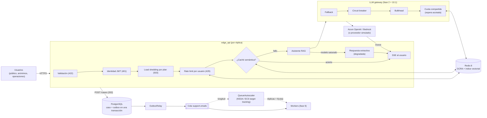

# Fase 10 · Escala y patrones asíncronos bajo carga

**Objetivo:** que un pico de demanda (la salida a la venta de un festival en Headache) no tumbe el
sistema ni agote la cuota de los modelos. Cada petición se decide pronto y barato: se rechaza,
se sirve desde la caché, se degrada o se encola. Nada espera sin límite.

| Subfase | Commit | Qué |
|---|---|---|
| 10.1 | `adad325` | Resiliencia del cliente LLM: circuit breaker, bulkhead, backpressure, presupuesto de tiempo |
| 10.2 | `f9a3df8` | `edge_api`: identidad por JWT, *load shedding* por plan y rate limiting GCRA en Redis |
| 10.3 | `6707f46` | Caché semántica con guarda de facetas, Redis 8 vectorial y calibración en la CI |
| 10.4 | `070db89` | Streaming SSE en la capa de modelos y en el edge |
| 10.5 | `0a012ca` | *Transactional outbox*, idempotencia y `POST /cases` con 202 + SSE |
| 10.6 | `5f5e20e` | Autoescalado por longitud de cola (regla tipo KEDA, plan de capacidad, Terraform) |
| 10.7 | — | Pruebas de carga con Locust, informe de límites, bulkhead por ruta, degradación y este documento |

## 1. Arquitectura



| Pieza | Dónde vive |
|---|---|
| Breaker, bulkhead, presupuesto de tiempo (`time_budget`, `with_deadline`) | `headache_core/application/llm/resilience.py` |
| Cuota con espera acotada y cuota compartida entre réplicas | `application/llm/gateway.py`, `adapters/llm_factory.py` |
| Rate limiting (puerto, GCRA en memoria y en Redis con Lua) | `ports/rate_limit.py`, `adapters/memory.py`, `adapters/redis_rate_limit.py` |
| Admisión: reparto de capacidad por plan, bulkhead por ruta | `domain/admission.py`, `application/admission.py` |
| Caché semántica: facetas y espacio (dominio), servicio, Redis | `domain/semantic_cache.py`, `application/semantic_cache.py`, `adapters/redis_semantic_cache.py` |
| Streaming del modelo y respuesta con citas verificadas | `application/llm/streaming.py`, `application/answer_stream.py` |
| Outbox, relay e idempotencia de altas | `application/outbox.py`, `application/case_intake.py`, `adapters/postgres/outbox.py`, migración 0007 |
| Autoescalado (regla, plan de capacidad, controlador, métricas, actuador) | `domain/autoscaling.py`, `application/autoscaler.py`, `adapters/queue_metrics.py`, `adapters/compose_scaler.py` |
| Edge (rutas, identidad, SSE, caché, casos, degradación) | `services/edge_api/` |
| Proveedor simulado para carga | `adapters/simulated_llm.py` (`LLM_PROVIDER=simulated`) |
| Carga e informe | `loadtests/locustfile.py`, `loadtests/run_edge.ps1`, `scripts/load_report.py` |
| Nube (desactivado por defecto) | `infra/terraform/{azure,aws}/queue_workers.tf` |

## 2. Qué se construye

### 10.1 · Resiliencia del cliente LLM

- Orden del gateway: `Fallback → CircuitBreaker → Bulkhead → Observed → SharedQuota → RateLimited → adaptador`.
- **Circuit breaker** (cerrado, abierto, semiabierto). Un 429 con `Retry-After` lo abre a la primera, porque el proveedor ya ha dicho cuándo volver.
- **Bulkhead**: N llamadas a la vez por despliegue (`LLM_GATEWAY__MAX_CONCURRENCY`).
- **Backpressure**: la cuota TPM/RPM se *reserva* con espera máxima (`MAX_QUEUE_SECONDS`) y se devuelve si la llamada no ocurre. Si la espera no cabe, `LLMOverloadedError` con `retry_after`.
- **Presupuesto de tiempo por petición** (`time_budget`): acota reintentos, esperas y la llamada. Si se agota, `LLMDeadlineExceededError` (HTTP 504).

### 10.2 · Admisión y rate limiting distribuido

```powershell
docker compose --profile scale up -d                     # Redis 8 en 127.0.0.1:6380
$env:RATE_LIMIT__BACKEND = "redis"
uv run uvicorn edge_api.app:create_app --factory --port 8200
uv run python -m edge_api.tokens --user ops-ana --plan internal
```

- Se decide de lo más barato a lo más caro: 422 → 401 → 503 por saturación (en memoria) → 429 por usuario (Redis) → modelo.
- El plan sale del token firmado. Un token inválido da 401, nunca se trata como anónimo.
- *Load shedding* por plan: internos 100 % de la capacidad, públicos 80 %, anónimos 60 %.
- **GCRA** en un script Lua atómico con el reloj de Redis: la misma cuota para todas las réplicas.
- Si Redis cae, *fail-open* con un límite local por réplica y un enfriamiento de 5 s, sin reintentos que bloqueen.

### 10.3 · Caché semántica con guarda de facetas

```powershell
uv run python -m rag_evals.semantic_cache --check        # calibración del umbral (CI, coste 0)
```

- La similitud solo **propone**. El dominio exige las mismas facetas: ciudad (con alias), categoría, operación, IDs y números. Sin esa guarda, "¿abren antes en Barcelona?" respondería a la misma pregunta sobre Madrid.
- Espacio por ACL del plan, idioma, versión del índice y modo. Lo personal (`ord_`, "mi pedido") nunca se busca ni se guarda.
- *Single-flight* por réplica: N preguntas idénticas en curso se calculan una sola vez (`coalesced`).

### 10.4 · Streaming SSE

- `StreamingLLMPort.stream()` en Azure (`include_usage`), Bedrock `ConverseStream` y el fake. Todas las capas del gateway lo respetan.
- El fallback solo salta **antes del primer trozo**: después no se empalman respuestas.
- `POST /ask/stream` hace *priming*: lo que falla antes del primer evento es un código HTTP; lo que falla después, `event: error`. Hay latidos `: ping`.
- Las citas `[n]` se verifican al final; una respuesta sin verificar no se cachea.

### 10.5 · Outbox, idempotencia y 202

- El cambio de estado del caso y su evento se guardan en la **misma transacción**. `OutboxRelay` publica con `FOR UPDATE SKIP LOCKED`, reserva por tiempo y backoff. Esto cierra el límite de la 9.6.
- `POST /cases` con `Idempotency-Key` devuelve 202. Un doble clic devuelve el mismo caso (`Idempotent-Replayed`); otro cuerpo con la misma clave, 409.
- El cliente sigue el estado por SSE en `GET /cases/{id}/events`.

### 10.6 · Autoescalado por longitud de cola

```powershell
uv run python scripts/capacity_plan.py
uv run python scripts/queue_autoscaler.py --apply      # con el perfil scale y RabbitMQ
```

- Regla tipo KEDA `queueLength` en el dominio, con:
  - activación desde 0;
  - subida limitada por paso;
  - ventana de estabilización;
  - enfriamiento antes de bajar a 0.
- `CapacityPlan` usa la ley de Little y el **techo de la cuota**: por encima de él, más réplicas solo producen 429.
- Terraform desactivado:
  - Azure: Container Apps con regla KEDA `azure-servicebus` e identidad.
  - AWS: ECS Fargate con *target tracking* sobre mensajes por tarea.

### 10.7 · Pruebas de carga e informe de límites

```powershell
docker compose up -d postgres ; docker compose --profile scale up -d redis-scale
powershell -NoProfile -ExecutionPolicy Bypass -File loadtests/run_edge.ps1 -Profile protegido   # o sin_cache / ingenuo
$env:LOAD_PEAK = 200
uv run --group load locust -f loadtests/locustfile.py --host http://127.0.0.1:8200 --headless --csv evals/reports/load/protegido
uv run python scripts/load_report.py evals/reports/load/ingenuo evals/reports/load/sin_cache evals/reports/load/protegido --out evals/reports/load/README.md
```

- **Proveedor simulado** (`SimulatedLLM`), con coste 0 y comportamiento realista:
  - 450 ms hasta el primer token y 80 tokens/s;
  - cuota de 200 K TPM y 1.200 RPM compartida en Redis, con 429 y `retry_after` como el real.
  - El gateway del edge se limita a 150 K TPM, por debajo del proveedor.
- **Forma `FestivalOnSale`:**
  - 30 s de calentamiento al 15 %;
  - subida a 200 usuarios;
  - 90 s de pico;
  - bajada.
- **Mezcla de tráfico:**
  - visitantes con SSE (miden el TTFT);
  - anónimos;
  - personal interno;
  - altas de casos con un 20 % de doble clic;
  - dos abusadores a 20 peticiones/s.
- **Tres perfiles del mismo edge:**
  - `ingenuo`: sin caché, sin límites y esperas de cuota sin tope;
  - `sin_cache`: toda la protección menos la caché;
  - `protegido`: la configuración de la fase.
- La carga destapó dos límites y se corrigieron en esta subfase (sección 3.2):
  - **Bulkhead por ruta**: `/cases` tiene su propio compartimento (`EDGE__CASES_CAPACITY`, `AdmissionController.bulkhead()`).
  - **Degradación**: con el modelo saturado se responde con citas literales (`degraded=true`, no se cachea). En el edge, la espera máxima de cuota baja a 2 s.

## 3. Resultados medidos

Todo en local: el edge (un proceso) y Locust en la misma máquina, con el proveedor simulado y
embeddings `hashing`. Locust avisó de CPU alta, así que las colas de p99 son en parte del
generador de carga. Las cifras sirven para **comparar perfiles**, no como capacidad absoluta.
Informe completo: [evals/reports/load/README.md](../evals/reports/load/README.md).

### 3.1 · Pico de 200 usuarios: tres perfiles

| Métrica | Ingenuo | Sin caché | Protegido |
|---|---:|---:|---:|
| Peticiones servidas en 150 s | 1.018 | 4.717 | 11.401 |
| Rendimiento | 6,8 req/s | 31,3 req/s | 75,6 req/s |
| Respuestas por SSE entregadas a visitantes | 243 | 1.469 | 2.920 |
| Visitantes sin respuesta (`/ask/stream`) | 17 % (504 a los 60 s) | 23 % (503 inmediato) | 0,03 % |
| TTFT p50 / p95 (respuesta nueva) | 1,4 s / 57 s | 2,5 s / 4,4 s | 0,77 s / 1,4 s |
| TTFT p50 / p95 (caché) | — | — | 8 ms / 42 ms |
| Personal interno: fallos / p95 | 33 % / 60 s | 0 % / 4,0 s | 0 % / 0,77 s |
| Altas de casos: fallos / p95 | 0 % / 0,54 s | 0 % / 0,82 s | 0 % / 0,84 s |
| Abusador frenado con 429 | no (lo frena la lentitud) | 73 % | 97 % |
| Llamadas al modelo | 505 | 532 | 68 |
| Coste estimado del pico (gpt-4.1-mini) | ~0,19 $ | ~0,20 $ | ~0,03 $ |
| Peticiones colgadas al terminar | 90 | 8 | 0 |

- **Ingenuo**: el modelo marca el ritmo. Hay 505 llamadas en 150 s: la ráfaga inicial del cubo de
  cuota más ~2,5/s sostenidas. Lo demás se acumula en
  una cola sin límite:
  - la latencia crece hasta el timeout de 60 s;
  - el personal interno sufre igual que un anónimo;
  - el abusador no se frena por política, solo porque todo va lento.
- **Sin caché**: la protección convierte la sobrecarga en rechazos **inmediatos** (503 `shed`
  con `Retry-After`) en lugar de esperas de un minuto. Con el modelo saturado:
  - 1.366 respuestas salieron degradadas (citas literales) en vez de error;
  - el personal interno no pierde ninguna petición.
- **Protegido**: la caché sirve el 97,7 % (3.521 aciertos, 14 fusionadas y 68 cálculos). El
  modelo trabaja por **preguntas distintas**, no por usuarios: cabe en la cuota y el p95 de
  TTFT queda por debajo de 1,5 s.
- El coste estimado usa el uso que devuelve el simulador (~585 tokens de entrada, medidos con las
  40 preguntas del escenario, y 90 de salida) a precio de gpt-4.1-mini. Por cada 1.000 respuestas
  entregadas sale ~0,79 $ en el ingenuo y ~0,009 $ en el protegido. En el ingenuo, la mitad del gasto (505 llamadas para 243 respuestas)
  se pierde: el modelo responde a usuarios que ya se han ido por timeout.

### 3.2 · Dónde se rompe y cómo se arregló

La primera ejecución de `sin_cache` (antes de los arreglos) destapó dos límites que los tests unitarios no veían:

| Límite | Síntoma medido | Causa | Solución | Después |
|---|---|---|---|---|
| Capacidad compartida entre rutas | 72 % de las altas de casos con 503 | Las preguntas lentas al modelo ocupaban los 64 huecos de la réplica | Bulkhead por ruta: `/cases` con 32 huecos propios y el mismo rate limit por usuario | 0 % de fallos en `/cases` |
| Espera de cuota larga para un chat | TTFT p50 9,8 s; 84 % de visitantes sin respuesta; personal interno con 30 % de fallos y p50 11 s | 10 s de espera máxima por cuota, pensados para *workers*: los huecos se llenaban de peticiones esperando | Espera de 2 s en el edge y **degradación** a respuesta extractiva si el modelo no llega | TTFT p95 4,4 s; 23 % sin respuesta; personal interno sin fallos |

Límites que quedan (y su siguiente paso):

| Límite | Por qué | Solución propuesta |
|---|---|---|
| El techo del modelo es la cuota: ~2,5 respuestas nuevas por segundo sostenidas | 150 K TPM / ~985 tokens **reservados** por llamada | Más cuota (otro despliegue o región con el fallback de la fase 2) o menos tokens por llamada (menos fragmentos) |
| Se reserva cuota de más | El gateway reserva entrada + `max_tokens` (400) y la respuesta usa ~90: ~985 reservados frente a ~675 usados (31 % de cuota desaprovechada) | `max_tokens` ajustado a la respuesta (150 bastaría) o devolver la diferencia al terminar, con el uso real |
| La degradación espera 2 s antes de rendirse | Hasta agotar la espera no se sabe si llega la cuota | Degradar al instante si `retry_after` supera el presupuesto, o leer el breaker abierto antes de esperar |
| Un proceso de edge satura la CPU con ~75 req/s locales | Python + SSE + Locust en la misma máquina | Varias réplicas tras el balanceador (el estado ya está en Redis) y la carga desde Azure Load Testing |
| *Single-flight* solo dentro de una réplica | Las peticiones en curso viven en memoria del proceso | Bloqueo corto en Redis por clave de caché si las réplicas son muchas |

### 3.3 · Resto de la fase (local, coste 0)

| Prueba | Resultado |
|---|---|
| Calibración de la caché (`hashing`, 36 casos) | Umbral 0,55: 12/17 paráfrasis reutilizadas y 0 falsos aciertos con guarda; sin guarda, 11 falsos aciertos |
| Demo de autoescalado (2 ráfagas, 20 mensajes por réplica) | 0 → 4 → 8 réplicas; bajada 8 → 4 → 1 → 0 tras la ventana y el enfriamiento ([informe](../evals/reports/autoscaling.md)) |
| Plan de capacidad (150 K TPM, 4.000 tokens por caso) | Techo de 38 casos/min: más de 2 réplicas solo producen 429 |
| Proveedor simulado con cuota de 3 RPM y 10 peticiones a la vez por el gateway completo | 3 respuestas; el breaker deja como mucho 2 429 del proveedor |

## 4. Comparativa Azure ↔ AWS ↔ framework

| Pieza | A. Gestionado (Azure / AWS) | B. Propio (este repo) | C. Framework / librería |
|---|---|---|---|
| Rate limiting y cuotas | APIM `rate-limit-by-key`, `llm-token-limit` / API Gateway *usage plans*, WAF *rate-based rules* | `RedisRateLimiter` (GCRA en Lua) + `AdmissionController` | `slowapi`, `limits`; LiteLLM proxy (TPM/RPM por clave) |
| Caché semántica | APIM `azure-openai-semantic-cache-lookup/store` + Managed Redis / ElastiCache (Valkey vectorial) | `SemanticCache` + guarda de facetas | LangChain `RedisSemanticCache`, GPTCache |
| Resiliencia del cliente | APIM *backend circuit breaker* / SDK con reintentos (`botocore` *adaptive*) | `CircuitBreakerLLM`, bulkhead, `time_budget` | `tenacity`, `aiobreaker`, LiteLLM *router* (cooldowns) |
| Streaming | Container Apps / ALB con SSE | `POST /ask/stream` (SSE con *priming* y latidos) | `sse-starlette` |
| Outbox | Cosmos DB *change feed* / DynamoDB Streams, EventBridge Pipes | `outbox_events` + `OutboxRelay` | Debezium (CDC), MassTransit |
| Autoescalado por cola | KEDA en ACA/AKS (`azure-servicebus`) / ECS *target tracking* sobre SQS, KEDA en EKS | `QueueAutoscaler` + `DockerComposeScaler` | KEDA `ScaledObject` |
| Carga | Azure Load Testing (JMeter, Locust) / *Distributed Load Testing on AWS* | `loadtests/locustfile.py` + proveedor simulado | Locust, k6 |

## 5. Decisiones y límites (para defenderlos)

- **Se rechaza pronto y barato.** El 503 por saturación se decide en memoria, antes de tocar Redis o el modelo. Un rechazo con `Retry-After` en 5 ms es mejor experiencia que un timeout a los 60 s, y el cliente sabe cuándo volver.
- **Caché con guarda del dominio.** El riesgo de una caché semántica no es el coste, sino responder lo de Madrid a quien pregunta por Barcelona. Por eso la similitud propone y el dominio decide, con un gate en la CI (0 falsos aciertos).
- **Degradar antes que fallar.** Una respuesta con citas literales es peor que una redactada, pero mejor que un 503 en mitad de una venta.
  - No se cachea, para que el plan B no se quede cuando el modelo vuelve.
  - Solo se degrada antes del primer trozo: no se cambia de modo a mitad de respuesta.
- **Un compartimento por clase de ruta.** Lo barato y crítico para el negocio (dar de alta un caso) no compite por huecos con lo caro (preguntar al modelo).
- **Proveedor simulado para la carga.** Una prueba de carga contra el modelo real cuesta dinero y choca con la cuota antes de medir el resto. El simulado reproduce lo que importa (latencia, cuota compartida, 429), y la validación real se hace aparte y pequeña.
- **Locust frente a k6.** Python como el resto del repo, escenarios con lógica (Zipf, doble clic, SSE) y compatible con Azure Load Testing. k6 escala mejor por generador, pero añade otro lenguaje.
- **Límites conocidos:** las cifras son de una sola máquina; el *single-flight* es por réplica; la degradación espera 2 s; no se ha medido con varias réplicas del edge ni con el modelo real.

## 6. Pendiente con coste

Ver [pendientes-cloud.md](pendientes-cloud.md) (sección de la fase 10):

- calibración de la caché con embeddings reales;
- Redis gestionado;
- APIM / API Gateway frente al edge;
- streaming real;
- autoescalado en Container Apps y ECS;
- carga con Azure Load Testing y una prueba pequeña contra Azure OpenAI para ver los 429 reales.

## 7. Checkpoint de entrevista

Preguntas técnicas y de negocio: [preguntas-entrevista.md](preguntas-entrevista.md#fase-10).
