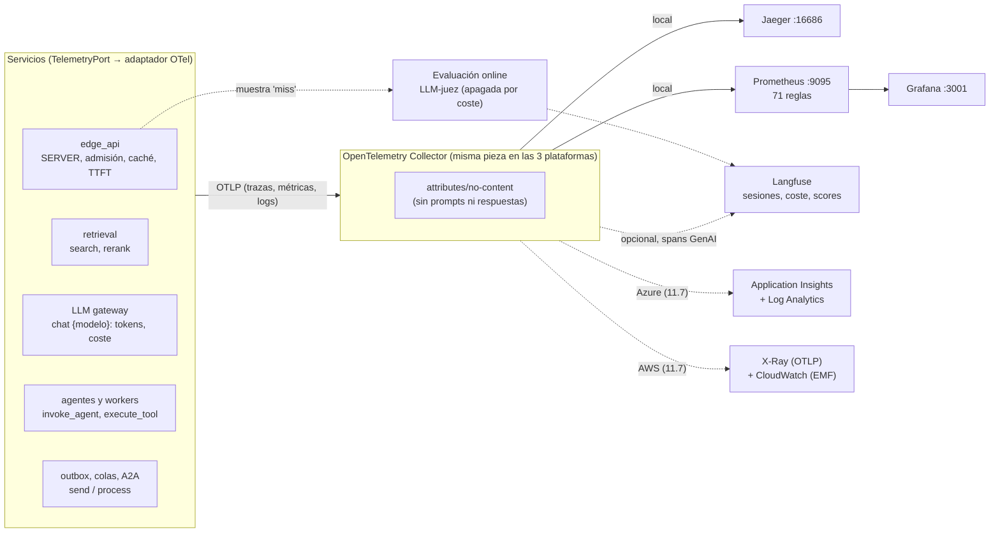

# Fase 11 · Observabilidad de sistemas agénticos

**Objetivo:** saber en todo momento qué hace cada agente y cada llamada al modelo, cuánto cuesta y
por qué falla, y enterarse antes que el usuario. Una sola instrumentación (OpenTelemetry con la
convención GenAI) y un collector que decide el destino: Jaeger y Prometheus en local, Langfuse
para el equipo de IA, Application Insights en Azure y X-Ray + CloudWatch en AWS.

| Subfase | Commit | Qué |
|---|---|---|
| 11.1 | `b74de98` | `TelemetryPort`, adaptador OTel, convención GenAI, logs JSON con `trace_id` y redacción de PII |
| 11.2 | `c05491f` | Instrumentación de edge, RAG, caché, tools, agentes y MCP (TTFT, errores tras el 200) |
| 11.3 | `006970e` | Propagación W3C por outbox (migración 0008), RabbitMQ, SQS, Service Bus y A2A |
| 11.4 | `b20aaf4` + `4e02437` | Métricas RED y GenAI (tokens, coste por agente), catálogo de SLO; arreglo del redondeo del GCRA |
| 11.5 | `76d1bc0` + `8fea488` | Stack local (collector, Jaeger, Prometheus, Grafana), dashboard como código y reenvío a Langfuse |
| 11.6 | `ccfb62e` | Alertas de SLO (*burn rate*) y de coste generadas desde el dominio, `promtool` en la CI, evaluación online con LLM-juez y runbook |
| 11.7 | — | Terraform desactivado (App Insights, CloudWatch/X-Ray), collectors de nube validados en la CI y este documento |

## 1. Arquitectura



| Pieza | Dónde vive |
|---|---|
| Puerto y adaptador (`NullTelemetry`, `OTelTelemetry`, `recording_telemetry`) | `ports/telemetry.py`, `adapters/otel.py` |
| Atributos de la convención GenAI, redacción, logs JSON | `application/telemetry/genai.py`, `redaction.py`, `logs.py` |
| Spans del modelo (TTFT, tokens, coste) | `application/telemetry/llm_tracer.py` |
| Agentes y tools | `application/agents/tracing.py` (`TracedAgent`), `application/tools/loop.py` |
| Propagación por colas, outbox y A2A | `application/telemetry/messaging.py`, `application/outbox.py`, migración 0008, `orchestrator/remote/tracing.py` |
| Catálogo de métricas y SLO | `application/telemetry/metrics.py`, `domain/slo.py` |
| Dashboard y reglas generados | `adapters/prometheus.py`, `scripts/build_observability.py` → `infra/local/telemetry/` |
| Evaluación online y scores | `application/online_eval.py`, `adapters/langfuse_scores.py` |
| Runbook | [runbook-incidentes.md](runbook-incidentes.md) |
| Collectors de nube | `infra/otel/collector-azure.yaml`, `infra/otel/collector-aws.yaml` |
| Nube (desactivado por defecto) | `infra/terraform/{azure,aws}/observability.tf` (`observability_enabled`) |

## 2. Qué se construye

### 11.1 · Telemetría base

- Los casos de uso piden spans a `TelemetryPort` (`get_telemetry()`), como piden un LLM a `LLMPort`. Solo `adapters/otel.py` importa el SDK: por defecto `NullTelemetry` y los tests no cambian.
- Atributos de la convención **GenAI** de OpenTelemetry (`gen_ai.operation.name`, `gen_ai.request.model`, `gen_ai.usage.input_tokens`...) más `genaipocs.*` (coste, plan, caché) y `langfuse.*`.
- Prompts y respuestas solo con `TELEMETRY__CAPTURE_CONTENT=true` y siempre redactados. Logs JSON con `trace_id`/`span_id`.

```powershell
uv run pytest packages/genaipocs_core/tests/test_telemetry.py packages/genaipocs_core/tests/test_instrumentation.py -q
# En cualquier servicio: TELEMETRY__EXPORTER=console (spans por consola) u otlp (al collector)
```

### 11.2 · Instrumentación

- `chat {modelo}` con TTFT, tokens y coste; `execute_tool {tool}`; `invoke_agent {agente}`; `retrieval knowledge` con `search` y `rerank`; `semantic_cache.lookup/store`; `rate_limit`.
- El edge enriquece el span SERVER con plan, decisión de admisión, caché, modo y degradación.
- Un error devuelto al modelo como resultado de una tool, o un SSE roto tras el 200, se marca con `mark_error`: si no, la traza lo pintaría en verde.

### 11.3 · Propagación de punta a punta

- Contexto W3C (`traceparent`) **fuera del cuerpo**: cabeceras AMQP, atributos de SQS, propiedades de Service Bus y columna `outbox_events.headers`.
- Un caso asíncrono es **una sola traza** (padre, no *link*): el relay y los workers continúan la del `POST /cases`. A2A inyecta el contexto en httpx y el especialista abre el SERVER.

```powershell
uv run pytest services/orchestrator/tests/test_trace_propagation.py -q
docker compose --profile sqs --profile servicebus up -d ; uv run pytest -m integration packages/genaipocs_core/tests/integration/test_message_bus_contract.py
```

### 11.4 · Métricas RED, GenAI y SLO

- Catálogo único (`metrics.py`): duración y errores de las llamadas al modelo (`gen_ai.client.operation.duration`), tokens, `genaipocs.llm.cost` por agente, TTFT del edge, admisión por plan (429/503), caché, respuestas degradadas, rechazos del gateway, colas y backlog del outbox.
- Cardinalidad baja: nunca IDs de caso o usuario en una etiqueta.
- 6 SLO en `domain/slo.py` (Python puro) con presupuesto de error, *burn rate* multiventana (14,4 / 6 / 3 / 1) y presupuesto de coste (20 $/día, aviso al 80 %).

### 11.5 · Stack local y dashboard como código

```powershell
docker compose --profile telemetry up -d                     # collector, Jaeger, Prometheus, Grafana
uv run python scripts/telemetry_demo.py --rounds 3 --minutes 3
# Con Langfuse: OTEL_COLLECTOR_EXTRA=otel-collector.langfuse y --profile observability
```

- El dashboard `Genaipocs · GenAI` (Grafana :3001) se genera desde el catálogo: coste, tokens, latencia, TTFT, errores, 429/503 por plan, caché, colas y faithfulness.
- El collector borra prompts y respuestas antes de Jaeger; el contenido solo llega a Langfuse.

### 11.6 · Alertas como código, evaluación online y runbook

- `build_rules()` genera `rules/genaipocs.rules.yml` desde `domain/slo.py`: 42 recording rules (SLI por ventana), 24 alertas de *burn rate* y 5 operativas (`LlmCostBudget`, `LlmCostRunaway`, `OutboxBacklogGrowing`, `FaithfulnessDrop`, `PromptInjectionSpike`; la 11.G2 añadió `MessageSettleFailures`). Un SLO sin SLI rompe la generación.
- 11 escenarios de `promtool test rules` en la CI. Cada alerta enlaza un ancla del [runbook](runbook-incidentes.md).
- Evaluación online: el edge ofrece respuestas generadas (`miss`) a un juez que no bloquea (cola acotada, `EDGE__ONLINE_EVAL_RATE`, `EDGE__ONLINE_EVAL_PER_MINUTE`). El score va al mismo `trace_id` en Langfuse y a la métrica `genaipocs.eval.faithfulness`.

```powershell
uv run python scripts/build_observability.py --check
docker compose --profile telemetry run --rm --entrypoint promtool prometheus test rules /etc/prometheus/rules/tests/genaipocs.test.yml
```

### 11.7 · Nube: Terraform desactivado y collectors

| | Azure (`azure/observability.tf`) | AWS (`aws/observability.tf`) |
|---|---|---|
| Almacén | Log Analytics (30 días, tope diario `observability_daily_cap_gb = 0.5`) | Log groups `/genaipocs/{env}/app` (14 días) y `/metrics` (EMF, 3 días) |
| Trazas | Application Insights basado en workspace, sin claves locales (`local_authentication_enabled = false`) | X-Ray por su endpoint OTLP (Transaction Search) + grupo `errors` |
| Permiso del collector | Rol *Monitoring Metrics Publisher* (identidad) | Política IAM `otel_collector` (X-Ray y logs) para el rol de la tarea |
| Aviso | Action group con email | Tema SNS con email |
| Alerta de coste desbocado | Consulta KQL (5 min / 15 min): coste ×96 > 3 × presupuesto diario | Alarma con Metrics Insights: coste en 15 min > 3 × presupuesto / 96 |
| Segunda alerta | *Burn rate* rápido de errores del modelo (> 14,4 × 1 %) | Backlog del outbox > 100 durante 10 min |

- Los collectors de nube (`infra/otel/`) son el local con otro destino: mismo OTLP, mismo `attributes/no-content`. Azure usa el exporter `azuremonitor` con `azureauth` (identidad gestionada, audiencia `https://monitor.azure.com/.default`); AWS usa `otlphttp` firmado con `sigv4auth` hacia X-Ray y `awsemf` para las métricas, declarando solo las dimensiones que usan las alarmas (cada combinación se factura).
- La CI valida las tres configuraciones con la imagen del collector fijada (`validate`, sin enviar nada) y Terraform con `fmt`/`validate`.

```powershell
cd infra/terraform/azure ; terraform fmt -check -recursive ; terraform init -backend=false ; terraform validate
cd ../aws ; terraform init -backend=false ; terraform validate
```

## 3. Resultados medidos (local, coste 0)

### 3.1 · Un caso asíncrono, de la entrada al resultado

Árbol que pinta `recording_telemetry().tree()` en `test_an_async_case_is_one_trace_from_intake_to_outcome`
(relay y workers en contextos vacíos, como en procesos distintos). **14 spans y un solo `trace_id`:**

```text
POST /cases [server]
  outbox.relay [internal]
    send support.emails [producer]
      process support.emails [consumer]
        chat fake-llm [client]                        ← triaje
        outbox.relay [internal]
          send case.triaged.refunds [producer]
            process case.triaged.refunds [consumer]
              invoke_agent genaipocs-refunds-specialist [internal]
                chat fake-llm [client]
                execute_tool request_refund [internal] ← approval_required (no es error)
                chat fake-llm [client]
              outbox.relay [internal]
                send case.outcomes [producer]
```

Con el stack local y el reenvío a Langfuse, la misma traza aparece en Jaeger (14 spans) y en
Langfuse como observaciones `GENERATION`, `AGENT` y `TOOL`, con coste calculado (0,0002796 $).

### 3.2 · Resto de la fase

| Prueba | Resultado |
|---|---|
| Cabeceras de traza por los tres brokers (contrato) | RabbitMQ, SQS (ElasticMQ) y Service Bus (emulador): OK |
| Demo de tráfico (`telemetry_demo.py`, 65 casos en 3 min) | 17 consultas PromQL del dashboard con datos; dashboard revisado en el navegador |
| Reglas de alerta | 71 reglas válidas (`promtool check`), 11 escenarios en verde (`promtool test`), grupos con salud `ok` en Prometheus |
| Collectors | Local, Azure y AWS válidos con `otelcol-contrib 0.163.1 validate` |
| Terraform | `fmt` y `validate` en verde en `azure` y `aws`, todo con `count = 0` por defecto |
| Calidad | 1.049 tests, `mypy --strict` sin errores |

### 3.3 · Lo que la observabilidad destapó

| Hallazgo | Causa | Arreglo |
|---|---|---|
| El rate limiter rechazaba a veces la primera petición con el cupo vacío | Redondeo en coma flotante del GCRA: `(now + 60) - 60 > now` | Tolerancia de 1 µs en memoria y en Lua, con test de regresión (`4e02437`) |
| Un test del outbox fallaba solo en la CI | Plazos de décimas de segundo en un runner lento | Reserva larga y sondeo (`8fea488`) |
| La alerta de faithfulness no saltaba con datos reales | Con unidad `"1"`, el collector solo añade `_ratio` en gauges | Nombres verificados contra el collector real, no contra la documentación |
| Un test de alerta por pico corto pasaba por casualidad | Con menos historia que la ventana larga, la ventana entera es el pico | Escenario con 7 h de historia |

## 4. Comparativa Azure ↔ AWS ↔ framework

| Pieza | A. Gestionado (Azure / AWS) | B. Propio (este repo) | C. Framework / herramienta |
|---|---|---|---|
| Instrumentación | Azure Monitor OpenTelemetry Distro / ADOT (AWS Distro for OpenTelemetry) | `TelemetryPort` + `adapters/otel.py` con la convención GenAI | OpenLLMetry, OpenInference, instrumentación nativa de MAF / Strands / LangGraph |
| Trazas | Application Insights (mapa de aplicación, *transaction search*) / X-Ray (Transaction Search sobre OTLP) | Jaeger en local | Langfuse, Arize Phoenix, LangSmith |
| Trazas de agentes gestionados | Foundry Tracing (sobre App Insights) / AgentCore Observability (sobre CloudWatch) | Spans `invoke_agent` / `execute_tool` propios | Langfuse (sesiones, árbol de agentes) |
| Métricas | Azure Monitor Metrics, Managed Prometheus / CloudWatch (EMF), Amazon Managed Prometheus | Prometheus con reglas generadas | — |
| Dashboards | Workbooks, Managed Grafana / CloudWatch dashboards, Managed Grafana | Dashboard generado desde el catálogo | Grafana |
| Alertas | Log search alerts + action groups / CloudWatch alarms + SNS | Reglas de Prometheus + `promtool` | Alertmanager |
| Evals online y prompts | Foundry evaluations / Bedrock evaluations | `OnlineEvaluator` + juez | Langfuse (scores, datasets, prompts), Phoenix, LangSmith |
| Pieza común | OpenTelemetry Collector (con exporter `azuremonitor` / imagen ADOT) | `infra/local/telemetry/otel-collector.yaml` e `infra/otel/` | — |

**Langfuse frente a un backend genérico:** Langfuse entiende de LLM (sesiones, prompts, coste por
modelo, scores de evals, datasets), pero no de infraestructura: no sabe de colas, de 503 ni de
Redis. Jaeger/X-Ray/App Insights ven todo el sistema con menos semántica GenAI. Por eso no se elige
uno: se instrumenta una vez con OTel y el collector reparte. Phoenix es la alternativa *open source*
más cercana a Langfuse (muy fuerte en evals); LangSmith, la natural si todo es LangChain, pero es
SaaS y ata el formato.

## 5. Decisiones y límites (para defenderlos)

- **Una instrumentación, varios destinos.** El código habla OTel y el collector decide. Cambiar de Jaeger a X-Ray o añadir Langfuse es configuración, no código. Es la misma idea que `LLMPort` aplicada a la telemetría.
- **Convención GenAI de OTel aunque esté en *Development*.** Es la que entienden Langfuse, App Insights y X-Ray sin traducir. El riesgo de que cambie se aísla en `genai.py` (un solo fichero de nombres).
- **El contenido no sale hacia el backend genérico.** Prompts y respuestas pueden traer PII: apagados por defecto, redactados si se activan y borrados en el collector antes de Jaeger, App Insights o X-Ray. Langfuse, con acceso restringido, es el único que los ve.
- **Un caso es una sola traza** (padre, no *link*), aunque cruce outbox, tres colas y A2A. Se pierde la separación "petición frente a procesamiento", y a cambio soporte ve el caso completo con un solo ID.
- **Alertas generadas desde el dominio.** Los SLO viven en `domain/slo.py`; reglas, dashboard y tests salen de ahí. No hay umbrales copiados a mano que se desincronicen.
- **Alertas por *burn rate*, no por umbral fijo.** Avisan de lo que importa (el presupuesto de error se acaba) y no despiertan a nadie por un pico de un minuto.
- **Evaluación online apagada por defecto.** Un juez por respuesta duplicaría el coste: se muestrea, se limita por minuto y nunca bloquea al usuario.
- **X-Ray por OTLP y no por el exporter `awsxray`.** El formato de segmentos convierte casi todos los atributos en metadatos no indexados; el endpoint OTLP guarda los `gen_ai.*` tal cual.
- **Límites conocidos:** en la nube solo se han portado 2 alertas por plataforma (las 71 viven en Prometheus); no hay muestreo de cola (*tail sampling*); Langfuse sigue en v3 local; la evaluación online no se ha medido con un juez real; los collectors de nube están validados, pero no desplegados.

## 6. Pendiente con coste

Ver [pendientes-cloud.md](pendientes-cloud.md) (sección de la fase 11):

- `observability_enabled = true` en Azure y AWS con el collector de nube y una traza real;
- Transaction Search de X-Ray;
- Foundry Tracing y AgentCore Observability frente a la instrumentación propia;
- evaluación online con juez real y coste medido;
- coste de ingesta y portar el resto de alertas.

## 7. GCP (pasada 11.G)

**Objetivo:** el tercer destino del mismo collector. Las trazas van a **Cloud Trace** y los logs a
**Cloud Logging**, los dos por la Telemetry API (OTLP). Las métricas van a **Managed Service for
Prometheus**, y las alertas de **Cloud Monitoring** se escriben en PromQL. El código de los
servicios no cambia. Coste 0: validación del collector, un Cloud Monitoring falso y `terraform
test`. Lo real queda en [pendientes](pendientes-cloud.md#fase-11-gcp).

| Subfase | Commit | Qué |
|---|---|---|
| 11.G1 | `345a7bb` | `collector-gcp.yaml`, nombres de las métricas comprobados con el collector real y `observability.tf` |
| 11.G2 | `9da4188` | Las 36 alertas en Cloud Monitoring (PromQL), generadas desde `domain/slo.py` y probadas con `promtool` |
| 11.G3 | — | Logs con los campos de Cloud Logging, spans de los frameworks sin contenido ni duplicados en Langfuse y una traza por el broker real |

### Verificación previa (22-11-2026)

| Comprobado | Resultado | Consecuencia |
|---|---|---|
| [Telemetry API](https://docs.cloud.google.com/stackdriver/docs/reference/telemetry/overview) | OTLP nativo para trazas, métricas y logs en `telemetry.googleapis.com`. Es la vía recomendada desde 2025: admite 1.024 atributos por span y la API propietaria de Cloud Trace solo 32. Rol `roles/telemetry.writer` | Trazas y logs por OTLP, igual que en X-Ray. Se habilita `telemetry.googleapis.com` |
| [Métricas por OTLP](https://docs.cloud.google.com/stackdriver/docs/otlp-metrics/overview) | Se guardan como series de Prometheus, pero **conservan los puntos** del nombre (`genaipocs.llm.cost`) | Las 77 reglas generadas no valdrían tal cual. Las métricas van por el exporter `googlemanagedprometheus`, que traduce como el Prometheus local |
| [Collector en Cloud Run](https://docs.cloud.google.com/stackdriver/docs/instrumentation/opentelemetry-collector-cloud-run) | Sidecar con la imagen de Google (`otelcol-google`), `googleclientauth`, `health_check` obligatorio y detector `gcp` | Mismo diseño. La CI valida con la imagen contrib ya fijada, que trae esos componentes |
| [Alertas PromQL](https://cloud.google.com/monitoring/promql/create-promql-alerts) | Una condición por política y sin *recording rules*. Gratis hasta el 01-09-2027 ([coste](https://docs.cloud.google.com/monitoring/alerts/cost-control)) | La 11.G2 genera las alertas con los SLI expandidos dentro de cada consulta |
| ADK 2.14 (telemetría instalada) | `ADK_CAPTURE_MESSAGE_CONTENT_IN_SPANS=true` por defecto, y usa el proveedor global de OTel, que fijamos nosotros | Se sospechó una fuga de prompts. **Medido en la 11.G3:** en la ruta que usamos no la hay por defecto; solo si se activa la convención experimental por entorno. La fuga real era de Strands (11.G3) |

### 11.G1 · Collector de GCP y Terraform

```powershell
docker run --rm -v ${PWD}/infra/otel:/cfg:ro -e GOOGLE_CLOUD_PROJECT=genaipocs-dev -e ENVIRONMENT=dev `
  otel/opentelemetry-collector-contrib:0.163.1 validate --config=/cfg/collector-gcp.yaml
uv run python scripts/check_collector_gcp.py     # collector real contra un Cloud Monitoring falso (~15 s)
cd infra/terraform/gcp ; terraform fmt -check -recursive ; terraform validate ; terraform test
```

**El collector** (`infra/otel/collector-gcp.yaml`) es el local con otro destino:

- **Lo que no cambia:** receptor OTLP, `memory_limiter`, `batch` y `attributes/no-content`.
- **Trazas y logs:** `otlp_http/telemetry` a `https://telemetry.googleapis.com` con el token de
  `googleclientauth` (la cuenta adjunta; el proyecto de cuota va en `x-goog-user-project`).
  `resource/gcp_project_id` añade `gcp.project_id`, que es lo que usa la API para saber a qué
  proyecto va cada span.
- **Métricas:** `googlemanagedprometheus`. Como en local, solo el entorno se convierte en
  etiqueta; `service.name` ya va en `job`.

Paralelo con las otras nubes:

| | Azure | AWS | GCP |
|---|---|---|---|
| Trazas | `azuremonitor` | OTLP a X-Ray con `sigv4auth` | OTLP a la Telemetry API con `googleclientauth` |
| Métricas | `azuremonitor` | `awsemf` con dimensiones declaradas | `googlemanagedprometheus` (los mismos nombres que en local) |
| Identidad | Identidad gestionada (`azureauth`) | Rol de la tarea | Cuenta de servicio adjunta (ADC) |

**Por qué se comprueban los nombres con el collector real.** Si el exporter tradujera distinto,
las alertas de la 11.G2 consultarían series que no existen y **no saltarían nunca, sin dar ningún
error**. `scripts/check_collector_gcp.py` monta la prueba así:

1. Levanta en el propio proceso un servidor gRPC que imita `MetricService.CreateTimeSeries`.
2. Arranca el collector de GCP en Docker. Unos `--config=yaml:` le apuntan las métricas a ese
   servidor (`use_insecure`) y mandan las trazas a `debug`, así que no hace falta ninguna
   credencial.
3. Emite un punto de cada métrica de `CATALOG` y compara cada `metric.type` recibido con el que
   espera `prometheus.metric`.

Resultado: **23 de 23** iguales, por ejemplo
`prometheus.googleapis.com/genaipocs_llm_cost_USD_total/counter`. La comprobación corre en la CI
(job `quality`).

**Hallazgo: Cloud Monitoring descarta los puntos acumulados de duración cero** (inicio = fin).
- En el primer intento solo llegó el gauge: con un único envío justo después de crear el
  instrumento, los contadores y los histogramas tenían duración cero.
- La prueba ahora emite dos veces, separadas por más de un intervalo de exportación.
- En producción le pasaría lo mismo a un **Cloud Run job** que emite una vez y termina (como la
  carga de la 10.G5): perdería sus contadores sin ningún error.

**Terraform** (`observability.tf`, desactivado con `observability_enabled`):

- Roles del collector para la cuenta de la aplicación: `roles/telemetry.writer` (trazas y logs) y
  `roles/monitoring.metricWriter` (métricas).
- Bucket `_Default` de Cloud Logging con 30 días de retención, que van incluidos en el precio. Es
  el paralelo de Log Analytics, pero **no se activa `enable_analytics`**: no se puede desactivar
  después.
- **Exclusiones**: las sondas `/health`, `/ready` y `/ping` de Cloud Run y los logs DEBUG. Lo
  excluido no se ingiere ni se cobra. Es lo más cercano al tope diario de Log Analytics: GCP no
  corta la ingesta, solo deja filtrarla antes.
- Canal de guardia por correo, separado del del presupuesto.
- `tests/observability.tftest.hcl` comprueba los dos estados: desactivado no crea nada; activado,
  crea los roles, la retención, las exclusiones y el canal.

### 11.G2 · Alertas de Cloud Monitoring generadas

```powershell
uv run python scripts/build_observability.py --check     # reglas, dashboard y alertas de GCP al día
docker run --rm -v ${PWD}/infra/terraform/gcp/alerts:/alerts:ro --entrypoint promtool `
  prom/prometheus:v3.15.1 test rules /alerts/tests/genaipocs.test.yml /alerts/tests/platform.test.yml
uv run pytest packages/genaipocs_core/tests/test_cloud_monitoring.py
```

**La idea.** Cloud Monitoring evalúa PromQL sobre Managed Prometheus, y la 11.G1 demostró que las
métricas llegan con los mismos nombres. Por eso aquí se portan **todas** las alertas, no 2 de
muestra como en Azure y AWS: salen de la misma fuente, `build_rules()`, que sale de
`domain/slo.py`. `adapters/cloud_monitoring.py` las transforma y `build_observability.py` escribe
tres ficheros en `infra/terraform/gcp/alerts/`:

| Fichero | Para qué |
|---|---|
| `genaipocs.alerts.yml` | Las alertas en formato de Prometheus, para `promtool` |
| `tests/genaipocs.test.yml` | Los tests locales, apuntados a esas alertas |
| `alert_policies.json` | Lo que `observability.tf` recorre con `for_each` |

**Qué cambia respecto a Prometheus:**

| | Prometheus (local) | Cloud Monitoring |
|---|---|---|
| SLI | *Recording rules* `slo:error_ratio:rate1h{slo=...}`, evaluadas cada 30 s | No hay *recording rules*: cada referencia se sustituye por su expresión dentro de la alerta |
| Condiciones | Un grupo con muchas reglas | **Una política por alerta**, con una sola condición PromQL |
| `for` | El que diga la regla | Igual hasta 25 h de consulta. Más allá (*burn rate* de 3 días, drift de 1 + 7 días) Cloud Monitoring **desactiva la ventana de reintento**: salta en la primera evaluación, y la documentación de la alerta lo avisa |
| Intervalo | 30 s / 1 min | 60 s; 300 s para consultas de más de 25 h (el mínimo que permite) |
| Anotaciones | `{{ $value }}` | No entiende las plantillas de Prometheus: el valor se ve en la incidencia. El runbook es un enlace absoluto (`runbook_base_url`) |
| Métricas aún inexistentes | La regla evalúa a vacío | El `apply` falla: `disable_metric_validation = true` |

**Las pruebas.** Si la expansión cambiara el resultado, una alerta saltaría cuando no toca o no
saltaría nunca. Por eso las alertas expandidas pasan **los mismos tests de `promtool`** que las
locales:

- Las expresiones de los tests que leen una *recording rule* (`drift:psi{...}`) se expanden con la
  misma función.
- Resultado: los mismos escenarios dan las mismas alertas. Saltan las del *burn rate* y no las de
  un pico corto, y el drift de intenciones se detecta y el estable no.
- `platform.test.yml`, escrito a mano, cubre las alertas que solo existen en GCP.

**Alertas nuevas:**

| Alerta | Dónde | Por qué |
|---|---|---|
| `MessageSettleFailures` | Local y GCP | Heredada de la 10.G1. `ack_failures` y `lease_failures` eran contadores del objeto y ahora son la métrica `genaipocs.messaging.settle_failures` (por suscripción y por operación: `ack`, `nack`, `modack`). Más de 0,01/s durante 10 min = reentregas y el modelo pagado otra vez |
| `PubSubBacklogGrowing` | Solo GCP | Más de 100 mensajes sin confirmar en una suscripción `.worker`. **Misma métrica y mismo selector** que el autoescalador y CREMA: `pubsub_subscription_selector`, que comparten `pubsub_backlog_promql` y la nueva `pubsub_backlog_by_subscription_promql`. Una incidencia por cola (`sum by (subscription_id)`); las DLQ no cuentan |
| `PubSubAckDeadlinesExpiring` | Solo GCP | `expired_ack_deadlines_count`: el latido no llega o los turnos superan `PUBSUB__MAX_LEASE_S` |
| `LogIngestionPace` | Solo GCP | Ingesta de 6 h proyectada a un día por encima de 1,67 GiB (los 50 GiB/mes gratis). Es lo más cercano al tope diario de Log Analytics, que GCP no tiene: aquí solo se avisa |

**Coste:**

- Las 36 políticas son **gratis hasta el 01-09-2027**.
- Después, 0,35 $/mes por métrica referenciada y 0,50 $ por millón de puntos devueltos: con
  ~40 referencias, unos 14 $/mes más los puntos.
- Evaluar cada 60 s y no cada 30 s reduce a la mitad los puntos devueltos.
- Si hiciera falta recortar, primero las de ticket con ventana de 3 días: duplican lo que ya
  cubre la de 1 día.

### 11.G3 · Logs enlazados con la traza y spans de los frameworks

```powershell
uv run pytest packages/genaipocs_core/tests/test_telemetry.py -k gcp
uv run pytest services/booking_agent/tests/test_harness_flavors.py -k "adk_ or strands_ or startup_policy"
docker compose --profile sqs --profile servicebus --profile pubsub up -d
uv run pytest -m integration packages/genaipocs_core/tests/integration/test_message_bus_contract.py -k one_trace
```

**Logs que Cloud Logging enlaza con la traza** (`TELEMETRY__LOG_FORMAT=gcp`):

- En Cloud Run, cada línea de stdout llega sola a Cloud Logging. No hace falta exporter de logs,
  pero sí sus campos:
  - `severity`: sin él, todo sale como DEFAULT y no se puede filtrar por nivel.
  - `logging.googleapis.com/trace` con la ruta completa (`projects/<GCP__PROJECT>/traces/<id>`):
    es lo que pinta el log dentro de la traza en Cloud Trace.
  - `logging.googleapis.com/spanId` y `trace_sampled`.
- `TraceIds` lleva ahora el flag de muestreo. Sin `GCP__PROJECT`, el arranque falla con un
  mensaje claro: sin proyecto no se puede escribir la ruta de la traza.
- Equivale a lo que en Azure hace el exporter de App Insights y en AWS el `trace_id` de X-Ray.

**Spans propios de los frameworks.** `setup_observability` fija el proveedor global de OTel y los
frameworks lo usan para emitir sus propios spans: ADK con el *scope* `gcp.vertex.agent` y Strands
con `strands.telemetry.tracer`. Un test los reproduce con un proveedor global en memoria y un turno
con tool (`test_harness_flavors.py`):

| Medido | ADK 2.14 / Strands | Consecuencia |
|---|---|---|
| Contenido por defecto | ADK: **no** en sus atributos; la sospecha de la verificación previa no se confirma en la ruta que usamos. Strands: **sí**, en **eventos** del span (`gen_ai.user.message`, `gen_ai.choice`, `gen_ai.tool.message`), que `attributes/no-content` no toca. **Fuga real desde la fase 11** (también en AWS) | `fix:` aparte. El arranque añade `gen_ai_unredacted_attributes=` (vacío = redactar todo) a `OTEL_SEMCONV_STABILITY_OPT_IN` y conserva el resto de la lista. Los cuatro collectors borran `content`, `message` y los `gen_ai.*.messages` de los eventos `gen_ai.*` (`transform/no-event-content`), pero dejan los metadatos (`role`, `finish_reason`) y las excepciones |
| Con la convención experimental activada por entorno (`OTEL_SEMCONV_STABILITY_OPT_IN`, `OTEL_INSTRUMENTATION_GENAI_CAPTURE_MESSAGE_CONTENT=SPAN_ONLY`) | **Sí**: `gen_ai.input.messages`, `gen_ai.output.messages`, `gen_ai.tool.call.arguments` | `silence_framework_content()` en el arranque fija `ADK_CAPTURE_MESSAGE_CONTENT_IN_SPANS=false` y `NO_CONTENT`. El test de control demuestra que sin la política se filtra y con ella no |
| Duplicados | ADK: `generate_content` por cada llamada al modelo, **con los tokens**, además de nuestro `chat`. Strands: `chat` con tokens e `invoke_agent` con el total | El reenvío a Langfuse descarta los spans de los frameworks por *scope*: si no, contaría el uso dos veces. En Jaeger y Cloud Trace siguen, sin contenido, porque enseñan los pasos internos del framework |

- **Defensa en profundidad:** los cuatro collectors borran también `gen_ai.system_instructions`
  y los atributos de contenido de ADK (`gcp.vertex.agent.llm_request`, `tool_call_args`...),
  mientras conservan los IDs. Comprobado enviando un span al collector de GCP con salida `debug`.
- **Por qué se apaga siempre y no según `TELEMETRY__CAPTURE_CONTENT`:** el contenido de los
  frameworks no pasa por nuestro redactor de PII. Cuando se pide contenido, ya lo dan nuestros
  spans, redactados.

**Una traza a través del broker real.** El test de contrato
`test_send_and_process_are_one_trace_through_the_real_broker` publica desde un contexto vacío,
como si fuera otro proceso, y comprueba que el span `process` es hijo del `send`: padre, no
*link*, y con la misma traza. Pasa con RabbitMQ, ElasticMQ (SQS), el emulador de Service Bus y el
emulador de Pub/Sub. Hasta ahora, de punta a punta solo se probaba con el bus en memoria.

## 8. Checkpoint de entrevista

Preguntas técnicas y de negocio: [preguntas-entrevista.md](preguntas-entrevista.md#fase-11).
