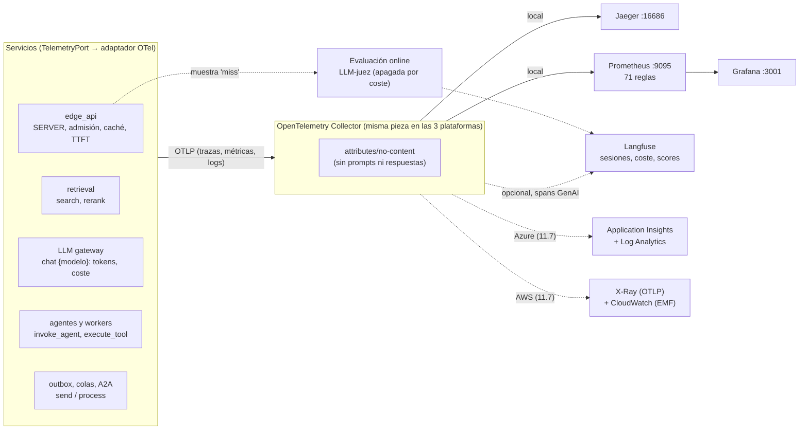

# Fase 11 · Observabilidad de sistemas agénticos

**Objetivo:** saber en todo momento qué hace cada agente y cada llamada al modelo, cuánto cuesta y
por qué falla, y enterarse antes que el usuario. Una sola instrumentación (OpenTelemetry con la
convención GenAI) y un collector que decide el destino: Jaeger y Prometheus en local, Langfuse
para el equipo de IA, Application Insights en Azure y X-Ray + CloudWatch en AWS.

| Subfase | Commit | Qué |
|---|---|---|
| 11.1 | `b74de98` | `TelemetryPort`, adaptador OTel, convención GenAI, logs JSON con `trace_id` y redacción de PII |
| 11.2 | `c05491f` | Instrumentación de edge, RAG, caché, tools, agentes y MCP (TTFT, errores tras el 200) |
| 11.3 | `006970e` | Propagación W3C por outbox (migración 0008), RabbitMQ, SQS, Service Bus y A2A |
| 11.4 | `b20aaf4` + `4e02437` | Métricas RED y GenAI (tokens, coste por agente), catálogo de SLO; arreglo del redondeo del GCRA |
| 11.5 | `76d1bc0` + `8fea488` | Stack local (collector, Jaeger, Prometheus, Grafana), dashboard como código y reenvío a Langfuse |
| 11.6 | `ccfb62e` | Alertas de SLO (*burn rate*) y de coste generadas desde el dominio, `promtool` en la CI, evaluación online con LLM-juez y runbook |
| 11.7 | — | Terraform desactivado (App Insights, CloudWatch/X-Ray), collectors de nube validados en la CI y este documento |

## 1. Arquitectura



| Pieza | Dónde vive |
|---|---|
| Puerto y adaptador (`NullTelemetry`, `OTelTelemetry`, `recording_telemetry`) | `ports/telemetry.py`, `adapters/otel.py` |
| Atributos de la convención GenAI, redacción, logs JSON | `application/telemetry/genai.py`, `redaction.py`, `logs.py` |
| Spans del modelo (TTFT, tokens, coste) | `application/telemetry/llm_tracer.py` |
| Agentes y tools | `application/agents/tracing.py` (`TracedAgent`), `application/tools/loop.py` |
| Propagación por colas, outbox y A2A | `application/telemetry/messaging.py`, `application/outbox.py`, migración 0008, `orchestrator/remote/tracing.py` |
| Catálogo de métricas y SLO | `application/telemetry/metrics.py`, `domain/slo.py` |
| Dashboard y reglas generados | `adapters/prometheus.py`, `scripts/build_observability.py` → `infra/local/telemetry/` |
| Evaluación online y scores | `application/online_eval.py`, `adapters/langfuse_scores.py` |
| Runbook | [runbook-incidentes.md](runbook-incidentes.md) |
| Collectors de nube | `infra/otel/collector-azure.yaml`, `infra/otel/collector-aws.yaml` |
| Nube (desactivado por defecto) | `infra/terraform/{azure,aws}/observability.tf` (`observability_enabled`) |

## 2. Qué se construye

### 11.1 · Telemetría base

- Los casos de uso piden spans a `TelemetryPort` (`get_telemetry()`), como piden un LLM a `LLMPort`. Solo `adapters/otel.py` importa el SDK: por defecto `NullTelemetry` y los tests no cambian.
- Atributos de la convención **GenAI** de OpenTelemetry (`gen_ai.operation.name`, `gen_ai.request.model`, `gen_ai.usage.input_tokens`...) más `headache.*` (coste, plan, caché) y `langfuse.*`.
- Prompts y respuestas solo con `TELEMETRY__CAPTURE_CONTENT=true` y siempre redactados. Logs JSON con `trace_id`/`span_id`.

```powershell
uv run pytest packages/headache_core/tests/test_telemetry.py packages/headache_core/tests/test_instrumentation.py -q
# En cualquier servicio: TELEMETRY__EXPORTER=console (spans por consola) u otlp (al collector)
```

### 11.2 · Instrumentación

- `chat {modelo}` con TTFT, tokens y coste; `execute_tool {tool}`; `invoke_agent {agente}`; `retrieval knowledge` con `search` y `rerank`; `semantic_cache.lookup/store`; `rate_limit`.
- El edge enriquece el span SERVER con plan, decisión de admisión, caché, modo y degradación.
- Un error devuelto al modelo como resultado de una tool, o un SSE roto tras el 200, se marca con `mark_error`: si no, la traza lo pintaría en verde.

### 11.3 · Propagación de punta a punta

- Contexto W3C (`traceparent`) **fuera del cuerpo**: cabeceras AMQP, atributos de SQS, propiedades de Service Bus y columna `outbox_events.headers`.
- Un caso asíncrono es **una sola traza** (padre, no *link*): el relay y los workers continúan la del `POST /cases`. A2A inyecta el contexto en httpx y el especialista abre el SERVER.

```powershell
uv run pytest services/orchestrator/tests/test_trace_propagation.py -q
docker compose --profile sqs --profile servicebus up -d ; uv run pytest -m integration packages/headache_core/tests/integration/test_message_bus_contract.py
```

### 11.4 · Métricas RED, GenAI y SLO

- Catálogo único (`metrics.py`): duración y errores de las llamadas al modelo (`gen_ai.client.operation.duration`), tokens, `headache.llm.cost` por agente, TTFT del edge, admisión por plan (429/503), caché, respuestas degradadas, rechazos del gateway, colas y backlog del outbox.
- Cardinalidad baja: nunca IDs de caso o usuario en una etiqueta.
- 6 SLO en `domain/slo.py` (Python puro) con presupuesto de error, *burn rate* multiventana (14,4 / 6 / 3 / 1) y presupuesto de coste (20 $/día, aviso al 80 %).

### 11.5 · Stack local y dashboard como código

```powershell
docker compose --profile telemetry up -d                     # collector, Jaeger, Prometheus, Grafana
uv run python scripts/telemetry_demo.py --rounds 3 --minutes 3
# Con Langfuse: OTEL_COLLECTOR_EXTRA=otel-collector.langfuse y --profile observability
```

- El dashboard `Headache · GenAI` (Grafana :3001) se genera desde el catálogo: coste, tokens, latencia, TTFT, errores, 429/503 por plan, caché, colas y faithfulness.
- El collector borra prompts y respuestas antes de Jaeger; el contenido solo llega a Langfuse.

### 11.6 · Alertas como código, evaluación online y runbook

- `build_rules()` genera `rules/headache.rules.yml` desde `domain/slo.py`: 42 recording rules (SLI por ventana), 24 alertas de *burn rate* y 5 operativas (`LlmCostBudget`, `LlmCostRunaway`, `OutboxBacklogGrowing`, `FaithfulnessDrop`, `PromptInjectionSpike`). Un SLO sin SLI rompe la generación.
- 11 escenarios de `promtool test rules` en la CI. Cada alerta enlaza un ancla del [runbook](runbook-incidentes.md).
- Evaluación online: el edge ofrece respuestas generadas (`miss`) a un juez que no bloquea (cola acotada, `EDGE__ONLINE_EVAL_RATE`, `EDGE__ONLINE_EVAL_PER_MINUTE`). El score va al mismo `trace_id` en Langfuse y a la métrica `headache.eval.faithfulness`.

```powershell
uv run python scripts/build_observability.py --check
docker compose --profile telemetry run --rm --entrypoint promtool prometheus test rules /etc/prometheus/rules/tests/headache.test.yml
```

### 11.7 · Nube: Terraform desactivado y collectors

| | Azure (`azure/observability.tf`) | AWS (`aws/observability.tf`) |
|---|---|---|
| Almacén | Log Analytics (30 días, tope diario `observability_daily_cap_gb = 0.5`) | Log groups `/headache/{env}/app` (14 días) y `/metrics` (EMF, 3 días) |
| Trazas | Application Insights basado en workspace, sin claves locales (`local_authentication_enabled = false`) | X-Ray por su endpoint OTLP (Transaction Search) + grupo `errors` |
| Permiso del collector | Rol *Monitoring Metrics Publisher* (identidad) | Política IAM `otel_collector` (X-Ray y logs) para el rol de la tarea |
| Aviso | Action group con email | Tema SNS con email |
| Alerta de coste desbocado | Consulta KQL (5 min / 15 min): coste ×96 > 3 × presupuesto diario | Alarma con Metrics Insights: coste en 15 min > 3 × presupuesto / 96 |
| Segunda alerta | *Burn rate* rápido de errores del modelo (> 14,4 × 1 %) | Backlog del outbox > 100 durante 10 min |

- Los collectors de nube (`infra/otel/`) son el local con otro destino: mismo OTLP, mismo `attributes/no-content`. Azure usa el exporter `azuremonitor` con `azureauth` (identidad gestionada, audiencia `https://monitor.azure.com/.default`); AWS usa `otlphttp` firmado con `sigv4auth` hacia X-Ray y `awsemf` para las métricas, declarando solo las dimensiones que usan las alarmas (cada combinación se factura).
- La CI valida las tres configuraciones con la imagen del collector fijada (`validate`, sin enviar nada) y Terraform con `fmt`/`validate`.

```powershell
cd infra/terraform/azure ; terraform fmt -check -recursive ; terraform init -backend=false ; terraform validate
cd ../aws ; terraform init -backend=false ; terraform validate
```

## 3. Resultados medidos (local, coste 0)

### 3.1 · Un caso asíncrono, de la entrada al resultado

Árbol que pinta `recording_telemetry().tree()` en `test_an_async_case_is_one_trace_from_intake_to_outcome`
(relay y workers en contextos vacíos, como en procesos distintos). **14 spans y un solo `trace_id`:**

```text
POST /cases [server]
  outbox.relay [internal]
    send support.emails [producer]
      process support.emails [consumer]
        chat fake-llm [client]                        ← triaje
        outbox.relay [internal]
          send case.triaged.refunds [producer]
            process case.triaged.refunds [consumer]
              invoke_agent headache-refunds-specialist [internal]
                chat fake-llm [client]
                execute_tool request_refund [internal] ← approval_required (no es error)
                chat fake-llm [client]
              outbox.relay [internal]
                send case.outcomes [producer]
```

Con el stack local y el reenvío a Langfuse, la misma traza aparece en Jaeger (14 spans) y en
Langfuse como observaciones `GENERATION`, `AGENT` y `TOOL`, con coste calculado (0,0002796 $).

### 3.2 · Resto de la fase

| Prueba | Resultado |
|---|---|
| Cabeceras de traza por los tres brokers (contrato) | RabbitMQ, SQS (ElasticMQ) y Service Bus (emulador): OK |
| Demo de tráfico (`telemetry_demo.py`, 65 casos en 3 min) | 17 consultas PromQL del dashboard con datos; dashboard revisado en el navegador |
| Reglas de alerta | 71 reglas válidas (`promtool check`), 11 escenarios en verde (`promtool test`), grupos con salud `ok` en Prometheus |
| Collectors | Local, Azure y AWS válidos con `otelcol-contrib 0.163.1 validate` |
| Terraform | `fmt` y `validate` en verde en `azure` y `aws`, todo con `count = 0` por defecto |
| Calidad | 1.049 tests, `mypy --strict` sin errores |

### 3.3 · Lo que la observabilidad destapó

| Hallazgo | Causa | Arreglo |
|---|---|---|
| El rate limiter rechazaba a veces la primera petición con el cupo vacío | Redondeo en coma flotante del GCRA: `(now + 60) - 60 > now` | Tolerancia de 1 µs en memoria y en Lua, con test de regresión (`4e02437`) |
| Un test del outbox fallaba solo en la CI | Plazos de décimas de segundo en un runner lento | Reserva larga y sondeo (`8fea488`) |
| La alerta de faithfulness no saltaba con datos reales | Con unidad `"1"`, el collector solo añade `_ratio` en gauges | Nombres verificados contra el collector real, no contra la documentación |
| Un test de alerta por pico corto pasaba por casualidad | Con menos historia que la ventana larga, la ventana entera es el pico | Escenario con 7 h de historia |

## 4. Comparativa Azure ↔ AWS ↔ framework

| Pieza | A. Gestionado (Azure / AWS) | B. Propio (este repo) | C. Framework / herramienta |
|---|---|---|---|
| Instrumentación | Azure Monitor OpenTelemetry Distro / ADOT (AWS Distro for OpenTelemetry) | `TelemetryPort` + `adapters/otel.py` con la convención GenAI | OpenLLMetry, OpenInference, instrumentación nativa de MAF / Strands / LangGraph |
| Trazas | Application Insights (mapa de aplicación, *transaction search*) / X-Ray (Transaction Search sobre OTLP) | Jaeger en local | Langfuse, Arize Phoenix, LangSmith |
| Trazas de agentes gestionados | Foundry Tracing (sobre App Insights) / AgentCore Observability (sobre CloudWatch) | Spans `invoke_agent` / `execute_tool` propios | Langfuse (sesiones, árbol de agentes) |
| Métricas | Azure Monitor Metrics, Managed Prometheus / CloudWatch (EMF), Amazon Managed Prometheus | Prometheus con reglas generadas | — |
| Dashboards | Workbooks, Managed Grafana / CloudWatch dashboards, Managed Grafana | Dashboard generado desde el catálogo | Grafana |
| Alertas | Log search alerts + action groups / CloudWatch alarms + SNS | Reglas de Prometheus + `promtool` | Alertmanager |
| Evals online y prompts | Foundry evaluations / Bedrock evaluations | `OnlineEvaluator` + juez | Langfuse (scores, datasets, prompts), Phoenix, LangSmith |
| Pieza común | OpenTelemetry Collector (con exporter `azuremonitor` / imagen ADOT) | `infra/local/telemetry/otel-collector.yaml` e `infra/otel/` | — |

**Langfuse frente a un backend genérico:** Langfuse entiende de LLM (sesiones, prompts, coste por
modelo, scores de evals, datasets), pero no de infraestructura: no sabe de colas, de 503 ni de
Redis. Jaeger/X-Ray/App Insights ven todo el sistema con menos semántica GenAI. Por eso no se elige
uno: se instrumenta una vez con OTel y el collector reparte. Phoenix es la alternativa *open source*
más cercana a Langfuse (muy fuerte en evals); LangSmith, la natural si todo es LangChain, pero es
SaaS y ata el formato.

## 5. Decisiones y límites (para defenderlos)

- **Una instrumentación, varios destinos.** El código habla OTel y el collector decide. Cambiar de Jaeger a X-Ray o añadir Langfuse es configuración, no código. Es la misma idea que `LLMPort` aplicada a la telemetría.
- **Convención GenAI de OTel aunque esté en *Development*.** Es la que entienden Langfuse, App Insights y X-Ray sin traducir. El riesgo de que cambie se aísla en `genai.py` (un solo fichero de nombres).
- **El contenido no sale hacia el backend genérico.** Prompts y respuestas pueden traer PII: apagados por defecto, redactados si se activan y borrados en el collector antes de Jaeger, App Insights o X-Ray. Langfuse, con acceso restringido, es el único que los ve.
- **Un caso es una sola traza** (padre, no *link*), aunque cruce outbox, tres colas y A2A. Se pierde la separación "petición frente a procesamiento", y a cambio soporte ve el caso completo con un solo ID.
- **Alertas generadas desde el dominio.** Los SLO viven en `domain/slo.py`; reglas, dashboard y tests salen de ahí. No hay umbrales copiados a mano que se desincronicen.
- **Alertas por *burn rate*, no por umbral fijo.** Avisan de lo que importa (el presupuesto de error se acaba) y no despiertan a nadie por un pico de un minuto.
- **Evaluación online apagada por defecto.** Un juez por respuesta duplicaría el coste: se muestrea, se limita por minuto y nunca bloquea al usuario.
- **X-Ray por OTLP y no por el exporter `awsxray`.** El formato de segmentos convierte casi todos los atributos en metadatos no indexados; el endpoint OTLP guarda los `gen_ai.*` tal cual.
- **Límites conocidos:** en la nube solo se han portado 2 alertas por plataforma (las 71 viven en Prometheus); no hay muestreo de cola (*tail sampling*); Langfuse sigue en v3 local; la evaluación online no se ha medido con un juez real; los collectors de nube están validados, pero no desplegados.

## 6. Pendiente con coste

Ver [pendientes-cloud.md](pendientes-cloud.md) (sección de la fase 11):

- `observability_enabled = true` en Azure y AWS con el collector de nube y una traza real;
- Transaction Search de X-Ray;
- Foundry Tracing y AgentCore Observability frente a la instrumentación propia;
- evaluación online con juez real y coste medido;
- coste de ingesta y portar el resto de alertas.

## 7. Checkpoint de entrevista

Preguntas técnicas y de negocio: [preguntas-entrevista.md](preguntas-entrevista.md#fase-11).
