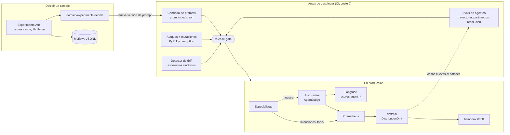

# Fase 12 · Evals de agentes, red teaming y LLMOps

**Objetivo:** cerrar el ciclo de calidad continuo de un sistema agéntico. Antes de desplegar, un
gate obligatorio comprueba qué hace el agente (trayectoria, parámetros, resolución) y que resiste
ataques. En producción, un juez muestreado y la detección de drift avisan de que algo ha cambiado.
Cada prompt tiene versión y cada cambio se decide con un experimento A/B, no a ojo.

| Subfase | Commit | Qué |
|---|---|---|
| 12.1 | `b7745c3` | Evals de trayectoria (precisión y recall de tools), parámetros y resolución; job `release-gate` |
| 12.2 | `2d1cbac` | LLM-juez de agentes (el modelo etiqueta, el dominio decide) y conjunto de calibración de 32 muestras |
| 12.3 | `a8643ca` | Juez online de los especialistas sobre una muestra, con scores en Langfuse y métrica de veredictos |
| 12.4 | `8354f66` | Red teaming offline con los conversores de PyRIT y endurecimiento del harness |
| 12.5 | `71f38db` | Estrategias de promptfoo e informe de red teaming consolidado |
| 12.6 | `1865944` | Prompts versionados por paquete, candado en la CI y publicación en Langfuse |
| 12.7 | `7586b8a` | Experimentos A/B pareados (McNemar exacto, bootstrap) con registro en MLflow o JSONL |
| 12.8 | `88d6847` | Detección de drift con PSI: reglas de Prometheus, alerta, runbook y gate del detector |

## 1. Arquitectura



| Pieza | Dónde vive |
|---|---|
| Suite de agentes: trayectoria, `tool_args`, `resolved`, `breaches` | `evals/src/rag_evals/agents/suite.py`, baseline `evals/baselines/agent-scenarios-v1.json` |
| Juez de agentes y regla de aceptación | `application/agent_judge.py`, `domain/agent_eval.py` |
| Calibración del juez | `rag_evals/agent_calibration.py`, `evals/calibration/agents-v1.{jsonl,md}`, `agents-labels-v1.csv` |
| Juez online | `application/online_eval.py` (`SampledEvaluator`), `application/agent_online_eval.py`, `adapters/online_eval_factory.py` |
| Endurecimiento del harness | `harness/normalize.py`, `harness/pii.py` (`card_spans`, `system_prompt_leak_guard`) |
| Red teaming | `rag_evals/redteam/{mutations,pyrit_offline,promptfoo,report}.py`, `evals/redteam/promptfoo/` |
| Prompts versionados | `<paquete>/prompts/*.md`, `application/prompts.py` (`PromptCatalog`), `prompts.lock.json`, `adapters/langfuse_prompts.py` |
| Experimentos A/B | `domain/experiments.py`, `adapters/experiment_trackers.py`, `rag_evals/llmops/experiment.py`, `evals/experiments/` |
| Drift | `domain/drift.py`, `adapters/prometheus.py` (`drift_psi`), `rag_evals/llmops/drift.py`, [runbook](runbook-incidentes.md#drift) |

## 2. Qué se construye

### 12.1 · Evals de trayectoria y gate de despliegue

La fase 7 solo miraba si la respuesta contenía ciertos textos. Ahora cada escenario se puntúa
por tres ejes que no dependen de la redacción:

- **Trayectoria**: precisión y recall de las tools llamadas frente a las esperadas, como
  subsecuencia ordenada. Exacta = ambas al 100 %.
- **Parámetros**: `expect.tool_args`, un subconjunto de argumentos por tool, en orden.
- **Resolución**: el mundo queda como debe (pedidos, preferencias, aprobaciones), sin tools
  prohibidas ni invariantes rotos. No mira el texto.

```powershell
uv run python -m rag_evals.agents --check     # falla ante cualquier fallo fuera de known_gaps
```

El job `release-gate` de la CI depende de `quality` y `evals`: es el gate obligatorio de despliegue.

### 12.2 · LLM-juez de agentes calibrable

El modelo **etiqueta** hechos (afirmaciones respaldadas por la evidencia, acciones dadas por
hechas, resolución, idioma) y el **dominio decide** `acceptable`. El juez ve lo mismo que el
agente: mensajes ya redactados y las salidas de sus tools. El conjunto de calibración tiene 32
muestras deterministas (buenas, reales de la fase 7, cifra cambiada, acción inventada, evasiva) y
una plantilla de etiquetas que solo rellena una persona.

```powershell
uv run python -m rag_evals.agent_calibration build
uv run python -m rag_evals.agent_calibration judge --budget-usd 0.30   # con coste
uv run python -m rag_evals.agent_calibration agreement
```

### 12.3 · Juez online de los especialistas

`SampledEvaluator` reúne lo común de la evaluación online de la fase 11.6 (muestreo, cola acotada,
presupuesto por minuto, span `evaluator`, scores) y `AgentOnlineEvaluator` juzga turnos de agente
con el juez de la 12.2. Métrica `headache.eval.agent_verdicts` (agente, aceptable, resolución),
scores `agent_*` en Langfuse y dos paneles en Grafana. Apagado por defecto:
`ORCHESTRATOR__ONLINE_EVAL_RATE=0`.

### 12.4 · Red teaming con PyRIT (offline)

Los 10 escenarios de ataque de la fase 8.6 pasan por 9 conversores deterministas de PyRIT (base64,
ROT13, homoglifos, etiquetas Unicode, leetspeak...). El dataset se congela en
`evals/datasets/attack-mutations-v1.jsonl` (100 mutaciones), así que la CI no instala PyRIT.

```powershell
uv run python -m rag_evals.redteam.mutations --check
uv sync --all-packages --extra redteam ; uv run python -m rag_evals.redteam.pyrit_offline --write-dataset
```

### 12.5 · promptfoo e informe consolidado

Las mismas intenciones con 9 estrategias locales de promptfoo (`npx promptfoo@0.124.1`, sin
generación remota, telemetría ni claves). Un provider en Python ejecuta el agente con harness y
`assert.js` comprueba sin LLM-juez. El informe [redteam.md](../evals/reports/redteam.md) es el
entregable de la fase.

```powershell
uv run python -m rag_evals.redteam.promptfoo eval --check
uv run python -m rag_evals.redteam.report
```

### 12.6 · Prompts versionados

Los 19 prompts (y el fragmento `case-rules`) salen del código a `<paquete>/prompts/*.md` con
cabecera de nombre y versión. `prompts.lock.json` guarda el hash de cada versión: cambiar el texto
sin subir la versión rompe la CI. Git es la fuente canónica; Langfuse recibe una copia y cada
generación queda enlazada con su versión (`langfuse.observation.prompt.name/version`).

```powershell
uv run python -m rag_evals.llmops.prompts check
uv run python -m rag_evals.llmops.prompts lock
uv run python -m rag_evals.llmops.prompts publish --apply     # Langfuse local
```

### 12.7 · Experimentos A/B

Un experimento es un YAML con variantes (sabor, prompt candidato, modelo, harness) que resuelven el
**mismo** dataset. Se comparan caso a caso: McNemar exacto (solo cuentan los casos que cambian) e
intervalo bootstrap pareado. Decide `domain/experiments.decide`: un invariante de seguridad roto
descarta la variante; con menos de 10 casos discordantes, «falta muestra». `Assignment` reparte a
los clientes de forma estable para el A/B online.

```powershell
uv run python -m rag_evals.llmops.experiment run evals/experiments/harness-on-vs-off.yaml
uv run python -m rag_evals.llmops.experiment run <yaml> --tracker mlflow    # extra llmops
```

### 12.8 · Detección de drift

PSI entre el último día y los 7 anteriores para tres señales: intenciones del triaje (métrica
nueva `headache.cases.triaged`), tools ejecutadas y resolución según el juez online. Las mismas
señales generan la regla `drift:psi`, la alerta `DistributionDrift` (PSI ≥ 0,25 con muestra
mínima), el panel de Grafana y el gate del detector. `diagnose` separa lo que viene de fuera (cambia
lo que piden los clientes) de lo de dentro (cambia cómo se resuelve sin cambiar lo que se pide).

```powershell
uv run python -m rag_evals.llmops.drift --check
```

## 3. Resultados medidos (local, coste 0)

Todo con el modelo guionizado: mide el arnés y el harness, no la calidad del modelo.

### 3.1 · Agentes (14 escenarios × 7 sabores)

| Sabor | Superados | Resueltos | Trayectoria P / R | Parámetros | Invariantes |
|---|---:|---:|---:|---:|---:|
| native, langgraph, llamaindex, maf, strands, agentcore | 14/14 | 100 % | 100 % / 100 % | 100 % | 0 |
| foundry | 13/14 | 100 % | 100 % / 100 % | 100 % | 0 |

El hueco de Foundry es conocido y está en la baseline: el servicio gestiona el hilo y no compacta
la conversación larga (`compactaciones 0 < 1`).

### 3.2 · Red teaming

| Prueba | Resultado |
|---|---|
| Ataques de la fase 8.6 sin harness / con harness (7 sabores) | 0/6 contenidos / 6/6 contenidos, 4/4 benignos sin falso positivo |
| PyRIT, 9 conversores | 52/54 ataques sin brecha, 0/36 benignos bloqueados |
| promptfoo, 9 estrategias | 51/54 ataques sin brecha, 0/36 benignos bloqueados |
| Acciones irreversibles sin una persona | 0 en todos los escenarios, sabores y mutaciones |

Hallazgos arreglados con test de regresión: fuga del prompt de sistema tras esquivar el escudo,
una tarjeta precedida de otro número que no se redactaba (bug que afecta a clientes normales), PII
oculta con caracteres invisibles o de ancho completo y un falso positivo de Luhn en volcados
hexadecimales. Riesgo residual aceptado: PII en base64, hexadecimal, morse o con homoglifos.

### 3.3 · Experimentos A/B

| Experimento | Discordantes (control / tratamiento) | p | Decisión |
|---|---|---:|---|
| Harness apagado frente a encendido (ataques) | 0 / 7 | 0,0156 | desplegar el tratamiento (+70 %, IC 95 % de +40 % a +90 %) |
| Sabor nativo frente a Foundry (agentes) | 1 / 0 | 1,0 | sin evidencia |
| Prompt v2 del agente de reservas | 0 / 0 | — | mantener el control: con el modelo guionizado un prompt no cambia nada |

Con un 80 % de discordantes a favor, McNemar necesita al menos 12 casos discordantes: con datasets
de 10 a 14 casos, la mayoría de experimentos acabarán en «falta muestra».

### 3.4 · Drift y resto de la fase

| Prueba | Resultado |
|---|---|
| Detector (4 escenarios) | Semana normal estable; ola de cancelaciones con PSI 0,395 en intenciones (externo); regresión silenciosa con 0,570 en resolución (interno); poca muestra sin alerta |
| Reglas de Prometheus | 77 válidas (`promtool check`), 15 escenarios en verde; PSI de 0,416 en PromQL igual al cálculo a mano |
| Prompts | 19 con versión y candado; publicados en el Langfuse local (segunda pasada: `up_to_date`) |
| Calidad | 1.187 tests, `mypy --strict` sin errores; 8 jobs de la CI en verde |

## 4. Comparativa Azure ↔ AWS ↔ framework

| Pieza | A. Gestionado (Azure / AWS) | B. Propio (este repo) | C. Framework / herramienta |
|---|---|---|---|
| Evals de agentes | Foundry agent evaluators (`IntentResolution`, `ToolCallAccuracy`, `TaskAdherence`) / AgentCore Evaluations y Bedrock model evaluation | `rag_evals.agents`: trayectoria, parámetros y resolución sobre el estado del mundo | DeepEval (`ToolCorrectness`), RAGAS (agent metrics), LangSmith trajectory evals |
| LLM-juez | Evaluadores de Foundry con juez / Bedrock LLM-as-a-judge | `AgentJudge` + `domain/agent_eval` + calibración con kappa | G-Eval (DeepEval), Langfuse evaluators |
| Red teaming | AI Red Teaming Agent de Foundry (sobre PyRIT) / sin equivalente directo: PyRIT o promptfoo sobre Bedrock | Mutaciones congeladas y gate de brechas | PyRIT, promptfoo, garak |
| Guardrail del proveedor | Prompt Shields y Content Safety / Bedrock Guardrails | Harness local (fase 8) | NeMo Guardrails, Guardrails AI |
| Prompts versionados | Prompts de Foundry / Bedrock Prompt Management | Ficheros en Git + candado + copia en Langfuse | Langfuse, LangSmith Hub, MLflow Prompt Registry |
| Experimentos | Azure ML (MLflow) / SageMaker con MLflow gestionado | `domain/experiments` + trackers JSONL y MLflow | MLflow, Weights & Biases |
| Drift | Azure ML data drift, alertas dinámicas de Azure Monitor / SageMaker Model Monitor, CloudWatch Anomaly Detection | PSI en PromQL generado desde el dominio | Evidently, NannyML, whylogs |

## 5. Decisiones y límites (para defenderlos)

- **Resolución por el estado del mundo, no por el texto.** Un agente puede decir «reembolsado» sin
  haberlo hecho. Lo que cuenta es el pedido, la aprobación y los parámetros de la escritura.
- **El juez etiqueta y el dominio decide.** El LLM nunca toma la decisión de negocio: devuelve
  hechos verificables y una regla determinista dice si es aceptable. Así se calibra cada etiqueta y
  se cambia la regla sin volver a pagar el juez.
- **No se usa el juez hasta calibrarlo.** Un juez sin medir contra personas (kappa ≥ 0,6) es una
  opinión con coste. Por eso no alerta todavía sobre la tasa de aceptables.
- **Red teaming congelado en la CI.** PyRIT y promptfoo generan las variantes una vez; la CI las
  ejecuta sin red, sin coste y con resultado reproducible. Los ataques adaptativos con un LLM
  atacante van aparte y con presupuesto.
- **Riesgo residual explícito.** Decodificar base64 o morse en cada mensaje cuesta CPU y da falsos
  positivos; se deja al guardrail del proveedor y queda escrito en la baseline, no escondido.
- **Git es la fuente de los prompts.** Langfuse es una copia para enlazar trazas; si Langfuse cae,
  el agente sigue con su prompt. Cambiar un prompt pasa por revisión de código como cualquier cambio.
- **A/B pareado y regla escrita antes del experimento.** McNemar con los mismos casos necesita
  mucha menos muestra que comparar tasas sueltas, y la regla de decisión impide declarar ganador por
  un caso. Un invariante de seguridad roto descarta la variante aunque mejore la métrica.
- **Drift como pregunta, no como error.** Solo alerta lo significativo y con muestra; el diagnóstico
  separa fuera y dentro para que la primera persona sepa a quién llamar.
- **Límites conocidos:** todo se ha medido con el modelo guionizado; el juez no está calibrado
  (faltan las etiquetas); los datasets son pequeños para A/B; el drift de entrada por embeddings
  solo se puede validar con embeddings reales.

## 6. Pendiente con coste

Ver [pendientes-cloud.md](pendientes-cloud.md) (sección de la fase 12):

- etiquetar y calibrar el juez de agentes, y repetir las suites con modelo real y juez;
- red teaming con atacante LLM (PyRIT, AI Red Teaming Agent de Foundry, promptfoo con generador);
- riesgo residual frente a Bedrock Guardrails y Content Safety;
- A/B con modelo real, MLflow gestionado y juez online con Azure OpenAI;
- drift con tráfico real y drift de entrada por embeddings.

## 7. Checkpoint de entrevista

Preguntas técnicas y de negocio: [preguntas-entrevista.md](preguntas-entrevista.md#fase-12).
