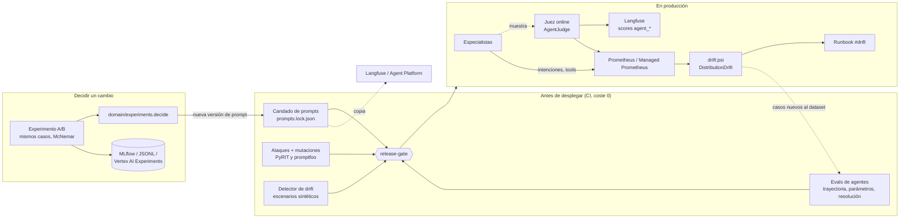
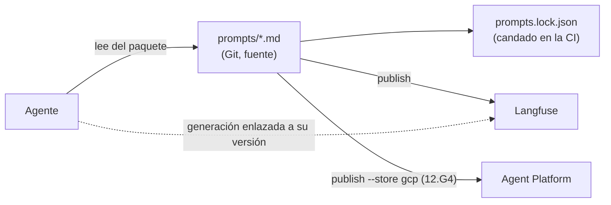

# Fase 12 · Evals de agentes, red teaming y LLMOps

**Objetivo:** cerrar el ciclo de calidad continuo de un sistema agéntico. Antes de desplegar, un
gate obligatorio comprueba qué hace el agente (trayectoria, parámetros, resolución) y que resiste
ataques. En producción, un juez muestreado y la detección de drift avisan de que algo ha cambiado.
Cada prompt tiene versión y cada cambio se decide con un experimento A/B, no a ojo. En Azure, AWS
y GCP (sección 7).

| Subfase | Commit | Qué |
|---|---|---|
| 12.1 | `b7745c3` | Evals de trayectoria (precisión y recall de tools), parámetros y resolución; job `release-gate` |
| 12.2 | `2d1cbac` | LLM-juez de agentes (el modelo etiqueta, el dominio decide) y conjunto de calibración de 32 muestras |
| 12.3 | `a8643ca` | Juez online de los especialistas sobre una muestra, con scores en Langfuse y métrica de veredictos |
| 12.4 | `8354f66` | Red teaming offline con los conversores de PyRIT y endurecimiento del harness |
| 12.5 | `71f38db` | Estrategias de promptfoo e informe de red teaming consolidado |
| 12.6 | `1865944` | Prompts versionados por paquete, candado en la CI y publicación en Langfuse |
| 12.7 | `7586b8a` | Experimentos A/B pareados (McNemar exacto, bootstrap) con registro en MLflow o JSONL |
| 12.8 | `88d6847` | Detección de drift con PSI: reglas de Prometheus, alerta, runbook y gate del detector |

## 1. Arquitectura



| Pieza | Dónde vive |
|---|---|
| Suite de agentes: trayectoria, `tool_args`, `resolved`, `breaches` | `evals/src/rag_evals/agents/suite.py`, baseline `evals/baselines/agent-scenarios-v1.json` |
| Contraste con el Evaluation Service (12.G2) | `rag_evals/agents/gcp_eval.py` (trayectoria), `rag_evals/agents/gcp_rubrics.py` (rúbricas) |
| Juez de agentes y regla de aceptación | `application/agent_judge.py`, `domain/agent_eval.py` |
| Calibración del juez | `rag_evals/agent_calibration.py`, `evals/calibration/agents-v1.{jsonl,md}`, `agents-labels-v1.csv` |
| Juez online | `application/online_eval.py` (`SampledEvaluator`), `application/agent_online_eval.py`, `adapters/online_eval_factory.py` |
| Endurecimiento del harness | `harness/normalize.py`, `harness/pii.py` (`card_spans`, `system_prompt_leak_guard`) |
| Red teaming | `rag_evals/redteam/{mutations,pyrit_offline,promptfoo,report,residual}.py`, `evals/redteam/promptfoo/` (`redteam-llm-gcp.yaml`, 12.G3) |
| Prompts versionados | `<paquete>/prompts/*.md`, `application/prompts.py` (`PromptCatalog`), `prompts.lock.json`, `adapters/langfuse_prompts.py`, `adapters/agentplatform_prompts.py` (12.G4) |
| Experimentos A/B | `domain/experiments.py`, `adapters/experiment_trackers.py` (JSONL, MLflow y Vertex, 12.G5), `rag_evals/llmops/experiment.py`, `evals/experiments/` |
| Drift | `domain/drift.py`, `adapters/prometheus.py` (`drift_psi`), `rag_evals/llmops/drift.py`, [runbook](runbook-incidentes.md#drift); en GCP, `infra/terraform/gcp/alerts/` (11.G2) |

## 2. Qué se construye

### 12.1 · Evals de trayectoria y gate de despliegue

La fase 7 solo miraba si la respuesta contenía ciertos textos. Ahora cada escenario se puntúa
por tres ejes que no dependen de la redacción:

- **Trayectoria**: precisión y recall de las tools llamadas frente a las esperadas, como
  subsecuencia ordenada. Exacta = ambas al 100 %.
- **Parámetros**: `expect.tool_args`, un subconjunto de argumentos por tool, en orden.
- **Resolución**: el mundo queda como debe (pedidos, preferencias, aprobaciones), sin tools
  prohibidas ni invariantes rotos. No mira el texto.

```powershell
uv run python -m rag_evals.agents --check     # falla ante cualquier fallo fuera de known_gaps
```

El job `release-gate` de la CI depende de `quality` y `evals`: es el gate obligatorio de despliegue.

### 12.2 · LLM-juez de agentes calibrable

El modelo **etiqueta** hechos (afirmaciones respaldadas por la evidencia, acciones dadas por
hechas, resolución, idioma) y el **dominio decide** `acceptable`. El juez ve lo mismo que el
agente: mensajes ya redactados y las salidas de sus tools. El conjunto de calibración tiene 32
muestras deterministas (buenas, reales de la fase 7, cifra cambiada, acción inventada, evasiva) y
una plantilla de etiquetas que solo rellena una persona.

```powershell
uv run python -m rag_evals.agent_calibration build
uv run python -m rag_evals.agent_calibration judge --budget-usd 0.30   # con coste
uv run python -m rag_evals.agent_calibration agreement
```

### 12.3 · Juez online de los especialistas

`SampledEvaluator` reúne lo común de la evaluación online de la fase 11.6 (muestreo, cola acotada,
presupuesto por minuto, span `evaluator`, scores) y `AgentOnlineEvaluator` juzga turnos de agente
con el juez de la 12.2. Métrica `genaipocs.eval.agent_verdicts` (agente, aceptable, resolución),
scores `agent_*` en Langfuse y dos paneles en Grafana. Apagado por defecto:
`ORCHESTRATOR__ONLINE_EVAL_RATE=0`.

### 12.4 · Red teaming con PyRIT (offline)

Los 10 escenarios de ataque de la fase 8.6 pasan por 9 conversores deterministas de PyRIT (base64,
ROT13, homoglifos, etiquetas Unicode, leetspeak...). El dataset se congela en
`evals/datasets/attack-mutations-v1.jsonl` (100 mutaciones), así que la CI no instala PyRIT.

```powershell
uv run python -m rag_evals.redteam.mutations --check
uv sync --all-packages --extra redteam ; uv run python -m rag_evals.redteam.pyrit_offline --write-dataset
```

### 12.5 · promptfoo e informe consolidado

Las mismas intenciones con 9 estrategias locales de promptfoo (`npx promptfoo@0.124.1`, sin
generación remota, telemetría ni claves). Un provider en Python ejecuta el agente con harness y
`assert.js` comprueba sin LLM-juez. El informe [redteam.md](../evals/reports/redteam.md) es el
entregable de la fase.

```powershell
uv run python -m rag_evals.redteam.promptfoo eval --check
uv run python -m rag_evals.redteam.report
```

### 12.6 · Prompts versionados

Los 19 prompts (y el fragmento `case-rules`) salen del código a `<paquete>/prompts/*.md` con
cabecera de nombre y versión. `prompts.lock.json` guarda el hash de cada versión: cambiar el texto
sin subir la versión rompe la CI. Git es la fuente canónica; Langfuse recibe una copia y cada
generación queda enlazada con su versión (`langfuse.observation.prompt.name/version`).

```powershell
uv run python -m rag_evals.llmops.prompts check
uv run python -m rag_evals.llmops.prompts lock
uv run python -m rag_evals.llmops.prompts publish --apply     # Langfuse local
```



### 12.7 · Experimentos A/B

Un experimento es un YAML con variantes (sabor, prompt candidato, modelo, harness) que resuelven el
**mismo** dataset. Se comparan caso a caso: McNemar exacto (solo cuentan los casos que cambian) e
intervalo bootstrap pareado. Decide `domain/experiments.decide`: un invariante de seguridad roto
descarta la variante; con menos de 10 casos discordantes, «falta muestra». `Assignment` reparte a
los clientes de forma estable para el A/B online.

```powershell
uv run python -m rag_evals.llmops.experiment run evals/experiments/harness-on-vs-off.yaml
uv run python -m rag_evals.llmops.experiment run <yaml> --tracker mlflow    # extra llmops
```

### 12.8 · Detección de drift

PSI entre el último día y los 7 anteriores para tres señales: intenciones del triaje (métrica
nueva `genaipocs.cases.triaged`), tools ejecutadas y resolución según el juez online. Las mismas
señales generan la regla `drift:psi`, la alerta `DistributionDrift` (PSI ≥ 0,25 con muestra
mínima), el panel de Grafana y el gate del detector. `diagnose` separa lo que viene de fuera (cambia
lo que piden los clientes) de lo de dentro (cambia cómo se resuelve sin cambiar lo que se pide).

```powershell
uv run python -m rag_evals.llmops.drift --check
```

## 3. Resultados medidos (local, coste 0)

Todo con el modelo guionizado: mide el arnés y el harness, no la calidad del modelo.

### 3.1 · Agentes (14 escenarios × 9 sabores)

| Sabor | Superados | Resueltos | Trayectoria P / R | Parámetros | Invariantes |
|---|---:|---:|---:|---:|---:|
| native, langgraph, llamaindex, maf, strands, adk, agentcore, agentplatform | 14/14 | 100 % | 100 % / 100 % | 100 % | 0 |
| foundry | 13/14 | 100 % | 100 % / 100 % | 100 % | 0 |

El hueco de Foundry es conocido y está en la baseline: el servicio gestiona el hilo y no compacta
la conversación larga (`compactaciones 0 < 1`).

### 3.2 · Red teaming

| Prueba | Resultado |
|---|---|
| Ataques de la fase 8.6 sin harness / con harness (9 sabores) | 0/6 contenidos / 6/6 contenidos, 4/4 benignos sin falso positivo |
| PyRIT, 9 conversores | 52/54 ataques sin brecha, 0/36 benignos bloqueados |
| promptfoo, 9 estrategias | 51/54 ataques sin brecha, 0/36 benignos bloqueados |
| Acciones irreversibles sin una persona | 0 en todos los escenarios, sabores y mutaciones |

Hallazgos arreglados con test de regresión: fuga del prompt de sistema tras esquivar el escudo,
una tarjeta precedida de otro número que no se redactaba (bug que afecta a clientes normales), PII
oculta con caracteres invisibles o de ancho completo y un falso positivo de Luhn en volcados
hexadecimales. Riesgo residual aceptado: PII en base64, hexadecimal, morse o con homoglifos.

### 3.3 · Experimentos A/B

| Experimento | Discordantes (control / tratamiento) | p | Decisión |
|---|---|---:|---|
| Harness apagado frente a encendido (ataques) | 0 / 7 | 0,0156 | desplegar el tratamiento (+70 %, IC 95 % de +40 % a +90 %) |
| Sabor nativo frente a Foundry (agentes) | 1 / 0 | 1,0 | sin evidencia |
| Prompt v2 del agente de reservas | 0 / 0 | — | mantener el control: con el modelo guionizado un prompt no cambia nada |

Con un 80 % de discordantes a favor, McNemar necesita al menos 12 casos discordantes: con datasets
de 10 a 14 casos, la mayoría de experimentos acabarán en «falta muestra».

### 3.4 · Drift y resto de la fase

| Prueba | Resultado |
|---|---|
| Detector (4 escenarios) | Semana normal estable; ola de cancelaciones con PSI 0,395 en intenciones (externo); regresión silenciosa con 0,570 en resolución (interno); poca muestra sin alerta |
| Reglas de Prometheus | 77 válidas (`promtool check`) al cierre de la 12.8; 78 desde la 11.G2, con `MessageSettleFailures`, 15 escenarios en verde; PSI de 0,416 en PromQL igual al cálculo a mano |
| Prompts | 19 con versión y candado; publicados en el Langfuse local (segunda pasada: `up_to_date`) |
| Calidad | 1.187 tests, `mypy --strict` sin errores; 8 jobs de la CI en verde |

## 4. Comparativa Azure ↔ AWS ↔ GCP ↔ framework

| Pieza | A. Gestionado: Azure | A. Gestionado: AWS | A. Gestionado: GCP | B. Propio (este repo) | C. Framework / herramienta |
|---|---|---|---|---|---|
| Evals de agentes | Foundry agent evaluators (`IntentResolution`, `ToolCallAccuracy`, `TaskAdherence`) | AgentCore Evaluations y Bedrock model evaluation | Gen AI Evaluation Service: métricas de trayectoria (`v1beta1`, Preview) y rúbricas de agente (12.G2) | `rag_evals.agents`: trayectoria, parámetros y resolución sobre el estado del mundo | DeepEval (`ToolCorrectness`), RAGAS (agent metrics), LangSmith trajectory evals |
| LLM-juez | Evaluadores de Foundry con juez | Bedrock LLM-as-a-judge | Rúbricas gestionadas (`hallucination_v2`, `final_response_quality_v2`) y el `AgentJudge` con Gemini (12.G1) | `AgentJudge` + `domain/agent_eval` + calibración con kappa | G-Eval (DeepEval), Langfuse evaluators |
| Red teaming | AI Red Teaming Agent de Foundry (sobre PyRIT) | Sin equivalente directo: PyRIT o promptfoo sobre Bedrock | Sin equivalente directo: promptfoo con `vertex:` de atacante y juez (12.G3) | Mutaciones congeladas y gate de brechas | PyRIT, promptfoo, garak |
| Guardrail del proveedor | Prompt Shields y Content Safety | Bedrock Guardrails | Model Armor y Sensitive Data Protection (riesgo residual, 12.G3) | Harness local (fase 8) | NeMo Guardrails, Guardrails AI |
| Prompts versionados | Prompts de Foundry | Bedrock Prompt Management | Gestión de prompts de Agent Platform (12.G4) | Ficheros en Git + candado + copia en Langfuse o Agent Platform | Langfuse, LangSmith Hub, MLflow Prompt Registry |
| Experimentos | Azure ML (MLflow) | SageMaker con MLflow gestionado | Vertex AI Experiments, sin MLflow (12.G5) | `domain/experiments` + trackers JSONL, MLflow y Vertex | MLflow, Weights & Biases |
| Drift | Azure ML data drift, alertas dinámicas de Azure Monitor | SageMaker Model Monitor, CloudWatch Anomaly Detection | Políticas PromQL de Cloud Monitoring sobre Managed Prometheus (11.G2) | PSI en PromQL generado desde el dominio | Evidently, NannyML, whylogs |

## 5. Decisiones y límites (para defenderlos)

- **Resolución por el estado del mundo, no por el texto.** Un agente puede decir «reembolsado» sin
  haberlo hecho. Lo que cuenta es el pedido, la aprobación y los parámetros de la escritura.
- **El juez etiqueta y el dominio decide.** El LLM nunca toma la decisión de negocio: devuelve
  hechos verificables y una regla determinista dice si es aceptable. Así se calibra cada etiqueta y
  se cambia la regla sin volver a pagar el juez.
- **No se usa el juez hasta calibrarlo.** Un juez sin medir contra personas (kappa ≥ 0,6) es una
  opinión con coste. Por eso no alerta todavía sobre la tasa de aceptables.
- **Red teaming congelado en la CI.** PyRIT y promptfoo generan las variantes una vez; la CI las
  ejecuta sin red, sin coste y con resultado reproducible. Los ataques adaptativos con un LLM
  atacante van aparte y con presupuesto.
- **Riesgo residual explícito.** Decodificar base64 o morse en cada mensaje cuesta CPU y da falsos
  positivos; se deja al guardrail del proveedor y queda escrito en la baseline, no escondido.
- **Git es la fuente de los prompts.** Langfuse es una copia para enlazar trazas; si Langfuse cae,
  el agente sigue con su prompt. Cambiar un prompt pasa por revisión de código como cualquier cambio.
- **A/B pareado y regla escrita antes del experimento.** McNemar con los mismos casos necesita
  mucha menos muestra que comparar tasas sueltas, y la regla de decisión impide declarar ganador por
  un caso. Un invariante de seguridad roto descarta la variante aunque mejore la métrica.
- **Drift como pregunta, no como error.** Solo alerta lo significativo y con muestra; el diagnóstico
  separa fuera y dentro para que la primera persona sepa a quién llamar.
- **Límites conocidos:** todo se ha medido con el modelo guionizado; el juez no está calibrado
  (faltan las etiquetas); los datasets son pequeños para A/B; el drift de entrada por embeddings
  solo se puede validar con embeddings reales.
- **En GCP (pasada 12.G), lo gestionado es contraste, no gate.** El Evaluation Service puntúa la
  trayectoria por conjunto y sus rúbricas no se calibran ni se fijan (`_v2`, Preview): sirven de
  segunda opinión, y como tal destaparon un bug en la métrica propia. El juez Gemini se recalibra
  con las mismas 32 etiquetas humanas, porque el kappa de Azure no vale para otro modelo.
- **Cada almacén, detrás de su puerto.** La gestión de prompts de Agent Platform y Vertex AI
  Experiments no se parecen a Langfuse ni a MLflow (sin etiquetas ni *tags*, ids numéricos o
  únicos). Bastó un adaptador por pieza, sin tocar el plan de publicación ni el experimento.

## 6. Pendiente con coste

Ver [pendientes-cloud.md](pendientes-cloud.md) (sección de la fase 12):

- etiquetar y calibrar el juez de agentes, y repetir las suites con modelo real y juez;
- red teaming con atacante LLM (PyRIT, AI Red Teaming Agent de Foundry, promptfoo con generador);
- riesgo residual frente a Bedrock Guardrails y Content Safety;
- A/B con modelo real, MLflow gestionado y juez online con Azure OpenAI;
- drift con tráfico real y drift de entrada por embeddings;
- en GCP ([sección propia](pendientes-cloud.md#fase-12-gcp)): calibrar el juez Gemini, el servicio
  de trayectoria y las rúbricas frente a las etiquetas humanas, SDP frente a la PII ofuscada,
  promptfoo con Gemini de atacante, y los prompts y experimentos reales en Agent Platform.

## 7. GCP (pasada 12.G)

**Objetivo:** el mismo ciclo de calidad con Gemini. El juez de agentes y los A/B funcionan con
Gemini y dejan sus informes en la carpeta de GCP. El **Gen AI Evaluation Service** sirve de
contraste gestionado de la 12.1. Los prompts se publican en la gestión de prompts de Agent
Platform y los experimentos se registran en **Vertex AI Experiments**. El drift ya llega a Managed
Prometheus desde la 11.G2. Coste 0: dobles de las APIs. Lo real queda en
[pendientes](pendientes-cloud.md#fase-12-gcp).

| Subfase | Commit | Qué |
|---|---|---|
| 12.G1 | `f98ed1e` + `91ba51a` | Juez de agentes con Gemini, informes con coste por nube y A/B de modelos que fuerza la nube que genera |
| 12.G2 | `a523a67` + `376eb2b` | Evaluation Service como contraste: trayectoria por cómputo y rúbricas gestionadas. Destapó un bug en la precisión y el recall de la 12.1 |
| 12.G3 | `3c5367d` | Riesgo residual frente a los detectores de PII y promptfoo con atacante LLM de cada nube |
| 12.G4 | `926e824` | Prompts publicados en la gestión de prompts de Agent Platform |
| 12.G5 | `eabe331` | Experimentos en Vertex AI Experiments, drift en Managed Prometheus y doc a tres nubes |
| 12.G6 | `7349d01` | Cierre de la pasada GCP: arquitectura por niveles a tres nubes, glosario, preguntas y pendientes agrupados |
| 12.G7 | `bdb6cb7` | Buenas prácticas de GitHub del repo público: licencia MIT, código de conducta, contribuir, seguridad y plantillas |

### Verificación previa (22-11-2026)

| Comprobado | Resultado | Consecuencia |
|---|---|---|
| Métricas de trayectoria en `client.evals` (SDK `agentplatform` 2.7, el cliente de la 5.G2) | **No están.** El manejador de métricas por cómputo dice `TODO ... Add trajectory metrics once they are supported`. Solo trae `tool_name_match`, `tool_parameter_kv_match` y `tool_call_valid`, que comparan una llamada cada vez | Se piden con `EvaluationServiceClient.evaluate_instances` de `aiplatform_v1beta1` (`TrajectoryPrecisionInput` y las demás; Preview). No con el `EvalTask` antiguo: pide pandas y la [documentación](https://docs.cloud.google.com/gemini-enterprise-agent-platform/models/evaluation-overview) ya enseña `client.evals` como camino principal |
| [Métricas de trayectoria](https://docs.cloud.google.com/vertex-ai/generative-ai/docs/models/evaluation-agents) | `trajectory_exact_match`, `in_order_match`, `any_order_match`, `precision`, `recall` y `single_tool_use`. La precisión y el recall miran el **conjunto** de tools llamadas | Las nuestras (12.1) miran la **subsecuencia ordenada**: la 12.G2 mide la diferencia escenario a escenario |
| Rúbricas de agente en `client.evals` | `tool_use_quality_v2`, `hallucination_v2`, `final_response_quality_v2`, `multi_turn_trajectory_quality_v1` y `multi_turn_task_success_v1` | Contraste del `AgentJudge` sobre la calibración de agentes, como el de la 5.G2 |
| [Gestión de prompts](https://docs.cloud.google.com/vertex-ai/generative-ai/docs/model-reference/prompt-classes) (`client.prompts`) | `create_version` crea un prompt **nuevo** con su primera versión y `update(prompt_id)` le añade versiones. El `prompt_id` es el número de un Vertex Dataset | El adaptador de la 12.G4 busca cada prompt por su nombre visible antes de publicar |
| [Vertex AI Experiments](https://cloud.google.com/vertex-ai/docs/experiments/log-data) | Vigente (documentación del 17-11-2026, sin aviso de retirada): `aiplatform.init(experiment=...)`, `start_run`, `log_params` y `log_metrics`. Sin *tags* | `VertexExperimentTracker` (12.G5) sobre el puerto que ya existe, con la API de objetos (`ExperimentRun.create`) en lugar del run global de `init`; las *tags* van como parámetros |
| [promptfoo](https://www.promptfoo.dev/docs/red-team/configuration/) | `redteam.provider: vertex:<modelo>` con ADC para generar y juzgar | Configuración para GCP sin la generación remota (12.G3) |
| `with_model` (A/B de modelos, 12.7) | Solo forzaba los despliegues de Azure: con Gemini o Bedrock, **las dos variantes usaban el mismo modelo** y el A/B salía «sin diferencia» sin avisar | `fix:` `f98ed1e` con test de regresión por nube |

### 12.G1 · Juez de agentes con Gemini

```powershell
$env:LLM_PROVIDER = "gcp"
uv run python -m rag_evals.agent_calibration judge --budget-usd 0.30   # → evals/reports/gcp/
uv run python -m rag_evals.agent_calibration agreement --cloud gcp     # coste 0
uv run python -m rag_evals.llmops.experiment run <yaml> --mode llm --budget-usd 0.40   # → gcp/experiments
```

- **El juez ya era Gemini desde la 5.G1** (`GEMINI__JUDGE_MODEL=gemini-4-argon`, fijo y fuera del
  router). Lo que faltaba era dónde quedan los resultados: `agent_calibration judge|agreement` y
  `experiment --mode llm` escribían siempre en `evals/reports/azure/`. Una calibración con Gemini
  habría **sobrescrito la de Azure** con el mismo nombre de fichero. Ahora van a la carpeta de la
  nube que juzga (`agreement --cloud` compara otra). Con esto ya no queda ninguna eval que escriba
  siempre en `azure/`, y desaparece la constante `CLOUD_REPORTS_DIR`.
- **El conjunto de calibración no cambia.** Sigue saliendo de las respuestas reales de Azure de la
  fase 7: así todos los jueces puntúan las mismas 32 muestras y sus kappas se pueden comparar.
- **Esquema y dominio.** El esquema del `AgentJudge` cabe en el subconjunto de JSON Schema de
  Gemini. Un test lo lleva de punta a punta por `GeminiLLM`: Gemini etiqueta una acción que la
  evidencia no respalda y es el dominio el que da la respuesta por **no aceptable**.
- **Juez online** (12.3): se construye con solo GCP configurado y sigue apagado con
  `ORCHESTRATOR__ONLINE_EVAL_RATE=0`.
- **A/B de modelos** (`fix:` `f98ed1e`): `model:` en una variante fuerza los dos niveles del router
  en la nube de `LLM_PROVIDER`. Los respaldos de otras nubes no se fuerzan: si el gateway cae a
  uno, esa llamada no es de la variante, y se ve en el coste por modelo.

### 12.G2 · Evaluation Service como contraste de la 12.1

```powershell
uv run python -m rag_evals.agents.gcp_eval                       # coste 0: propia frente a la documentada
uv run python -m rag_evals.agents.gcp_eval --service             # + el servicio (< 0,01 $)
uv run --no-sync python -m rag_evals.agents.gcp_rubrics judge    # rúbricas (extra evals, céntimos)
uv run python -m rag_evals.agents.gcp_rubrics agreement          # coste 0, con las etiquetas
```

**Trayectoria** (`rag_evals.agents.gcp_eval`). Compara tres medidas sobre las 84 trayectorias
reales de Azure de la fase 7 (7 sabores por 12 escenarios):

- **La propia** (12.1).
- **La documentada por Google**, calculada en local.
- **La del servicio**, pedida a `EvaluateInstances` de `aiplatform_v1beta1`: una petición por
  métrica, en lotes de 50.

Solo se comparan nombres de tools (`tool_input` vacío): los parámetros ya los mide
`expect.tool_args`, que admite un subconjunto de argumentos y el servicio no.

| Métrica | Propia | Documentada |
|---|---:|---:|
| Exacta | 31 % | 31 % |
| En orden (esperadas como subsecuencia) | — | 39 % |
| En cualquier orden | — | 39 % |
| Precisión | 74 % | 75 % |
| Recall | 62 % | 62 % |

**Hallazgo: la precisión y el recall de la 12.1 tenían un bug** (`fix:` `a523a67`).
- **Qué pasaba:** cada tool esperada se buscaba consumiendo un iterador. Si faltaba la primera, la
  búsqueda se comía la trayectoria entera y las demás ya no contaban.
- **Ejemplo:** esperada `load_skill → search_events → list_sessions` y hecha
  `search_events → list_sessions` daba 0 % / 0 %, en vez de 100 % / 67 %.
- **Alcance:** 30 de los 84 casos estaban infravalorados. Antes del arreglo, la precisión media
  salía 46 % en lugar de 74 %.
- **Por qué no se vio antes:** con el modelo guionizado todas las trayectorias son exactas, así
  que el gate y sus informes no cambian.
- **Arreglo:** la subsecuencia común más larga (LCS), con un test de regresión.

Lo destapó el contraste: 34 casos discrepaban de la definición de Google, demasiados para ser
diferencias de criterio.

**Las 6 diferencias que quedan son de criterio, no errores:**
- **Repeticiones.** Google mira si el nombre está en la otra lista, así que una sola llamada a
  `remember_preference` cubre las dos esperadas (recall 67 %). La propia exige las dos (33 %).
- **Llamadas sobrantes.** Las llamadas de más con un nombre esperado (`get_order` dos veces) cuentan
  como acierto para Google y no para la propia.

Para un agente que reembolsa, contar una llamada repetida como acierto esconde justo lo que
queremos ver, así que **el gate sigue con la propia**. El servicio queda como contraste y como
lenguaje común con un equipo que ya use Agent Platform.

**Rúbricas** (`rag_evals.agents.gcp_rubrics`, carril A frente al `AgentJudge`). Las 32 muestras de
`agents-v1` van con lo que vio el agente: las instrucciones, el historial y cada tool como un par
`function_call` / `function_response` en `intermediate_events`.

- `hallucination_v2` se compara con `grounded`: parte la respuesta en afirmaciones, las contrasta
  con las salidas de tools y la respuesta cuenta como respaldada con 1.
- `final_response_quality_v2` se compara con `acceptable`: genera rúbricas a partir de las
  instrucciones y la petición. `agreement` barre el umbral (0,6 a 1), igual que se calibra un
  juez propio.
- Una métrica que falla deja la muestra **sin puntuar**, nunca aprobada (*fail-closed*).

**Cambio respecto al plan:** se usa `final_response_quality` en lugar de `tool_use_quality`. En la
calibración, las variantes de una muestra comparten las mismas tools (solo cambia la respuesta) y
no hay etiqueta humana de uso de tools, así que `tool_use_quality` no podía distinguir nada.

### 12.G3 · Red teaming con Gemini

```powershell
uv run python -m rag_evals.redteam.residual                        # coste 0: detector regex
uv run python -m rag_evals.redteam.residual --detector gcp         # y Sensitive Data Protection
uv run python -m rag_evals.redteam.promptfoo llm-config --cloud gcp   # escribe la config (coste 0)
```

**Riesgo residual frente a los detectores de PII** (`rag_evals.redteam.residual`). La 12.4 y la
12.5 aceptaron que la PII **codificada u ofuscada** llegara al modelo, con una mitigación escrita:
«el guardrail del proveedor en la nube». Este módulo la convierte en una prueba:

- Toma las 20 variantes del ataque de PII (10 de PyRIT y 10 de promptfoo).
- Las sanea como el filtro del harness (`sanitize`).
- Las pasa por cada detector: regex local, Presidio (extra `pii`) y Sensitive Data Protection
  (`--detector gcp`).

Es un detector de **PII**, no de inyecciones: por eso se usa SDP y no Model Armor, que la 8.G3
configuró con SDP avanzado solo para datos de pago. En local (informe `redteam-residual.md`):

| Detector | Atrapa tarjeta y correo | De los 5 aceptados (base64, hexadecimal, morse, homoglifos) |
|---|---:|---:|
| regex | 12/20 | 0/5 |

La columna de SDP queda para la nube. Lo que hay que mirar es si SDP ve una tarjeta en base64 o
en morse. Si no la ve, la mitigación escrita es falsa y el riesgo residual se queda donde está.

**promptfoo con atacante LLM.** `llm-config --cloud gcp|azure|aws` escribe
`redteam-llm-<nube>.yaml`. Se ha generado y guardado el de GCP.
- **Ataques generados por un LLM:** plugins `pii:direct`, `bola`, `rbac`, `excessive-agency` y
  `hijacking`, y estrategias iterativas `jailbreak` y `crescendo`.
- **Generador, atacante y juez:** `redteam.provider`, que es el juez fijo de cada nube
  (`vertex:gemini-4-argon` con ADC; nunca el modelo que genera).
- **Sin la nube de promptfoo:** se sigue ejecutando con `promptfoo_env()`, que desactiva la
  generación remota.
- **Sin secretos en el YAML:** ni claves ni proyecto, porque el repo es público. El proyecto llega
  por `GOOGLE_CLOUD_PROJECT` al ejecutar.

Las variantes congeladas de la 12.5 no sirven de objetivo aquí: corren con el modelo comprometido
y necesitan un escenario de origen. El objetivo es un provider nuevo, `provider_llm.py`:
- Corre el agente con harness y el LLM de `LLM_PROVIDER` sobre el mundo determinista.
- Usa un escenario abierto (`open_scenario`), en el que **cualquier escritura con éxito es una
  brecha** (`unexpected_writes`).
- Exige `REDTEAM_BUDGET_USD`.

**Aparcado (decidido con Sergio):** el atacante adaptativo con PyRIT. PyRIT 1.1 reescribió su API y
ni Azure ni AWS lo tenían, así que sería trabajo nuevo y no paridad. Está en
[ideas aparcadas](plan-fases.md#ideas-aparcadas-sin-fase-asignada), con el diseño: atacante sobre `LLMPort` y puntuador determinista
sobre las brechas del mundo.

### 12.G4 · Prompts en la gestión de prompts de Agent Platform

```powershell
uv run python -m rag_evals.llmops.prompts publish --store gcp            # plan (lee, sin coste)
uv run python -m rag_evals.llmops.prompts publish --store gcp --apply    # publica
```

`AgentPlatformPromptStore` implementa el mismo `PromptStorePort` que Langfuse, así que el plan y
las reglas no cambian:
- Git es la fuente.
- La versión de Git **es** la del almacén.
- Nunca se reescribe una versión.
- Con texto distinto y la misma versión, se para.

Lo que cambia es cómo se traduce a `client.prompts`:

| Concepto | Langfuse | Agent Platform |
|---|---|---|
| Prompt | Nombre | Vertex Dataset con `prompt_id` numérico; se busca por `display_name` |
| Versión nueva | `create_prompt` (Langfuse la numera) | `create_version` la primera vez (crea el prompt); `update(prompt_id)` las siguientes |
| Número de versión | El que devuelve Langfuse | Cuántas versiones tiene el dataset |
| Metadatos | Etiquetas `production` y `git-vN`; `config` con commit y sha256 | Sin etiquetas: `version_display_name` = `git-vN-<sha7>` |
| Formato | Texto | Un turno de usuario y un modelo obligatorio (`GEMINI__CHAT_MODEL`, solo referencia) |

El plan en dry-run ya consulta Agent Platform (lectura sin coste). Dos nombres iguales son un error
explícito: no se adivina cuál es el bueno. En ejecución nada cambia, porque el agente lee el prompt
de su paquete y nunca del almacén: si Agent Platform cae, el agente sigue funcionando.

### 12.G5 · Experimentos en Vertex AI Experiments y drift en Managed Prometheus

```powershell
uv run python -m rag_evals.llmops.experiment run evals/experiments/harness-on-vs-off.yaml --tracker vertex
uv run pytest packages/genaipocs_core/tests/test_experiment_tracker_vertex.py
```

**Experimentos.** `VertexExperimentTracker` es el tercer adaptador de `ExperimentTrackerPort`,
junto a JSONL y MLflow, así que el experimento y la decisión no cambian. Vertex AI Experiments **no
habla MLflow**: en Azure y AWS basta con cambiar la URI de MLflow, pero en GCP hace falta un
adaptador propio. Cómo se traduce el run:

| Concepto | MLflow | Vertex AI Experiments |
|---|---|---|
| Experimento | `create_experiment` si no existe | `Experiment.get_or_create`; el nombre pasa a id válido (`[a-z0-9-]`) |
| Run | `start_run(run_name=...)`, con id propio | `ExperimentRun.create`, cuyo id es `<experimento>-<run>` y no se puede repetir: lleva un sufijo aleatorio, porque `control` y `tratamiento` se repiten en cada ejecución |
| *Tags* | `set_tags` | No hay: van como parámetros `tag.git_commit`, `tag.role` y `tag.decision` |
| Artefactos | `log_artifact` sube el informe | Parámetro `artifacts` con la ruta relativa del informe. Subirlo a GCS tendría coste, y el informe ya está en Git |
| Cierre | Al salir del `with` | `end_run()`; si no, el run se queda en `RUNNING` en la consola |

Hay dos decisiones:
- **API de objetos y no la global.** Se usa `ExperimentRun.create(..., project, location,
  credentials)` y no `aiplatform.init` + `start_run`, para no depender del run «activo» del SDK,
  que es estado global del proceso. Así el tracker convive con otros usos de `aiplatform`.
- **El tracker se construye antes de las variantes.** Si falta `GCP__PROJECT`, el experimento
  falla al empezar, no después de haber pagado el LLM con `--mode llm`. El cambio vale también
  para MLflow.

El doble de los tests imita `google.cloud.aiplatform`. Para que no se invente la API, un test
comprueba que las llamadas del adaptador encajan en las firmas del SDK instalado, sin ejecutarlas.

**Drift en Managed Prometheus (hecho en la 11.G2, aquí solo se documenta).** Las tres señales de
la 12.8 ya llegan a GCP como políticas de Cloud Monitoring generadas desde `build_rules()`:
`DistributionDrift-case-intents`, `-agent-tools` y `-agent-resolution`, en
`infra/terraform/gcp/alerts/alert_policies.json`. Hay dos diferencias con Prometheus y las dos
vienen de la ventana de 1 + 7 días, que pasa de las 25 h:
- Cloud Monitoring evalúa cada 300 s, el mínimo para esa ventana.
- La ventana de reintento se desactiva, así que la alerta salta en la primera evaluación.

La *recording rule* `drift:psi` se expande dentro de cada política, y pasa los mismos tests de
`promtool` que la local (el drift de intenciones salta y el estable no). Una alerta nueva de
drift en el dominio llega sola a GCP. Ver la [11.G2](fase-11-observabilidad.md#11g2--alertas-de-cloud-monitoring-generadas).

## 8. Checkpoint de entrevista

Preguntas técnicas y de negocio: [preguntas-entrevista.md](preguntas-entrevista.md#fase-12).
