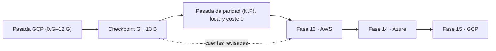

# Checkpoint G→13 B · Ajustes del plan antes de desplegar

**Objetivo:** antes de la fase 13, dejar el plan y las cuentas listos para desplegar en las tres
nubes: un índice legible, los conectores que faltan en cada nube contrastados con el repo, una
**pasada de paridad** para que Azure, AWS y GCP lleguen iguales a los despliegues, y las cuentas
personales revisadas. Sin código de producto ni coste. PR #18 (rama `fase/g-13-b`, 27-11-2026).

| Subfase | Commit | Qué |
|---|---|---|
| B.1 | `d6dd89e` | Índice del README: la fila G (12 pasadas en una celda) se parte en una fila por pasada (0.G … 12.G) |
| B.2 | `154315a` | Conectores candidatos contrastados con el repo ([conectores-candidatos.md](conectores-candidatos.md)) y **pasada de paridad (P)** en el [plan](plan-fases.md#pasada-p) |
| B.3 | `7e1e53a` | Guía para preparar las cuentas ([preparar-cuentas-cloud.md](preparar-cuentas-cloud.md)): tarjeta, créditos, limpieza, identidad y modelos |
| B.4 | `e5b9ea5` | Inventario de las cuentas personales, guía corregida para la nueva experiencia de AWS y cuatro lecciones |
| Cierre | último commit de la PR #18 | Este doc, preguntas de entrevista y estado |

## 1. Plan resultante

| Pieza | Dónde vive |
|---|---|
| Alcance de la pasada P (huecos de paridad, ampliaciones, lo que se queda en los despliegues) | [conectores-candidatos.md](conectores-candidatos.md) |
| Plan de la pasada y cambios en las fases 13–15 | [plan-fases.md](plan-fases.md#pasada-p) |
| Estado de las cuentas y cómo prepararlas | [preparar-cuentas-cloud.md](preparar-cuentas-cloud.md) |
| Convención `N.P1`, rama `fase/<N>-p` | `AGENTS.md` |

## 2. Qué se construyó

- **B.1.** La fila G del índice del README pasa a 12 filas (0.G, 2.G … 12.G), cada una con su
  resumen de una línea y su enlace. `AGENTS.md` conserva una sola fila porque ya tiene la columna
  GCP por fase.
- **B.2.** Una investigación previa de conectores (23-11-2026) se contrastó con el repo
  (`rg` en código, IaC y docs). **Ningún servicio de nube de la lista estaba implementado**; donde
  aparecían era en comentarios de equivalencias. Se clasificaron en tres grupos:
  - **Huecos de paridad**, que una nube tiene y otra no: Bedrock Evaluations, API Center, memoria
    de Foundry, PII con Azure AI Language y Comprehend, espera humana con Step Functions y Durable
    Functions, prompts de Foundry y Bedrock, y MLflow gestionado.
  - **Ampliaciones de las tres nubes**: prompt routing, el mismo modelo por otra nube, parsing
    gestionado, eventos, Cosmos DB con vectores, GraphRAG, AgentCore Policy…
  - **Configuración de los despliegues**: APIM como AI gateway, Front Door, KEDA, Bicep, CDK…
- **B.3.** Condiciones de alta de las tres nubes comprobadas en las páginas oficiales.
- **B.4.** Inventario de solo lectura con las CLI de las tres nubes (la de AWS y `gcloud`,
  instaladas con `winget`), en perfiles aislados.

## 3. Resultados

| | Azure | AWS | GCP |
|---|---|---|---|
| Cuenta | Prueba caducada (`Disabled`, `FreeTrial`) | Nueva experiencia, un proyecto en `eu-north-1`, plan Free con 120 $ hasta el 04-04-2027 | Facturación cerrada desde 2018 |
| Recursos | Un grupo del inicio rápido de Foundry | Ninguno | Dos proyectos antiguos, **borrados** (30 días recuperables) |
| Coste | 0 | 0 | 0 |

Hallazgos que cambian el plan:

- Desde el **16-11-2026**, el crédito de prueba de GCP no cubre Gemini ni Agent Platform.
- La cuenta de AWS es de la **nueva experiencia**: una región (`eu-north-1`), sin root, IAM
  Identity Center, Organizations ni Comprehend, y límite de gasto en vez de presupuestos. Activar
  las funciones avanzadas lo abre todo, pero **no tiene vuelta atrás**.
- En la nueva experiencia, AgentCore está en la capa gratuita. En la cuenta clásica, solo en el
  plan Paid.

## 4. Decisiones (Sergio, 27-11-2026)

| Decisión | Por qué |
|---|---|
| **Pasada de paridad (P)** antes de la fase 13 | Que los despliegues 13, 14 y 15 partan de las tres nubes iguales; con dobles en local y coste 0, como la pasada GCP |
| Bedrock Evaluations, de la fase 13 a la **5.P**; espera humana con Step Functions y Durable Functions, de "Ideas aparcadas" a la **9.P** | Son huecos de paridad, no despliegue |
| OSS, SaaS y modelos locales, backlog sin compromiso | Los locales chocan con la regla 4; el resto no aporta paridad entre nubes |
| AWS: nada activado; **región y tipo de cuenta se deciden al iniciar la fase 13** | Antes hay que comprobar qué hay en `eu-north-1` y si Terraform acepta las credenciales de `aws login` |
| Azure: sin limpiar hasta la fase 14 | Una suscripción deshabilitada no admite borrados y no cuesta nada |
| GCP: borrar los dos proyectos antiguos | Sin uso ni vigencia |

## 5. Límites

- Las condiciones de las tres nubes (créditos, servicios, regiones) se comprobaron el 27-11-2026 y
  cambian a menudo: se repasan antes de cada alta y al iniciar cada fase de despliegue.
- La clasificación de los conectores comprobó que **no están en el repo**, no su estado en cada
  nube (GA o preview, regiones): eso se comprueba al iniciar cada `N.P`.
- Las afirmaciones de la investigación original sobre terceros (compras, licencias, fechas) no se
  verificaron y no pasaron al repo.

## 6. Pendiente con coste

Ninguno nuevo. Las cuentas quedan revisadas para las sesiones de
[pendientes-cloud.md](pendientes-cloud.md). En la fase 2 de ese fichero, la AWS CLI ya tiene sesión;
falta `BEDROCK__PROFILE` con la región que se decida en la fase 13.

## Checkpoint de entrevista

Preguntas técnicas y de negocio: [preguntas-entrevista.md](preguntas-entrevista.md#checkpoint-g-13-b).
