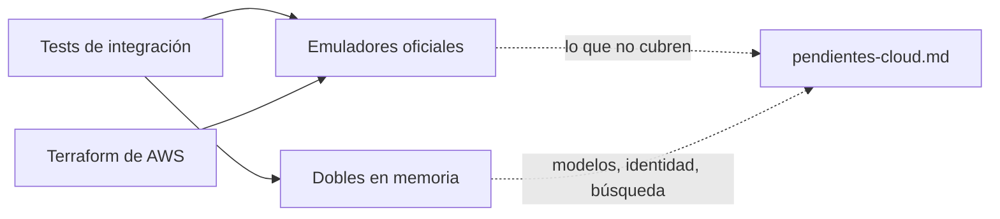

# Checkpoint G→13 · Emuladores locales de AWS, Azure y GCP

**Objetivo:** ejecutar en local, sin coste, el máximo de servicios de las tres nubes con emuladores
**oficiales**, para probar los adaptadores y la IaC antes de los despliegues (fases 13, 14 y 15) y
reducir lo que queda en [pendientes-cloud.md](pendientes-cloud.md). Plan en
[plan-fases.md](plan-fases.md#checkpoint-g-13).

| Subfase | Commit | Qué |
|---|---|---|
| G→13.1 | `58f88e5` | Inventario de emuladores oficiales por nube, comparativa con lo que ya usamos y decisión |
| G→13.2 | `fe71124` | AWS Emulator en `docker compose` (perfil `aws`) y tests de integración de SQS, S3 y S3 Vectors |
| G→13.3 | `e926280` | Terraform de AWS aplicado contra el emulador (`terraform test` con estado en memoria) e ingesta de la KB de punta a punta |
| G→13.4 | (este commit) | Azure: Azurite para la subida incremental de blobs y emulador de Service Bus fijado en `2.0.1` |
| G→13.5 | | CI: AWS Emulator y Azurite en el job `integration` |

## 1. Concepto

Un **emulador** es un proceso local que habla el mismo protocolo que el servicio de la nube: el SDK
no cambia, solo el *endpoint*. Responde con los mismos recursos y los mismos errores, sin cuenta, sin
red y sin coste. Encaja con la regla 5 ("local y sin coste primero") y con el patrón que ya teníamos
para las colas (fase 3 y [contrato de mensajería](../packages/genaipocs_core/tests/integration/test_message_bus_contract.py)).

Qué cubre y qué no, en cualquier nube:

- **Plano de control** (crear una cola, un bucket o un índice): es donde los emuladores son más
  fieles. Es lo que usa la IaC.
- **Plano de datos sencillo** (enviar un mensaje, guardar un vector, subir un fichero): suele estar.
- **Nunca**: modelos (Bedrock, Foundry, Gemini: no hay inferencia local y la regla 4 los quiere en la
  nube), **identidad y permisos reales** (IAM, Entra ID, IAM de GCP), cuotas, latencia, región y
  multi-cuenta. Un emulador que acepta una llamada no demuestra que el rol la permita.

El valor para Genaipocs: hoy todo lo caro de `infra/terraform/*` está con `*_enabled = false` y solo
pasa `terraform validate` y `terraform test` con proveedores simulados (`mock_provider`). Nadie lo ha
aplicado nunca. Un emulador permite aplicarlo en segundos, sin coste, y detectar en local errores que
aparecerían en el primer `apply` de la fase 13 (nombres inválidos, enums que el provider acepta y la
API no, dependencias entre recursos).

## 2. Inventario por nube (verificado el 22-11-2026)

Solo fuentes oficiales de cada proveedor. "Usa el repo" indica dónde lo usamos hoy.

### 2.1 AWS: AWS Emulator

AWS publicó el **AWS Emulator** el 11-11-2026
([anuncio](https://aws.amazon.com/blogs/aws/test-your-applications-against-aws-locally-with-aws-emulator/),
[guía](https://docs.aws.amazon.com/emulator/latest/userguide/what-is-service.html),
[código](https://github.com/aws/aws-emulator)). A diferencia de Azure y GCP, es **un solo emulador
para casi todas las API**: los servicios se generan de los mismos modelos de API que los SDK.

| Aspecto | Valor | Consecuencia |
|---|---|---|
| Licencia y coste | CC0 1.0 (dominio público; `vendor/` en Apache 2.0). Sin EULA, sin cuenta, sin cuota | Se puede usar en local y en la CI pública |
| Arranque | Linux: paquete RPM o DEB. Windows y macOS: **Docker, con una imagen que construye cada uno** con el Dockerfile de la guía (no hay imagen publicada) | Dockerfile propio en `infra/local/` con la versión fijada |
| Versiones | Una release cada ~2 h (`v1.0.569` el 22-11-2026). URL por versión: `.../LTS/aws-emulator-<versión>-1-x86_64.rpm` | Fijar versión, como el resto de imágenes; subirla es un cambio deliberado |
| Protocolo | HTTPS en `127.0.0.1:9297`, certificado propio y **SigV4 con claves nuevas en cada arranque** (en `~/.aws/emulator/9297/`) | El fixture lee credenciales y certificado de una carpeta montada, no del shell |
| SDK | `AWS_ENDPOINT_URL`, `AWS_CA_BUNDLE`, `AWS_DISABLE_HOST_PREFIX_INJECTION=true`. S3 solo en *path style* (`127.0.0.1`, nunca `localhost`) | Coincide con la regla del repo de `127.0.0.1` |
| Estado | En memoria; se pierde al parar. 2 GB de RAM recomendados | Tests autocontenidos: cada uno crea sus recursos |
| Límites | **No evalúa IAM** ni políticas de recursos; una región y una cuenta (`000000000000`); validado solo contra `us-west-2`; 501 `NotImplemented` en lo que no implementa | No sirve para probar seguridad |
| Telemetría | **Activada por defecto** (datos de uso anónimos) | `EMULATOR_TELEMETRY=off` siempre |
| IaC | La guía solo dice que el soporte de CloudFormation, Terraform y CDK "varía por servicio" | Medido en la G→13.3 ([sección 6](#6-terraform-de-aws-contra-el-emulador-g133)): aplica todo el módulo salvo el autoescalado de ECS |

**Fidelidad** = pruebas de fidelidad que pasa sobre el total, publicadas con cada release
(`scores.json` de la `v1.0.569`: 35.751 de 46.037 en 356 servicios, un 78 %). Los servicios que usa
el repo:

| Servicio | Usa el repo | Fidelidad | ¿Lo adoptamos? |
|---|---|---|---|
| SQS | `adapters/sqs.py`, `main.tf`, `queue_workers.tf` | 338/359 (94 %) | Sí: contrato de mensajería (G→13.2) |
| SNS | `observability.tf` (alarmas) | 282/296 (95 %) | Sí, en el `apply` de la G→13.3 |
| S3 | `managed_ingestion.py aws`, `main.tf`, `lane_a.tf` | 1187/1295 (92 %) | Sí: subida de documentos (G→13.2) |
| S3 Vectors | `adapters/s3_vectors.py`, `main.tf`, `lane_a.tf` | **163/165 (99 %)** | Sí: el adaptador real, sin dobles (G→13.2) |
| IAM / STS | roles de `*.tf` | 655/727 / 154/188 | Solo para crear roles; nunca para probar permisos |
| CloudWatch / Logs / X-Ray | `observability.tf` | 805/865 / 595/667 / 165/181 | En el `apply` (G→13.3) |
| ECS / Application Auto Scaling | `queue_workers.tf` | 510/639 / 139/140 | En el `apply`; no ejecuta tareas reales que nos sirvan |
| Bedrock KB (`bedrock-agent`) | `bedrock_kb.py`, `lane_a.tf` | 50/63 | Solo el plano de control en el `apply` |
| Bedrock AgentCore (control) | `agentcore.tf`, `mcp_gateway.tf` | 128/177 | En el `apply`, para validar enums como `TOKEN_EXCHANGE` |
| Bedrock Guardrails | `guardrails.tf` | (en `bedrock`: 140/168) | En el `apply`; `ApplyGuardrail` no sustituye al real |
| Bedrock Runtime (`Converse`) | `adapters/bedrock.py` | 75/116; **`converse-basic-text-roundtrip` falla** | **No**: modelos solo en la nube (regla 4) |
| Budgets | `main.tf` | 34/36 | En el `apply` |

Otros emuladores de AWS: DynamoDB Local y SAM CLI (`sam local invoke` para Lambda) siguen
existiendo, pero el repo no usa DynamoDB ni Lambda todavía (fase 13). **Step Functions Local** figura
como "unsupported" en su propia página. El AgentCore Runtime ya se prueba en local con su contrato
HTTP (fase 7).

### 2.2 Azure: emuladores sueltos

Microsoft no tiene un emulador "multiservicio": hay uno por servicio de datos o mensajería, y Aspire
17 los orquesta (`RunAsEmulator()`), pero su AppHost es .NET o TypeScript, no Python.

| Servicio | Usa el repo | Emulador oficial | Licencia | Permite | No permite |
|---|---|---|---|---|---|
| Service Bus | `adapters/servicebus.py` (perfil `servicebus`) | `mcr.microsoft.com/azure-messaging/servicebus-emulator:2.0.1` + `mssql/server:2022-latest` ([doc](https://learn.microsoft.com/en-us/azure/service-bus-messaging/overview-emulator)) | EULA propia + EULA de SQL Server | Colas, topics y suscripciones con filtros, DLQ, config JSON | Entra ID, entidades particionadas; 50 entidades, TTL de 1 h; administración desde Python |
| Blob Storage | `managed_ingestion.py azure` (carril A) | **Azurite** `mcr.microsoft.com/azure-storage/azurite:3.38.0` ([doc](https://learn.microsoft.com/en-us/azure/storage/common/storage-use-azurite)) | **MIT** | Blob y Queue (estables), Table (preview), `UseDevelopmentStorage=true` | Firma real de tokens y RBAC, ADLS Gen2, soft delete |
| Event Hubs | — | `eventhubs-emulator:2.2.1` | EULA | AMQP y Kafka | Entra ID, Capture |
| Cosmos DB | — | `azure-cosmos-emulator:vnext-latest` (GA en junio de 2026) | No verificada | API NoSQL, índices vectoriales | Autenticación, procedimientos almacenados |
| App Configuration | — | `app-configuration-emulator:1.2.0` | No verificada | Claves y *snapshots* | Entra ID |
| Functions | (fase 14) | Core Tools (`func`): ejecuta en local, no emula | MIT | Triggers HTTP, colas con Azurite | Event Grid real |
| AI Search, OpenAI/Foundry, Content Safety, Key Vault, Event Grid, APIM, Container Apps, Monitor, Entra ID | Muchas fases | **No hay emulador** | — | — | Todo (los contenedores de Content Safety facturan contra Azure y se retiran el 30-04-2027) |

Terraform `azurerm` **no puede apuntar a ningún emulador**: los emuladores solo exponen el plano de
datos, no Azure Resource Manager. Las entidades se declaran en sus JSON (`infra/local/servicebus/config.json`).
Azure SQL Edge se retiró el 30-09-2025; el repo ya usa `mssql/server`.

### 2.3 GCP: emuladores de `gcloud`

Lista actual ([referencia](https://docs.cloud.google.com/sdk/gcloud/reference/beta/emulators)):
**Pub/Sub, Firestore, Datastore, Bigtable y Spanner**. Licencia: términos del Cloud SDK (gratuita,
no Apache), salvo Spanner (Apache 2.0). La imagen `google-cloud-cli:<versión>-emulators` conserva
cada versión **365 días**.

| Servicio | Usa el repo | Emulador oficial | Permite | No permite |
|---|---|---|---|---|
| Pub/Sub | `adapters/pubsub.py` (perfil `pubsub`, CI) | `gcloud beta emulators pubsub` (beta) | Publicar, pull, DLQ, ordenación, filtros | IAM, retención, entrega a BigQuery |
| Cloud Storage | `gcp_rag_engine.py`, `gcp_agent_search.py` | **No hay** ("there is no official emulator for Cloud Storage") | — | Solo emuladores de la comunidad |
| Firestore, Datastore, Bigtable, Spanner | — | Sí (Firestore GA, Spanner GA, el resto beta) | — | El repo no los usa |
| Cloud Run | `queue_workers.tf`, `a2a.tf` | Parcial: `gcloud beta code dev` o `docker run` | Servicios HTTP | Jobs, worker pools, IAM |
| Apigee | `mcp_gateway.tf` | `apigee-emulator` (orientado a VS Code, licencia no indicada) | Proxies y políticas | Sin guía de CI |
| Agent Runtime | `agent_platform.tf` | No; `adk web` / `adk api_server` (Apache 2.0) | Agente en local | El modelo es real (coste) |
| Tasks, Workflows, Eventarc, Secret Manager, Gemini, Vector Search, RAG Engine, Model Armor, Agent Search, Monitoring | Muchas fases | **No hay emulador** | — | Todo |

Terraform `google` admite `*_custom_endpoint`, pero HashiCorp lo describe como "best-effort" y el
provider exige credenciales siempre. Ningún emulador de GCP sirve para aplicar nuestra IaC.

## 3. Comparativa con lo que ya usamos

| Necesidad | Hoy | Emulador oficial | Diferencia |
|---|---|---|---|
| Colas AWS | ElasticMQ 1.7.1 (comunidad, protocolo SQS) | AWS Emulator (SQS 94 %) | El oficial valida errores contra AWS y comparte proceso con S3 e IaC; ElasticMQ arranca en ~1 s y sin HTTPS |
| Colas Azure | Emulador de Service Bus `latest` | El mismo, fijado en `2.0.1` | `latest` rompe la reproducibilidad |
| Colas GCP | Emulador de Pub/Sub 593.0.0 | El mismo | Caduca a los 365 días: anotar la subida |
| Vectores AWS | `S3VectorsStore` solo con dobles | AWS Emulator (S3 Vectors 99 %) | Se prueba el adaptador real |
| Objetos | En memoria | S3 (AWS Emulator), Azurite; GCS sin oficial | La subida de `managed_ingestion` se prueba en AWS y Azure |
| IaC | `validate` + `terraform test` con `mock_provider` | AWS Emulator (`apply` real) | El mock no valida contra la API; el emulador sí (en lo que implementa) |
| Modelos, búsqueda gestionada, identidad | Dobles en memoria (`simulated_llm`, `memory`) | Ninguno en ninguna nube | Siguen en `pendientes-cloud.md` |

## 4. Decisión (22-11-2026, con Sergio)



| Pieza | Dónde vive | Decisión |
|---|---|---|
| AWS Emulator | `infra/local/aws-emulator/Dockerfile`, perfil `aws` | **Se adopta** (G→13.2): imagen local construida con el RPM fijado (`1.0.569`), telemetría apagada |
| Terraform de AWS contra el emulador | `infra/terraform/aws/tests-emulator/` | **Se adopta** (G→13.3): `terraform test` con `apply`, estado en memoria; no toca el estado local |
| ElasticMQ | perfil `sqs`, CI | **Se mantiene** junto al AWS Emulator; se decide en la G→13.5 con datos |
| Azurite | perfil `azure` | **Se adopta** (G→13.4): MIT, prueba la subida incremental de blobs del carril A |
| Emulador de Service Bus | perfil `servicebus` | Se fija en `2.0.1`; **sigue fuera de la CI** (EULA y ~2 GB con SQL Server) |
| Event Hubs, Cosmos DB, App Configuration | — | No se adoptan: el repo no usa esos servicios |
| Emuladores de GCP (Firestore, Spanner, Bigtable, Datastore) | — | No se adoptan: el repo no los usa. Pub/Sub ya está |
| Cloud Storage | — | Sin emulador oficial: sigue con dobles en memoria |

## 5. AWS Emulator en local (G→13.2)

| Pieza | Dónde vive |
|---|---|
| Imagen (RPM `1.0.569` sobre Amazon Linux 2023, telemetría apagada) | `infra/local/aws-emulator/Dockerfile` |
| Servicio `aws-emulator` (perfil `aws`, `127.0.0.1:9297`, 2 GB) | `docker-compose.yml` |
| Claves y certificado de cada arranque (ignorado por Git) | `.aws-emulator/9297/` |
| Fixture `aws_emulator` (factoría de clientes boto3; salta si no está) | `packages/genaipocs_core/tests/conftest.py` |
| Contrato de mensajería con el broker `sqs-emulator` | `tests/integration/test_message_bus_contract.py` |
| `S3VectorStore` real y subida a S3 del carril A | `tests/integration/test_aws_emulator.py` |

```bash
docker compose --profile aws build aws-emulator      # una vez (descarga el RPM, ~200 MB)
docker compose --profile aws up -d
uv run pytest -m integration -k "emulator or sqs"
docker compose --profile aws stop                     # al parar borra claves y certificado
```

Cómo se conecta el cliente (lo que cambia frente a ElasticMQ):

- **HTTPS con su propio certificado**: `verify=.aws-emulator/9297/ca.pem`. Se regenera en cada
  arranque, así que se lee la ruta, nunca se copia.
- **SigV4 de verdad**: las claves (`emulator_credentials`) son nuevas en cada arranque y el emulador
  rechaza cualquier otra. Es una red de seguridad: con unas credenciales reales en el entorno, la
  petición falla en vez de llegar a AWS. Los tests construyen la sesión con esas claves de forma
  explícita y, además, comprueban la cuenta `000000000000`.
- **Un endpoint para todos los servicios**: `Config(inject_host_prefix=False)` y S3 en *path style*.
- Para ejecutar la aplicación (no los tests) contra el emulador no hace falta código: boto3 lee
  `AWS_ENDPOINT_URL`, `AWS_CA_BUNDLE` y `AWS_SHARED_CREDENTIALS_FILE`
  ([guía](https://docs.aws.amazon.com/emulator/latest/userguide/point-sdk-to-emulator.html)).

Resultados (22-11-2026, local, Docker Desktop):

| Prueba | ElasticMQ 1.7.1 | AWS Emulator 1.0.569 |
|---|---|---|
| Contrato de mensajería (6 tests: entrega, trazas, reintento, DLQ por agotamiento y por error permanente) | 6/6 | 6/6 |
| DLQ tras 3 entregas (`maxReceiveCount`) | 6,1 s | 6,2 s |
| `S3VectorStore`: upsert idempotente, búsqueda coseno, filtro `$eq` y `$and`, borrado | — (sin S3 Vectors) | ✅ |
| `BedrockKnowledgeBaseIngestion.upload`: documento UTF-8 + `.metadata.json` | — | ✅ |
| Suite `pytest -m integration` con núcleo + perfil `aws` | — | 51 pasan, 43 se saltan (sin `sqs`, `servicebus`, `pubsub` ni `scale`) |

Hallazgos:

- **S3 Vectors calcula de verdad**: con vectores `[1,0,0]`, `[0.9,0.1,0]` y `[0,1,0]` devuelve
  distancias 0, 0,0061 y 1 (coseno) y aplica el filtro de metadatos. Hasta ahora el adaptador solo
  se probaba con dobles: es el primer test que valida su contrato con la API.
- Arranque: ~1 s hasta `/__admin/health`. La imagen ocupa ~2 GB en Docker Desktop (el RPM,
  ~200 MB, trae los modelos de todos los servicios); la construcción, ~40 s.
- La ingesta de la Knowledge Base (`start_ingestion_job`) no se prueba aquí: necesita una KB, y
  la creará Terraform en la G→13.3.

## 6. Terraform de AWS contra el emulador (G→13.3)

Hasta ahora el módulo `infra/terraform/aws` solo pasaba `validate`: todo lo caro está con
`*_enabled = false` y nunca se había aplicado. `terraform test` con `command = apply` (el valor por
defecto) lo aplica de verdad contra el emulador, con el estado **en memoria** (no toca
`terraform.tfstate`) y destruye al terminar.

```bash
docker compose --profile aws up -d
cd infra/terraform/aws
terraform test -test-directory=tests-emulator        # ~3 min; 3 runs
```

| Pieza | Dónde vive |
|---|---|
| Test (`provider` del emulador + 3 `run`) | `infra/terraform/aws/tests-emulator/emulator.tftest.hcl` |
| `account_id` explícito en el presupuesto | `infra/terraform/aws/main.tf` |
| Ingesta de la KB de punta a punta (Python) | `tests/integration/test_aws_emulator.py` |

El `provider` del test sustituye al del módulo y lleva **tres redes de seguridad** para que nada
llegue a AWS: claves del emulador (AWS las rechaza), un proxy inexistente salvo para `127.0.0.1` y
un `assert` de la cuenta `000000000000`. La segunda no es teórica: en la primera prueba, el
provider leyó las etiquetas del bucket por **S3 Control**, que no estaba en `endpoints`, y la
petición salió a `000000000000.s3-control.eu-west-1.amazonaws.com` (sin riesgo: firmada con claves
que AWS no conoce; ver [lecciones](lecciones-aprendidas.md#verificación-y-ci)).

Resultado por módulo (emulador 1.0.569, provider `hashicorp/aws` 6.67.0, 22-11-2026):

| Módulo (`run`) | Recursos | Resultado |
|---|---|---|
| Base (`base`): colas y DLQ, S3, S3 Vectors (2 índices), IAM, **Knowledge Base + data source**, presupuesto | 15 | ✅ crea, lee y destruye |
| `agentcore_enabled` (Memory + Runtime), `bedrock_guardrail_enabled` (guardrail + versión), `observability_enabled` (logs, X-Ray, SNS, 2 alarmas) | 20 | ✅ crea y destruye; la lectura de AgentCore da 501 (ver abajo) |
| `mcp_gateway_enabled` sin targets: rol, proveedor OAuth con `TOKEN_EXCHANGE`, gateway | 4 | ✅: **la API acepta `TOKEN_EXCHANGE`**, que el provider no documenta (pendiente de la fase 13) |
| Targets del gateway (`mcp_server_urls`) | 3 | ⚠️ fuera del test: el emulador hace el *tool discovery* contra la URL (como AWS) y el target queda `FAILED` sin servidores MCP públicos |
| `queue_workers_enabled` (ECS, autoescalado por backlog) | 12 | ❌ fuera del test: `PutScalingPolicy` con *metric math* → **501** `NotImplemented` |
| Ingesta (`start_ingestion_job` + `get_ingestion_job`) | — | ✅ `COMPLETE`, 2 escaneados, 2 indexados, 2 vectores en el índice (sin modelo real) |

Ajustes que exigió el emulador, y por qué:

| Síntoma | Causa | Solución |
|---|---|---|
| `terraform test` colgado 10 min | El provider 6.x lee las etiquetas de un bucket por S3 Control, que antepone la cuenta al host (`000000000000.127.0.0.1`): nunca llega al emulador y reintenta | `skip_requesting_account_id` + `skip_credentials_validation`: sin id de cuenta, el provider usa `GetBucketTagging` (código de `internal/service/s3/tags.go`) |
| `CreateBudget`: `accountId` vacío | Sin id de cuenta en el provider | `account_id = data.aws_caller_identity.current.account_id` en `main.tf` (en AWS, el mismo valor) |
| Refresh de AgentCore: 501 | `ListTagsForResource` de AgentCore Control no implementado | `plan_options { refresh = false }` en el `run` siguiente |

Hallazgos:

- **El emulador valida contra el modelo de API de AWS**, no contra lo que el provider documenta:
  por eso `TOKEN_EXCHANGE` deja de ser una duda abierta (falta verlo con targets reales en la fase 13).
- **Se comporta como AWS en lo asíncrono**: la KB tarda en borrarse (`DELETING`), el gateway target
  intenta conectar con el servidor MCP y el job de ingesta pasa por `STARTING` → `COMPLETE`.
- Lo que no implementa lo dice con un 501 explícito (`scaffolded but not implemented`), no con un
  éxito falso: el fallo es visible y se puede reportar en su repositorio.

## 7. Azure: Azurite y Service Bus fijado (G→13.4)

| Pieza | Dónde vive |
|---|---|
| Azurite 3.38.0 (solo Blob, en memoria, techo de 256 MB; perfil `azure`) | `docker-compose.yml` |
| `upload_if_changed`: subida incremental del carril A, sacada del script al adaptador (como `gcp_rag_engine.upload`) | `adapters/azure_search_managed.py`, usada por `scripts/managed_ingestion.py` |
| Test de integración | `tests/integration/test_azurite.py` |
| Emulador de Service Bus fijado en `2.0.1` (antes `latest`) | `docker-compose.yml` |

```bash
docker compose --profile azure up -d azurite
uv run pytest -m integration packages/genaipocs_core/tests/integration/test_azurite.py
```

Resultados (22-11-2026, local):

| Prueba | Resultado |
|---|---|
| Subida incremental: 1.ª pasada sube 2, 2.ª no sube nada, cambiar contenido o un metadato resube solo ese | ✅ (Azurite guarda el Content-MD5 como Azure Storage: el contrato que `needs_upload` validó en Azure en el checkpoint 8→9) |
| Contrato de mensajería con Service Bus `2.0.1` + SQL Server | 6/6 (~42 s) |

Decisiones:

- **`UseDevelopmentStorage=true`** en vez de la cadena con la clave de `devstoreaccount1`: la clave
  es pública, pero así no hay nada con forma de secreto en el repo (los escáneres no distinguen).
- Solo `azurite-blob`: Queue y Table no los usa el repo. Con `--inMemoryPersistence`, cada arranque
  empieza vacío, como el AWS Emulator.
- Lo que Azurite no prueba: la identidad gestionada (con la que sube el script en Azure) ni RBAC;
  tampoco el indexer de AI Search que lee esos blobs (sin emulador).

## 8. Límites

- Un test verde contra un emulador demuestra que el **contrato de la API** encaja, no que el despliegue
  funcione: IAM, red, cuotas y regiones solo se validan en la nube.
- La fidelidad del AWS Emulator cambia varias veces al día: un test que dependa de un hueco del
  emulador puede romperse al subir de versión. Por eso la versión está fijada y los tests esperan lo
  que hace AWS, no lo que hace el emulador hoy.
- GCP es la nube con menos cobertura local (sin Cloud Storage) y Azure no tiene nada para la IaC.

## Checkpoint de entrevista

Las preguntas se añaden a [preguntas-entrevista.md](preguntas-entrevista.md) al cerrar el
checkpoint.
