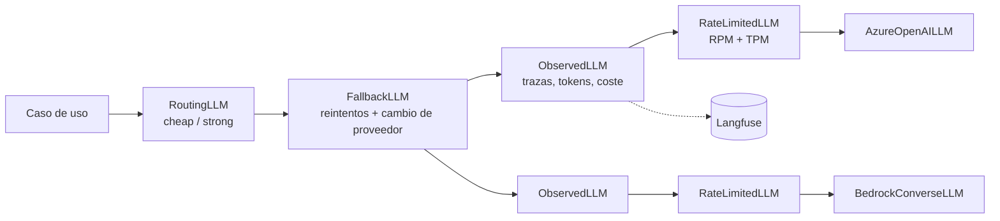

# Fase 2 · Capa de modelos: Azure OpenAI vs Bedrock, LLM gateway, routing, caching y coste

**Objetivo:** que ninguna parte del sistema hable con un proveedor de modelos directamente. Todo pasa
por `LLMPort` y por un **gateway** que decide modelo, reintenta, cambia de proveedor, limita, traza y
calcula el coste de cada llamada. Los agentes de las fases 6–8 heredan todo esto sin saberlo.

Commits: `be68163 feat: fase 2 - capa de modelos, LLM gateway, model routing y prompt caching` y
`1f87a99 docs: cierre de la fase 2 con validación en cloud pendiente`.

## 1. Arquitectura: capas de cebolla



Cada capa es un decorador que implementa el mismo `LLMPort` (como las políticas de APIM). El
montaje vive en un solo sitio: `adapters/llm_factory.build_gateway(settings)`.

| Capa | Clase (`application/llm/`) | Qué hace |
|---|---|---|
| Routing | `RoutingLLM` + `HeuristicClassifier` / `LLMClassifier` | Envía cada petición al modelo más barato capaz de resolverla |
| Fallback | `FallbackLLM` | Reintenta errores transitorios con backoff exponencial y *full jitter*; un 429 salta directamente al siguiente proveedor (su cuota sigue agotada); los errores no transitorios (400, credenciales) se propagan |
| Observabilidad | `ObservedLLM` + `LLMTracer` | Una *generation* por llamada: modelo, tokens (incluidos los cacheados), coste, latencia y error |
| Rate limit | `RateLimitedLLM` + `TokenBucket` | Límite en cliente por RPM y TPM (tokens estimados a ~4 caracteres/token) para no provocar 429 |
| Adaptador | `AzureOpenAILLM`, `BedrockConverseLLM` | SDK nativo, sin reintentos propios (`max_retries=0`): los reintentos son del gateway |

Errores tipados en `ports/llm.py`: `LLMError` → `LLMTransientError` → `LLMRateLimitError`. Cada
adaptador traduce los suyos; el gateway solo conoce estos.

> **Fase 10.1:** el gateway suma `CircuitBreakerLLM`, `ConcurrencyLimitedLLM` (bulkhead), espera
> máxima en `RateLimitedLLM` (backpressure), `Retry-After` y presupuesto de tiempo (`time_budget`).
> Detalle en el doc de la fase 10.

## 2. Los proveedores

| Aspecto | Azure OpenAI (Foundry) | Bedrock Converse | Gemini en Agent Platform (2.G) |
|---|---|---|---|
| SDK | `openai` (`AsyncAzureOpenAI`) | `boto3` `bedrock-runtime` (síncrono → `asyncio.to_thread`) | `google-genai` 2.x, `client.aio.models` (asíncrono nativo) |
| Autenticación | Entra ID: `DefaultAzureCredential` + token provider (sin claves) | Perfil de AWS SSO (`BEDROCK__PROFILE`) / IAM Role | ADC + *impersonation* de `headache-dev-app` (`roles/aiplatform.user`), sin claves |
| Modelos (strong / cheap) | `gpt-4.1-mini` / `gpt-4.1-nano` | Claude Haiku 4.5 / Nova Lite (perfiles de inferencia `eu.`) | `gemini-4-hydrogen` / `gemini-3.5-flash-lite` (endpoint `global`) |
| Prompt caching | **Automático** para prefijos idénticos ≥ 1024 tokens; no se marca ni se desactiva; se lee en `prompt_tokens_details.cached_tokens` | **Explícito**: bloque `cachePoint` al final del prefijo estable; informa `cacheWriteInputTokens` y `cacheReadInputTokens` | **Implícito** (≥ 4096 tokens, *best-effort*, sin coste de escritura) y **explícito** con `CachedContent` (2.G3; Hydrogen no lo admite) |
| Tokens de entrada | Incluyen los cacheados | Excluyen lo leído/escrito en caché: el adaptador los suma (semántica OpenAI) | Incluyen los cacheados; los de razonamiento se suman a la **salida** |
| Structured outputs | `response_format` JSON Schema en modo `strict` | Tool use forzado (portable entre Claude y Nova) o `outputConfig` nativo | `response_json_schema` + `application/json` |
| Estado entre turnos | — | — | ***Thought signature*** en la primera `functionCall` de cada paso: hay que devolverla (si no, 400) |
| Temperatura | Se respeta | Se respeta | **Ignorada** en 3.5+ y Gemini 4 (no se envía); se controla `thinking_level` |

`ChatMessage(cache_checkpoint=True)` marca dónde termina el prefijo estable: en Bedrock se convierte
en `cachePoint`; en Azure y en la caché implícita de Gemini no hace nada (cachean solos). El mismo
código de aplicación aprovecha la caché de los tres.

## 3. Structured outputs

`application/llm/structured.py` `complete_structured(llm, messages, OutputModel)`:

- Esquema Pydantic → JSON Schema; `_to_strict` lo adapta al modo *strict* de OpenAI
  (`additionalProperties: false`, todos los campos `required`).
- Quita vallas de Markdown si el modelo las añade y valida con Pydantic.
- Si falla, reintenta con el error como feedback; `StructuredResult` guarda **todas** las llamadas
  (también las de corrección) para que el coste sea el real.

Caso de uso: `application/support_triage.py`. El LLM **solo extrae y clasifica** (`TicketTriage`:
intención, idioma, `order_id`, urgencia); qué hacer después lo decide el dominio.

## 4. Model routing

- `HeuristicClassifier` (por defecto): gratis, determinista y con latencia ~0. Mira solo el último
  mensaje del usuario (un prompt de sistema largo y cacheado no hace la petición más difícil):
  más de 1500 caracteres o palabras de razonamiento (`why`, `explain`, `compare`, `por qué`,
  `reclamación`...) ⇒ `strong`; si no, `cheap`.
- `LLMClassifier` (`LLM_GATEWAY__ROUTER=llm`): un modelo barato decide con salida estructurada
  (`RoutingVerdict`). Más preciso, pero añade una llamada. Si falla, elige `strong` (prima la calidad).
- Regla previa a cualquier clasificador (checkpoint 8→9): si el turno ofrece una tool **con
  efectos** (`read_only=False`, p. ej. `request_refund`), va a `strong`. Medido en Azure: con
  "quiero el reembolso de mi último pedido" (corto ⇒ `cheap`), `gpt-4.1-nano` inventó IDs y no
  llegó a pedir el reembolso (0/2); `gpt-4.1-mini` lo resolvió (2/2). Un error en una escritura
  cuesta más que la diferencia de precio (~0,001 $ por turno). Para que los turnos de solo
  lectura sigan yendo a `cheap`, el agente debe ofrecer las tools de escritura solo cuando la
  intención las necesita.

## 5. Coste por petición

`application/llm/pricing.py` `PriceTable`: USD por millón de tokens de entrada, salida, entrada
cacheada y escritura en caché; coincidencia por el prefijo más largo
(`gpt-4.1-mini-2025-04-14` → `gpt-4.1-mini`) y normalización de nombres de LiteLLM/Bedrock.

| Modelo | Entrada | Salida | Cacheada | Escritura en caché |
|---|---|---|---|---|
| `gpt-4.1-nano` | 0,10 | 0,40 | 0,025 | = entrada |
| `gpt-4.1-mini` | 0,40 | 1,60 | 0,10 | = entrada |
| `amazon.nova-lite` | 0,06 | 0,24 | 0,015 | = entrada |
| `anthropic.claude-haiku-4-5` | 1,00 | 5,00 | 0,10 | 1,25 |
| `gemini-3.5-flash-lite` | 0,30 | 2,50 | 0,03 | = entrada (la implícita no cobra escritura) |
| `gemini-4-hydrogen` | 1,50 | 7,50 | 0,075 | = entrada (la implícita no cobra escritura) |

Precios orientativos (revisar la página oficial: cambian y varían por región). Lección clave: en
Azure la caché es un 75 % más barata y gratis de escribir; en Claude es un 90 % más barata pero
**escribir cuesta un 25 % más**, así que solo compensa si el prefijo se reutiliza. En Gemini la
implícita es un 90–95 % más barata y gratis, pero no está garantizada; la explícita sí, a cambio de
pagar almacenamiento por hora (2.G3).

## 6. Dos motores de gateway (carriles B y C)

`LLM_GATEWAY__ENGINE`:

- `native` (carril B): las capas anteriores, código propio y probado con fakes.
- `litellm` (carril C): `adapters/litellm_gateway.py` sobre el `Router` de LiteLLM (reintentos,
  fallback y RPM/TPM declarativos). Sus excepciones heredan de las de `openai` y se traducen igual.
  Se envuelve en el mismo `ObservedLLM` y `RoutingLLM`, así que trazas y coste son comparables.
  `LITELLM_LOCAL_MODEL_COST_MAP=True`: sin descargas de red al importar.

Carril A (gestionado): **APIM como AI Gateway** (`azure-openai-token-limit`, `emit-token-metric`,
backends con balanceo y *circuit breaker*, caché semántica) y en AWS **cross-region inference
profiles** + cuotas de Bedrock (no hay un gateway gestionado equivalente a APIM; se usa API Gateway
o LiteLLM desplegado).

## 7. Observabilidad

`adapters/langfuse_tracer.py` (SDK v4): una *generation* por llamada con `usage_details`
(entrada, salida, cacheados) y `cost_details`. `CompositeTracer` envía a varios destinos (Langfuse +
contabilidad en memoria de los scripts). Sin claves configuradas ⇒ `NullTracer`. Langfuse corre en
local con `docker compose --profile observability up -d`.

## 8. Configuración

| Variable | Uso |
|---|---|
| `LLM_PROVIDER=azure\|aws\|gcp` | Proveedor principal |
| `LLM_GATEWAY__FALLBACK_PROVIDER` | Proveedor de respaldo (vacío = sin fallback) |
| `LLM_GATEWAY__ENGINE=native\|litellm`, `LLM_GATEWAY__ROUTER=heuristic\|llm` | Motor y clasificador |
| `LLM_GATEWAY__MAX_RETRIES`, `__REQUESTS_PER_MINUTE`, `__TOKENS_PER_MINUTE` | Reintentos y límites (ajustar a la cuota real) |
| `AZURE_OPENAI__ENDPOINT`, `__CHAT_DEPLOYMENT`, `__CHEAP_CHAT_DEPLOYMENT` | Azure (sin `API_KEY` ⇒ Entra ID) |
| `BEDROCK__REGION`, `__PROFILE`, `__CHAT_MODEL_ID`, `__CHEAP_CHAT_MODEL_ID` | Bedrock |
| `GCP__PROJECT`, `__IMPERSONATE_SERVICE_ACCOUNT` | Proyecto y cuenta de servicio a suplantar |
| `GEMINI__ENTERPRISE`, `__LOCATION`, `__CHAT_MODEL`, `__CHEAP_CHAT_MODEL`, `__THINKING_LEVEL`, `__CHEAP_THINKING_LEVEL`, `__TIMEOUT_SECONDS` | Gemini (sin `API_KEY` con Agent Platform) |
| `LANGFUSE__HOST`, `__PUBLIC_KEY`, `__SECRET_KEY` | Trazas |

## 9. Scripts (con coste; pedir confirmación)

- `scripts/llm_cache_benchmark.py --provider azure|aws --tier strong --runs 5`: el mismo manual de
  políticas (~10 k tokens) con caché (prefijo idéntico + `cache_checkpoint`) y sin ella (nonce al
  principio). Mide tokens cacheados, latencia y coste.
- `scripts/llm_gateway_demo.py --limit 20`: triaje de emails de soporte por el gateway completo
  (routing, structured outputs, fallback, rate limit, trazas); compara la intención predicha con la
  esperada. Repetir con `LLM_GATEWAY__ENGINE=litellm`.

Tests sin red: adaptadores con clientes falsos, gateway (fallback, backoff, 429, token bucket con
reloj inyectado), precios, routing, structured outputs y factoría.

### Resultados en Azure (18-10-2026)

Foundry en `swedencentral`, despliegues **DataZoneStandard** de 200 K TPM, Entra ID sin claves
(checkpoint 8→9). Trazas en Langfuse local (107 *generations* con uso y coste). Gasto total: ~0,06 $.

**Prompt caching** (`llm_cache_benchmark.py`, manual de ~9 K tokens, 5 llamadas por modo):

| Tier | Modo | Tokens cacheados | Coste | Latencia p50 |
|---|---|---|---|---|
| `strong` (`gpt-4.1-mini`) | sin caché | 0 % | 0,0183 $ | 897 ms |
| `strong` (`gpt-4.1-mini`) | con caché | 78,7 % (98 % desde la 2.ª llamada) | 0,0077 $ (**−58 %**) | 654 ms (−27 %) |
| `cheap` (`gpt-4.1-nano`) | sin caché | 0 % | 0,0046 $ | 496 ms |
| `cheap` (`gpt-4.1-nano`) | con caché | 78,7 % (98 % desde la 2.ª llamada) | 0,0019 $ (**−59 %**) | 462 ms (−7 %) |

- Azure cachea solo, sin marcar nada y sin coste de escritura: la 1.ª llamada con caché ya es
  "normal" y las siguientes leen 8 832 tokens cacheados (bloques de 128 tras los primeros 1 024).
- El ahorro de latencia es mayor en el modelo grande: el prefijo pesa más en su tiempo de proceso.

**Gateway** (`llm_gateway_demo.py`, triaje de 20 emails de soporte):

| Motor | Router | Acierto | Llamadas | `nano` / `mini` | Coste |
|---|---|---|---|---|---|
| `native` | heurístico | 20/20 | 20 | 18 / 2 | 0,00152 $ |
| `litellm` | heurístico | 20/20 | 20 | 18 / 2 | 0,00149 $ |
| `native` | LLM | 20/20 | 40 | 38 / 2 | 0,00217 $ (+42 %) |

- Los dos motores son equivalentes en calidad, enrutado y coste: la elección es de control y
  operación, no de resultados.
- El router LLM llega a la misma decisión que la heurística (las 2 quejas van a `mini`) con el doble
  de llamadas: en este caso **no compensa**. Se justificaría si la heurística enrutara mal.

**Hallazgo: 429 con 50 K TPM.** Con ~10 K tokens por petición, 50 K TPM son ~5 peticiones por
minuto: las 5 llamadas sin caché agotaron el minuto y la siguiente devolvió 429. Dos correcciones:

1. **Dimensionar la capacidad según la carga** (200 K TPM). En los despliegues Standard la capacidad
   no se paga: solo limita, dentro de la cuota de la suscripción.
2. **Todo cliente pasa por el limitador** (`RateLimitedLLM`), también el benchmark, con
   `LLM_GATEWAY__TOKENS_PER_MINUTE` por debajo de la capacidad (150 K, 25 % de margen): el *token
   bucket* admite una ráfaga del tamaño del cubo **más** la recarga, y Azure cuenta por ventana.

## 10. GCP (pasada 2.G)

**Objetivo:** Gemini como tercer proveedor detrás del mismo `LLMPort`, para que routing, fallback,
trazas y coste funcionen igual con las tres nubes. Coste 0: todo se prueba con dobles.

| Subfase | Commit | Qué |
|---|---|---|
| 2.G1 | (pendiente) | Adaptador `GeminiLLM`, *thought signatures* en el puerto, precios y rol de IAM |
| 2.G2 | — | Gateway con tres proveedores, fallback en cadena y LiteLLM `vertex_ai/` |
| 2.G3 | — | Caché implícita frente a explícita (`CachedContent`) y benchmark `--provider gcp` |

### 10.1 Verificación previa (14-11-2026)

| Comprobado | Resultado | Consecuencia |
|---|---|---|
| Modelos | Los del plan (`gemini-3.1-pro`, `gemini-3-flash`) no eran IDs válidos: la gama es Gemini 4 (`carbon`, `argon`, `hydrogen`), 3.8 Flash, 3.5 y 3.1 Flash-Lite; 3 Flash es *legacy* | `gemini-4-hydrogen` (GA desde el 12-11-2026) / `gemini-3.5-flash-lite`, los que Google recomienda para proyectos nuevos; juez provisional `gemini-4-argon` (5.G1). Plan B: `gemini-3.8-flash` |
| Precios | Argon dobla el 1-12-2026 y 3.8 Flash el 1-1-2027 | La tabla ya lleva los precios nuevos |
| Regiones | Gemini 4 solo en `global` y en las multirregiones `us`/`eu` | `GEMINI__LOCATION=global`; `eu` (~+10 %) es la respuesta de residencia de datos para Headache |
| SDK | `google-genai` 2.34 (3.3 publicada; ADK 2.14 exige `<3`). `Client(enterprise=True)` sustituye a `vertexai=True`. Sin `retry_options` hace un solo intento. Si `aiohttp` está instalado, lo usa en asíncrono | `GEMINI__USE_VERTEX` → `GEMINI__ENTERPRISE`; errores de transporte de `httpx` **y** `aiohttp` |
| *Thought signatures* | Gemini 3/4 dan 400 si no se devuelve la firma de la primera `functionCall` de cada paso; duplicarla también da 400. Para historial de otro modelo, `skip_thought_signature_validator` ("último recurso") | `ToolCall.signature` en el puerto |
| Muestreo | Hydrogen y 3.5+ **ignoran** `temperature`/`top_p`/`top_k` y Google anuncia 400 en generaciones futuras | El adaptador no los envía |
| Razonamiento | Hydrogen piensa en `high` por defecto y rechaza `minimal`; Flash-Lite piensa en `minimal`, que puede cortar un bucle de tools antes de tiempo | `thinking_level=low` en los dos, por tier; se calibra en la nube |
| Caché | Implícita desde 4096 tokens; Hydrogen **no admite** la explícita | La 2.G3 mide la explícita con el modelo barato |

### 10.2 Adaptador `GeminiLLM` (2.G1)

`adapters/gemini.py`, con `adapters/gcp_auth.py` (ADC + *impersonation*, compartido con las fases
siguientes de la pasada):

- **Mensajes:** los `SYSTEM` van a `system_instruction`; `ASSISTANT` → turno `model` con su texto y
  sus `functionCall`; los `TOOL` consecutivos (llamadas en paralelo) se agrupan en un único turno
  `user` de `functionResponse`, en orden y con `id` y `name` (el nombre se recupera del historial).
  La salida va en `{"output": ...}` y un fallo en `{"error": ...}`, la convención de Gemini.
- ***Thought signatures*:** la firma (bytes) viaja en base64 en `ToolCall.signature`, para que el
  historial siga siendo JSON (`agentcore_memory` lo serializa con `asdict`). Al reenviar el
  historial se coloca solo en la primera llamada de cada paso. Si falta (historial de Azure o
  Bedrock tras un fallback a mitad de conversación), se pone el valor ficticio documentado.
- **Uso y coste:** entrada = `prompt_token_count` (ya incluye los cacheados) + tokens de tools
  integradas; salida = respuesta + razonamiento (`thoughts_token_count`), que también consume
  `max_output_tokens`. Las partes `thought` no forman parte del texto.
- **Errores:** 429 → `LLMRateLimitError` con `retry_after` desde `RetryInfo.retryDelay`;
  408/5xx (incluido 504 `DEADLINE_EXCEEDED`) y errores de transporte → `LLMTransientError`;
  `block_reason` (incluido `MODEL_ARMOR`) o `finish_reason` de seguridad → `LLMContentFilterError`;
  `MALFORMED_FUNCTION_CALL` → transitorio (suele salir al repetir); credenciales → `LLMError`.
- **Streaming:** `generate_content_stream`; la firma puede llegar en una parte de texto vacía al
  final, que no se emite.

```powershell
uv run pytest packages/headache_core/tests/test_gemini_adapter.py packages/headache_core/tests/test_llm_factory.py
terraform -chdir=infra/terraform/gcp validate   # roles/aiplatform.user para headache-dev-app
```

**Límites conocidos** (se abordan cuando toca):

- Las firmas de las partes de **texto** finales no se conservan (el puerto no las transporta). Google
  no las valida (sin 400), pero avisa de que perderlas degrada el razonamiento entre turnos.
- Los puentes de los sabores de framework (fase 7) reconstruyen `ToolCall` sin firma: con Gemini
  caerían en el valor ficticio. Se resuelve en la 7.G1.
- En Gemini 4 la firma va ligada al prefijo: **compactar** el historial con el mismo modelo da 400
  salvo `prefix_mismatch_behavior="DROP"` en `ThinkingConfig`, que el SDK 2.34 aún no expone
  (habría que mandarlo por `extra_body`). Afecta al context engineering de la 7.G1.

## 11. Pendiente con coste (validación en cloud)

- [x] Azure: Foundry con `gpt-4.1-mini` y `gpt-4.1-nano`, benchmark de caché, demo del gateway con
  los dos motores y trazas en Langfuse (resultados arriba).
- [ ] AWS: `aws configure sso`, habilitar Claude Haiku 4.5 y Nova Lite en Bedrock (`eu-west-1`) y
  repetir ambos scripts con `--provider aws` (comparar `cachePoint` explícito frente a la caché
  automática de Azure y el coste de escritura de Claude).
- [ ] Fallback real entre proveedores (`LLM_GATEWAY__FALLBACK_PROVIDER=aws`), cuando haya AWS.
- [ ] Valorar migrar Langfuse a la imagen v4 en la fase 11.
- [ ] GCP: prueba de humo de los dos modelos de Gemini y respuestas reales capturadas para
  sustituir los dobles ([pendientes](pendientes-cloud.md#fase-2-gcp)).

## 12. Decisiones (para defenderlas)

- **Gateway como decoradores del puerto**: cada responsabilidad se prueba aislada y el orden es
  explícito (el rate limit va por proveedor, debajo del fallback; las trazas registran cada intento).
- **Reintentos solo en una capa**: SDKs con `max_retries=0`; si no, los reintentos se multiplican.
- **429 ≠ 5xx**: reintentar un 429 contra el mismo despliegue empeora la saturación.
- **Routing heurístico por defecto**: el clasificador LLM se justifica solo si el ahorro supera su coste.
- **Coste calculado por nosotros**, no solo el que reporta el proveedor: permite presupuestos por
  petición (`CostMeter` en las evals de la fase 5) y comparar proveedores.
- **Prefijo estable primero** en los prompts: condición para que cualquier caché funcione (la base
  del context engineering de la fase 7).
- **El estado opaco del proveedor viaja en el puerto** (`ToolCall.signature`), no en un canal
  aparte: el historial es el único sitio que sobrevive a reintentos, fallback y checkpoints.

## 13. Checkpoint de entrevista

Las preguntas técnicas y de negocio/stakeholders de esta fase, con sus respuestas modelo, están en
[preguntas de entrevista · fase 2](preguntas-entrevista.md#fase-2).
