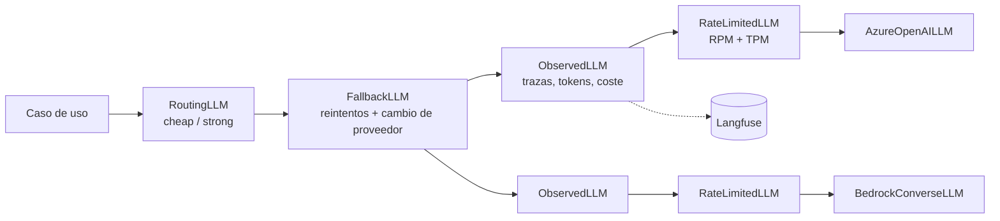

# Fase 2 · Capa de modelos: Azure OpenAI vs Bedrock, LLM gateway, routing, caching y coste

**Objetivo:** que ninguna parte del sistema hable con un proveedor de modelos directamente. Todo pasa
por `LLMPort` y por un **gateway** que decide modelo, reintenta, cambia de proveedor, limita, traza y
calcula el coste de cada llamada. Los agentes de las fases 6–8 heredan todo esto sin saberlo.

Commits: `be68163 feat: fase 2 - capa de modelos, LLM gateway, model routing y prompt caching` y
`1f87a99 docs: cierre de la fase 2 con validación en cloud pendiente`.

## 1. Arquitectura: capas de cebolla

Cada capa es un decorador que implementa el mismo `LLMPort` (como las políticas de APIM). El
montaje vive en un solo sitio: `adapters/llm_factory.build_gateway(settings)`.

| Capa | Clase (`application/llm/`) | Qué hace |
|---|---|---|
| Routing | `RoutingLLM` + `HeuristicClassifier` / `LLMClassifier` | Envía cada petición al modelo más barato capaz de resolverla |
| Fallback | `FallbackLLM` | Reintenta errores transitorios con backoff exponencial y *full jitter*; un 429 salta directamente al siguiente proveedor (su cuota sigue agotada); los errores no transitorios (400, credenciales) se propagan |
| Observabilidad | `ObservedLLM` + `LLMTracer` | Una *generation* por llamada: modelo, tokens (incluidos los cacheados), coste, latencia y error |
| Rate limit | `RateLimitedLLM` + `TokenBucket` | Límite en cliente por RPM y TPM (tokens estimados a ~4 caracteres/token) para no provocar 429 |
| Adaptador | `AzureOpenAILLM`, `BedrockConverseLLM` | SDK nativo, sin reintentos propios (`max_retries=0`): los reintentos son del gateway |

Errores tipados en `ports/llm.py`: `LLMError` → `LLMTransientError` → `LLMRateLimitError`. Cada
adaptador traduce los suyos; el gateway solo conoce estos.

## 2. Los dos proveedores

| Aspecto | Azure OpenAI (Foundry) | Bedrock Converse |
|---|---|---|
| SDK | `openai` (`AsyncAzureOpenAI`) | `boto3` `bedrock-runtime` (síncrono → `asyncio.to_thread`) |
| Autenticación | Entra ID: `DefaultAzureCredential` + token provider (sin claves) | Perfil de AWS SSO (`BEDROCK__PROFILE`) / IAM Role |
| Modelos (strong / cheap) | `gpt-4.1-mini` / `gpt-4.1-nano` | Claude Haiku 4.5 / Nova Lite (perfiles de inferencia `eu.`) |
| Prompt caching | **Automático** para prefijos idénticos ≥ 1024 tokens; no se marca ni se desactiva; se lee en `prompt_tokens_details.cached_tokens` | **Explícito**: bloque `cachePoint` al final del prefijo estable; informa `cacheWriteInputTokens` y `cacheReadInputTokens` |
| Tokens de entrada | Incluyen los cacheados | Excluyen lo leído/escrito en caché: el adaptador los suma (semántica OpenAI) |
| Structured outputs | `response_format` JSON Schema en modo `strict` | Tool use forzado (portable entre Claude y Nova) o `outputConfig` nativo |

`ChatMessage(cache_checkpoint=True)` marca dónde termina el prefijo estable: en Bedrock se convierte
en `cachePoint`; en Azure no hace nada (ya cachea solo). El mismo código de aplicación aprovecha la
caché de ambos.

## 3. Structured outputs

`application/llm/structured.py` `complete_structured(llm, messages, OutputModel)`:

- Esquema Pydantic → JSON Schema; `_to_strict` lo adapta al modo *strict* de OpenAI
  (`additionalProperties: false`, todos los campos `required`).
- Quita vallas de Markdown si el modelo las añade y valida con Pydantic.
- Si falla, reintenta con el error como feedback; `StructuredResult` guarda **todas** las llamadas
  (también las de corrección) para que el coste sea el real.

Caso de uso: `application/support_triage.py`. El LLM **solo extrae y clasifica** (`TicketTriage`:
intención, idioma, `order_id`, urgencia); qué hacer después lo decide el dominio.

## 4. Model routing

- `HeuristicClassifier` (por defecto): gratis, determinista y con latencia ~0. Mira solo el último
  mensaje del usuario (un prompt de sistema largo y cacheado no hace la petición más difícil):
  más de 1500 caracteres o palabras de razonamiento (`why`, `explain`, `compare`, `por qué`,
  `reclamación`...) ⇒ `strong`; si no, `cheap`.
- `LLMClassifier` (`LLM_GATEWAY__ROUTER=llm`): un modelo barato decide con salida estructurada
  (`RoutingVerdict`). Más preciso, pero añade una llamada. Si falla, elige `strong` (prima la calidad).

## 5. Coste por petición

`application/llm/pricing.py` `PriceTable`: USD por millón de tokens de entrada, salida, entrada
cacheada y escritura en caché; coincidencia por el prefijo más largo
(`gpt-4.1-mini-2025-04-14` → `gpt-4.1-mini`) y normalización de nombres de LiteLLM/Bedrock.

| Modelo | Entrada | Salida | Cacheada | Escritura en caché |
|---|---|---|---|---|
| `gpt-4.1-nano` | 0,10 | 0,40 | 0,025 | = entrada |
| `gpt-4.1-mini` | 0,40 | 1,60 | 0,10 | = entrada |
| `amazon.nova-lite` | 0,06 | 0,24 | 0,015 | = entrada |
| `anthropic.claude-haiku-4-5` | 1,00 | 5,00 | 0,10 | 1,25 |

Precios orientativos (revisar la página oficial: cambian y varían por región). Lección clave: en
Azure la caché es un 75 % más barata y gratis de escribir; en Claude es un 90 % más barata pero
**escribir cuesta un 25 % más**, así que solo compensa si el prefijo se reutiliza.

## 6. Dos motores de gateway (carriles B y C)

`LLM_GATEWAY__ENGINE`:

- `native` (carril B): las capas anteriores, código propio y probado con fakes.
- `litellm` (carril C): `adapters/litellm_gateway.py` sobre el `Router` de LiteLLM (reintentos,
  fallback y RPM/TPM declarativos). Sus excepciones heredan de las de `openai` y se traducen igual.
  Se envuelve en el mismo `ObservedLLM` y `RoutingLLM`, así que trazas y coste son comparables.
  `LITELLM_LOCAL_MODEL_COST_MAP=True`: sin descargas de red al importar.

Carril A (gestionado): **APIM como AI Gateway** (`azure-openai-token-limit`, `emit-token-metric`,
backends con balanceo y *circuit breaker*, caché semántica) y en AWS **cross-region inference
profiles** + cuotas de Bedrock (no hay un gateway gestionado equivalente a APIM; se usa API Gateway
o LiteLLM desplegado).

## 7. Observabilidad

`adapters/langfuse_tracer.py` (SDK v4): una *generation* por llamada con `usage_details`
(entrada, salida, cacheados) y `cost_details`. `CompositeTracer` envía a varios destinos (Langfuse +
contabilidad en memoria de los scripts). Sin claves configuradas ⇒ `NullTracer`. Langfuse corre en
local con `docker compose --profile observability up -d`.

## 8. Configuración

| Variable | Uso |
|---|---|
| `LLM_PROVIDER=azure\|aws` | Proveedor principal |
| `LLM_GATEWAY__FALLBACK_PROVIDER` | Proveedor de respaldo (vacío = sin fallback) |
| `LLM_GATEWAY__ENGINE=native\|litellm`, `LLM_GATEWAY__ROUTER=heuristic\|llm` | Motor y clasificador |
| `LLM_GATEWAY__MAX_RETRIES`, `__REQUESTS_PER_MINUTE`, `__TOKENS_PER_MINUTE` | Reintentos y límites (ajustar a la cuota real) |
| `AZURE_OPENAI__ENDPOINT`, `__CHAT_DEPLOYMENT`, `__CHEAP_CHAT_DEPLOYMENT` | Azure (sin `API_KEY` ⇒ Entra ID) |
| `BEDROCK__REGION`, `__PROFILE`, `__CHAT_MODEL_ID`, `__CHEAP_CHAT_MODEL_ID` | Bedrock |
| `LANGFUSE__HOST`, `__PUBLIC_KEY`, `__SECRET_KEY` | Trazas |

## 9. Scripts (con coste; pedir confirmación)

- `scripts/llm_cache_benchmark.py --provider azure|aws --tier strong --runs 5`: el mismo manual de
  políticas (~10 k tokens) con caché (prefijo idéntico + `cache_checkpoint`) y sin ella (nonce al
  principio). Mide tokens cacheados, latencia y coste.
- `scripts/llm_gateway_demo.py --limit 20`: triaje de emails de soporte por el gateway completo
  (routing, structured outputs, fallback, rate limit, trazas); compara la intención predicha con la
  esperada. Repetir con `LLM_GATEWAY__ENGINE=litellm`.

Tests sin red: adaptadores con clientes falsos, gateway (fallback, backoff, 429, token bucket con
reloj inyectado), precios, routing, structured outputs y factoría.

## 10. Pendiente con coste (validación en cloud)

- `az login` y `aws configure sso`; desplegar `gpt-4.1-mini` y `gpt-4.1-nano` en Foundry con el rol
  *Cognitive Services OpenAI User*; habilitar Claude Haiku 4.5 y Nova Lite en Bedrock (`eu-west-1`).
- Ejecutar ambos scripts con los dos proveedores y los dos motores y revisar las trazas en Langfuse.
- Valorar migrar Langfuse a la imagen v4 en la fase 11.

## 11. Decisiones (para defenderlas)

- **Gateway como decoradores del puerto**: cada responsabilidad se prueba aislada y el orden es
  explícito (el rate limit va por proveedor, debajo del fallback; las trazas registran cada intento).
- **Reintentos solo en una capa**: SDKs con `max_retries=0`; si no, los reintentos se multiplican.
- **429 ≠ 5xx**: reintentar un 429 contra el mismo despliegue empeora la saturación.
- **Routing heurístico por defecto**: el clasificador LLM se justifica solo si el ahorro supera su coste.
- **Coste calculado por nosotros**, no solo el que reporta el proveedor: permite presupuestos por
  petición (`CostMeter` en las evals de la fase 5) y comparar proveedores.
- **Prefijo estable primero** en los prompts: condición para que cualquier caché funcione (la base
  del context engineering de la fase 7).

## 12. Checkpoint de entrevista

1. **¿Por qué un LLM gateway?** Para centralizar lo transversal (cuotas, fallback, routing, trazas,
   coste, seguridad) fuera del código de negocio y cambiar de proveedor sin tocar casos de uso.
2. **¿Cómo bajas el coste sin perder calidad?** Routing al modelo más barato capaz, prompt caching
   con prefijos estables, salidas estructuradas cortas y medir el coste por petición.
3. **Diferencia de prompt caching entre Azure y Bedrock.** Azure: automático por prefijo ≥ 1024
   tokens, sin coste de escritura. Bedrock: explícito con `cachePoint`; en Claude la escritura cuesta
   más y la lectura un 90 % menos.
4. **¿Qué haces ante un 429?** No reintentar contra el mismo despliegue: limitar en cliente (token
   bucket por TPM), saltar a otro despliegue o región y, en el carril gestionado, APIM con backends
   balanceados.
5. **¿LiteLLM o gateway propio?** LiteLLM da rapidez y cobertura de proveedores; el propio da control
   y tests deterministas. Aquí conviven tras el mismo puerto y se comparan con las mismas trazas.
