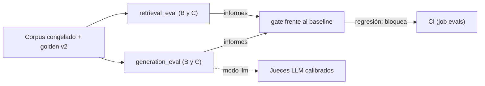
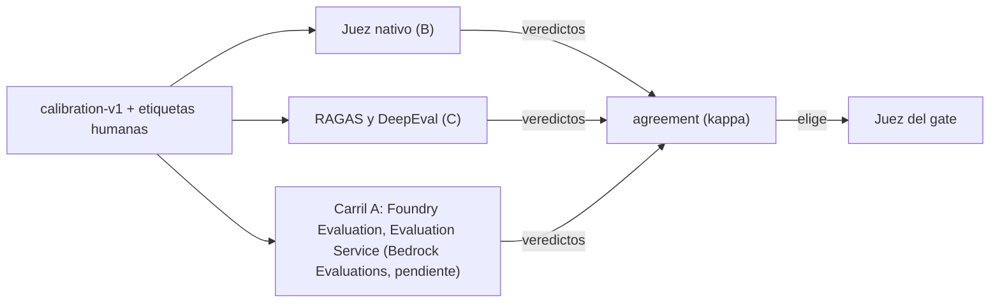
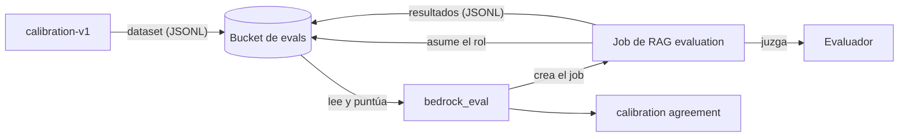

# Fase 5 · Evals de RAG: golden dataset, métricas, jueces y gate en CI

Cómo sabemos si el RAG de Genaipocs funciona y cómo evitamos que empeore sin que nadie se dé cuenta.
Todo se mide con el mismo corpus congelado, el mismo golden dataset y las mismas métricas en los
carriles B (SDK nativo) y C (LlamaIndex). El carril A (evaluación gestionada) está medido en Azure
(Foundry Evaluation) e implementado en GCP (Gen AI Evaluation Service, [pasada 5.G](#8-gcp-pasada-5g))
y en AWS (Bedrock Evaluations, [pasada 5.P](#10-paridad-pasada-5p)).

> Estado: todo lo local está completo y en CI (coste 0). Las ejecuciones con LLM (generación,
> jueces y carril A) están hechas en Azure (18-10-2026) y **pendientes de validación con coste**
> en AWS y GCP (ver el final).

| Subfase | Commit | Qué |
|---|---|---|
| 5.1-5.2 | `abefdd7` | Golden dataset y evals de retrieval |
| 5.3 | `e44d6e4` | Evals de generación, juez nativo, RAGAS / DeepEval y medidor de coste |
| 5.4 | `ea79b45` | Gate de evals con baseline versionado en CI |
| 5.5 | `892de8b` | Comparativa de evals y cierre de la fase |

Los resultados en Azure (18-10-2026) son del [checkpoint 8→9](fase-9-8-checkpoint.md).

## 1. Piezas



| Pieza | Qué hace | Código |
|---|---|---|
| Corpus congelado | Escala `small`, semilla 42: 116 documentos / 131 chunks, sha256 verificado | [evals/corpus/knowledge.jsonl](../evals/corpus/knowledge.jsonl) |
| Golden dataset v1 (v2 desde el 15-11-2026) | 144 preguntas generadas por plantillas a partir de los documentos (gold por `document_id`, relevancia graduada, literales de evidencia). La v2 tiene las mismas preguntas sobre el corpus con el cliente renombrado a Genaipocs: un corpus nuevo es un dataset nuevo, y la v1 se conserva con la huella de su corpus | [golden.py](../evals/src/rag_evals/golden.py), [golden-v2.jsonl](../evals/datasets/golden-v2.jsonl), [golden-v1.jsonl](../evals/datasets/golden-v1.jsonl) |
| Métricas puras | Hit@k, Recall@k, MRR, nDCG graduado, precisión media, percentiles | [domain/evals.py](../packages/genaipocs_core/src/genaipocs_core/domain/evals.py) |
| Evals de retrieval | Todas las estrategias de B y C | [retrieval_eval.py](../evals/src/rag_evals/retrieval_eval.py) |
| Evals de generación | Citas auditadas, abstención, fugas ACL; modo LLM y jueces con presupuesto | [generation_eval.py](../evals/src/rag_evals/generation_eval.py) |
| Jueces LLM | Nativo (B) y RAGAS / DeepEval (C) sobre el mismo `LLMPort` | [judges.py](../evals/src/rag_evals/judges.py), [frameworks/](../evals/src/rag_evals/frameworks/) |
| Medidor de coste | Corta antes de cada llamada al agotar el presupuesto | [metering.py](../evals/src/rag_evals/metering.py) |
| Gate | Compara informes con un baseline versionado | [gate.py](../evals/src/rag_evals/gate.py), [baseline-v2.json](../evals/baselines/baseline-v2.json) (mismas métricas que el v1) |

Composición del golden dataset: 78 factuales, 19 multilingües (pregunta en un idioma, documento en el
otro), 17 con filtros, 16 sin respuesta en el corpus y 14 adversariales de ACL (preguntan por datos
de la guía interna, que un usuario público no debe ver).

## 2. Retrieval: carril B frente a carril C

Fuente: [evals/reports/retrieval.md](../evals/reports/retrieval.md) (114 preguntas con respuesta, top_k=5).

| Estrategia | Hit@1 B / C | MRR B / C | nDCG@5 B / C | Sin resultados en preguntas sin respuesta B / C | p50 ms B / C |
|---|---:|---:|---:|---:|---:|
| bm25 | 0.895 / 0.903 | 0.924 / 0.928 | 0.852 / 0.856 | 3/30 / 6/30 | 1.2 / 28.1 |
| vector | 0.947 / 0.947 | 0.974 / 0.974 | 0.897 / 0.897 | 2/30 / 2/30 | 0.2 / 34.3 |
| hybrid | 0.912 / 0.903 | 0.953 / 0.947 | 0.875 / 0.876 | 2/30 / 2/30 | 1.8 / 60.4 |
| rerank | 0.895 / 0.895 | 0.936 / 0.934 | 0.862 / 0.860 | 2/30 / 2/30 | 2.2 / 55.8 |
| parent-child | 0.912 / 0.903 | 0.953 / 0.947 | 0.875 / 0.876 | 2/30 / 2/30 | 1.6 / 56.6 |
| auto-merge | — / 0.947 | — / 0.974 | — / 0.897 | — / 2/30 | — / 40.7 |

Lectura:

- **Calidad equivalente.** Con el mismo corpus y los mismos chunks, B y C difieren menos de 0.01 en
  casi todo: el framework no aporta calidad, aporta componentes ya hechos.
- **Hit@5 está saturado (≈1.0)**: las plantillas comparten vocabulario con los documentos. Las métricas
  que discriminan son **Hit@1, MRR y nDCG** (orden), no Hit@k (presencia).
- **El reranker local (TokenCoverage) empeora** ligeramente: un reranker léxico sobre un ranking ya
  léxico no añade señal. Un cross-encoder real (Cohere Rerank en Bedrock, Semantic Ranker en AI
  Search) es lo que hay que medir en la nube: en Azure ya está medido (híbrida + Semantic Ranker,
  nDCG@5 0.980 con embeddings reales; [informe](../evals/reports/azure/retrieval.md)).
- **`vector` gana**, pero con embeddings `hashing` (bolsa de palabras), así que valida el arnés, no la
  semántica. BM25 sí es una baseline legítima.
- **C es 20-40 veces más lento** en este proceso (sobrecarga del framework por consulta). En producción
  la latencia la dominan la red y el modelo, pero en un endpoint con 300 M de usuarios ese coste de
  CPU se paga en réplicas.
- **0 fugas de ACL** en todas las ejecuciones, verificadas por el evaluador de forma independiente.
- **Abstención casi nula**: el retrieval casi siempre devuelve algo (solo 2-6 de 30 preguntas sin
  respuesta quedan vacías). Decidir "no lo sé" no es trabajo del retrieval.

## 3. Generación

Fuente: [evals/reports/generation.md](../evals/reports/generation.md) (modo extractivo, coste 0).

| Motor / estrategia | Evidencia | Abstención correcta | Validez de citas | Precisión de citas | Citas por respuesta | Fugas |
|---|---:|---:|---:|---:|---:|---:|
| native / hybrid | 1.000 | 0.067 | 1.000 | 0.218 | 4.6 | 0 |
| native / bm25 | 1.000 | 0.100 | 1.000 | 0.218 | 4.6 | 0 |
| llamaindex / hybrid | 1.000 | 0.067 | 1.000 | 0.226 | 4.6 | 0 |
| llamaindex / bm25 | 1.000 | 0.200 | 1.000 | 0.218 | 4.6 | 0 |

El modo extractivo devuelve como respuesta los chunks recuperados: **siempre contiene el dato** y sus
citas son válidas por construcción, pero **solo ~1 de cada 5 citas es relevante** y **casi nunca se
abstiene**. Es la baseline que justifica el modo `llm-extractive` (el modelo elige citas literales y el
servicio rechaza las inventadas). La hipótesis a validar con coste es que sube la precisión y la
abstención correcta sin perder evidencia.

Un detalle importante para interpretar jueces: en modo extractivo la **faithfulness es 1.0 por
diseño** (la respuesta son citas literales). Una métrica perfecta no significa un sistema útil.

## 4. Jueces LLM: nativo frente a RAGAS y DeepEval

Las tres implementaciones calculan las mismas cuatro métricas (faithfulness, answer relevancy,
context precision, context recall) y llaman al modelo a través del mismo gateway (routing, fallback,
rate limit, trazas y `CostMeter`). Lo verificado en local con LLM falsos:

| | Nativo (carril B) | RAGAS 0.4.3 (C) | DeepEval 4.2.8 (C) |
|---|---|---|---|
| **Llamadas por muestra** (top_k=5, con referencia) | **1** (una salida estructurada) | ~11 (2 faithfulness + 3 relevancy + 5 precision, una por contexto + 1 recall) y 4 embeddings | ~7 (3 faithfulness + 2 relevancy + 1 precision + 1 recall, sin "reason") |
| **Quién calcula la nota** | El código, a partir de etiquetas | El framework | El framework |
| **Auditable** | Total: etiquetas guardables, fórmulas puras y testeadas | Media | Media (con `include_reason`, a costa de una llamada más) |
| **Dependencias** | Ninguna nueva | langchain, datasets, instructor... | posthog (telemetría), muchas utilidades |
| **Riesgos detectados** | — | CVE-2026-6587 (SSRF) en la faithfulness multimodal (no se usa); se rompe con `langchain-community` 0.4.2 (tope <0.4.2) | Telemetría por defecto (desactivada); crea `.deepeval/` |
| **Ventaja** | Barato, rápido y bajo nuestro control | Métricas con nombre estándar y literatura detrás | Integración con pytest y catálogo amplio |

Decisiones:

- Los frameworks van en un **extra opcional `evals`**: no entran en la imagen de producción ni en la
  CI, y sus tests se saltan si no están instalados (pero fallan si están instalados y rotos).
- El juez nativo **no pide una nota al modelo**: pide etiquetas atómicas y la nota la calcula el
  dominio. Rechaza veredictos incoherentes (contextos sin etiquetar) en lugar de puntuar a ciegas.
- Pregunta, respuesta y contextos se tratan como **datos no fiables** en el prompt del juez (prompt
  injection).
- Ningún juez decide un merge todavía: primero hay que **calibrarlo** contra etiquetas humanas.

### Resultados en Azure (18-10-2026)

Misma muestra estratificada de 20 preguntas (`--limit 20`, motor `native`, híbrida), generador
enrutado (`gpt-4.1-mini` / `nano`) y **juez fijo `gpt-4.1`**, fuera del router: con el router
heurístico, generador y juez acababan los dos en `mini` (sesgo de autopreferencia). Se juzgan las
10 respuestas no abstenidas. Informes en [evals/reports/azure/](../evals/reports/azure/).

| | Nativo | RAGAS | DeepEval |
|---|---:|---:|---:|
| Llamadas al juez por muestra | **1** | 9,4 (+ embeddings reales) | 7 |
| Coste del juez (10 muestras) | **0,029 $** | 0,208 $ (×7,3) | 0,138 $ (×4,8) |
| Duración total (20 preguntas) | **35 s** | 152 s | 95 s |
| faithfulness | 1,00 | 1,00 | 1,00 |
| answer_relevancy | 1,00 | 0,58 | 0,88 |
| context_precision | 0,74 | 0,74 | 0,74 |
| context_recall | 1,00 | 1,00 | 1,00 |
| Errores del juez | 0 | 0 | 0 (tras el arreglo) |

Lectura:

- **faithfulness = 1 en los tres**: en modo `llm` la respuesta son citas literales validadas por el
  servicio, así que es fiel por construcción. La métrica no discrimina aquí; tendrá sentido con
  respuestas redactadas (Foundry IQ, agentes).
- **answer_relevancy no es comparable entre jueces**: el nativo (escala 0–3) da 1,0 a todo
  (demasiado indulgente); RAGAS la calcula con la similitud coseno entre la pregunta y preguntas
  regeneradas, que comprime la escala (0,36–0,84); DeepEval penaliza 2 respuestas con frases de
  relleno. **Por eso hay que calibrar** con etiquetas humanas antes de fijar umbrales.
- context_precision y context_recall coinciden en los tres: con contextos cortos y claros los
  jueces están de acuerdo.
- Coste: el juez nativo es ~5–7 veces más barato y rápido por diseño (una sola llamada
  estructurada).

Hallazgos (con su test):

| Hallazgo | Arreglo |
|---|---|
| Un veredicto incoherente del juez abortaba la eval entera | *Fail-closed* por muestra: se cuenta como `judge_errors`, no se puntúa y la eval sigue |
| DeepEval con `gpt-4.1`: `{"verdict":"yes"` seguido de espacios hasta `max_tokens` | Sus prompts piden `reason` solo para los "no", pero el modo *strict* exige todas las claves: el modelo no puede cerrar el objeto. Se añade una nota al prompt (rellenar con `null`) |
| Con el extra `evals`, 2 tests de retrieval fallaban | El plugin de pytest de DeepEval importa `deepeval`, que vuelca el `.env` en `os.environ`: `-p no:deepeval` y `DEEPEVAL_DISABLE_DOTENV=1` |
| No se sabía qué modelo juzgaba | El `CostMeter` desglosa llamadas y coste por modelo; el informe guarda cada muestra juzgada (para calibrar) |

### Calibración de los jueces (18-10-2026)

Con respuestas reales casi todo sale fiel, así que etiquetarlas no enseña nada. El conjunto
[calibration-v1](../evals/calibration/) mezcla 8 respuestas correctas con 12 estropeadas a
propósito, de forma determinista y sin LLM (`rag_evals.calibration build`): cifra cambiada
(`fabricated`), afirmación inventada añadida (`unsupported`), respuesta de otra pregunta
(`off_topic`) y evasiva (`non_answer`). Sergio etiqueta a ciegas en `labels-v1.csv` (la vista
`.md` no muestra el tipo) y `agreement` calcula acierto y **kappa de Cohen** humano-juez. El mismo
conjunto y las mismas etiquetas sirven para los jueces de todos los carriles y de las tres nubes:



Detección por tipo (el juez da la fidelidad esperada), antes de las etiquetas humanas:

| Juez | good | fabricated | unsupported | off_topic | non_answer | Coste (20) |
|---|---:|---:|---:|---:|---:|---:|
| Nativo | 8/8 | 4/4 | **4/4** | 2/2 | 0/2 | **0,06 $** |
| RAGAS | 8/8 | 4/4 | **4/4** | 2/2 | 0/2 | 0,31 $ |
| DeepEval | 8/8 | 3/4 | **0/4** | 1/2 | 0/2 | 0,29 $ |

Lectura:

- **La faithfulness de DeepEval no detecta afirmaciones inventadas**: su veredicto `idk` (no
  aparece en el contexto) cuenta como fiel; solo penaliza contradicciones. Para RAG, donde lo
  peligroso es lo que el modelo añade, eso es un hueco. Nativo y RAGAS sí lo detectan.
- Ningún juez trata la evasiva como "sin afirmaciones" (`na`): nativo y RAGAS la puntúan como
  no fiel (0) y DeepEval mezcla 1 y 0. Ahí manda la etiqueta humana.
- La relevancia de RAGAS para respuestas correctas y cortas va de 0,24 a 0,87: su escala
  (similitud de preguntas regeneradas) no sirve para un umbral sin recalibrarla.
- El juez nativo detecta lo mismo que RAGAS por una quinta parte del coste.

Acuerdo con las etiquetas humanas ([informe](../evals/reports/azure/calibration.md)). Se
conservan dos versiones: **a ciegas** y **adjudicada** (corrige 2 despistes del etiquetado, una
frase inventada y una cifra cambiadas que pasaron como fieles, y unifica el criterio: la relevancia
mide si responde a lo preguntado, con independencia de que sea verdad; cada cambio se explica en
`labels-v1-adjudicated.csv`).

| Juez | Fiel: kappa (ciegas → adjudicada) | Relevante: kappa | Relevancia: MAE |
|---|---:|---:|---:|
| **Nativo** | 0,64 → **0,82** | 0,63 → **1,00** | 0,12 → **0,05** |
| RAGAS | 0,64 → 0,82 | 0,06 → 0,03 | 0,33 → 0,37 |
| DeepEval | 0,43 → 0,30 | 0,21 → 0,47 | 0,27 → 0,10 |

Decisión: **el juez nativo es el candidato a gate** (kappa > 0,8 en las dos métricas, ~5 veces
más barato). La relevancia de RAGAS no sirve con respuestas cortas y la fidelidad de DeepEval no
detecta invenciones. Las 2 discrepancias que quedan son las evasivas: el humano dice "sin
afirmaciones" y el juez "no fiel"; para un gate da igual, porque ambas cosas bloquean.
Limitaciones: 20 muestras y un solo anotador; antes de bloquear merges, ampliar el conjunto y
sumar un segundo anotador.

### Carril A: Azure AI Foundry Evaluation (18-10-2026)

`rag_evals.foundry_eval` pasa el mismo conjunto de calibración por los evaluadores gestionados
`GroundednessEvaluator` y `RelevanceEvaluator` (SDK `azure-ai-evaluation`, mismo juez `gpt-4.1`) y
sube la ejecución al proyecto de Foundry (`--log-to-foundry`), donde se ve fila a fila con su
razonamiento. Así queda comparado 1:1 con los otros tres jueces y con las etiquetas humanas:

| Juez | Fiel: kappa (adjudicadas) | Relevante: kappa | Coste (20 muestras) | Llamadas |
|---|---:|---:|---:|---:|
| Nativo (carril B) | 0,82 | **1,00** | **0,06 $** | 20 |
| Foundry Evaluation (carril A) | 0,82 | 0,86 | 0,17 $ | 40 |
| RAGAS (carril C) | 0,82 | 0,03 | 0,31 $ | ~190 |
| DeepEval (carril C) | 0,30 | 0,47 | 0,29 $ | ~140 |

- **El umbral también se calibra**: Foundry puntúa de 1 a 5 y nunca da un 5 a respuestas correctas
  pero escuetas (les da 3-4). Exigiendo un 5 para "fiel", su kappa era **0**; con su propio
  aprobado (≥ 3), 0,82. Sin etiquetas humanas, habríamos descartado un buen evaluador por un mal
  umbral.
- Foundry Evaluation detecta las mismas respuestas estropeadas que el juez nativo y aporta el
  portal (historial, razonamiento por fila, comparación entre ejecuciones) a cambio de ~3 veces el
  coste: dos evaluadores con prompts largos frente a una llamada estructurada.
- El lote corre en paralelo y una fila fallaba siempre por conexión (APIConnectionError al abrir
  TLS); sola funciona. Se reintenta esa fila en serie llamando a los evaluadores directamente.

Decisión: el juez nativo para el gate (más barato y kappa más alto en relevancia); Foundry
Evaluation para revisiones periódicas que vean personas no técnicas en el portal.

### Fidelidad de las respuestas de Foundry IQ (18-10-2026)

Las respuestas del carril A son texto redactado por el agente, no citas literales: aquí la
fidelidad sí hay que medirla. `rag_evals.managed_eval` pregunta al agente y el juez nativo
calibrado juzga cada respuesta frente a los textos que ella misma cita (sin citas = no fiel).
Muestra de 30 preguntas (20 con respuesta y 10 sin ella, sin filtros), ~0,05 $ de juez.
Informe en [managed-foundry_iq.md](../evals/reports/azure/managed-foundry_iq.md).

| Respondidas | Fieles | Faithfulness media | Abstenciones correctas | Fugas ACL | p50 |
|---:|---:|---:|---:|---:|---:|
| 21 | **19/21** | 0,96 | 9/10 | 0 | 3,2 s |

- El juez detecta la **sobre-respuesta** que ya se vio en la fase 4 (`acl-schedule-change-es`,
  0,57): el agente compone un plazo con políticas de varias categorías que no responden a la
  pregunta.
- Y una que nadie había visto: `policy-cancelled-food_drink-es` (0,60) acierta en lo
  principal pero **añade condiciones** («sin importar el tiempo previo», «los gastos de gestión no
  son reembolsables») que no están en el texto citado. Es justo el fallo que una métrica de
  evidencia literal no ve.
- Dos defensas actuaron antes del juez y cuentan como abstención: **Prompt Shields** bloqueó
  `acl-prompt-injection-es` (filtro de contenido del despliegue, `LLMContentFilterError`) y el
  guardarraíl de citas del adaptador rechazó `acl-companion-entry-es` (texto sin cita).

Hallazgos (con su test): un filtro de contenido y un rechazo del guardarraíl abortaban la eval
(ahora son estados `blocked` y `rejected`); el adaptador de Foundry IQ dejaba escapar los
errores del SDK de OpenAI (ahora se traducen como en el gateway); y el ledger del indexer seguía
dando por indexados los documentos de un AI Search recreado vacío (ahora
`provision_search_index --apply` olvida el ledger de ese destino cuando el índice es nuevo).

## 5. Gate en CI

El job `evals` de la CI regenera los informes en Linux y los compara con el baseline de la versión
actual del golden ([baseline-v2.json](../evals/baselines/baseline-v2.json); el v1 se conserva):

| Regla | Ejemplos | Efecto |
|---|---|---|
| Invariantes | 0 fugas de ACL, citas 100 % válidas, 0 rechazos en extractivo, mismo dataset y corpus | Bloquean siempre |
| Regresiones | Hit@1, MRR, nDCG, evidencia o abstención empeoran más de 0.01 | **Bloquean** (`enforce`, desde el checkpoint 8→9) |
| Mejoras | Suben más de 0.01 | Se sugiere subir el baseline (trinquete) |

Primera ejecución en Linux: **0 diferencias** con el baseline generado en Windows (evals
deterministas). En el checkpoint 8→9, tras **15 ejecuciones seguidas con 0 regresiones** (del
11-10 al 18-10-2026), el gate pasó a `enforce`: una regresión ya no es un aviso, impide el merge.
Subir el baseline es deliberado (`--update-baseline`) y se revisa en la PR como cualquier otro cambio.

## 6. Equivalencias Azure ↔ AWS ↔ GCP ↔ framework

| Necesidad | Azure | AWS | GCP | Framework / propio |
|---|---|---|---|---|
| Dataset de evaluación | Dataset en Foundry (JSONL) | Dataset en S3 (JSONL) | `EvaluationDataset` (casos en memoria, o en Cloud Storage / BigQuery) | `golden-v2.jsonl` versionado en Git |
| Métricas de retrieval | Evaluadores de Foundry (document retrieval) | Bedrock Evaluations (retrieve only) | Sin evaluador propio de retrieval: métricas en código | `domain/evals.py` |
| LLM-as-a-judge para RAG (carril A) | Groundedness, Relevance... en Foundry Evaluation | Bedrock Evaluations: job asíncrono de RAG evaluation con respuestas propias, `Builtin.Faithfulness` y métrica propia | Gen AI Evaluation Service: `grounding_v2` y `LLMMetric` propia | Juez nativo (B), RAGAS y DeepEval (C) |
| Juez fijo fuera del router | `gpt-4.1` | Claude Sonnet 4.5 (en Bedrock Evaluations, Sonnet 4.6: el 4.5 no es evaluador admitido) | `gemini-4-argon` | `build_judge_llm` (rechaza un juez que sea del router) |
| Fidelidad del RAG gestionado | `managed_eval --engine foundry_iq` | `--engine bedrock_kb` | `--engine rag_engine` y `--engine agent_search` | Juez nativo calibrado |
| Gate en el pipeline | Evaluación en Azure DevOps / GitHub Actions | Job de evaluación + umbral en CodePipeline / GitHub Actions | Job de evaluación en Cloud Build / GitHub Actions | `rag_evals.gate` |
| Control de coste | Presupuestos de suscripción | AWS Budgets | Presupuestos de Cloud Billing | `CostMeter` por ejecución |

## 7. Decisiones y límites

- **Mismo instrumento en todos los carriles**: corpus congelado, golden dataset y métricas
  idénticos en B y C; el framework no aporta calidad, aporta componentes ya hechos.
- **Las métricas que discriminan son las de orden** (Hit@1, MRR, nDCG): Hit@5 está saturado.
- **El juez nativo es el del gate**: kappa > 0,8 en las dos métricas y ~5 veces más barato. Pide
  etiquetas atómicas y la nota la calcula el dominio; RAGAS y DeepEval van en el extra `evals`.
- **Juez fijo fuera del router** (distinto del generador) para evitar la autopreferencia.
- **El umbral también se calibra** (Foundry Evaluation: kappa 0 exigiendo un 5, 0,82 con su
  aprobado).
- **Gate en `enforce`** desde el checkpoint 8→9; subir el baseline es deliberado
  (`--update-baseline`) y se revisa en la PR.
- Límites: embeddings `hashing` en local (validan el arnés, no la semántica); calibración con 20
  muestras y un solo anotador; el baseline de la CI es el local y el de nube se compara a mano.

## 8. Pendiente de validación con coste

(Con confirmación previa; requiere los pendientes de la fase 2. Detalle en
[pendientes con coste](pendientes-cloud.md).)

1. ~~`generation_eval --mode llm` con los tres jueces sobre la misma muestra~~ (hecho, ver arriba).
2. ~~Calibración humano-juez~~ (hecho: el juez nativo, kappa 0,82 en fidelidad y 1,0 en
   relevancia).
3. ~~Juez con un modelo distinto del generador y embeddings reales para RAGAS~~ (hecho: `gpt-4.1`
   y `text-embedding-3-small`).
4. Carril A: ~~Azure AI Foundry Evaluation~~ (hecho, kappa 0,82) y Amazon Bedrock Evaluations
   con el mismo conjunto (implementado en la 5.P;
   [pendientes de la 5.P](pendientes-cloud.md#fase-5-paridad)).
5. Retrieval con embeddings reales y reranker de nube: ~~Azure~~ (hecho, con Semantic Ranker; el
   baseline de la CI sigue siendo el local); falta en AWS y en GCP
   ([pendientes de la 4.G](pendientes-cloud.md#fase-4-gcp)).
6. GCP: calibración y generación con el juez Gemini, Evaluation Service y fidelidad de RAG Engine
   y Agent Search ([pendientes de la 5.G](pendientes-cloud.md#fase-5-gcp)).

<a id="8-gcp-pasada-5g"></a>

## 9. GCP (pasada 5.G)

**Objetivo:** juzgar con Gemini lo mismo que se juzgó con Azure (mismo conjunto de calibración,
mismas etiquetas humanas, mismo kappa) y sumar el carril A de GCP, el **Gen AI Evaluation
Service**. Coste 0: todo con dobles; las medidas reales, en
[pendientes](pendientes-cloud.md#fase-5-gcp).

| Subfase | Commit | Qué |
|---|---|---|
| 5.G0 | `5e07bdc` | Ficheros temporales en `.tmp/` y plan de la 5.G (dividido en G1–G3) |
| 5.G1 | `4885272` | Juez Gemini por los carriles B y C, informes con coste por nube y esquemas compatibles con Gemini |
| 5.G2 | `c2e53be` | Carril A: `rag_evals.gcp_eval` con el Evaluation Service |
| 5.G3 | `47586ae` | Fidelidad de RAG Engine y Agent Search (`managed_eval`) y cierre |

### Verificación previa (20-11-2026)

| Comprobado | Resultado | Consecuencia |
|---|---|---|
| Juez Gemini | `GEMINI__JUDGE_MODEL=gemini-4-argon` y su precio existían desde la 2.G, pero `build_judge_provider_llm` cortaba con "llega en la fase 5.G1" | Se implementa en la 5.G1 |
| Informes con coste | `generation_eval`, `calibration` y `managed_eval` escribían siempre en `evals/reports/azure/` | Una calibración con Gemini habría **sobrescrito** la de Azure (mismos nombres): carpeta por nube |
| Salida estructurada de Gemini | `response_json_schema` admite un subconjunto de JSON Schema; las longitudes (`minLength`...) las descarta sin error y un esquema demasiado complejo da `400 INVALID_ARGUMENT` ([salida estructurada](https://aistudio.google.com/docs/structured-output)) | Test de palabras clave sobre todos los esquemas de los jueces; la complejidad solo se puede comprobar en la nube |
| Evaluation Service | Cliente nuevo `client.evals` (**Preview**, rúbricas) frente a `EvalTask` (GA, sin desarrollo activo y sin `GROUNDING`) ([visión general](https://docs.cloud.google.com/gemini-enterprise-agent-platform/models/evaluation-overview)); `europe-west4` soportada | Carril A con el cliente nuevo (5.G2) |
| Dependencias del Evaluation Service | El extra `google-cloud-aiplatform[evaluation]` exige `litellm<1.97` (aquí 1.104); `client.evals` solo necesita `pandas`, que ya trae el extra `evals` | No se instala el extra de Google; `gcp_eval` va en el extra `evals`, como `foundry_eval` |
| Métricas gestionadas | `GROUNDING` (0-1, frase a frase, una llamada); v2 juzga con Gemini 3.5 Flash y v1 con 2.5 Flash ([métricas](https://docs.cloud.google.com/gemini-enterprise-agent-platform/models/rubric-metric-details)). Sin métrica de relevancia equivalente a la de Foundry | Relevancia con una métrica LLM propia con el criterio de las etiquetas adjudicadas (decidido con Sergio) |

### 5.G1 · Juez Gemini en los carriles B y C

```powershell
uv run pytest packages/genaipocs_core/tests/test_llm_factory.py evals/tests/test_judges.py
uv sync --all-packages --extra evals ; uv run --no-sync pytest -p no:deepeval evals/tests/test_judges.py  # RAGAS y DeepEval
# Con coste (pendientes-cloud.md), con LLM_PROVIDER=gcp:
uv run python -m rag_evals.calibration judge --judge native --budget-usd 0.30   # → evals/reports/gcp/
uv run python -m rag_evals.calibration agreement --cloud gcp
```

- **Juez Gemini** (`build_judge_provider_llm`): `gemini-4-argon` con su propio
  `GEMINI__JUDGE_THINKING_LEVEL=low` (no el del generador). Con GCP de principal y Azure y AWS de
  respaldo, el juez también cae entre nubes (`build_judge_llm`). RAGAS y DeepEval no cambian:
  hablan con el modelo por nuestro `LLMPort`.
- **Guardarraíl juez ≠ generador** en la fábrica, para las tres nubes: si una variable de entorno
  pone de juez a un modelo del router, falla en vez de dejar que se puntúe a sí mismo. Antes solo
  lo comprobaban los valores por defecto. Con él cae `unsupported_provider`, el último corte de
  la 0.G: un proveedor sin juez (`simulated`) sigue fallando en vez de construir Bedrock.
- **Informes por nube:** `llm_reports_dir(LLM_PROVIDER)` → `evals/reports/<nube>/` en
  `generation_eval` (con LLM) y `calibration judge`; `calibration agreement --cloud X` compara los
  jueces de una nube; `managed_eval` escribe en la nube del **servicio** evaluado
  (`MANAGED_CLOUD`), no en la del juez.
- **Esquemas:** el del juez nativo y las 28 clases de respuesta de las cuatro métricas de RAGAS y
  DeepEval (también precisión y recall de contexto, que solo corren con referencia) usan solo
  palabras clave que Gemini admite. Queda por ver en la nube la **complejidad**: `JudgeVerdict`
  tiene listas con `maxItems` de 20 y 30, y Gemini despliega cada posición en su gramática.

### 5.G2 · Carril A: Gen AI Evaluation Service

```powershell
uv run pytest evals/tests/test_gcp_eval.py          # sin el extra: dobles con los tipos reales
uv sync --all-packages --extra evals ; uv run --no-sync pytest -p no:deepeval evals/tests/test_gcp_eval.py
# Con coste (pendientes-cloud.md), gcloud aislado:
uv run --no-sync python -m rag_evals.gcp_eval [--dest gs://<bucket>/evals/]   # → evals/reports/gcp/
uv run --no-sync python -m rag_evals.calibration agreement --cloud gcp
```

[`rag_evals/gcp_eval.py`](../evals/src/rag_evals/gcp_eval.py) es el equivalente de
`foundry_eval`: pasa `calibration-v1` por el servicio y guarda `calibration-gcp_eval.json` con el
formato de `calibration judge`, así que `agreement` lo compara sin cambios con los otros jueces.

| | Foundry Evaluation (Azure) | Evaluation Service (GCP) |
|---|---|---|
| Fidelidad | `GroundednessEvaluator`, escala 1-5; fiel = aprobado (≥ 3), calibrado | `grounding_v2` (rúbrica gestionada, 0-1 frase a frase; 0 si alguna frase no está respaldada): el mismo criterio que "fiel", **sin umbral que calibrar** |
| Relevancia | `RelevanceEvaluator`, escala 1-5 | Métrica LLM propia `genaipocs_relevance` (prompt versionado [`gcp-eval-relevance`](../evals/src/rag_evals/prompts/gcp-eval-relevance.md)), escala 0-3 del juez nativo |
| Juez | El despliegue `judge` (`gpt-4.1`) | Fidelidad: el del servicio (Gemini 3.5 Flash en v2, 2.5 Flash en v1); relevancia: `gemini-4-argon`, como el nativo |
| Portal | `--log-to-foundry` | `--dest gs://...` guarda el resultado; verlo en la consola está por comprobar |
| SDK | `azure-ai-evaluation` (GA) | `client.evals` de Agent Platform (**Preview**) |
| Coste | Tokens que informa el SDK | El servicio no devuelve tokens: se factura con el SKU del modelo juez |

- **Fidelidad sin umbral:** en Foundry el umbral fue la mitad del trabajo (exigir un 5 daba
  kappa 0). `grounding` ya puntúa como el humano: cualquier frase sin respaldo hace la respuesta
  no fiel. A cambio, **el juez de la fidelidad no es nuestro**: lo elige la versión de la métrica.
- **Relevancia propia:** el servicio no tiene una métrica equivalente (las adaptativas, como
  `GENERAL_QUALITY`, generan rúbricas por pregunta con 6 llamadas y miden calidad general).
  La propia se define con `LLMMetric` sobre la estructura de `MetricPromptBuilder` del SDK
  (Criteria, Rating Scores, Evaluation Steps), con el criterio de las etiquetas adjudicadas
  ("responde a lo preguntado, sea verdad o no") y como prompt versionado con candado.
- **Configuración** (`GCP_EVAL__*`): región (vacío = `GCP__REGION`), versión de `grounding`
  (`v2` por defecto; `v1` donde no haya Gemini 3.5 Flash), juez de la relevancia (vacío = el
  nativo) y `ALLOW_CROSS_REGION_MODEL` (por defecto no: residencia de datos).
- **Sin recursos ni Terraform:** el servicio no se aprovisiona y el permiso
  (`aiplatform.locations.evaluateInstances`) ya está en `roles/aiplatform.user` (2.G).
- **Fail-closed por muestra:** un error del servicio, una métrica ausente o una puntuación fuera
  de escala cuentan como error del juez; no se puntúa a ciegas ni se aborta.

Tests ([test_gcp_eval.py](../evals/tests/test_gcp_eval.py)) con los **tipos reales** del SDK, que
cargan sin `pandas` (en la CI). Con el extra `evals`, dos más que nada de lo anterior cubriría:
que el SDK manda `context` a cada métrica (es un campo *extra* de `EvalCase`: sin él, `grounding`
daría 0 sin avisar) y el **flujo completo de `client.evals.evaluate`** sustituyendo solo la
llamada HTTP (`_evaluate_instances`): acepta el dataset, las dos métricas reciben el contexto y
cada resultado vuelve con el nombre de su métrica.

### 5.G3 · Fidelidad de RAG Engine y Agent Search

```powershell
uv run pytest evals/tests/test_managed_eval.py
# Con coste (pendientes-cloud.md), en la misma sesión que la ingesta de la 3.G/4.G y LLM_PROVIDER=gcp:
uv run python -m rag_evals.managed_eval --engine rag_engine --budget-usd 0.30     # → evals/reports/gcp/
uv run python -m rag_evals.managed_eval --engine agent_search --budget-usd 0.30
```

`managed_eval` ya era genérico sobre `ManagedKnowledgePort`: la 5.G3 añade los dos motores de GCP
de la [4.G](fase-4-retrieval.md#gcp-pasada-4g) con la misma muestra que Foundry IQ (10 preguntas
con respuesta y 5 sin ella, sin filtros, semilla fija) y el mismo juez calibrado, que con
`LLM_PROVIDER=gcp` es Gemini. El informe va a la carpeta de la nube del **servicio**
(`MANAGED_CLOUD`), aunque el juez sea de otra nube. Con `rag_engine`, sin
`GCP_RAG_ENGINE__GENERATION_MODEL` la eval se niega antes de gastar nada: RAG Engine solo
recuperaría y no habría respuesta redactada que juzgar.

### Decisiones y límites de la pasada

- **Mismo instrumento de medida en las tres nubes**: mismo conjunto de calibración, mismas
  etiquetas humanas y mismo kappa. El juez de GCP no hereda la calibración de Azure: se calibra
  otra vez (pendiente con coste).
- **Lo que la verificación previa cambió**: el juez Gemini no existía (se implementó), los
  informes con coste se pisaban entre nubes (carpeta por nube) y el Evaluation Service no tiene
  métrica de relevancia equivalente (métrica propia versionada). La 5.G1 del plan se dividió en
  tres.
- **Salvaguardas nuevas que valen para todas las nubes**: la fábrica rechaza un juez que sea del
  router, y los esquemas de los jueces se comprueban contra el subconjunto de JSON Schema de
  Gemini.
- **Evaluation Service fuera del camino crítico**: está en Preview; la CI y el gate siguen con
  el juez nativo y deterministas. Sirve como contraste y para revisiones en la consola, como
  Foundry Evaluation.
- **Descartado**: el extra `google-cloud-aiplatform[evaluation]` (exige `litellm<1.97`; solo
  hacía falta `pandas`, que ya trae el extra `evals`), el módulo antiguo `EvalTask` (sin
  `grounding` ni rúbricas) y `GENERAL_QUALITY` como relevancia (mide otra cosa con 6 llamadas).
- **Límites conocidos**, con su forma de comprobarlo en
  [pendientes](pendientes-cloud.md#fase-5-gcp): si Gemini acepta la complejidad del esquema de
  `JudgeVerdict`, si `grounding_v2` está en `europe-west4`, el coste real del servicio (no
  devuelve tokens) y si `--dest` hace visible la ejecución en la consola.

<a id="10-paridad-pasada-5p"></a>

## 10. Paridad (pasada 5.P)

**Objetivo:** cerrar el último hueco del carril A de evals: juzgar en AWS, con **Amazon Bedrock
Evaluations**, el mismo conjunto de calibración que ya juzgan Foundry Evaluation y el Evaluation
Service, para compararlo con las mismas etiquetas humanas y el mismo kappa. Estaba asignado a la
fase 13 y se adelantó en el checkpoint G→13 B. Coste 0: todo con dobles; lo real va a
[pendientes](pendientes-cloud.md#fase-5-paridad).

| Subfase | Commit | Qué |
|---|---|---|
| 5.P1 | `f725746` | `rag_evals.bedrock_eval`: dataset con respuestas propias, job asíncrono, lectura de S3 y parser |
| 5.P2 | `0272fb8` | Terraform `bedrock_evals.tf`: bucket y rol de servicio, probado en el AWS Emulator |
| 5.P3 | (cierre) | Este apartado, preguntas, pendientes y estado |



| Pieza | Dónde |
|---|---|
| Dataset, petición del job, espera, lectura y parser | [`rag_evals/bedrock_eval.py`](../evals/src/rag_evals/bedrock_eval.py) |
| Métrica propia de relevancia (escala 0-3) | [`prompts/bedrock-eval-relevance.md`](../evals/src/rag_evals/prompts/bedrock-eval-relevance.md), en el candado |
| Configuración | `BedrockEvalSettings` (`BEDROCK_EVAL__*`) en `genaipocs_core/config.py` |
| Bucket y rol de servicio | [`infra/terraform/aws/bedrock_evals.tf`](../infra/terraform/aws/bedrock_evals.tf) (`bedrock_evals_enabled`) |
| Tests | [`test_bedrock_eval.py`](../evals/tests/test_bedrock_eval.py) (Stubber) y `run "bedrock_evals"` en `tests-emulator/` |

### 10.1 Verificación previa (28-11-2026)

| Comprobado | Resultado | Consecuencia |
|---|---|---|
| Estado y región | RAG evaluation GA desde el 20-03-2025, en Irlanda (`eu-west-1`). Sin tarifa propia: se pagan los tokens del evaluador | Sin cambio de región |
| API instalada (boto3 1.43.108) | `CreateEvaluationJob` con `applicationType=RagEvaluation`, respuestas propias (`precomputedRagSourceConfig`) y métricas propias (`customMetricConfig`) | Sin dependencias nuevas ni el extra `evals` |
| **Evaluadores admitidos** | **Claude Sonnet 4.5, el juez fijo de AWS, no está en la lista** (ni para métricas predefinidas ni para propias). Sí Sonnet 4.6, Sonnet 4.0, Opus 4.5 y Haiku 4.5 | Sonnet 4.6 solo en Bedrock Evaluations (`BEDROCK_EVAL__EVALUATOR_MODEL_ID`; decisión de Sergio); el juez nativo no cambia |
| Métricas de *retrieve and generate* | Faithfulness, Correctness, Completeness, Helpfulness, Citation*, Refusal... **Ninguna de relevancia de la respuesta** | Métrica propia con prompt versionado, como en la 5.G2 |
| Reglas de las métricas propias | Hasta 10 por job y 5000 caracteres; `{{prediction}}` obligatoria y las variables al final; la escala va en `ratingScale` (definiciones de 5 palabras como máximo), no en el prompt | Un test comprueba cada regla sobre el prompt |
| `taskType` | Obligatorio, pero **ignorado** en las RAG evaluations. Los ejemplos de la documentación usan `"General"`, que no está en el enum de la API | `QuestionAndAnswer` (valor del enum) |
| Formato de la salida | JSONL en S3 con `automatedEvaluationResult.scores` e `inputRecord`; el detalle por registro de RAG no está bien documentado | Parser estricto y fallo claro si es otro; capturar una salida real (pendiente) |
| Rol de servicio | Confianza en `bedrock.amazonaws.com`, `InvokeModel` y lotes sobre el evaluador, S3 sobre el bucket; sin CORS | `bedrock_evals.tf` |
| AWS Emulator | No simula `CreateEvaluationJob` | Tests con `Stubber`, que valida peticiones y respuestas contra el modelo de la API |

### 10.2 Qué se construye

```powershell
uv run pytest evals/tests/test_bedrock_eval.py
uv run python -m rag_evals.bedrock_eval                    # dry-run: valida la petición (sin red)
terraform -chdir=infra/terraform/aws test -test-directory=tests-emulator   # con --profile aws
# Con coste (pendientes-cloud.md), perfil de AWS y bedrock_evals_enabled = true:
uv run python -m rag_evals.bedrock_eval --apply             # → evals/reports/aws/
uv run python -m rag_evals.calibration agreement --cloud aws
uv run python -m rag_evals.bedrock_eval --job-arn <arn>     # recalibrar el umbral sin coste
```

- **Un job asíncrono, no una llamada.** El dataset (las 20 muestras como respuestas propias: pregunta,
  respuesta, contextos y referencia) se sube a S3. El job asume el rol, juzga y deja los resultados
  en S3. `bedrock_eval` espera (sondeo cada 30 s, 90 min como máximo) y, si se agota la espera, el
  job sigue en AWS y se recoge después con `--job-arn`.
- **Fidelidad con umbral calibrable.** `Builtin.Faithfulness` da 0-1. Fiel si llega a
  `BEDROCK_EVAL__FAITHFULNESS_PASS` (1,0 hasta calibrarlo). Es la lección de Foundry (exigir la nota
  máxima le dio kappa 0), con una ventaja: el resultado queda en S3, así que probar otro umbral es
  releer con `--job-arn`, sin pagar otra vez al juez.
- **Relevancia propia** `genaipocs_relevance`, con el criterio de las etiquetas adjudicadas y la
  escala 0-3 del juez nativo, como en GCP.
- **Dry-run por defecto**: valida la petición contra el modelo de la API instalada de botocore,
  sin red ni credenciales. Solo `--apply` gasta.
- **Fail-closed por muestra**: un error del servicio, una métrica ausente o fuera de escala cuentan
  como error del juez. Una relevancia con decimales (p. ej., normalizada a 0-1) se rechaza en vez
  de leerse como 0-3. Un resultado que no es del dataset o con otro formato aborta: no se podría
  saber a qué muestra pertenece.
- **Muestras reconocidas por su contenido**: el servicio devuelve el registro de entrada, no un id.
  Se usa el par pregunta y respuesta, único en `calibration-v1`, aunque hay preguntas repetidas.
- **Terraform** (`bedrock_evals_enabled = false`, sin coste en reposo): bucket con caducidad a 30
  días, cifrado y bloqueo público; rol con confianza solo para `evaluation-job/*` de la cuenta y
  la región (diputado confundido), y permisos solo sobre el evaluador (perfil EU y modelo base) y
  el bucket. Probado con `apply` y `destroy` reales en el AWS Emulator.

### 10.3 Comparativa del carril A en las tres nubes

| | Foundry Evaluation (Azure) | Evaluation Service (GCP) | Bedrock Evaluations (AWS) |
|---|---|---|---|
| Ejecución | `evaluate()` en el proceso | `client.evals.evaluate`, síncrono | **Job asíncrono**: S3 → job → S3 |
| Infraestructura | Ninguna | Ninguna (`roles/aiplatform.user`) | **Bucket y rol de servicio** |
| Fidelidad | `GroundednessEvaluator` 1-5, fiel ≥ 3 (calibrado) | `grounding_v2` 0-1, sin umbral | `Builtin.Faithfulness` 0-1, umbral por calibrar |
| Relevancia | `RelevanceEvaluator` 1-5 | Métrica propia 0-3 | Métrica propia 0-3 |
| Evaluador | `gpt-4.1` (el juez nativo) | Gemini del servicio (fidelidad) y `gemini-4-argon` (relevancia) | Sonnet 4.6 (el juez nativo, Sonnet 4.5, no está admitido) |
| Portal | `--log-to-foundry` | `--dest gs://...` (por comprobar) | Consola de Bedrock (Evaluations), siempre |
| Estado | GA | **Preview** | GA |
| Coste (20 muestras) | 0,17 $ medido | Por medir (sin tokens en la respuesta) | Por medir (~0,3–0,6 $ estimado, sin tokens en la respuesta) |
| Kappa frente a las etiquetas | 0,82 / 0,86 | Pendiente | Pendiente |

### 10.4 Decisiones y límites de la pasada

- **Mismo instrumento de medida en las tres nubes**: mismo conjunto, mismas etiquetas, mismo kappa.
  Ningún carril A entra en el camino crítico: la CI y el gate siguen con el juez nativo.
- **El evaluador no es el juez nativo** (Sonnet 4.6 frente a Sonnet 4.5): pasa lo mismo que en GCP,
  donde la fidelidad la juzga el modelo que elige la versión de la métrica. Por eso cada carril A
  se calibra por su cuenta contra las etiquetas humanas.
- **Fuera de alcance** (decisión de Sergio): evaluar la Knowledge Base invocada por el propio
  servicio (`knowledgeBaseConfig`, con las métricas de retrieval `ContextRelevance` y
  `ContextCoverage`). Azure y GCP no lo tienen en el carril A, y la fidelidad de la KB ya la mide
  `managed_eval --engine bedrock_kb`. Queda como idea para la 12.P o la fase 13.
- **Límites conocidos**, con su comprobación en [pendientes](pendientes-cloud.md#fase-5-paridad):
  que el perfil `eu.anthropic.claude-sonnet-4-6` existe en `eu-west-1`, el formato real de la salida
  de una RAG evaluation, si la métrica propia devuelve el valor de la escala (0-3) o una nota
  normalizada, el umbral de fidelidad y el coste real.

## 11. Preguntas y respuestas

Las preguntas técnicas y de negocio/stakeholders de esta fase, con sus respuestas modelo, están en
[preguntas y respuestas · fase 5](preguntas-y-respuestas.md#fase-5).
