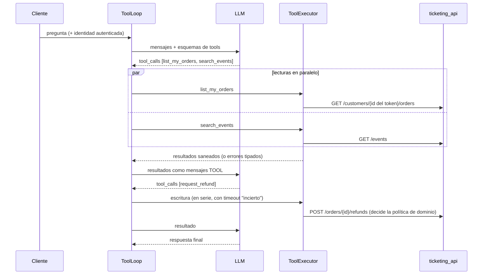
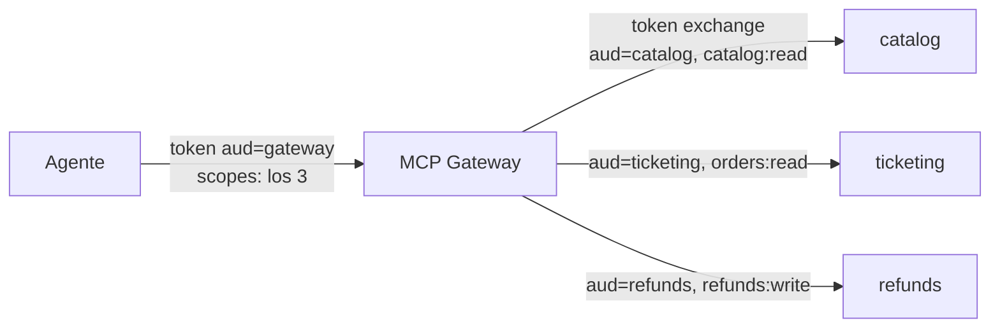

# Fase 6 · Tool calling avanzado, servidores MCP, OAuth y MCP Gateway

Cómo deja Headache que un LLM consulte y modifique el backend de ticketing de forma segura: el
modelo propone, el backend valida, autoriza, ejecuta y sanea. Las mismas tools se usan en proceso
(bucle propio), por MCP (tres servidores FastMCP) y detrás de un gateway (propio, AgentCore o APIM).

> Estado: todo lo local está completo, probado (tests + contenedores) y en CI. La ejecución con
> LLM real, el IdP en la nube (Entra ID / Cognito) y los gateways gestionados están **pendientes
> de validación con coste** (ver el final).

## 1. Piezas

| Pieza | Qué hace | Código |
|---|---|---|
| Tool calling en el puerto | `complete(..., tools=ToolConfig)`, `Role.TOOL`, `ToolCall`; Azure OpenAI, Bedrock Converse y LiteLLM | [ports/llm.py](../packages/headache_core/src/headache_core/ports/llm.py) |
| Tools tipadas | Esquema strict desde Pydantic; identidad en `ToolContext`, nunca en el esquema | [registry.py](../packages/headache_core/src/headache_core/application/tools/registry.py) |
| Bucle manual (carril B) | Lecturas en paralelo acotado, escrituras en serie, timeouts, errores tipados, límite de iteraciones | [loop.py](../packages/headache_core/src/headache_core/application/tools/loop.py) |
| Saneamiento | Invisibles fuera, textos y listas acotados sin romper el JSON | [tool_output.py](../packages/headache_core/src/headache_core/domain/tool_output.py) |
| Tools de ticketing | 6 tools con proyección de salida y propiedad del pedido | [ticketing.py](../packages/headache_core/src/headache_core/application/tools/ticketing.py) |
| Servidores MCP | `catalog`, `ticketing`, `refunds` (FastMCP 4, Streamable HTTP), contratos versionados | [headache_mcp](../services/mcp_servers/src/headache_mcp), [contracts/](../services/mcp_servers/contracts) |
| OAuth 2.1 | Resource servers JWT (firma, `iss`, `exp`, `aud` por servidor, scopes), RFC 9728 | [auth.py](../services/mcp_servers/src/headache_mcp/auth.py) |
| MCP Gateway propio | Agregación, token exchange por servidor, rate limit y auditoría | [gateway.py](../services/mcp_servers/src/headache_mcp/gateway.py) |
| Agente mínimo | Descubre tools MCP y las usa con el mismo bucle | [support_agent](../services/support_agent/src/support_agent) |
| Gateways gestionados (IaC) | AgentCore Gateway (AWS) y APIM (Azure), desactivados por defecto | [aws/mcp_gateway.tf](../infra/terraform/aws/mcp_gateway.tf), [azure/mcp_gateway.tf](../infra/terraform/azure/mcp_gateway.tf) |

## 2. El bucle de tools hecho a mano



Diferencias entre proveedores que el adaptador oculta:

| Concepto | Azure OpenAI | Bedrock Converse |
|---|---|---|
| Definir tools | `tools[].function` + `strict` | `toolConfig.tools[].toolSpec` |
| Forzar uso | `tool_choice: "required"` / función | `toolChoice: {any}` / `{tool}` |
| Petición del modelo | `message.tool_calls` (argumentos en texto JSON) | bloques `toolUse` (argumentos como objeto) |
| Resultado | mensaje `role: tool` | `toolResult` dentro de un turno `user`, con `status: error` |
| Varias a la vez | `parallel_tool_calls` | varios `toolUse`; los resultados se agrupan en **un** turno `user` |

Decisiones:

- **El modelo nunca elige identidad.** `customer_id` sale del token; un pedido ajeno responde igual
  que uno inexistente (no revela existencia).
- **Errores como datos.** `unknown_tool`, `invalid_arguments`, `timeout`, `not_found`, `rejected`,
  `unavailable`… vuelven al modelo para que corrija o explique; los fallos internos no filtran trazas.
- **Escrituras.** En serie y nunca reintentadas tras un timeout: el resultado es *incierto*.
- **Proyección.** Las tools devuelven solo lo que el modelo necesita (sin email ni `venue_id`).
- **Límite de iteraciones.** Si el modelo entra en bucle, se escala a un humano.

## 3. Servidores MCP

| Servidor | Puerto | Tools | Scope | Efecto |
|---|---|---|---|---|
| `catalog` | 8101 | `search_events`, `get_event`, `list_sessions` | `catalog:read` | lectura |
| `ticketing` | 8102 | `list_my_orders`, `get_order` | `orders:read` | lectura, datos personales |
| `refunds` | 8103 | `request_refund` | `refunds:write` | escritura |

- El servidor MCP es **solo transporte**: usa el mismo `ToolExecutor` que el bucle local.
- Las anotaciones MCP (`readOnlyHint`, `destructiveHint`, `idempotentHint`) salen de `read_only`.
- `tools/list` está versionado en `contracts/*.json`: cambiar nombre, descripción o esquema es un
  cambio deliberado (`python -m headache_mcp.contracts --update`) y CI lo comprueba.
- Una imagen (`services/mcp_servers/Dockerfile`) y un contenedor por servidor (`--profile mcp`).

## 4. OAuth 2.1 en MCP

- Cada servidor es un **resource server**: valida firma, `iss`, `exp`, `aud` y scope antes de
  ejecutar nada, y publica sus metadatos en `/.well-known/oauth-protected-resource/mcp` (RFC 9728).
- **Un audience por servidor** (`api://headache-mcp/{server}`): un token de `ticketing` no sirve en
  `refunds`. Es la defensa contra el *token passthrough* que prohíbe la especificación MCP.
- En local, `DevTokenIssuer` hace de authorization server (clave RSA en `.secrets/`, ignorado por
  Git). En la nube, Entra ID o Cognito (`MCP__ISSUER` + `MCP__JWKS_URI`).

## 5. MCP Gateway: propio frente a AgentCore Gateway frente a APIM

Un gateway pone **un único punto de control** entre los agentes y los servidores MCP: autenticación,
autorización, cuotas, auditoría, descubrimiento y, a veces, búsqueda semántica de tools.



| Capacidad | B · Gateway propio (FastMCP) | A · AgentCore Gateway (AWS) | A · API Management (Azure) |
|---|---|---|---|
| Endpoint para el agente | uno, con las tools de los tres | uno, con las tools de todos los *targets* | uno **por servidor** (`/headache-{server}/mcp`) |
| Autenticación de entrada | `JWTVerifier` (audience del gateway) | `CUSTOM_JWT` (OIDC discovery, audience, scopes, claims) | política `validate-jwt` |
| Credencial hacia el servidor | token exchange (dev STS) | OAuth **token exchange (OBO)**, client credentials, API key o SigV4 | reenvía el token del propio servidor (APIM es su puerta) |
| Token passthrough a MCP | no | **no admitido** para destinos MCP | no aplica (mismo audience) |
| Descubrimiento | proxy en cada `tools/list` | `DEFAULT` (sincronizado) o `DYNAMIC` (en cada llamada) | passthrough del servidor |
| Búsqueda semántica de tools | no | `search_type = SEMANTIC` (no compatible con `DYNAMIC`) | no |
| Políticas | middleware: rate limit por usuario, auditoría | interceptores Lambda, *policy engine* Cedar | XML: `rate-limit-by-key`, cuotas, IP, caché, transformaciones |
| Otros orígenes de tools | — | OpenAPI, Lambda, Smithy, API Gateway, conectores | REST API de APIM convertida en MCP |
| Coste en reposo | 0 (un contenedor más) | ~0, pago por llamada | Developer ~50 $/mes (Consumption **no** admite MCP) |
| IaC | código + compose | `aws_bedrockagentcore_gateway` (+ `_target`, `_oauth2_credential_provider`) | `azapi_resource` (`Microsoft.ApiManagement/service/apis@2025-09-01-preview`, `type = "mcp"`) |

Lectura:

- **AgentCore Gateway** es el más cercano a nuestro gateway propio: agrega servidores y hace OBO,
  así cada servidor recibe un token con su audience y el usuario original. Con OBO y sin 2LO hay
  que usar `listing_mode = DYNAMIC` (no hay token de usuario en la sincronización de fondo).
- **APIM** es un API gateway con soporte MCP: brilla en políticas (cuotas, IP, transformaciones,
  observabilidad con App Insights) y en convertir REST en MCP, pero publica cada servidor por
  separado y no hace OBO de serie. Hay que desactivar el log del cuerpo de respuesta (rompe el
  streaming) y no admite *workspaces* ni prompts MCP.
- **Propio**: sin coste y totalmente controlable; a cambio, hay que operar y securizar el STS y
  mantener las políticas en código. Útil como referencia y para entornos sin gateway gestionado.

Uso en local (sin coste):

```powershell
uv run python -m headache_mcp.auth --customer cus_0121338 --server gateway   # crea .secrets/
$env:MCP__AUTH="jwt"; docker compose --profile mcp up -d --build              # 3 servidores + gateway
# Si el 8000 del host está ocupado: API en otro puerto y MCP_TICKETING_API_URL=http://host.docker.internal:8010
# Agente (tiene coste): uv run python -m support_agent --gateway --customer cus_0121338 "..."
```

## 6. Equivalencias Azure ↔ AWS ↔ framework

| Concepto | Azure | AWS | Framework (fase 7) |
|---|---|---|---|
| Tool calling | Azure OpenAI `tools` | Bedrock Converse `toolConfig` | LangChain `bind_tools`, Strands `@tool`, MAF `AIFunction` |
| Bucle de tools | Foundry Agent Service (gestionado) | AgentCore Runtime / Bedrock Agents | LangGraph `ToolNode`, Strands agent loop |
| Servidor MCP alojado | Container Apps / Functions | AgentCore Runtime (MCP) / ECS | FastMCP |
| Cliente MCP | tool `mcp` de Foundry | AgentCore Gateway / Strands `MCPClient` | `MultiServerMCPClient`, `McpToolset` (nuestro) |
| MCP Gateway | API Management | AgentCore Gateway | gateway propio (FastMCP `ProxyProvider`) |
| IdP / OBO | Entra ID On-Behalf-Of | Cognito + AgentCore Identity (token exchange) | `DevTokenIssuer` (solo local) |

## 7. Resultados en Azure (18-10-2026)

API de ticketing local, servidores MCP en Docker con `MCP__AUTH=jwt` (emisor y STS de
desarrollo) y Azure OpenAI con el gateway; trazas y coste en Langfuse.

| Prueba | Resultado |
|---|---|
| `tool_loop_demo` · "¿Qué pedidos tengo?" | `list_my_orders` y respuesta correcta; 0,0002 $ con `nano` |
| `tool_loop_demo` · "Quiero el reembolso de mi último pedido" (antes del arreglo) | ❌ `nano` pasó la sesión `ses_0018361` a `get_event` (o un `evt_` deducido de ella, o el ID de ejemplo de la descripción) y se rindió; `mini` igual hasta corregir el prompt |
| Mismo caso (después) | ✅ `list_my_orders` → `request_refund` → la política del dominio lo rechaza (categoría sin reembolso) y el agente lo explica; 0,0012 $ |
| `support_agent` sin y con `--gateway` | ✅ 6 tools descubiertas en los 3 servidores; el gateway valida el token del cliente y emite uno nuevo por servidor (token exchange); mismo resultado |
| Langfuse | 51 *generations* con modelo, tokens y coste |

Lo que no se ve con modelos falsos (cada uno con su test):

| Hallazgo | Arreglo |
|---|---|
| Patrón de ID genérico (`^[a-z]{3}_...`): un `ses_` pasaba la validación de `get_event` | Prefijo exacto por tipo (`^evt_`, `^ord_`): el error de validación llega al modelo antes de llamar a la API. Contratos MCP actualizados de forma deliberada |
| La descripción traía un ID de ejemplo (`evt_0000123`) y `nano` lo usó literal | Sin IDs de ejemplo completos: "empieza por `evt_`, tal cual lo devolvió otra tool" |
| El modelo quería consultar la política del evento antes de pedir el reembolso, pero desde un pedido no se llega al evento | Prompt: para reembolsar basta `request_refund` (la política la aplica el dominio); nunca construir un ID a partir de otro |
| `nano` sigue fallando la escritura aunque las tools estén bien | Routing: un turno con tools con efectos va al modelo potente ([fase 2](fase-2-modelos.md#4-model-routing)) |

## 8. Pendiente de validación con coste

- Ejecutar los mismos agentes con Bedrock (AWS).
- Registrar los servidores MCP en Entra ID (App ID URI y scopes; `scp` admite otros formatos de
  nombre) y en Cognito (resource server + scopes); probar OBO de extremo a extremo.
- Publicar los servidores por HTTPS (fases 13 y 14) y aplicar `mcp_gateway_enabled` (AWS) y
  `apim_enabled` (Azure) con confirmación; medir latencia y coste frente al gateway propio.
- Tool de compra con `Idempotency-Key` estable y aprobación humana (fase 8).

## 9. Checkpoint de entrevista

Las preguntas técnicas y de negocio/stakeholders de esta fase, con sus respuestas modelo, están en
[preguntas de entrevista · fase 6](preguntas-entrevista.md#fase-6).
