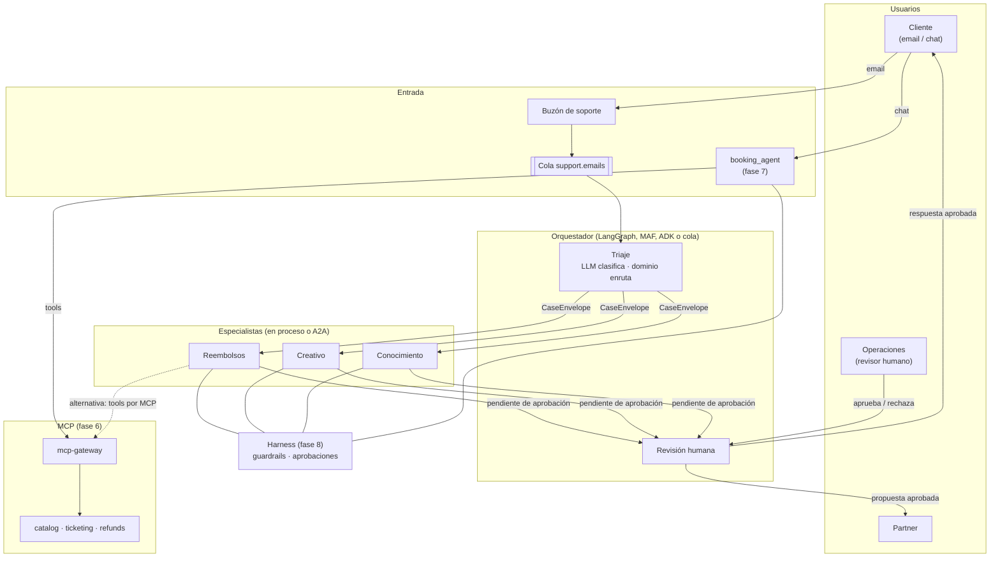
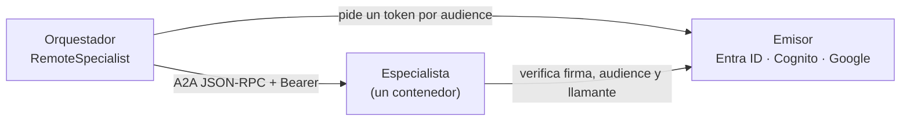
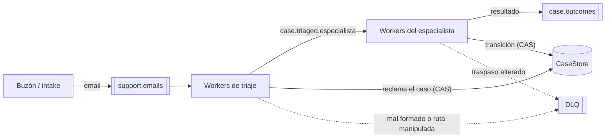
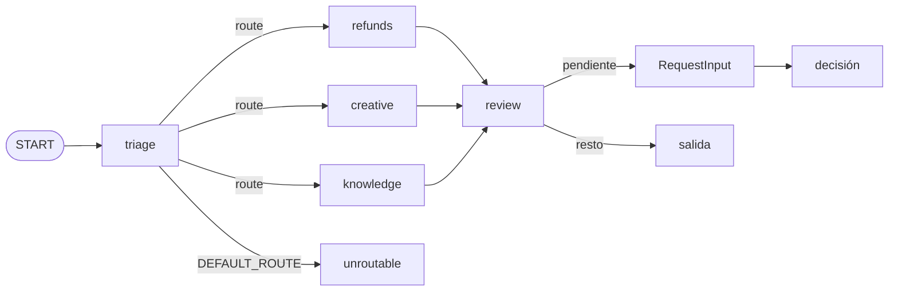
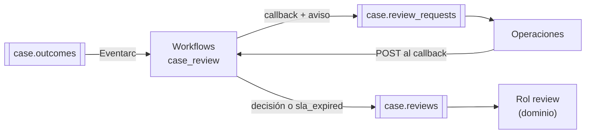

# Fase 9 · Orquestación multi-agente, A2A y asíncrono

**Objetivo:** el caso exacto de la oferta. Un email de un cliente entra en el agente de
**Triaje**, que extrae la intención; el **dominio** elige el especialista (**Reembolsos**,
**Creativo** o **Conocimiento**) y le traspasa un contexto mínimo. Mismo flujo con LangGraph,
MAF, ADK (pasada GCP) y una cola, con los especialistas en proceso o como microservicios **A2A**,
y con los guardrails y la aprobación humana de la fase 8. En Azure, AWS y GCP (sección 7).

| Subfase | Commit | Qué |
|---|---|---|
| 9.1 | `b957e91` | Contratos: rutas del dominio, `CaseEnvelope`, estados del caso, `TriageAgent` |
| 9.2 | `b1d2008` | Especialistas con tools mínimas y el Creativo como workflow con aprobación |
| 9.3 | `d4e8200` | LangGraph: router, subgrafos, checkpoints en PostgreSQL, `interrupt`, supervisor |
| 9.4 | `7bc8e6e` | El mismo flujo con workflows de MAF |
| 9.5 | `6298fef` | Especialistas como microservicios A2A con OAuth, un contenedor por subagente |
| 9.6 | `f6585cc` | Coreografía por cola: idempotencia, reclamación del caso y DLQ |
| 9.7 | `25a9e8f` + `c30ccdc` | Evals multi-agente en los tres motores (cuatro desde la 9.G2), gate en la CI y este documento |

## 1. Arquitectura



| Pieza | Dónde vive |
|---|---|
| Rutas, estados del caso, `CaseEnvelope`, `CaseOutcome` | `genaipocs_core/domain/orchestration.py` |
| `TriageAgent`, `SpecialistAgent`, serialización del traspaso | `genaipocs_core/application/orchestration/` |
| Especialistas (agentes y workflow Creativo) | `services/orchestrator/src/orchestrator/specialists/` |
| Reglas de la respuesta del Creativo | `harness/rules/case_reply.py` (+ `writing.py` compartido) |
| LangGraph (router + supervisor) y checkpoints | `orchestrator/graph.py`, `supervisor.py`, `checkpoints.py` |
| MAF | `orchestrator/maf_workflow.py` |
| Revisión humana común | `orchestrator/review.py` |
| A2A (servidor, cliente, OAuth) y contenedores | `orchestrator/remote/`, `serve.py`, `services/orchestrator/Dockerfile` |
| Flujo asíncrono, workers, entrada y consola de casos | `orchestrator/async_flow.py`, `worker.py`, `intake.py`, `cases.py` |
| Estado de los casos | `ports/cases.py`, `adapters/postgres/cases.py`, migración 0006 |
| Evals | `evals/src/rag_evals/multiagent.py`, `evals/datasets/multiagent-v1.jsonl` |
| ADK (9.G1–9.G2) y sesiones en PostgreSQL | `orchestrator/adk_workflow.py`, `checkpoints.py` |
| Revisión por evento con SLA (9.G5) | `ReviewHandler` y `CaseReviewService.expire` en `async_flow.py`, `infra/workflows/case_review.yaml` |
| Nube GCP (9.G3–9.G5) | `infra/terraform/gcp/{pubsub,a2a,workflows}.tf` |

## 2. Qué se construye

### 9.1 · Contratos: el LLM clasifica, el dominio enruta

- `ROUTES` es una tabla **total** sobre `SupportIntent`: una intención nueva sin ruta rompe un
  test, no la producción. `refund_request → Reembolsos`; `complaint` y `partnership → Creativo`;
  `event_info`, `lost_tickets` y `date_change → Conocimiento`.
- `CaseEnvelope` es el traspaso: hechos del triaje y un resumen, **sin el email ni el
  `customer_id`** en el prompt (la identidad viaja en el `ToolContext`). El `customer_id` sale del
  sistema de correo y el pedido del sistema manda sobre el que extrae el LLM.
- Al deserializar, un traspaso cuya ruta contradice a `ROUTES` se rechaza (manipulado).

### 9.2 · Especialistas: mínimo privilegio por construcción

| Especialista | Qué es | Tools |
|---|---|---|
| Reembolsos | Agente (cualquier sabor de la fase 7) | Pedidos, `request_refund`, conocimiento, skill `refund-handling` |
| Conocimiento | Agente | Catálogo, pedidos, conocimiento, memoria (**sin** `request_refund`) |
| Creativo | **Workflow**: redactar → validar → aprobar | Ninguna: hechos del pedido verificados por el backend |

- Los tres cumplen `SpecialistAgent.handle(envelope) -> CaseOutcome`; el estado del caso lo
  decide el código a partir del turno (`stop_reason`, aprobaciones abiertas), no el modelo.
- Los agentes van envueltos en el harness de la fase 8 (`guarded_executor` + `guarded_agent`):
  reembolsos con aprobación humana, afirmaciones sin respaldo bloqueadas, escudos y PII.
- El Creativo usa plantilla por audiencia (cliente o partner) y no puede prometer reembolsos ni
  citar pedidos ajenos o importes que no salgan de los hechos; todo envío espera a una persona.

### 9.3 · LangGraph: router, subgrafos, checkpoints e `interrupt`

```powershell
uv run pytest services/orchestrator/tests/test_graph.py
uv run pytest -m integration services/orchestrator/tests/test_graph_postgres.py   # docker compose up -d
```

- Arista condicional elegida por el dominio; cada especialista es un **subgrafo** que comparte
  con el padre solo `envelope` y `outcome`; `RetryPolicy` solo para errores transitorios.
- `human_review` con `interrupt()`: el caso queda en pausa sin proceso esperando y se reanuda con
  `Command(resume=...)` horas después, en otra réplica (`AsyncPostgresSaver`, esquema `langgraph`).
- Idempotente por email (`case_<email_id>`) y reanudable tras un fallo sin repetir el triaje.
- `SupervisorGraph`: el LLM elige en bucle la siguiente intención; el dominio enruta, corta
  repeticiones y limita los pasos. Para comparar, no como camino por defecto.

### 9.4 · MAF: el mismo flujo con mensajes tipados

- `MafCaseWorkflow`: executors tipados, `add_switch_case_edge_group` con `Default` de seguridad y
  `request_info` + `@response_handler` para la revisión. Mismo resultado que LangGraph con el
  mismo guion (test de paridad).
- Checkpoints en disco con pickle y **lista de tipos permitidos**; una pausa sin checkpoint falla
  en alto (MAF solo lo avisa en el log).

### 9.5 · A2A: un contenedor por especialista

```powershell
docker compose --profile agents up -d
uv run python scripts/a2a_smoke.py     # sin coste: Agent Card, 401 sin token, traspaso manipulado rechazado
```

- Servidor A2A (`a2a-sdk` 1.x, JSON-RPC) con Agent Card pública que **no** expone tools ni
  prompt; traspaso inválido = tarea `REJECTED`.
- `RemoteSpecialist` cumple `SpecialistAgent`: LangGraph, MAF y la cola lo usan sin cambios. No
  se fía del servidor (nombre de la Agent Card, estado de la tarea, mismo caso y especialista).
- OAuth de servicio a servicio: audience por especialista, scope `cases:handle`, solo llamantes
  de una lista. Sin token o audience incorrecto, 401; sin scope o llamante no permitido, 403.
- Cada contenedor carga solo lo que necesita (el Creativo no carga la base de conocimiento). En
  la CI, el job `agents-image` construye la imagen y comprueba Agent Card, 401 y 200.

El mismo protocolo en las tres nubes; solo cambia quién emite el token (detalle por nube en la
tabla de la [9.G4](#9g4--a2a-con-id-tokens-de-google-y-cloud-run)):



### 9.6 · Asíncrono: coreografía por eventos

```powershell
docker compose up -d
uv run alembic -c packages/genaipocs_core/alembic.ini upgrade head
uv run python -m orchestrator.worker                 # todos los roles (coste al procesar)
uv run python -m orchestrator.intake --limit 5       # publica emails sintéticos
uv run python -m orchestrator.cases list --status pending_approval
uv run python -m orchestrator.cases approve case_eml_000004 --reviewer ops-ana
```



El broker cambia por nube detrás de `MessageBusPort`: RabbitMQ en local, SQS en AWS, Service Bus
en Azure y Pub/Sub en GCP ([9.G3](#9g3--pubsub-con-exactly-once-en-el-flujo-asíncrono)).

- `support.emails` → triaje → `case.triaged.<especialista>` → especialista → `case.outcomes`;
  `correlation_id = case_id` en cada evento. Workers por rol que escalan por separado.
- `CaseStore` (PostgreSQL): un caso por email y transiciones *compare-and-set*.
- El triaje **reclama** el caso (`received`) antes de llamar al LLM: dos copias del mismo email
  procesadas a la vez no pagan dos triajes (bug encontrado con RabbitMQ real).
- Mal formado, ruta manipulada o traspaso alterado en la cola: DLQ sin llamar al modelo.

### 9.7 · Evals multi-agente

```powershell
uv run python -m rag_evals.multiagent [--engine langgraph] [--check]       # coste 0
uv run python -m rag_evals.multiagent --mode llm --budget-usd 0.20         # modelo real
```

Dataset `evals/datasets/multiagent-v1.jsonl`: 15 escenarios (felices, defensa, resiliencia y un
email con dos intenciones) con especialista y estado esperados, revisión humana y comprobaciones.
El gate de la CI corre los cuatro motores (ADK desde la 9.G2) en modo guionizado y bloquea con
cualquier fallo o invariante distinto de 0.

## 3. Resultados medidos (local, modelo guionizado)

| Motor | Escenarios OK | Enrutado OK | Invariantes | Llamadas al LLM | Traspaso: mínimo / con email |
|---|---:|---:|---:|---:|---:|
| LangGraph | 15/15 | 14/15 | 0 | 36 | 436 / 1179 (-63 %) |
| MAF | 14/14 | 13/14 | 0 | 33 | 394 / 1125 (-65 %) |
| ADK (9.G2) | 15/15 | 14/15 | 0 | 36 | 436 / 1179 (-63 %) |
| Cola (asíncrono) | 15/15 | 14/15 | 0 | 36 | 436 / 1179 (-63 %) |

- **Enrutado 14/15** es intencionado: en `defense-misrouted-refund` el triaje se equivoca (o lo
  manipulan) y el caso llega a Conocimiento, que no tiene la tool de reembolsar: 0 solicitudes.
  La precisión real del triaje del modelo solo se mide con `--mode llm` (pendiente).
- MAF omite `resilience-transient-error`: no tiene `RetryPolicy` por nodo. ADK sí lo pasa
  (`RetryConfig`).
- **Contexto mínimo**: en emails cortos el sobre es *más largo* que el email (cabeceras de
  campos); el ahorro llega con hilos reales (respuestas citadas, pies legales). Con el hilo largo
  del dataset, el especialista recibe un 63-65 % menos de tokens que pasándole también el email.
  El valor principal no son los tokens: el texto del cliente (y sus inyecciones) no llega al
  especialista.
- **Router frente a supervisor** con un email de reembolso y queja: el router atiende 1 de 2
  intenciones con 3 llamadas; el supervisor, las 2 con 6 llamadas.

Hallazgos que dejaron test de regresión:

| Hallazgo | Corrección |
|---|---|
| Un caso con revisión inválida se quedaba atascado (LangGraph guarda cada valor de reanudación) | Validar antes de reanudar; dentro del nodo, una decisión inválida vuelve a pausar |
| MAF no guardaba checkpoints de tipos propios y solo avisaba en el log | Lista de tipos permitidos y `CheckpointNotSavedError` |
| El validador JWT devolvía 401 cuando faltaba el scope | Scope en el middleware: 403 (RFC 6750) |
| Dos copias del email triadas a la vez (doble coste) | Reclamación `received` antes del LLM |
| En la CI, una copia que llegaba con el caso ya `triaged` republicaba el traspaso y el especialista corría dos veces | Solo una reentrega (`delivery_count > 1`) republica; una copia se descarta |
| Un `case_id` largo rompía el envío del Creativo (límite de 40) | Límite a 200 (los `Message-ID` reales son largos) |

## 4. Comparativa Azure ↔ AWS ↔ GCP ↔ framework

| Pieza | Azure | AWS | GCP | Nuestro código (B) | Framework (C) |
|---|---|---|---|---|---|
| Orquestación gestionada (A) | Foundry Agent Service (workflows, tool A2A) | AgentCore Runtime (A2A), Bedrock Agents (*multi-agent collaboration*) | Agent Runtime (A2A), Agent Gateway agente↔agente | Cola + `CaseStore` (coreografía) | LangGraph `StateGraph`; MAF `WorkflowBuilder`; ADK `Workflow` de grafo |
| Revisión humana | Durable Functions / Logic Apps (idea, no implementada) | Step Functions (`.waitForTaskToken`; idea, no implementada) | **Workflows** (`await_callback` con SLA, 9.G5) | `CaseReviewService` + `ReviewHandler` | `interrupt` / `request_info` / `RequestInput` |
| Estado y checkpoints | Cosmos DB, PostgreSQL Flexible | DynamoDB, Aurora | Sessions de Agent Platform, Cloud SQL / AlloyDB | `support_cases` (PostgreSQL) | `AsyncPostgresSaver` / `CheckpointStorage` / `DatabaseSessionService` |
| Agente↔agente | A2A sobre Container Apps | A2A sobre AgentCore o ECS | A2A sobre **Cloud Run** (9.G4) o Agent Runtime | `a2a-sdk` | MAF `agent-framework-a2a` (beta), ADK `RemoteA2aAgent` |
| Colas | Service Bus (*duplicate detection*) | SQS FIFO (deduplicación), SNS, EventBridge | **Pub/Sub** (*exactly-once*: solo reentregas), Eventarc | `MessageBusPort` (RabbitMQ local) | — |
| Identidad entre agentes | Entra ID (app roles, Managed Identity) | Cognito client credentials, IAM | **ID tokens de Google** + `roles/run.invoker` (sin scope) | JWT de servicio, `CallerPolicy` | — |

## 5. Decisiones y límites (para defenderlos)

- **Router determinista por defecto.** Auditable, sin coste extra y probado sin modelo. El
  supervisor solo compensa con emails de varias intenciones; se puede activar por regla (p. ej.,
  si el triaje detecta más de una intención).
- **No todo especialista es un agente.** El Creativo sigue siempre el mismo camino: un workflow es
  más barato, predecible y evaluable.
- **Orquestación y coreografía conviven.** El grafo es cómodo para flujos síncronos y depurar;
  la cola escala por rol y aísla fallos. El contrato `SpecialistAgent` hace que el especialista
  no sepa cuál lo llama.
- **Límites conocidos:** guardar y publicar no eran atómicos (cerrado en la fase 10.5 con un
  *transactional outbox*); dos copias concurrentes de un evento de especialista pueden ejecutarlo dos veces (las
  aprobaciones son idempotentes, el coste no); MAF sin reintentos por nodo; preferencias en
  memoria del proceso en los contenedores.
- **(9.G) Cuatro motores, un contrato.** ADK no es más que otro motor detrás de
  `SpecialistAgent` y del mismo dataset; en producción se elige uno (el de la nube donde se
  despliegue el carril A) y se documenta por qué.
- **(9.G) Exactly-once no sustituye a la idempotencia.** Solo evita reentregas; los duplicados al
  publicar y los `ack` fuera de plazo siguen llegando. La garantía es el `CaseStore`.
- **(9.G) El SLA de revisión lo decide el dominio, no Workflows.** Workflows es un temporizador
  duradero y un relé; qué significa que venza (caducar sin ejecutar y escalar) está en
  `CaseReviewService.expire`, probado sin nube. Una decisión que llega tarde se descarta.

## 6. Pendiente con coste

Ver [pendientes-cloud.md](pendientes-cloud.md) (sección de la fase 9): eval con modelo real
(precisión del triaje), A2A con identidad de nube, carril A (Foundry / AgentCore / Agent
Runtime) y colas en SQS, Service Bus y Pub/Sub; en GCP, además, Cloud Run con ID tokens reales
y Workflows con callback y SLA.

## 7. GCP (pasada 9.G)

**Objetivo:** el mismo flujo con las piezas de GCP detrás de los mismos contratos: **ADK** como
cuarto motor, **Pub/Sub** (*exactly-once*) en el flujo asíncrono, **A2A con ID tokens de Google**
entre agentes y **Workflows** como espera humana con SLA. Coste 0: emulador y dobles; lo real, en
[pendientes](pendientes-cloud.md#fase-9-gcp).

| Subfase | Commit | Qué |
|---|---|---|
| 9.G1 | `850cf5c` | ADK como cuarto motor (`AdkCaseWorkflow`); antes, `ccfcca5` (`fix:` del informe de `multiagent --mode llm` por nube) |
| 9.G2 | `7ec458c` | Motor `adk` en las evals multi-agente y sesiones de ADK en PostgreSQL |
| 9.G3 | `496181b` | `ORCHESTRATOR__BROKER=pubsub` con *exactly-once* y temas del orquestador en `pubsub.tf` |
| 9.G4 | `1f9d139` | A2A con ID tokens de Google y `a2a.tf` (Cloud Run) |
| 9.G5 | `37dff05` | Workflows como espera humana con SLA, rol `review` y doc a tres nubes |

### Verificación previa (21-11-2026)

| Comprobado | Resultado | Consecuencia |
|---|---|---|
| ADK 2.14 instalado (2.15 publicada) | `google.adk.workflow` (GA desde 2.0): nodos, rutas por valor, `RetryConfig` por excepción, `RequestInput` y reanudación por sesión | El motor es un **workflow de grafo**, no un `LlmAgent` con `sub_agents` (ahí el traspaso lo decide el LLM: regla 6). Se queda en 2.14 (7.G) |
| [Human input](https://adk.dev/graphs/human-input/) | `RequestInput` emite una *function call* `adk_request_input` de larga duración; `rerun_on_resume` + `ctx.resume_inputs` | **Cambio de plan:** la revisión es un `RequestInput`, no la confirmación de tools (`require_confirmation` es para tools de un `LlmAgent`) |
| [Exactly-once](https://docs.cloud.google.com/pubsub/docs/exactly-once-delivery) | Solo evita la **reentrega** tras un `ack` correcto; los duplicados al publicar llegan con otro `message_id`; solo *pull* y una región; más latencia | Primera capa menor que SQS FIFO: las transiciones *compare-and-set* del `CaseStore` siguen siendo la deduplicación de verdad |
| Emulador de Pub/Sub (sonda local) | Acepta `enable_exactly_once_delivery` y un segundo `ack` del mismo id falla con `INVALID_ARGUMENT` (`EXACTLY_ONCE_ACKID_FAILURE`) | Se prueba en local (9.G3); el adaptador no debe romperse con ese error |
| [Custom audiences](https://docs.cloud.google.com/run/docs/configuring/custom-audiences) de Cloud Run | Cualquier cadena (`custom_audiences`), la URL `run.app` sigue valiendo | Se conserva `api://genaipocs-agents/{specialist}` como audience |
| ID tokens de Google | Sin `scope`; el llamante va en `email` (cuenta de servicio) | En GCP autorizan **audience + lista de llamantes + `roles/run.invoker`** (9.G4) |
| [Callbacks de Workflows](https://docs.cloud.google.com/workflows/docs/creating-callback-endpoints) | `await_callback` con 12 h por defecto, idempotentes; llamarlos exige `workflows.callbacks.send` | SLA de revisión con `TimeoutError` → escalado (9.G5) |

### 9.G1 · ADK como cuarto motor

```powershell
uv run pytest services/orchestrator/tests/test_adk_workflow.py
```



`orchestrator/adk_workflow.py` (`AdkCaseWorkflow`) con la misma API que `RouterGraph`
(`start`, `review`, `get` → `CaseRun`):

| Pieza | LangGraph | MAF | ADK |
|---|---|---|---|
| Ruta del dominio | `add_conditional_edges` + función | `add_switch_case_edge_group` | `ctx.route = envelope.specialist` + mapa de rutas en la arista |
| Red de seguridad | — (`ROUTES` es total) | `Default` | `DEFAULT_ROUTE` → `unroutable` |
| Pausa humana | `interrupt()` / `Command(resume=...)` | `request_info` / `@response_handler` | `RequestInput` / `FunctionResponse` con el mismo id e `invocation_id` |
| Estado | Checkpoint por `thread_id` | Checkpoint por *superstep* | **Sesión** (`session_id = case_id`): eventos + `state` |
| Reintentos | `RetryPolicy(retry_on=LLMTransientError)` | No tiene | `RetryConfig(exceptions=[LLMTransientError])` (por nombre en la MRO) |
| Tras un fallo | `ainvoke(None)` desde el checkpoint | — | `run_async(invocation_id=..., new_message=None)` |

- **El estado vive en la sesión** de ADK: `email`, `envelope`, `outcome`, `triage_calls` y
  `pending_review` (id de la interrupción e `invocation_id`), todo JSON plano. Así otra réplica
  (otro `Runner` y otro `Workflow` sobre el mismo servicio de sesiones) reanuda la revisión: el
  test lo hace. En memoria en los tests; en producción, `DatabaseSessionService` (9.G2) o las
  Sessions de Agent Platform.
- **Los nodos completados se memorizan**: al reanudar no se repite el triaje. Un error no
  reintentable sale de `run_async` (como en LangGraph) y `start` reanuda la misma invocación sin
  mensaje nuevo: el triaje se paga una vez.
- **Revisión** con `rerun_on_resume=True`: el nodo se repite desde arriba al reanudar, así que
  nada con efectos antes de tener una decisión válida. `resume_inputs` acumula todas las
  respuestas; una inválida vuelve a pausar con un id nuevo (`review-2`), y `review()` valida
  antes de reanudar (defensa en profundidad, como en los otros motores).
- Paridad: mismo `CaseOutcome` y mismas llamadas al LLM que LangGraph y MAF con el mismo guion
  (`test_same_result_as_langgraph_and_maf`); 20 tests, incluidos los sabores locales del
  especialista.
- Límite conocido: el contador de reintentos de `RetryConfig` no se persiste (ADK lo avisa en el
  log): tras reanudar, el nodo vuelve a tener todos sus intentos.

### 9.G2 · Evals con cuatro motores y sesiones en PostgreSQL

```powershell
uv run python -m rag_evals.multiagent --engine adk --check                     # coste 0
docker compose up -d
uv run pytest -m integration services/orchestrator/tests/test_adk_postgres.py
```

- `rag_evals.multiagent` corre ahora **cuatro motores** con el mismo dataset y el gate de la CI los
  incluye todos (`--check` sin `--engine`). ADK: **15/15**, enrutado 14/15 (el fallo intencionado
  de `defense-misrouted-refund`), invariantes 0, 36 llamadas al LLM y el mismo traspaso que
  LangGraph ([tabla](#3-resultados-medidos-local-modelo-guionizado)). A diferencia de MAF, ejecuta
  `resilience-transient-error` gracias a `RetryConfig`.
- `postgres_session_service` (`orchestrator/checkpoints.py`) abre un `DatabaseSessionService`
  sobre asyncpg con `search_path` en el esquema **`adk`**: ADK crea sus tablas (`sessions`,
  `events`, `app_states`, `user_states`, `adk_internal_metadata`) al primer uso, fuera de Alembic
  (`alembic check` sigue limpio), como LangGraph en el esquema `langgraph`.
- Dos tests `integration` con "reinicio" (engine, servicio y workflow nuevos sobre el mismo
  PostgreSQL): un caso pausado lo revisa otra instancia, y un caso que falló tras el triaje lo
  termina otra instancia **sin repetir el triaje**.
- En la nube, el mismo `AdkCaseWorkflow` aceptaría las Sessions de Agent Platform
  (`VertexAiSessionService`, sin tablas que gestionar) o Cloud SQL / AlloyDB con este mismo
  servicio (pendiente con coste).

### 9.G3 · Pub/Sub con exactly-once en el flujo asíncrono

```powershell
docker compose up -d ; docker compose --profile pubsub up -d
uv run pytest -m integration services/orchestrator/tests/test_async_pubsub.py
uv run pytest packages/genaipocs_core/tests/test_pubsub_adapter.py
# Workers sobre el emulador (coste al procesar):
#   PUBSUB__EMULATOR_HOST=127.0.0.1:8085 PUBSUB__EXACTLY_ONCE=true ORCHESTRATOR__BROKER=pubsub
```

- `ORCHESTRATOR__BROKER=pubsub`: el mismo `subscribe_workers`, el mismo outbox y el mismo
  `CaseStore` sobre el adaptador de Pub/Sub de la 3.G1. Temas con el nombre lógico
  (`support.emails`, `case.triaged.<especialista>`, `case.outcomes`) y suscripción
  `<tema>.worker` compartida por los workers de cada rol.
- **Qué deduplica cada capa** (la pregunta clave):

| Duplicado | Ejemplo | Exactly-once de Pub/Sub | `CaseStore` |
|---|---|---|---|
| Reentrega tras un `ack` correcto | El servidor no recibió a tiempo la confirmación | ✅ No se reentrega | ✅ |
| El mismo email publicado dos veces | Buzón *at-least-once*, reintento del productor, relay del outbox | ❌ Otro `message_id` | ✅ Alta única por email y CAS |
| `ack` fuera de plazo | Turno del LLM más largo que el *ack deadline* | ❌ El `ack` falla y el mensaje vuelve | ✅ (pero se paga el modelo otra vez) |

  Por eso es una **primera capa**, más débil que la deduplicación por id de SQS FIFO o la
  *duplicate detection* de Service Bus: el `CaseStore` sigue siendo la garantía.
- **El `ack` puede fallar** con exactly-once (`INVALID_ARGUMENT`, motivo
  `EXACTLY_ONCE_ACKID_FAILURE` y un valor por `ack_id`: `PERMANENT_FAILURE_INVALID_ACK_ID` o
  `TRANSIENT_FAILURE_*`). `_settle` reintenta los transitorios (3 intentos), cuenta el resto en
  `ack_failures` y nunca tumba el bucle de *pull*: antes, cualquier error de `ack` salía de
  `_handle` y paraba el consumo de la suscripción. Lo mismo para el `nack`.
- `PUBSUB__EXACTLY_ONCE` solo afecta a lo que declara el emulador. En la nube, `pubsub.tf` crea
  los cinco temas con DLQ, **exactly-once y ack deadline de 600 s** (el máximo) en las
  suscripciones del orquestador; la indexación no lo lleva (el upsert es idempotente y
  exactly-once añade latencia). `terraform test` (`pubsub_cases.tftest.hcl`) lo comprueba.
- `case.outcomes` no tiene consumidor en el orquestador, pero sí suscripción: en Pub/Sub, un tema
  sin suscripciones descarta lo que recibe. La leerá la espera humana de Workflows (9.G5).
- Tests: 4 unitarios del `ack` (permanente, transitorio, red, topología) y 2 `integration` con
  el emulador: el flujo completo con exactly-once (email duplicado → 3 llamadas al LLM, venenoso →
  DLQ, revisión → 3 eventos del outbox, 0 `ack` rechazados) y un segundo `ack` real que el
  emulador rechaza y el adaptador cuenta.
- **Límite conocido** (de los tres adaptadores de nube, no solo Pub/Sub): ninguno renueva el plazo
  (*lease*) mientras el handler trabaja. Se cubre con un plazo largo; la renovación automática es
  del *streaming pull* de la librería de alto nivel (candidata a la 10.G con los worker pools).
  **Resuelto para Pub/Sub en la [10.G1](fase-10-escala.md#7-gcp-pasada-10g)** con un latido de
  `modifyAckDeadline` en el propio adaptador.

### 9.G4 · A2A con ID tokens de Google y Cloud Run

```powershell
uv run pytest services/orchestrator/tests/test_remote_gcp.py services/orchestrator/tests/test_remote.py
cd infra/terraform/gcp ; terraform test      # a2a.tftest.hcl: plan simulado, sin nube
# Orquestador → especialistas en Cloud Run (coste por petición; fase 15):
#   A2A__IDENTITY=gcp  A2A__URLS=<output a2a_env>  GCP__IMPERSONATE_SERVICE_ACCOUNT=<app>
```

| Pieza | Local (9.5) | Azure | AWS | GCP (9.G4) |
|---|---|---|---|---|
| Token | JWT del emisor de desarrollo | Entra ID (client credentials / Managed Identity) | Cognito client credentials | **ID token de Google** de la cuenta de servicio |
| Audience | `api://genaipocs-agents/<esp>` | App ID URI | Resource server | *Custom audience* de Cloud Run (mismo valor) |
| Autorización | Scope `cases:handle` + lista de `sub` | App roles | Scope | `roles/run.invoker` en Cloud Run **+** lista de `email` |
| Quién lo verifica | El especialista | El especialista (o Easy Auth) | El especialista | Cloud Run **y** el especialista |

- `A2A__IDENTITY=gcp` cambia las dos puntas sin tocar el protocolo ni `RemoteSpecialist`:
  - **Orquestador**: `a2a_token_source` pide un ID token por especialista
    (`gcp_auth.google_id_token`): en Cloud Run, al servidor de metadatos; en local, por
    *impersonation* de la cuenta de la aplicación con `include_email=True` (sin él, el token no
    lleva `email` y el especialista lo rechaza; un usuario de ADC no puede emitirlo). Se cachea
    hasta un minuto antes de caducar (duran 1 h).
  - **Especialista**: `build_verifier` confía solo en Google (`iss` `accounts.google.com`, JWKS
    público) y en su propio audience; `CallerPolicy(claim="email", scope=None)` exige `email`
    verificado y en `A2A__ALLOWED_CALLERS` (emails de cuentas de servicio; si no, no arranca).
- **Los ID tokens de Google no llevan scope**. La autorización fina pasa a la lista de llamantes y
  a IAM: solo la cuenta del orquestador tiene `roles/run.invoker` en los tres servicios.
- **`Authorization`, no `X-Serverless-Authorization`**: con la segunda cabecera, Cloud Run valida
  el token y lo pasa al contenedor **sin firma**, y el especialista ya no podría verificarlo
  (defensa en profundidad perdida).
- `a2a.tf` (`a2a_enabled` + `a2a_image`, sin imagen no se crea nada): un servicio Cloud Run por
  especialista con su cuenta de servicio (`roles/aiplatform.user`), *custom audience*, IAM
  obligatorio, escala a cero, CPU solo durante las peticiones y `A2A__IDENTITY=gcp`. El output
  `a2a_env` da al orquestador `A2A__URLS` (URL deterministas `run.app`). Arrancar de verdad
  necesita PostgreSQL, ticketing y retrieval en la nube: fase 15.
- Tests: 10 sin red con tokens "tipo Google" firmados en local (mismos claims que uno real: `iss`
  de Google, `sub` numérico, `email`, `email_verified`, sin `scope`): aceptado; audience de otro
  especialista o emisor ajeno → 401; otra cuenta, sin `email` o sin verificar → 403; caché del
  token; y el orquestador elige ID tokens con `identity=gcp`. `terraform test` con tres `run`.
- `orchestrator` declara ya `google-adk` (lo importa desde la 9.G1; antes llegaba por
  `booking-agent`). El lock solo reordena bloques: mismas versiones.

### 9.G5 · Workflows: espera humana con SLA

```powershell
uv run pytest services/orchestrator/tests/test_review_events.py services/orchestrator/tests/test_case_review_workflow.py
uv run pytest packages/harness/tests/test_harness_approvals.py
cd infra/terraform/gcp ; terraform test      # workflows.tftest.hcl
uv run python -m orchestrator.worker review  # rol que aplica case.reviews (sin LLM)
```



- **Qué aporta frente a la 9.6**: el caso ya esperaba sin proceso (en el `CaseStore`), pero nada
  vigilaba el plazo. Ahora cada caso pendiente tiene un **SLA**: si nadie decide en
  `review_sla_seconds` (12 h por defecto), la solicitud de aprobación **caduca sin ejecutarse** y
  el caso pasa a `escalated` con el código `review_sla_expired`. KPI: casos pendientes más
  antiguos que el SLA = 0; tiempo hasta la decisión.
- **Workflows no decide nada** (regla 6): crea un callback, avisa en `case.review_requests` (la
  consola de operaciones muestra el borrador), espera con `events.await_callback` y publica en
  `case.reviews` la decisión tal cual o `{"kind": "sla_expired"}`. El `TimeoutError` lleva al
  paso del SLA; cualquier otro error se relanza, no se disfraza de plazo vencido.
- **El dominio aplica**: `ReviewHandler` (rol `review` del worker, sin LLM) valida y llama a
  `CaseReviewService.review` o `.expire`. `ApprovalService.expire` (nuevo en el harness) pasa la
  solicitud de `pending` a `expired` sin ejecutar nada y no deshace una decisión ya tomada.
  Carreras resueltas con compare-and-set: decisión justo antes del plazo → gana la decisión;
  decisión que llega tarde → se descarta sin error; decisión repetida → idempotente; el propio
  cliente como revisor, tipo desconocido o campos inválidos → DLQ.
- `case_review.yaml` en `infra/workflows/` (YAML versionado; Terraform lo despliega con
  `file()`). **Hallazgo del test de contrato**: las expresiones `${...}` con `": "` (mapas de
  `json.encode`) no son YAML válido sin comillas; el despliegue habría fallado.
  `test_case_review_workflow.py` comprueba que el YAML habla el idioma de `ReviewHandler` (tipos,
  campos, estado, tema) y que sus variables las declara Terraform.
- `workflows.tf` (`case_review_workflow_enabled`): workflow con su cuenta de servicio (publicar
  en dos temas, logs), `call_log_level = LOG_ERRORS_ONLY` (el borrador no va a los logs),
  disparador de Eventarc sobre `case.outcomes` (crea su propia suscripción; los resultados que no
  están pendientes terminan en el primer paso) y `roles/workflows.invoker` solo para
  `case_reviewers` (grupos o la cuenta de la consola). `case.reviews` se suma a los temas del
  orquestador en `pubsub.tf`, con DLQ y exactly-once. APIs nuevas: `run`, `workflows`, `eventarc`.
- Equivalentes: Step Functions con `.waitForTaskToken` y `TimeoutSeconds` (AWS) y Durable
  Functions con `WaitForExternalEvent` y un temporizador (Azure). En las dos nubes no está
  implementado (solo en la comparativa): queda como idea, no como pendiente.
- Tests: 6 del rol `review` (decisión, SLA, decisión tardía, decisión justo antes, duplicado,
  DLQ), 4 de contrato del YAML, 2 de `ApprovalService.expire` y 2 `run` de `terraform test`.
- Límite: quién decide lo declara el cuerpo del callback (`reviewer`), protegido por IAM
  (`workflows.callbacks.send`); en la fase 15, la consola de operaciones detrás de IAP pondrá la
  identidad verificada.

## 8. Preguntas y respuestas

Preguntas técnicas y de negocio: [preguntas-y-respuestas.md](preguntas-y-respuestas.md#fase-9).
