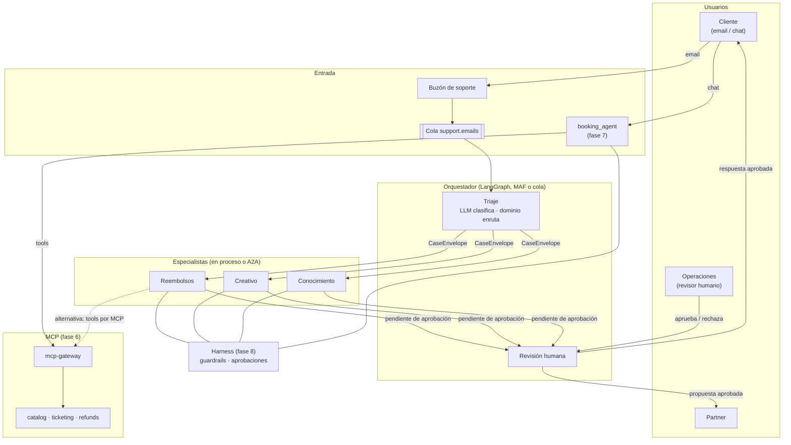

# Fase 9 · Orquestación multi-agente, A2A y asíncrono

**Objetivo:** el caso exacto de la oferta. Un email de un cliente entra en el agente de
**Triaje**, que extrae la intención; el **dominio** elige el especialista (**Reembolsos**,
**Creativo** o **Conocimiento**) y le traspasa un contexto mínimo. Mismo flujo con LangGraph,
MAF y una cola, con los especialistas en proceso o como microservicios **A2A**, y con los
guardrails y la aprobación humana de la fase 8.

| Subfase | Commit | Qué |
|---|---|---|
| 9.1 | `b957e91` | Contratos: rutas del dominio, `CaseEnvelope`, estados del caso, `TriageAgent` |
| 9.2 | `b1d2008` | Especialistas con tools mínimas y el Creativo como workflow con aprobación |
| 9.3 | `d4e8200` | LangGraph: router, subgrafos, checkpoints en PostgreSQL, `interrupt`, supervisor |
| 9.4 | `7bc8e6e` | El mismo flujo con workflows de MAF |
| 9.5 | `6298fef` | Especialistas como microservicios A2A con OAuth, un contenedor por subagente |
| 9.6 | `f6585cc` | Coreografía por cola: idempotencia, reclamación del caso y DLQ |
| 9.7 | — | Evals multi-agente en los tres motores, gate en la CI y este documento |

## 1. Arquitectura



| Pieza | Dónde vive |
|---|---|
| Rutas, estados del caso, `CaseEnvelope`, `CaseOutcome` | `headache_core/domain/orchestration.py` |
| `TriageAgent`, `SpecialistAgent`, serialización del traspaso | `headache_core/application/orchestration/` |
| Especialistas (agentes y workflow Creativo) | `services/orchestrator/src/orchestrator/specialists/` |
| Reglas de la respuesta del Creativo | `harness/rules/case_reply.py` (+ `writing.py` compartido) |
| LangGraph (router + supervisor) y checkpoints | `orchestrator/graph.py`, `supervisor.py`, `checkpoints.py` |
| MAF | `orchestrator/maf_workflow.py` |
| Revisión humana común | `orchestrator/review.py` |
| A2A (servidor, cliente, OAuth) y contenedores | `orchestrator/remote/`, `serve.py`, `services/orchestrator/Dockerfile` |
| Flujo asíncrono, workers, entrada y consola de casos | `orchestrator/async_flow.py`, `worker.py`, `intake.py`, `cases.py` |
| Estado de los casos | `ports/cases.py`, `adapters/postgres/cases.py`, migración 0006 |
| Evals | `evals/src/rag_evals/multiagent.py`, `evals/datasets/multiagent-v1.jsonl` |

## 2. Qué se construye

### 9.1 · Contratos: el LLM clasifica, el dominio enruta

- `ROUTES` es una tabla **total** sobre `SupportIntent`: una intención nueva sin ruta rompe un
  test, no la producción. `refund_request → Reembolsos`; `complaint` y `partnership → Creativo`;
  `event_info`, `lost_tickets` y `date_change → Conocimiento`.
- `CaseEnvelope` es el traspaso: hechos del triaje y un resumen, **sin el email ni el
  `customer_id`** en el prompt (la identidad viaja en el `ToolContext`). El `customer_id` sale del
  sistema de correo y el pedido del sistema manda sobre el que extrae el LLM.
- Al deserializar, un traspaso cuya ruta contradice a `ROUTES` se rechaza (manipulado).

### 9.2 · Especialistas: mínimo privilegio por construcción

| Especialista | Qué es | Tools |
|---|---|---|
| Reembolsos | Agente (cualquier sabor de la fase 7) | Pedidos, `request_refund`, conocimiento, skill `refund-handling` |
| Conocimiento | Agente | Catálogo, pedidos, conocimiento, memoria (**sin** `request_refund`) |
| Creativo | **Workflow**: redactar → validar → aprobar | Ninguna: hechos del pedido verificados por el backend |

- Los tres cumplen `SpecialistAgent.handle(envelope) -> CaseOutcome`; el estado del caso lo
  decide el código a partir del turno (`stop_reason`, aprobaciones abiertas), no el modelo.
- Los agentes van envueltos en el harness de la fase 8 (`guarded_executor` + `guarded_agent`):
  reembolsos con aprobación humana, afirmaciones sin respaldo bloqueadas, escudos y PII.
- El Creativo usa plantilla por audiencia (cliente o partner) y no puede prometer reembolsos ni
  citar pedidos ajenos o importes que no salgan de los hechos; todo envío espera a una persona.

### 9.3 · LangGraph: router, subgrafos, checkpoints e `interrupt`

```powershell
uv run pytest services/orchestrator/tests/test_graph.py
uv run pytest -m integration services/orchestrator/tests/test_graph_postgres.py   # docker compose up -d
```

- Arista condicional elegida por el dominio; cada especialista es un **subgrafo** que comparte
  con el padre solo `envelope` y `outcome`; `RetryPolicy` solo para errores transitorios.
- `human_review` con `interrupt()`: el caso queda en pausa sin proceso esperando y se reanuda con
  `Command(resume=...)` horas después, en otra réplica (`AsyncPostgresSaver`, esquema `langgraph`).
- Idempotente por email (`case_<email_id>`) y reanudable tras un fallo sin repetir el triaje.
- `SupervisorGraph`: el LLM elige en bucle la siguiente intención; el dominio enruta, corta
  repeticiones y limita los pasos. Para comparar, no como camino por defecto.

### 9.4 · MAF: el mismo flujo con mensajes tipados

- `MafCaseWorkflow`: executors tipados, `add_switch_case_edge_group` con `Default` de seguridad y
  `request_info` + `@response_handler` para la revisión. Mismo resultado que LangGraph con el
  mismo guion (test de paridad).
- Checkpoints en disco con pickle y **lista de tipos permitidos**; una pausa sin checkpoint falla
  en alto (MAF solo lo avisa en el log).

### 9.5 · A2A: un contenedor por especialista

```powershell
docker compose --profile agents up -d
uv run python scripts/a2a_smoke.py     # sin coste: Agent Card, 401 sin token, traspaso manipulado rechazado
```

- Servidor A2A (`a2a-sdk` 1.x, JSON-RPC) con Agent Card pública que **no** expone tools ni
  prompt; traspaso inválido = tarea `REJECTED`.
- `RemoteSpecialist` cumple `SpecialistAgent`: LangGraph, MAF y la cola lo usan sin cambios. No
  se fía del servidor (nombre de la Agent Card, estado de la tarea, mismo caso y especialista).
- OAuth de servicio a servicio: audience por especialista, scope `cases:handle`, solo llamantes
  de una lista. Sin token o audience incorrecto, 401; sin scope o llamante no permitido, 403.
- Cada contenedor carga solo lo que necesita (el Creativo no carga la base de conocimiento). En
  la CI, el job `agents-image` construye la imagen y comprueba Agent Card, 401 y 200.

### 9.6 · Asíncrono: coreografía por eventos

```powershell
docker compose up -d
uv run alembic -c packages/headache_core/alembic.ini upgrade head
uv run python -m orchestrator.worker                 # todos los roles (coste al procesar)
uv run python -m orchestrator.intake --limit 5       # publica emails sintéticos
uv run python -m orchestrator.cases list --status pending_approval
uv run python -m orchestrator.cases approve case_eml_000004 --reviewer ops-ana
```

- `support.emails` → triaje → `case.triaged.<especialista>` → especialista → `case.outcomes`;
  `correlation_id = case_id` en cada evento. Workers por rol que escalan por separado.
- `CaseStore` (PostgreSQL): un caso por email y transiciones *compare-and-set*.
- El triaje **reclama** el caso (`received`) antes de llamar al LLM: dos copias del mismo email
  procesadas a la vez no pagan dos triajes (bug encontrado con RabbitMQ real).
- Mal formado, ruta manipulada o traspaso alterado en la cola: DLQ sin llamar al modelo.

### 9.7 · Evals multi-agente

```powershell
uv run python -m rag_evals.multiagent [--engine langgraph] [--check]       # coste 0
uv run python -m rag_evals.multiagent --mode llm --budget-usd 0.20         # modelo real
```

Dataset `evals/datasets/multiagent-v1.jsonl`: 15 escenarios (felices, defensa, resiliencia y un
email con dos intenciones) con especialista y estado esperados, revisión humana y comprobaciones.
El gate de la CI corre los tres motores en modo guionizado y bloquea con cualquier fallo o
invariante distinto de 0.

## 3. Resultados medidos (local, modelo guionizado)

| Motor | Escenarios OK | Enrutado OK | Invariantes | Llamadas al LLM | Traspaso: mínimo / con email |
|---|---:|---:|---:|---:|---:|
| LangGraph | 15/15 | 14/15 | 0 | 36 | 436 / 1175 (-63 %) |
| MAF | 14/14 | 13/14 | 0 | 33 | 394 / 1121 (-65 %) |
| Cola (asíncrono) | 15/15 | 14/15 | 0 | 36 | 436 / 1175 (-63 %) |

- **Enrutado 14/15** es intencionado: en `defense-misrouted-refund` el triaje se equivoca (o lo
  manipulan) y el caso llega a Conocimiento, que no tiene la tool de reembolsar: 0 solicitudes.
  La precisión real del triaje del modelo solo se mide con `--mode llm` (pendiente).
- MAF omite `resilience-transient-error`: no tiene `RetryPolicy` por nodo.
- **Contexto mínimo**: en emails cortos el sobre es *más largo* que el email (cabeceras de
  campos); el ahorro llega con hilos reales (respuestas citadas, pies legales). Con el hilo largo
  del dataset, el especialista recibe un 63-65 % menos de tokens que pasándole también el email.
  El valor principal no son los tokens: el texto del cliente (y sus inyecciones) no llega al
  especialista.
- **Router frente a supervisor** con un email de reembolso y queja: el router atiende 1 de 2
  intenciones con 3 llamadas; el supervisor, las 2 con 6 llamadas.

Hallazgos que dejaron test de regresión:

| Hallazgo | Corrección |
|---|---|
| Un caso con revisión inválida se quedaba atascado (LangGraph guarda cada valor de reanudación) | Validar antes de reanudar; dentro del nodo, una decisión inválida vuelve a pausar |
| MAF no guardaba checkpoints de tipos propios y solo avisaba en el log | Lista de tipos permitidos y `CheckpointNotSavedError` |
| El validador JWT devolvía 401 cuando faltaba el scope | Scope en el middleware: 403 (RFC 6750) |
| Dos copias del email triadas a la vez (doble coste) | Reclamación `received` antes del LLM |
| Un `case_id` largo rompía el envío del Creativo (límite de 40) | Límite a 200 (los `Message-ID` reales son largos) |

## 4. Comparativa Azure ↔ AWS ↔ framework

| Pieza | A. Gestionado (Azure / AWS) | B. SDK nativo | C. Framework |
|---|---|---|---|
| Orquestación | Foundry Agent Service (workflows, tool A2A) / AgentCore Runtime (A2A), Bedrock Agents (*multi-agent collaboration*) | Cola + `CaseStore` (coreografía) | LangGraph `StateGraph`; MAF `WorkflowBuilder` |
| Revisión humana | Logic Apps / Step Functions (*wait for callback*) | `CaseReviewService` | `interrupt` / `request_info` |
| Estado y checkpoints | Cosmos DB, PostgreSQL Flexible / DynamoDB, Aurora | `support_cases` (PostgreSQL) | `AsyncPostgresSaver` / `CheckpointStorage` |
| Agente↔agente | A2A sobre Container Apps / AgentCore o ECS | `a2a-sdk` | MAF `agent-framework-a2a` (beta) |
| Colas | Service Bus (*duplicate detection*) / SQS FIFO (deduplicación), SNS, EventBridge | `MessageBusPort` (RabbitMQ local) | — |
| Identidad entre agentes | Entra ID (app roles, Managed Identity) / Cognito client credentials, IAM | JWT de servicio | — |

## 5. Decisiones y límites (para defenderlos)

- **Router determinista por defecto.** Auditable, sin coste extra y probado sin modelo. El
  supervisor solo compensa con emails de varias intenciones; se puede activar por regla (p. ej.,
  si el triaje detecta más de una intención).
- **No todo especialista es un agente.** El Creativo sigue siempre el mismo camino: un workflow es
  más barato, predecible y evaluable.
- **Orquestación y coreografía conviven.** El grafo es cómodo para flujos síncronos y depurar;
  la cola escala por rol y aísla fallos. El contrato `SpecialistAgent` hace que el especialista
  no sepa cuál lo llama.
- **Límites conocidos:** guardar y publicar no son atómicos (falta *transactional outbox*);
  dos copias concurrentes de un evento de especialista pueden ejecutarlo dos veces (las
  aprobaciones son idempotentes, el coste no); MAF sin reintentos por nodo; preferencias en
  memoria del proceso en los contenedores.

## 6. Pendiente con coste

Ver [pendientes-cloud.md](pendientes-cloud.md) (sección de la fase 9): eval con modelo real
(precisión del triaje), A2A con identidad de nube, carril A (Foundry / AgentCore) y colas en SQS
y Service Bus.

## 7. Checkpoint de entrevista

Preguntas técnicas y de negocio: [preguntas-entrevista.md](preguntas-entrevista.md#fase-9).
